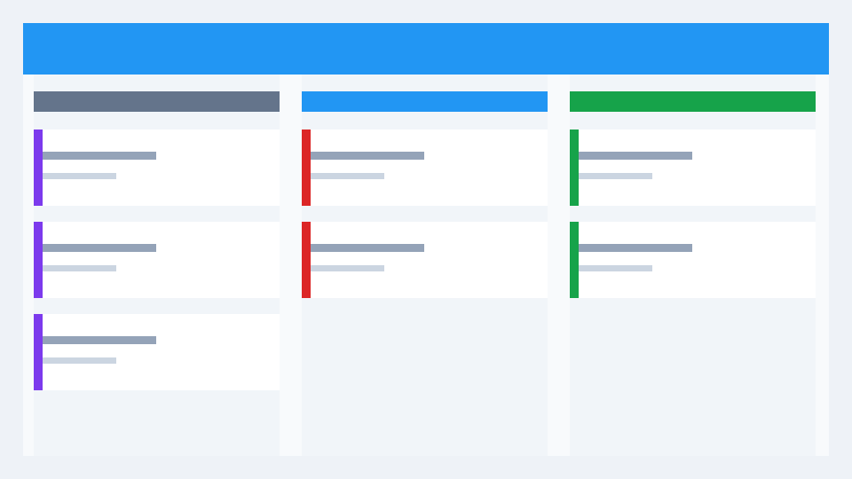

# 登录流程联调

**目标：** 复用 Kooboo 登录身份，核对项目成员的访问范围。

请通过成员选择器真实提及 @Jordan，协助检查手机上的状态入口。

- 检查登录后进入项目。
- 检查非成员不能读取任务。
- *保留输入*，避免失败后重新填写。

> 下图为虚构测试资料，用于检查 Markdown 图片与预览。



| 检查项 | 预期 |
| --- | --- |
| 编号 | 重名任务仍可区分 |
| 时间 | 显示明确时区 |

```text
示例日志：成员将任务由待办调整为进行中。
```

联调记录见[评论样例](comment.md)，生成业务正文时将此资料链接替换为真实任务内导航或普通可读说明，不创建失效本地链接。
