# 自动化插件与评分平台讨论记录

创建日期：2026-11-06（Asia/Shanghai）

最后更新：2026-11-07

状态：首版代码与本地服务集成已完成（2026-11-07）；真实 Kooboo 生成、Codex / DeepSeek 接入和界面浏览器验收尚未完成。继续保留讨论、决策与分层验证结果。

## 记录约定

- “已确认”只记录用户明确提出的要求或已明确接受的决策。
- “用户倾向”和“建议”保留为讨论方向，不自动升级为选型决定。
- “已观察”记录本轮读取的代码或文档事实，不代表浏览器、模型或产品验收通过。
- 后续按议题追加讨论、决策和验证结果；修改结论时注明原因。

## 已确认的范围与要求

1. 用户负责自动化流程中的插件与评分平台。
2. 平台需要支持 Site 评测和 AI App 评测。
3. 评测流程 SOP 与评分规则需要支持自定义。
4. 初始阶段只讨论；2026-11-07 用户确认页面方案及 UI 细节后，按此前授权进入实施，继续维护本 Markdown 文档。
5. 逐个问题讨论；已完成本阶段执行器与主力模型选型，其他议题后续逐项展开。
6. 本阶段采用 Codex SDK 控制本地 Codex Agent，主力模型使用 `deepseek-flash-1017`。用户明确确认该型号具备识图能力；本轮记录用户确认，不另行运行验证。
7. 这是一套内部特殊定制、服务批量任务的自动化工具系统；定制逻辑由自动化系统承担，不为此要求 Kooboo 新增专用入口、接口或后台生成任务能力。
8. 当前方向是整合为统一的“Kooboo AI Agent 自动化系统”，由内部模块承接生成执行、评测、证据与报告，不要求操作者分别操作三个独立产品。
9. 生成仍由 Kooboo AI Chat 执行，评测交给 Codex SDK 控制的评测 Agent；浏览器插件不是最终必须保留的产品形式。本阶段没有要求移除插件或实施迁移。
10. 后续讨论继续使用流程图和对照表辅助沟通。
11. 系统的业务源头是资源包，承接原 Admin 侧的资料与任务来源；资源包可以包含文件、内容站 URL、参考站 URL 或 App 需求文档等输入。
12. 需要覆盖资料建站、站点迁移、旧站升级、AI Site 模板制作、AI App 模板制作五类场景。AI Site 模板场景预期收集约 500–1000+ 个站点 URL，用于丰富 Kooboo 模板市场。
13. 所有场景的首次建站均以空白目标站为起点；用户后续补充先做首页、成单后继续生成内页的需求，续建不再套用首次建站必须空白的要求。统一把此前的“原站”称为“内容站”，视觉参考来源称为“参考站”；二者可以是同一个站点。
14. 迁移必须有内容站；有独立参考站时属于旧站升级，按“克隆内容站 → 导入资料包 → 在 Sandbox 克隆参考站”准备输入；没有独立参考站时，内容站同时充当参考站，可直接克隆到 Sandbox。
15. AI Site 模板中，来源站同时充当内容站和参考站，可直接克隆到 Sandbox；最终模板不得复用参考站资源，图片使用 `imagePlaceholder` 填充。用户提出该限制的目的是避免侵权。
16. Admin 侧必须保留外部 Admin 数据导入或接入能力，同事可以继续使用外部 Admin，不以迁入本系统为使用前提。
17. Admin 中的一条资源记录作为基线，可对应多个 Kooboo 生成站，用于重新生成和不同方案尝试。用户随后明确，核心是一对多关系，A/B 比较不重要，不作为核心功能要求。
18. 资料包应保留较大自由度。用户已基本认可资源基线、输入版本、生成记录、评测记录的逻辑模型及相关建议；具体字段、导入格式等尚未细化为实现方案。
19. Admin 侧概念设计可先收敛，继续讨论原插件侧功能，即统一系统中的生成执行模块。当前仍只讨论，不实施。
20. 不同场景需要不同的 prompt、skill 与约束；生成要求需要像评测 SOP 一样支持自定义。后续澄清：复用 Kooboo 自带的 skill、reference 和 tools，自动化侧以组织并发送一段完整 message 为预期。助手据此建议简化为场景提示词，不再额外引入技能管理体系或独立的生成方案选择层。
21. 新增场景作为后续扩展方向，当前暂缓，先覆盖已确定的五类场景。
22. 正常生成采用一次委托，在提示词中尽量要求 AI 自主完成、不要再次询问。后续明确的职责方向是系统记录与暴露状态，pending 由外部 AI 或人工跟进，不要求系统内置复杂的智能跟进判断。
23. 旧站迁移和升级需支持仅生成首页：先为大量潜在客户生成首页，成单后再继续生成其余页面，避免未成单时投入全站生成成本。Site / App 模板暂不要求该业务模式。
24. 调度侧需支持并发限制与自动队列：例如选中 10 个站点、并发上限为 3，其余排队，执行空位出现后自动补入。3 是示例，不是已确定的固定值。
25. 按用户明确的业务成本口径，资料准备和克隆为零成本，首页优先旨在节省 Kooboo AI 执行生成消耗的 token；不再把缩小采集 / 克隆范围作为成本优化需求。
26. 用户希望未来可将长批次任务交给 Grok bot 或其他 AI 监看：系统主动通知 pending，或让外部 AI 自行发现，再由外部 AI 跟进。具体接入方式尚未选择，不锁定某个 AI 产品。
27. 用户回复“是的，完全同意，现在这样的流程设计没有问题”，明确确认生成执行主流程：批量提交、限流排队、一次委托、状态留痕、暴露 pending、接受外部跟进、交接独立评测。确认停止等待的 pending 释放执行名额，跟进重新进入同一调度上限；具体判定与接入实现仍待定义。
28. 评分平台进入讨论：评测需显式设定本次范围，与仅首页、全站等生成委托对应；本地 AI 按 SOP 准备和采集所需材料，交付证据、评分与问题清单。
29. Site 迁移、升级与模板重视 UI 还原度及其评判准确性；成单后迁移与升级重视完整度。App 重视 UI 合理性、信息层级、交互体验与业务正确性，其细则需通过实际 App 评测逐步总结。
30. 对已有 Google 搜索积累的旧站，迁移 / 升级时保护既有搜索表现是重要评分要求；技术检查与实际搜索表现的边界按议题十继续讨论。
31. 评测知识希望以可随时更新的 Skill 承载，包含 SOP、references 和可封装的工具；维护入口可以在平台或其他位置，尚未确定。
32. 用户回复“你的理解、结论、建议没有问题；我们可以继续下一步”，认可议题十上一轮已展示的评分平台职责、范围、证据、Skill 版本固定及 SEO 结论边界等设计方向，转入 Site UI 还原度 SOP 讨论。具体权重、阈值和实施方式仍未确定。
33. Site UI 以本地 AI 理解与审核为主，保留上下文判断的弹性；程序和工具辅助取证与汇总，不把死板的截图或像素比对作为最终裁决。
34. 首页 hero banner 是最重要区域，评分权重应提高；具体数值尚未确定。
35. 页面按 banner 的语义结构拆分，例如 header → hero banner → 内容 banner → price banner → footer，检查生成站是否实现参考站的相应结构。
36. Banner 级评测需理解设计意图，并检查轮播、手风琴等动态与交互效果。设计意图具体检查项由助手继续提出建议。
37. PC 与移动端必须各自对照评测，不再仅作为可选或默认覆盖建议；具体视口与汇总权重待定。
38. 用户回复“是的，完全同意，下一步呢”，认可上一轮 Banner 设计意图的细化维度、Hero 单列加权、动态实际操作及两端分别审核的设计方向。继续讨论 Site UI 评分规则与报告结构；具体数值权重尚未确认。
39. 用户指定首页 UI 初始权重为 Hero 40%、结构 40%、其他区段合计 20%，并强调比例本身不是重点，必须可以随时修改。按此前认可的每轮规则快照保留当时口径，PC / 移动汇总比例仍未确定。
40. 用户认可上一轮完整度的依据、范围、逐项核验和结果表达：由内容站、资料与本次要求形成应交付清单，分别记录完成情况、遗漏与未验证项。
41. 用户补充完整度审核的重要指标：产品等动态内容应采用 Kooboo 动态路由与动态取值，数据按业务存放在 Content / Commerce / Sqlite 中，不能把 100 个产品分别创建成 100 个独立 Page 就视为合格。评测需覆盖相应数据与实现方式，具体取证及计分细则待讨论。
42. 用户回复“是的，可以继续下一步”，认可议题十五所述动态内容审核方向：纳入完整度中的 Kooboo 实现规范，结合数据、路由、取值和运行证据判断；证据不足标记未验证。权重、必过项和具体读取能力仍未确定。
43. 用户回复“完全同意”，确认议题十六上一轮展示的 SEO 迁移保护方案：按范围核对旧入口、内容与搜索配置，区分首页样稿、全站预览和正式上线核验；SEO 结果独立可见，权重与必过项自定义。长期搜索观察职责、具体工具与新增官方细则仍待细化。
44. 用户认可议题十七的 App 评测骨架，并希望讨论完成后实际验证这些规则；具体分值、工具、用例和经验细则仍待细化。
45. 用户明确授权全部讨论完成后开始实施。该授权不代表当前已讨论完毕；后续满足这个条件即可衔接实施，不再重复询问一般性的实施许可。
46. 自动化系统管理界面使用与 CPR 相同的 UI。用户进一步表示此前提及的两套 UI 本来就是同一方向，按同一套 CPR 界面体系记录；资源共享站现有实现可作为读取与复用参照，不扩张成所有被生成 Site / App 都必须使用 CPR。
47. 用户回复“同意”，确认上一轮展示的 Skill 维护与更新方向：平台维护 SOP、资料与评分规则，工具实现由开发维护；保存并启用版本，新评测固定本轮实际内容，已有评测和历史报告保留原口径，复评创建新记录。具体编辑器和更细的操作策略仍待实施时核对。
48. 用户回复“是的”，认可上一轮展示的报告、跟进与复评方向：执行、质量和覆盖分开表达，问题带证据，外部 AI / 人工决定处理方式，修复经调度后以新一轮评测验证，保留历史与范围。
49. 用户明确要求报告开放 API：同事可继续使用自己的 Admin，通过本系统 API 获取所需报告信息，无需迁入或使用本系统管理界面。具体查询方式、数据格式和鉴权方案后续定义。
50. 用户回复“同意，下一步呢”，确认上一轮展示的报告读取能力：来源关联、状态、完整结果、证据与多站多轮历史，平台与外部 Admin 使用同一实际报告；接口字段与鉴权实现待定。
51. 用户明确选择首版“先在当前开发机跑通”。后续常驻机器部署作为之后的工作，不在本轮要求其先准备服务器。
52. 用户要求加快讨论，在休息前将具体前端页面讨论并确认，然后准备实施。后续以本轮页面方案收敛为目标，常规实现细节由助手依已确认需求处理，不继续扩展非必要的产品议题。

## 初始流程与现有基础

用户提供的流程图：外部 Admin 将资料和任务标识交给插件；插件在 Kooboo 创建站点并驱动聊天；聊天结束后向评分平台提交请求；评分平台读取生成结果、保存评分与证据；Admin 查询结果。

这是初始角色划分。侧边讨论进一步提出统一自动化系统方向：可以由系统内部的浏览器执行模块承接原插件职责，生成、评测、证据与报告作为内部模块。插件与独立评分平台不再被视为必须分别交付和操作的最终产品形态；细节见议题三。

2026-11-06 已读取的本地实现与协议：

- 插件：`/Users/achen/Priv/Yardi/AI-App/kooboo_material_site_builder`。
- 评分平台：`/Users/achen/Priv/Yardi/AI-App/site_evaluator_impl`，Vue 前端与 Node.js 服务端。
- 插件接入协议区分“聊天停止”“平台接收”“评分通过”，支持持久化转交和幂等投递。
- 平台已有自建工具调用循环、阶段检查点、证据保存、评分规则发布版本和程序计算总分。
- 当前主要覆盖首页静态视觉，不能由此认定全站交互或 AI App 业务流程通过。
- SOP 当前由 `server/lib/sop.ts` 从固定目录加载并计算哈希。
- `RuleSet` 中同时包含评分维度、视口、采集和执行器配置；如何拆分仍待讨论。

上述是代码与项目文档观察，本轮没有运行真实评测或浏览器验收。

## 议题一：自建 Agent 与成熟 AI CLI / harness

### 用户的理解与倾向

1. 当前评测类似 Kooboo AI Chat：调用类似 `streamChat` 的模型接口，带上 prompt、skill、tools，驱动评测。
2. 用户预期的 CLI 是已有完整 harness 的 AI 工具，自带更多通用能力；我们主要提供评测 skill，由其执行并交付结果。
3. 用户认为第二种方式可能具有更强的能力与完成度，类比自己在 Kooboo AI Chat 与 Codex / Cursor 中执行通用任务的体验。

第 3 点属于用户经验与选型倾向，不记录成已完成的对照实验结论。

### 本轮澄清

讨论的两个选择更准确地表述为：

- 自己维护模型调用、工具执行、上下文和任务推进机制的评测 Agent。
- 复用成熟产品的 Agent harness，通过 CLI、SDK 等接口交付评测任务。

CLI 是一种调用入口，Agent 是执行任务的系统，两者不是相互排斥的类别。用户真正关注的是能否复用完整、成熟的执行系统。

这里的 harness 指围绕模型的执行系统，例如：维护会话与上下文、调度工具、处理工具结果与失败、持续推进工作、暴露执行事件，以及执行配置的权限策略。具体功能取决于所选产品与运行配置。

流式输出主要影响响应的传输与展示，并不是两种方案能力差异的核心。

### 现有实现的具体核对

- `server/lib/model.ts` 使用 OpenAI 客户端向兼容 Chat Completions 的接口发送 messages 和 tools；当前这段请求没有设置流式返回。
- `server/lib/agent.ts` 的 `runEvaluationAgent` 自行循环请求模型，执行工具，将工具结果回传模型，并维护预算、日志、证据与检查点。
- 工具集中在获取任务、截图、看图、审查、提交评测和报告阻塞；没有因此自动获得通用 shell 或自由编写脚本的能力。
- 因而用户对第一种方案的概念理解基本准确，但当前实现已经有专用执行控制，并非只有一次模型调用。
- 普通模型 API SDK 与 Codex SDK 的层级不同：前者在当前项目中承接模型请求，后者的官方用途是程序化控制本地 Codex Agent。

### 对能力差异的讨论结果（尚未最终选型）

助手判断：用户关于成熟 harness 更适合开放任务的推断有合理依据。对于需要读文件、执行脚本、分析失败并调整方法的工作，复用成熟执行系统是值得优先考虑的方向，可减少自行建设通用执行机制的工作。

同时保留以下限定：

- “CLI”这个名称本身不保证能力更强，应比较具体产品的模型、harness、工具、运行环境和权限。
- 用户在 Codex / Cursor 中观察到的优势可能来自上述多个因素，当前没有实验将其拆开。
- 成熟 harness 的通用能力，不等于更高的评分准确性或稳定性；本项目的评测完成度仍待验证。
- Skill 可包含流程、参考资料和脚本，但不会凭文字自动提供未安装或未配置的浏览器、账号、服务连接等能力。
- 我们可以将主要定制工作放在 skill、SOP、评分标准和少量专用工具上；是否还需要额外工具取决于执行环境。
- 复用成熟 harness 可以通过 CLI 或面向完整 Agent 的 SDK 实现，不要求必须使用命令行子进程。

### 当前建议

优先考虑“平台调用成熟 Agent harness 执行评测”的方向，把自建专用工具循环作为现有基础。平台保留任务管理、版本记录、证据存储和结果校验；不要为了保留控制权而默认自行维护所有通用 Agent 能力。

后续用户已确认本阶段采用 Codex SDK 控制本地 Codex Agent。具体集成与迁移细节仍待讨论，尚未授权实施。

### 待讨论 / 待验证

- 执行器与接入形态已确定为 Codex SDK 控制本地 Codex Agent，具体集成细节后续讨论。
- 该执行环境实际提供哪些工具，浏览器、看图和脚本运行是否满足评测要求。
- 同一批评测案例下的完成度、证据质量、评分可靠性、耗时和成本。

这些是后续议题，本轮不启动选型实验。

## 议题二：以 DeepSeek 为主力模型的 harness / SDK 选择

### 用户的新要求与问题

- 用户明确 DeepSeek 将是主力模型。
- 用户认可通过 Codex SDK 控制本地 Codex Agent 的形态。
- 问题：Codex SDK 能否使用 DeepSeek 配置？是否存在更适合 DeepSeek 的同类完整 Agent 工具？
- 后续用户决定先采用 Codex SDK，并明确主力模型为支持识图的 `deepseek-flash-1017`。

### 官方文档核对（2026-11-06）

1. Codex SDK 官方文档将其定位为程序化控制本地 Codex Agent，并支持配置传入与覆盖。
2. Codex 配置文档支持自定义 `model_provider`、provider 地址、认证和模型；当前 `wire_api` 只支持 `responses`。
3. DeepSeek 官方提供 Codex 接入指南，并明确其官方 API 原生支持 Responses API，针对 Codex 接入提供模型目录和配置说明。因此“Codex SDK → 本地 Codex Agent → DeepSeek 官方 API”具有文档依据。
4. 上述结论不等于任何 OpenAI-compatible 中转服务都能使用。若使用现有中转或私有部署，需要确认具体端点支持 Responses API 及该任务所需的工具、推理与图片消息。
5. DeepSeek 官方当前说明 `deepseek-flash` 支持图片输入，Responses API 同样可传图；Codex 接入指南将 `deepseek-v4-pro` 的输入模态声明为 `text`。视觉评测需按具体模型选型，不能仅凭“DeepSeek”或模型名称中的 Pro 判断。

这些是文档支持的接入路径。本轮未安装 SDK、未修改全局 Codex 配置、未配置密钥，也未运行模型或评测实验。

### 选型过程中的同类候选（历史比较）

以下保留选型讨论背景。用户后续已选择 Codex SDK，本阶段不继续展开其他执行器比较。

| 候选 | 已核对的能力与状态 | 当前判断 |
| --- | --- | --- |
| Codex SDK + DeepSeek | 本地完整 Agent；自定义 provider；DeepSeek 官方提供 Codex / Responses 接入说明。 | 保留为首要候选，不因 DeepSeek 是主力就排除。 |
| OpenCode SDK + DeepSeek | 官方 JS/TS SDK 控制 OpenCode server；provider 文档直接列出 DeepSeek；支持 SKILL.md；SDK v2 提供基于 JSON Schema 的结构化输出。 | 适合一并比较，尤其关注 Node.js 集成与多模型接入。没有证据证明其完成度高于 Codex。 |
| DeepSeek Harness（dsh） | DeepSeek AI 官方开源 Agent harness；已发布 Python SDK，可控制匹配运行时；项目明确处于 developer preview，可能发生破坏兼容性的变更。 | 值得关注与比较；官方归属不能替代对稳定性、工具能力及集成成本的核对。 |

SDK 支持结构化结果不等于结果已通过业务或证据校验。更换 harness 后仍需核对真实看图、工具连续执行与证据交付。

### 当前讨论结果

- 已确认：本阶段通过 Codex SDK 控制本地 Codex Agent；主力模型为 `deepseek-flash-1017`，用户明确确认其识图能力。
- 文档结论：Codex SDK 配合 DeepSeek 官方 API 有可行路径；需要按 Responses 协议核对实际服务地址。
- 选型结果：先采用 Codex SDK；OpenCode SDK 与 DeepSeek Harness 仅保留为历史比较，不继续作为本阶段待选项。
- 待后续讨论：实际采用的 DeepSeek 服务地址及端点协议、运行环境和集成方式。具体模型已确定。
- 待后续验证：工具循环、图片与工具结果传递、skill 执行、失败恢复和报告交付。本轮仍只讨论。

## 议题三：侧边会话结论——统一自动化系统与 Kooboo 边界

来源：2026-11-06 侧边会话 `01a1b029-bf2f-7333-8435-2414bae6c175` 已转交主会话的讨论结果。本节依据转交文本补录；该侧边会话没有修改文件、代码或配置。

### 已明确的边界

1. 这套自动化是内部特殊定制、专门服务批量任务的工具系统。定制逻辑应放在自动化系统侧。
2. 不为此要求 Kooboo 新增专用入口、接口或后台生成任务能力。此前提出的“让 Kooboo 提供完整后台任务接口”路线已被用户明确否定，从当前方案中排除。
3. 生成执行仍由 Kooboo AI Chat 完成。评测 Agent 负责后续评测，不取代 Kooboo 的生成 Agent。
4. 批量并发、浏览器登录状态、异常恢复与人工接管由自动化系统侧设计。
5. 当前仍只讨论，不实施；没有要求现在移除插件、改造 Kooboo 或执行系统迁移。

### 当前讨论方向

用户倾向保留 Kooboo AI Chat 现有页面执行流程，由统一自动化系统管理浏览器：

```text
统一自动化系统接收批量任务
  → 使用 Kooboo 现有 API 建站、上传资料
  → 进入现有 AI Chat 页面发送需求
  → 处理约定范围内的交互并跟踪状态
  → 调用 Codex SDK 控制的评测 Agent
  → 保存证据、评分与报告
```

浏览器插件不是必需的最终形式。未来可以由系统内部的浏览器执行模块承接原插件职责；“Kooboo AI Agent 自动化系统”提供统一操作界面与后台，内部组织生成、评测、证据与报告模块。

这里确认的是职责边界与整合方向，具体运行环境、浏览器管理方式、模块接口及插件过渡安排仍待后续讨论。

### 本次补录结果

- 侧边会话结论此前已传回主会话，但未写入本文；本次核对后补齐。
- 后续方案以统一自动化系统为讨论方向，保留“生成由 Kooboo AI Chat 执行、评测由独立评测 Agent 执行”的分工。
- 不再将 Kooboo 新增专用后台生成任务接口作为前置条件。

## 议题四：资源包作为源头与五类任务

### 用户明确的需求

- 持续使用流程图和对照表交流。
- 系统业务源头为资源包，也就是原 Admin 侧管理的输入。
- 资源包既可以是纯文件资料，也可以组合内容站 URL、参考站 URL；AI App 模板以业务需求文档等资料为输入。
- 用户已纠正上一轮助手的理解：所有场景均从空白目标站开始，不能用“迁移在既有克隆站上改、模板另起空站”区分两者。克隆与资料导入是空白起点之后的输入准备步骤。
- 迁移按是否有独立参考站分支；旧站升级属于有独立参考站的迁移场景。以下表格按最新澄清更新，评测细则仍为待讨论建议。

### 已确认的术语与起点

- 内容站：此前称“原站”，提供内容来源。
- 参考站：提供视觉参考。迁移没有独立参考站时，内容站同时充当参考站；AI Site 模板中的来源站也同时承担这两个角色。
- 目标站：本次生成交付的 Site / App，所有场景首次建站均以空白站点开始；首页完成后的内页续建按议题八讨论。
- Sandbox：承载克隆参考输入；Sandbox 中的参考资源不等于允许进入最终模板的资源。用户说明 Kooboo 已有相关 tools，本轮不检查或修改这些 tools。

| 任务类型 | 输入 | 用户描述的生成路径 | 评测依据与重点 |
| --- | --- | --- | --- |
| 资料建站 | 图片、文案等资源文件 | 从空白目标站根据资料构建 Site。 | 助手建议评估 UI 质量与资料要求完成度；没有视觉参考时不默认评还原度。 |
| 迁移：无独立参考站 | 内容站 URL，可附资料包；内容站同时充当参考站 | 从空白目标站开始；内容站可直接克隆到 Sandbox，再由 Kooboo AI 构建目标站。 | 对内容站的还原度与完整度；直接使用 Sandbox 参考路径可避免先克隆进目标再清理原克隆代码。 |
| 迁移：有独立参考站（旧站升级） | 内容站 URL、参考站 URL，可附资料包 | 空白目标站 → 克隆内容站 → 导入资料包 → 在 Sandbox 克隆参考站 → Kooboo AI 构建。 | 内容完整度以内容站与资料为依据；视觉还原度以参考站及约定范围为依据。 |
| AI Site 模板 | 收集的来源站 URL，可附任务说明；该站同时充当内容站和参考站 | 从空白目标站开始；来源站可直接克隆到 Sandbox，使用 redesign skill 构建目标模板。 | 视觉与约定模板范围的完整度；最终模板不得复用参考站资源，图片使用 `imagePlaceholder`。 |
| AI App 模板 | 常见 App 的业务需求文档等资料 | 根据资料，让 Kooboo AI 从零构建 App。 | UI 评测与业务评测，以需求和约定案例为依据；有视觉参考时可增加还原度评测。 |

AI Site 模板目标是丰富 Kooboo 的模板市场，用户描述的参考 URL 规模约为 500–1000+。AI App 模板目标是丰富 Kooboo 的 App 模板，输入为整理的常见 App 需求。

### 建议的整体关系（尚未逐项确认）

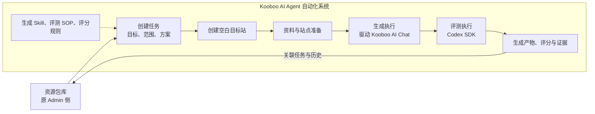

此图是概念职责图，不表示把 Kooboo AI Chat 搬进自动化系统。生成仍在 Kooboo 现有 AI Chat 中执行，系统侧通过现有 API 与浏览器执行模块驱动。

资源包与生成任务应分开：资源包描述输入，任务描述本次目标、范围和所选方案。用户后续明确 Admin 记录作为基线，与 Kooboo 生成站是一对多关系，用于重做与 A/B 测试。具体版本、生成和评测记录模型仍为建议，见议题五。

任务目标需要明确表达，不能仅按是否存在 URL 推断。一个站点 URL 可以用于迁移，也可以用于 AI Site 模板制作；相同输入不代表相同生成方式或评测标准。

### 评测口径建议（尚未确定评分细则）

- 无独立参考站的迁移：内容站同时提供内容与视觉基准；有独立参考站的迁移（升级）：内容站和资料提供内容依据，参考站提供约定的视觉依据。
- AI Site 模板：完整度相对约定的模板页面、组件和交互范围，不自动扩大为复刻参考站全部业务。
- AI Site 模板要求替换参考站资源，助手建议还原度重点比较布局、图片区域的比例与位置等设计结构，不因按要求使用 `imagePlaceholder` 而直接判定缺图或视觉失败；占位是否正确显示、资源是否违规沿用，应独立检查。具体评分规则仍待用户确认。
- AI App 模板：业务评测依据需求与案例，UI 评测没有参考站时侧重质量；不默认套用 Site 的视觉还原度。
- 迁移与升级要求符合 Kooboo 规范，助手建议将规范检查单列验收，避免仅凭视觉评分推定代码符合要求。
- 具体 SOP、评分维度、权重与页面 / 业务范围仍需后续逐项讨论。

### 本轮纠正结果与分支流程

已撤回上一轮“迁移与旧站升级在既有克隆结果上重构，而模板另外新建空站”的解释。用户明确所有场景起始为空白站，差别是内容站 / 参考站的输入角色、准备路径与资源使用限制。

用户随后回复“理解完全正确”，确认上述空白起点、内容站 / 参考站角色、三条分支流程与 AI Site 模板资源限制。后续讨论以此为基准，具体 SOP、评分维度和权重仍待逐项讨论。

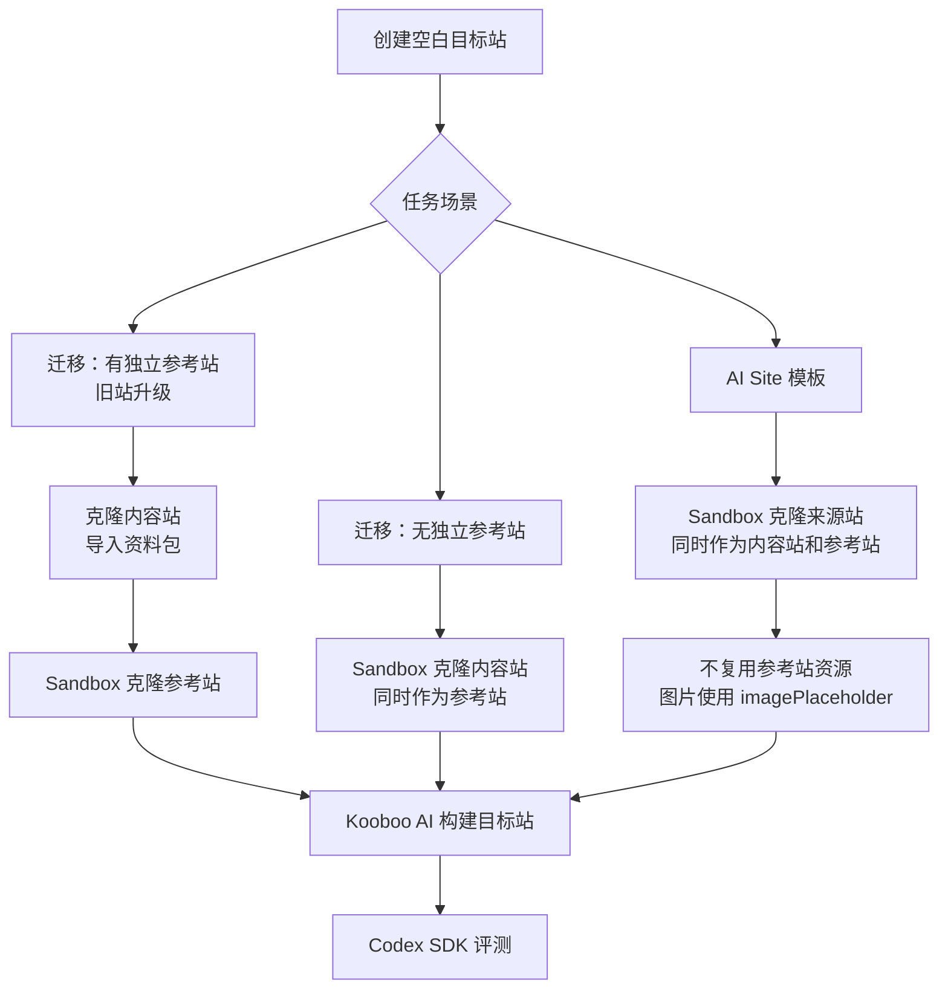

图聚焦本轮澄清的三条路径，资料建站与 AI App 模板同样适用空白目标站起点。无独立参考站的迁移直接将来源站克隆到 Sandbox，可避免“先克隆到目标站、重构后再删除原克隆代码”的清理操作。AI Site 模板沿用类似输入准备方式，但必须施加最终模板的资源替换限制。

本轮只更新术语、讨论流程和约束，不执行建站、克隆、模型调用或代码改造。

## 议题五：外部 Admin 接入、资源基线与自由资料包

### 用户明确的要求

1. 系统 Admin 需支持来自外部 Admin 的数据导入或接入，同事可以继续使用既有 Admin。
2. Admin 记录是基线，可关联多个 Kooboo 生成站，支持生成结果不理想后重做和不同方案尝试。用户随后澄清：主要支持一对多即可，A/B 比较不是核心要求。
3. 资料包需要较大自由度，用户询问适合的 Admin 数据模型。

### 接入关系建议（尚未确认具体协议）

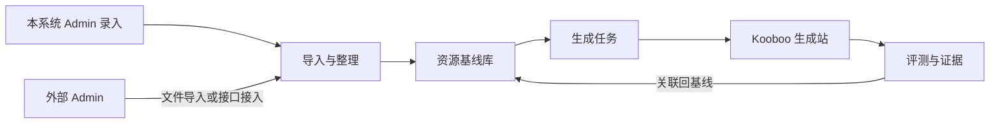

助手建议共用资源基线模型处理内部录入和外部接入。外部 Admin 保持自己的数据结构，导入时通过字段映射转成内部可识别信息，同时保留额外业务字段。

可以提供文件导入与 API 接入两类入口，具体格式和优先级尚未确定。附件需要随导入提供，或给出执行环境能够获取的入口；仅有外部机器的本地路径，不等于本系统已经取得文件。

建议保存来源系统标识、来源记录 ID、来源版本或更新时间和导入记录，用“来源系统 + 来源记录 ID”识别重复接入。相同来源记录应关联同一基线；资料变化形成新输入版本，历史生成和评分继续关联原版本。文件名和 URL 不宜单独承担基线身份。

### 基本认可的核心模型

用户已基本认可以下逻辑对象与设计方向；这不是已确定的数据库表或接口格式。

| 对象 | 主要内容 | 关系 |
| --- | --- | --- |
| 资源基线 | 稳定 ID、名称、自由说明、资料条目、来源信息、扩展业务字段 | 一条基线对应多个输入版本和多个生成结果。 |
| 输入版本 | 本次实际选用的说明、文件清单及内容、URL 与角色、已采集来源的引用 | 一个版本可用于多次生成，保留各次生成的输入依据。 |
| 生成记录 | 输入版本、任务场景、实际 message 等生成要求快照、可选备注、执行状态、目标环境与站点身份 | 每次重新建站单独记录；失败记录可以没有生成站。后续首页 / 内页续建记录的建议见议题八。 |
| 评测记录 | 生成记录、评测时的目标证据、SOP / 规则 / 模型版本、分项结果、报告和证据引用 | 同一个生成站可有多轮评测，保留历史。 |

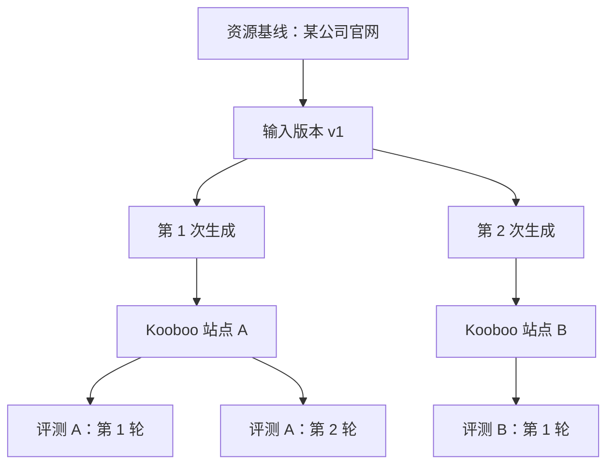

基线上不建议只保存一个 `siteId` 和一份评分。基线详情应能列出多个生成结果及对应评测，保留各次历史；不以专门的 A/B 比较功能为前提。

输入版本可以在发起生成时由系统自动保存，不要求用户手工维护版本文件。相同输入版本不意味着每次生成必须采用相同方案；生成记录分别保存 prompt、skill 和相关运行配置等实际使用信息。具体快照字段后续再定义。

只保存 URL 没有固定远端网页。建议同时记录实际使用的克隆 / 采集批次及时间。文件也需要保存实际使用内容或可追溯版本，而不是仅保存可变的原路径。目标站发生变化后的评测，按实际采集证据留痕，不能当作原站状态的复测证明。

### 资料包自由度建议

结构化信息由系统维护，资料正文与文件组织保持自由：

- 允许任意目录层级与文件名，混合图片、文档、文本、表格等资源。
- 允许只有 URL、只有需求说明、只有附件或多种输入组合，不强制必须有本地目录。
- 不强制要求 `README.md`、固定 JSON 清单或统一的业务字段模板。
- 提供自由说明，承载业务背景、事实优先级和特殊要求。
- 同一个 URL 可以同时承担内容站与参考站角色，不要求重复登记为两个资源。
- 外部来源的额外业务字段放在扩展信息中，生成与评测根据需要读取。

系统真正需要固定的是关联关系与执行信息：基线身份、所选输入、任务目标、输入角色、执行方案及结果归属。任务场景和方案可以在发起生成时选择，不必把资源基线永久限定为一种任务类型；基线可以有默认选择。

建议允许资料先入库、后补全。发起具体任务时，再按任务要求检查必需输入，例如迁移需要内容站，App 生成需要可用的需求信息。对于未声明角色或存在歧义的资料，可给出解析建议并让操作者确认，不把自由资料的推测直接当作已经确认的执行要求。

### 操作关系

- 重新生成：创建新的生成记录和空白目标站，继续关联同一基线及选定输入版本。
- 继续生成：用户补充成单后生成首页之外页面的需求；建议在选定的已有生成站上续建并单独留执行记录，详见议题八。
- 重新评测：对已有生成站创建新的评测记录，不因此重新建站。
- 调整资料：保存新输入版本，历史生成结果仍关联旧版本。
- 一对多：同一基线可以保留多个生成站及其记录，不要求它们构成 A/B 实验，也不要求专门的对比操作。

用户已基本认可本轮设计与建议，并明确一对多是核心，A/B 比较优先级低。Admin 侧概念方向可先收敛；具体字段、导入格式与映射、存储和页面布局可在后续细化，不阻碍进入生成执行模块的讨论。

## 议题六：转入原插件侧功能讨论

用户希望在 Admin 侧没有其他必要讨论项时，进入原插件侧功能。助手判断当前 Admin 概念方向已足够支持后续讨论，无必须先解决的阻塞项。

原插件侧在统一系统中对应“生成执行模块”。以下是下一阶段的职责建议，尚未逐项确认；不表示现在更换插件形式或实施代码。

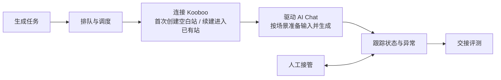

| 环节 | 待讨论的功能 |
| --- | --- |
| 任务接收 | 读取基线输入版本、任务场景、目标环境、本次范围与生成要求。 |
| 批量调度 | 并发上限、超额自动排队与空位自动补入已确认为需求；暂停、取消和恢复的细则仍待讨论。 |
| Kooboo 环境与站点 | 使用既有连接与能力完成登录；首次创建空白站，续建进入选定已有站，关联实际站点身份。 |
| AI Chat 驱动 | 发送要求、处理约定交互，驱动已确认的内容站 / 参考站、资料和生成流程；Sandbox 准备由 Kooboo 已有 tools 完成。 |
| 状态与异常 | 保存执行状态与异常信息，向外部 AI / 人工暴露 pending；恢复与跟进仍需纳入并发调度。具体状态与控制入口待细化。 |
| 结果交接 | 保存目标站、会话及执行信息，聊天停止后交接评测，由评测判断质量与完成情况。 |

用户同意先讨论生成方案，并确认不同场景需要不同的 prompt、skill 与约束，生成方案应像评测 SOP 一样支持自定义。具体配置结构与执行方式继续在议题七讨论；不将这些确认扩大为对全部执行模块功能的确认。

## 议题七：可自定义的生成方案

### 用户本轮确认

1. 不同场景确实需要不同的 prompt、skill 和约束。
2. 生成方案应像评测 SOP 一样支持自定义。
3. 希望未来能够新增场景，但当前可以暂缓；已确定的几类场景暂时足以覆盖需求。

因此，当前讨论范围是“现有场景下可自定义生成方案”，不要求本阶段提供新增场景编辑器或通用流程编排器。

### 本轮澄清：复用 Kooboo 能力，以完整 message 委托

用户进一步明确：Kooboo 已有自己的 skill、reference 和 tools，因此自动化侧无需再建设太多同类内容；最终驱动 AI Chat 的预期是一段 message。正常情况下采用一次委托，在提示词中尽量要求 AI 不要再次询问，自行完成任务。AI 仍可能反问或未按 prompt 执行，需要追踪和跟进。

助手修正此前将场景与生成方案分别选择的建议：该拆分只是助手的概念建议，并非用户已接受的产品要求。当前可收敛为“按场景维护可编辑的提示词，结合资料、本次范围和补充要求组织最终 message”；不要求操作者再选择一层生成方案，也不要求自动化侧另建 skill / reference / tools 管理系统。提示词模板与编辑方式仍是待确认的简化建议。

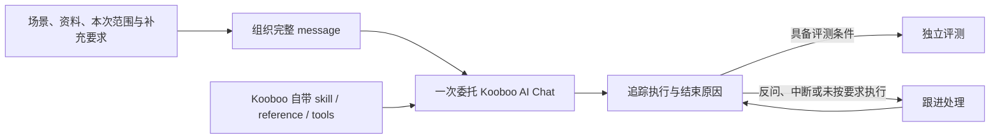

生成 message 指导工作，评测 SOP 检查结果，评分规则决定如何计分。聊天停止仍不等于完成或通过评测。

### 跟进职责：系统记录，外部 AI 处理

用户进一步指出内置智能跟进较麻烦，倾向让外部 AI 监看并处理：例如睡前启动 100 个站点任务，交给 Grok bot 或其他 AI；系统记录状态，出现 pending 后通知外部 AI，或者由外部 AI 主动发现并跟进。

因此，不继续将“系统自己判断该如何回答、持续追加消息”作为当前必需能力。系统承担确定性的状态记录、查询与执行控制；外部 AI 承担理解阻塞、决定如何跟进。通知与主动查询都是接入候选，尚未决定具体协议、优先级或某个 bot 产品，不表示已验证 Grok 的接入能力。

后续方向更新（2026-11-07，见议题三十一）：用户明确提出由平台内置、类似评测端 Codex SDK 的 Agent 接收信息、问题和工具，自主决策并执行下一步。以上外部 AI 优先的描述保留为历史讨论，不再作为当前禁止内置智能跟进的约束。

助手建议供跟进方取得任务目标与范围、关联站点 / 会话、最近聊天与工具错误、pending 原因和时间，并能通过系统请求继续、补充消息或重试。具体入口后续讨论；所有重新启动 AI 执行的操作都应经过同一并发限制，避免跟进绕过调度。

当前只讨论，不核对或改造 Kooboo 技能加载机制，不实施浏览器驱动与自动跟进。

## 议题八：迁移与升级先做首页，成单后续建

### 用户新增的 Admin 侧需求

- 可能收集几万个老旧站点，先让 AI 翻新或升级首页，再联系客户询问是否愿意付费升级。
- 客户愿意付费后，再继续生成首页之外的页面，控制未成单时的生成投入。
- 旧站迁移与升级需要支持“仅首页”的配置；Site / App 模板暂不要求这一业务模式。

### 已基本认可的范围与续建关系（细节待定义）

用户本轮同意此前对首页需求配置的建议和设计，包含本次范围、已有站点续建与对应评测方向；具体字段、页面清单及执行规则仍需后续定义。

“仅首页”属于本次生成范围，可以用于迁移或升级，不必新增一种场景。建议至少区分仅首页、全站，以及基于已有结果继续生成其余页面；是否开放任意页面范围后续再讨论。

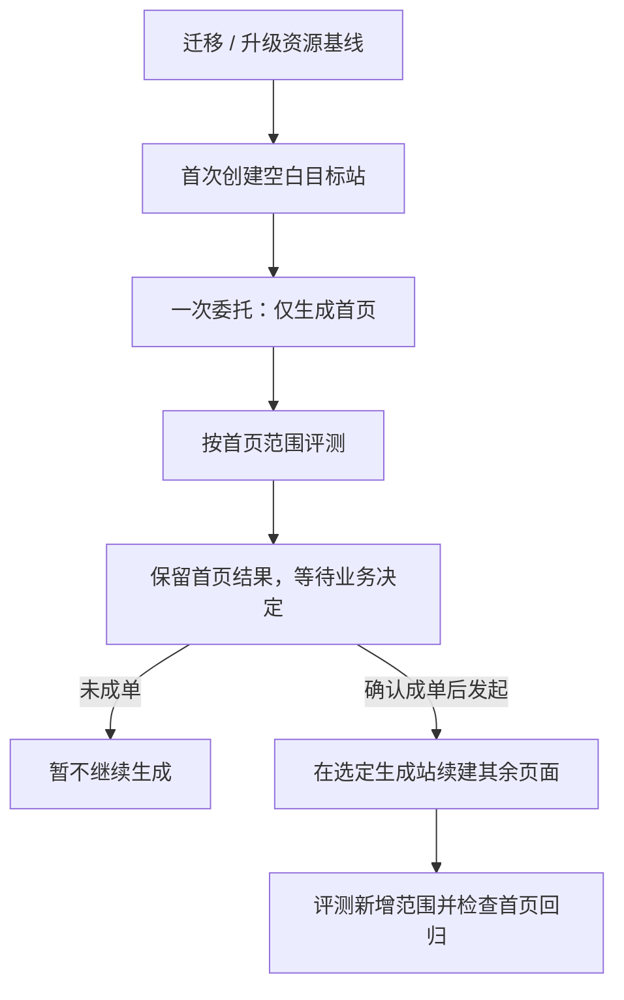

建议默认复用已经生成的首页所在站点，续建时延续其视觉与公共组件，不重新创建空站。首次生成、重新生成和续建的操作需区分：首次与重做仍从空白站开始；续建基于已有产物。是否复用原聊天会话属于执行细节，不把同站续建等同于必须依赖原会话。

Admin 仍保留资源基线一对多生成站的关系；每个生成站可经历多次生成执行。建议分别保留“首页生成”和“内页续建”的范围、最终 message、站点 / 会话身份、执行结果和评测记录。原首页评测只证明当时首页范围的结果，不代表续建后的全站通过。

建议把“本次范围”和“最终全站目标”分开：仅首页任务按首页要求评测，尚未委托的内页不作为本次缺失扣分；内页续建后评估新增页面，并检查首页、导航与公共组件是否受到影响。具体页面清单、链接处理、共用结构和评分方式后续细化。

成本口径已由用户纠正：资料准备和克隆为零成本，成本在 Kooboo AI 执行生成时消耗的 token。撤回此前将缩小采集 / 克隆范围作为成本优化重点的建议。首页任务可以准备完整资料，但生成要求仅委托首页，其他页面待成单后再生成；最终实际生成范围仍由独立评测检查。

## 议题九：并发队列与外部 AI 监看

### 用户明确的需求与机制说明

用户说明 Kooboo 的 `streamChat` / function-call loop 由前端负责，因此调度侧需要限制同时执行的任务数。批量提交与实际运行分开：例如一次选中 10 个站点，上限为 3，则最多 3 个运行，其余排队，空位出现后自动启动下一项。用户也描述了睡前提交 100 个任务、由外部 AI 监看的用法。

本文记录用户提供的机制作为讨论前提，本轮没有重新核对源码、运行并发实验或确定可承受的最大并发。

### 已确认的调度流程（状态判定与实现细节待定义）

用户在上一轮流程说明后明确回复“是的，完全同意，现在这样的流程设计没有问题”。由此确认主流程与职责划分：系统负责并发队列、一次委托、状态与上下文记录及跟进操作入口，外部 AI / 人工负责理解并处理阻塞；pending 确认停止后释放名额，跟进再次经过调度。个别任务阻塞时，其余队列继续推进。

外部跟进方可查看任务与范围、执行状态、阻塞上下文和生成 / 评测结果，并请求补充消息、继续、重试或取消的能力方向获确认。实际并发值、pending 判定条件、状态名称、查询 / 通知 / 控制的具体接口与外部 AI 产品仍未确定。本文其余未在主流程中展开的持久化、去重、优先级等建议，仍需后续细化；不因流程认可就视为全部实现细节已定。

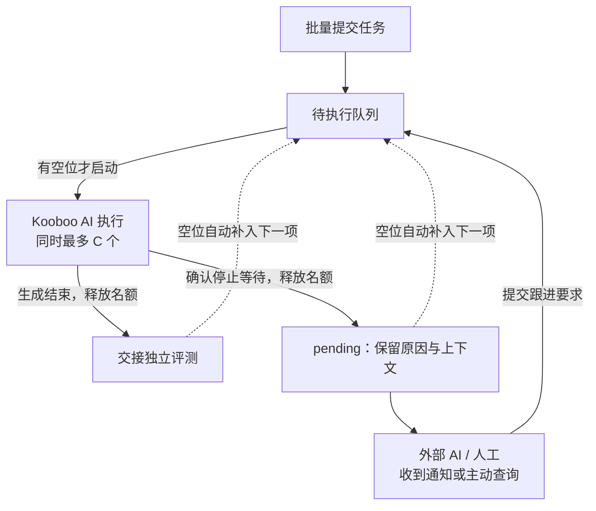

建议用以下含义区分执行状态，名称尚未定稿：

| 状态 | 含义 | 生成名额建议 |
| --- | --- | --- |
| queued | 已提交，等待调度 | 不占用。 |
| running | 前端循环正在执行本次委托 | 占用。 |
| pending | 已确认本次执行暂停 / 结束，等待补充信息或跟进 | 释放，让其他任务继续。 |
| generated | 本次生成执行已结束，转交评测 | 释放；不等同于评测通过。 |
| failed / cancelled | 本次执行失败或已确认取消 | 确认旧执行停止后释放；后续重试重新调度。 |

建议 pending 与 queued 分开，避免尚未执行的排队任务被误报为阻塞。不能仅因短暂无流式输出或超时就假定旧任务已停；无法确认其停止时，不立即释放名额并启动重复执行。

建议同一个调度执行池共享并发上限，不能每提交一个批次就额外开启 C 个。外部 AI 跟进也先进入调度，再启动实际执行；同站同时最多一个生成 / 跟进操作。默认顺序可先采用先进先出，跟进优先级与多环境分池后续再讨论。

任务、队列、站点与会话身份、状态变更及最近活动建议持久保存，方便长批次监看和断开后的状态核对；不把页面刷新后的任务重新启动视为无条件安全操作。通知或外部轮询应读取同一份状态，已被处理的旧 pending 不应重复触发同一跟进。

按用户提供的前端循环前提，执行环境在运行期间需持续承载 Kooboo 前端循环。外部 AI 监看与承载该循环是不同职责；不因交给 bot 监看而默认可关闭执行浏览器或让执行机器休眠。具体部署与恢复机制仍留后续讨论。

当前只记录设计，不启动队列、发送通知或接入任何外部 bot。

## 议题十：评分平台的功能、职责与可更新评测 Skill

### 用户明确的要求

1. 评测应和生成一样设定范围，包括仅首页与全部页面。
2. 由本地 AI 执行，编写 SOP，告知需要提供或收集的材料与证据，最终交付材料、证据、评分结果和发现的问题等。
3. Site 类型（升级 / 迁移 / Site 模板）的 UI 还原度评判准确性非常重要。
4. App 类型同时评测 UI 与业务正确性；UI 重视布局合理性、信息层级、交互和使用体验。用户举例：信息很多的对象不应生硬地全部塞进弹窗。细节标准需真正评测几个 App 后总结，不假定现阶段能一次写全。
5. Site 成单后的迁移 / 升级阶段，完整度非常重要。
6. 有 Google 搜索积累的旧站需重视站点变更导致搜索表现受损的风险，纳入重要评分要求。
7. 希望随时可在平台或其他位置更新评测 Skill，包含 SOP、reference 和可封装工具。

以下为本轮提出的职责拆分与设计建议。用户随后回复“你的理解、结论、建议没有问题；我们可以继续下一步”，认可上一轮已展示的设计方向。具体分数刻度、权重、阈值、工具实现及本平台长期 SEO 观察范围仍待细化；不把方向认可解释为实现已完成。

### 平台、Skill 与本地评测 AI 的职责建议

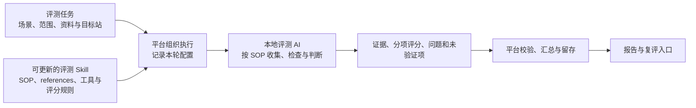

建议平台负责范围和输入组织、调度执行、状态与异常、结果校验、证据及历史留存和报告查看；Skill 负责检查方法、证据要求与评分口径；AI 负责在授权环境内运行检查、收集材料和形成有证据的分项判断。分数算术与权重汇总建议由程序计算 / 校验，避免要求 AI 自行承担所有汇总逻辑。

评分平台不因聊天结束就认定生成成功，也不在评测过程中默认修改被测站；后续修复属于新的生成 / 跟进执行。评测中断、缺少输入或无法获取证据需单独记录，不能以空报告当作通过。

### 本次范围与场景的评测重点建议

| 本次目标 | 主要评测内容 | 依据 |
| --- | --- | --- |
| Site 首页样稿 | 首页视觉质量、对参考的还原、首页内容与基本交互 | 内容站 / 资料、视觉参考站、本次首页要求。 |
| 成单后的迁移 / 升级 | 范围内全部页面与内容、资源和功能完整度、视觉、SEO 迁移保护 | 源站基线及已确认迁移范围；SEO 资料按可取得情况。 |
| AI Site 模板 | 参考设计的还原、可用的模板页面 / 组件 / 交互、资源替换约束 | 参考站与约定模板范围；图片使用 `imagePlaceholder` 的既定政策。 |
| AI App | UI 合理性与体验、需求覆盖、关键业务流程与结果正确性 | 业务需求、测试数据和角色；有视觉参考时才增加相应还原检查。 |
| 已有站内页续建 | 新增范围的完整度，并检查对首页 / 共用导航组件的影响 | 本轮委托与此前站点证据。 |

建议将实际页面 / 功能清单写入本轮范围，而非只保存“全站”标签。若基线页面发现不完整，须保留覆盖范围及未知项；抽样 UI 检查不自动等同于全部页面通过。仅首页任务不因未委托内页而直接扣完整度分，也不能因此出具全站可迁移或 SEO 已完整保护的结论。

还原依据沿用已确认的内容站 / 参考站分工：无独立参考站时，内容站兼视觉参考；升级有独立参考站时，内容来自内容站 / 资料，视觉按参考站与约定进行。没有视觉参考的资料建站可评设计质量，不能凭空声称参考还原度。

### UI 还原准确性与 App 体验的建议

Site 建议将“是否符合参考”和“设计是否好看”分别记录。SOP 可要求使用匹配的页面、视口与页面状态，留下参考与目标的对应截图、区域对照和具体差异位置；必要时保留 DOM / 尺寸等辅助证据。截图差异、页面数据和 AI 视觉判断共同服务于可复核结论，不承诺一种截图指标或 AI 自评分就能保证准确。

AI Site 模板应考虑既定的图片占位政策：不把按要求替换参考图片自动判作缺图，单独检查图片区域结构、显示情况和资源使用约束。具体计分仍待讨论。

App UI 建议从任务与信息量出发评测：对象详情是否有足够空间、信息分组是否清楚、主要操作是否易找、长内容是否方便阅读与编辑。弹窗本身不作为固定扣分条件，应基于实际对象复杂度和工作流说明问题。业务正确性建议跑关键流程，核对操作后的数据、状态、角色可见性等结果，不能仅凭按钮存在或页面截图判断。

用户已明确需实际跑几个 App 后总结细则。助手建议保留人工认可 / 否决的实例、截图与理由，逐步补入 references，并复评检查口径是否改善。本轮不运行真实 App、不承诺 AI 已能稳定判对这些细节。

### SEO 迁移保护：重要评测项与结论边界

助手建议命名为“SEO 迁移保护 / 搜索资产保留”，在需要保护旧站搜索表现的迁移 / 升级任务中单列维度。视觉分高不应掩盖关键旧 URL 无法承接等重大问题；是否设为阻断项与权重仍需后续确认。

核对 Google Search Central 官方迁移文档后的依据：Google 区分 URL 改变与仅更换基础设施；改变 URL 时指导准备旧新 URL 映射、永久重定向、更新 canonical 和内部链接、处理 sitemap，并监测流量。文档说明迁移期间排名可能暂时波动，因此一次离线检查不能证明排名与流量已经保住。

建议拆成两个阶段：

- 上线前 / 迁移准备检查：已知重要旧 URL 与内容是否有对应承接，URL 是否保留或有合理映射；检查响应与重定向、关键元信息、canonical、内部链接、sitemap、robots / noindex 等。具体项目需按场景和发布阶段启用。
- 上线后效果观察：在取得 Search Console、分析或日志数据时，对比收录、自然搜索流量与重要入口等实际表现。是否将长期观察纳入本平台及其范围尚未确认，不能默认本轮短时 AI 评测已经覆盖。

原站资料可从 sitemap、已知 URL 清单和采集记录开始；若能取得 Search Console / 流量资料，可帮助识别重要入口。没有这些资料时标明证据缺口与结论限制，不能假定没有重要搜索页面。临时预览域名、上线前有意设置的 noindex 应按预览阶段解释，同时保留上线前复查要求，避免把开发期正确配置直接当作生产故障。

官方依据（核对日期：2026-11-06）：

- Google Site moves with URL changes：`https://developers.google.com/search/docs/crawling-indexing/site-move-with-url-changes`
- Google Changing your hosting（URL 不变）：`https://developers.google.com/search/docs/crawling-indexing/site-move-no-url-changes`

### 可更新的评测 Skill 建议

用户希望评测内容可持续更新，助手建议先使用一个评测 Skill 包，按 Site / App 与范围读取相应 SOP 和 references，不要求先建大量独立配置对象。

可包含：入口指令、分场景 SOP、评分口径、证据与输出约定、带实例的 references，以及截图 / 页面比对 / URL 检查 / 业务验证等可复用工具。工具需在实际执行环境中可用，文件中写了工具名称不等于已经具备能力；本轮仅讨论包的职责，不创建实际 Skill 或工具。

建议支持随时编辑或更新，并在每轮评测开始时固定实际使用的 Skill 内容、评分规则与工具版本 / 哈希。更新影响后续新评测，进行中的评测及历史报告不静默换口径；可显式发起新一轮复评。Skill 存在平台、目录或仓库以及发布 / 编辑方式仍待讨论，不要求为了调 SOP 重发整个平台。

建议最终交付至少包含：任务范围与实际覆盖清单、材料与证据索引、分项得分及依据、问题位置与复现过程、严重程度和修复建议、未验证 / 阻塞项，以及本轮规则和模型信息。具体输出格式与分数刻度仍待定义；缺证据的项目单列，不能凭 AI 自信输出当作通过。

### 本轮讨论结果与边界

用户已认可上一轮展示的理解、结论和建议：平台组织与留存、Skill 规定方法、AI 执行；按本次范围评测；用可复核证据支持评分；区分 Site 还原与 App 体验；SEO 技术准备不能保证实际搜索权重；Skill 持续更新并按轮保留口径。进入下一步 Site UI 还原度 SOP 讨论。

权重、阈值、必过项、实际 UI 准确率与 App 细则仍未确定。本轮没有实施功能或运行评测；议题十一为新的 SOP 建议，尚未由用户确认。

## 议题十一：Site UI 还原度 SOP 草案（讨论建议）

### 本轮目标

将“怎样评得可信”拆成可检查的步骤，先确定参考依据、取证和差异判断，再讨论分值与权重。本轮只维护讨论文档，不创建可执行 Skill，不运行浏览器或真实评测。

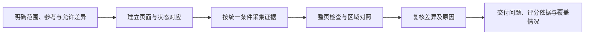

### 第一步：明确对照依据与允许变化

输入包含本轮范围、视觉参考、内容依据、生成要求和实际站点。建议把“必须还原的部分”和“允许变化的部分”写清，不默认所有 Site 任务都逐像素复刻：

| 场景 | 对照口径建议 |
| --- | --- |
| 无独立参考站的迁移 | 内容站兼视觉参考，核对约定内容与设计。 |
| 有独立参考站的升级 | 视觉对照参考站，内容核对内容站 / 资料；不因两站原文不同直接判还原失败。 |
| AI Site 模板 | 按生成要求评设计结构及约定风格；图片占位等既定资源替换单列，不按原图内容机械扣分。 |
| 无视觉参考的资料建站 | 可评设计质量与资料要求完成度，不编造视觉还原基准。 |

redesign 等任务对布局、风格和内容调整的具体允许范围应从委托要求取得；不由评测 AI 擅自把有意改动认定为偏差，也不能自行扩大豁免。若影响评分的关键口径不清，应报告待澄清项。

### 第二步：建立页面 / 状态对应和采集条件

建议先形成“参考页面 / 区域 → 目标页面 / 区域”的对应记录，再开始评分。首页任务包含整个首页，不等同于只检查首屏；全站任务明确实际检查清单，抽样项另记。

视口、浏览器缩放、页面语言、登录 / 弹窗 / 轮播等状态应按 SOP 对齐并记录。用户后续明确 PC 与移动端必须各自比对，具体视口与数量由 Skill 配置，尚未定值。字体、图片与懒加载等取证条件应有等待约定；静态截图可选取可比较的动画阶段，但动态行为仍需另行操作与取证，不能因截图稳定处理而跳过动画检查。动态内容的忽略 / 固定需要留理由，不能用遮罩掩盖真实问题。

只因采集失败或参考不可达而无证据时，标记未验证或阻塞；若有证据表明目标页面真实 404、资源损坏或空白，则记录为实际缺陷，不能混同。浏览器环境与截图工具本轮均不实施。

### 第三步：整页、区域与交互状态取证

建议保留整页截图用于区块顺序、缺漏和整体比例检查，再按对应语义区域提供可读的对照截图，例如页头、主视觉、主体内容和页脚。区域随页面结构识别，不强制所有站点使用固定组件清单，也不只依赖整页缩略图。

区域比较按内容职责对应，不简单按同一滚动坐标硬切。若前面一个区块高度变化导致后续整体位移，应保留整页布局影响，同时区分后续区域内部是否也有独立错误，不把一个原因无条件累计为多个扣分项。

按本轮范围补充菜单展开、移动导航、轮播或其他约定状态的截图 / 操作证据。静态截图对照不自动证明未检查的交互通过。

### 第四步：形成可定位的问题与分项判断

初步检查方向建议包含：区块结构与顺序、布局与尺寸比例、字体与信息层级、颜色与表面样式、图片区域和裁切、移动端适配及约定状态。哪些要求严格对齐、哪些允许 redesign，均以第一步的任务口径为准，具体评分维度与权重尚未确定。

建议每个问题记录页面、视口、区域 / 状态、参考与目标证据、预期与实际差异、影响和严重程度；必要时保存元素尺寸等辅助材料。避免只有“还原度较低”或“整体不错”等无法定位的结论。证据不支持的精确数值不应由 AI 编造。

先记录差异，再判断它是实际缺陷、允许变化还是取证条件不一致。若关键证据不足，不能靠 AI 自信补齐；报告保留未验证项与覆盖限制，不通过删掉难以验证项目来包装完整通过。

### 第五步：复核与校准

对影响显著的扣分先复核对应关系、页面状态和允许变化，必要时重新取证。相同缺陷尽量记录一次，并注明影响范围，不跨多个维度无依据重复扣分。总分按已固定规则由平台计算 / 校验。

助手建议正式使用前，用少量人工已经判断过的对照案例校准，包括明显缺区块、布局偏差、细节差异和按要求替换图片等情形；保留 AI 漏报与误报，调整 SOP / references 后复评。该校准计划是建议，本轮没有执行，也不声称已验证准确率。

### 本轮交付物建议

- 本次范围、对照页面 / 状态与允许变化说明。
- 参考与目标的整页、区域和约定状态证据，附采集条件。
- 有证据引用的问题清单、分项判断与评分依据。
- 已检查、未检查、采集失败和需人工复核的项目。
- 本轮 Skill / 规则及目标证据版本信息。

本节最初为助手草案。用户本轮进一步明确 AI 弹性审核、首页 hero 高权重、按 banner 结构与设计意图检查、动态交互及 PC / 移动分别评测，后续以这些要求修订，见下节。其余没有明确认可的细则仍作为建议；具体 Skill 和实现保持未实施状态。

## 议题十二：以 Banner 设计意图为核心的 Site UI 评测

### 用户本轮明确的六点

1. 本地 AI 审核应比严格的程序比对保留更多弹性。
2. 首页 hero banner 最重要，可以提高评分权重。
3. 按 header、hero、各内容 banner、price banner、footer 等顺序拆解参考页面，检查生成站的对应结构。
4. Banner 级对比应看设计意图，用户要求助手丰富其内容。
5. 轮播、手风琴等动态 / 交互效果需要比较与评分。
6. PC、移动端各自比较。

这些要求已确认。用户随后回复“是的，完全同意，下一步呢”，认可上一轮展示的内容任务、视觉焦点、构图空间、风格氛围、媒体作用、阅读操作引导和动态表达等细化方向，以及 Hero 单列、动态操作取证和两端分别评测。具体分数、权重与工具实现仍待定。

### 本地 AI 为主要裁判，Banner 为语义检查单元

SOP 指导 AI 先理解参考，再看生成结果如何承接。程序可辅助截图、记录操作和计算汇总，但不以一个机械差异指标代替 AI 的审美、结构与语境判断。弹性判断仍需解释依据，不能只说“感觉相近”。

Banner 在本讨论中指一个承担相对完整设计任务的页面区段，header / footer 也作为对应检查单元，不要求代码必须存在同名组件或一模一样的 DOM 容器。先按参考识别结构与顺序，再映射生成区段，报告缺失、顺序变化、内容角色替换或额外区段及其影响。

生成站缺失的参考 banner 仍留在检查清单，不能只对已生成区段打分而忽略缺漏。整页也保留独立观察，用于评判叙事顺序、区段衔接和视觉节奏。是否允许调整或合并区段，依生成任务要求，不由 AI 临时给出未经授权的豁免。

### Banner 设计意图的检查建议

AI 先用简短描述概括观察到的意图，再对照其表达手段是否保留。意图是从页面可见内容、构图与实际交互形成的有依据推断，不声称知道设计者未表达的真实想法。

| 方向 | 建议检查什么 |
| --- | --- |
| 内容任务 | 此区段在介绍产品、解释功能、建立信任、比较价格，还是引导咨询 / 购买；生成区段是否承担同样任务。 |
| 主次与视觉焦点 | 第一眼强调的是标题、产品、数字还是案例；标题、说明、图片和操作的层级是否保留。 |
| 构图与空间关系 | 图文关系、左右 / 居中布局、宽窄与高度比例、留白、叠放及对齐，是否维持关键设计关系。 |
| 视觉语言与氛围 | 字体尺度与字重、色彩、明暗、背景与装饰形式，是否维持参考的风格表达，而非只保留文字。 |
| 图片 / 媒体的设计角色 | 图片是背景、主体、证明材料还是产品演示；区域比例、裁切、遮罩与文案关系是否合适。模板依旧使用占位政策，不要求复用图片内容。 |
| 操作与阅读路径 | CTA 的主次、位置、可见性，以及用户下一步要读什么、做什么，是否得到相应引导。 |
| 动态叙事 | 展开、切换、滚动等行为在揭示什么信息，是否存在相应状态与效果，而不只是一张相似的静态图。 |

例：参考 hero 用大幅产品视觉、克制文案和突出 CTA 建立强烈首屏印象，生成站如果改成小图加普通长文字，即使文本都在，也应说明其视觉焦点、空间关系与首屏表达发生了哪些偏离；不能因大致相同的业务目的就给高还原分。

例：参考价格区强调方案横向比较与一个推荐方案，生成站若变成一段价格介绍，应检查比较关系、推荐层级和操作路径是否丢失。内容齐全与设计意图实现可分别说明。

### 首页 Hero 加权建议

用户已明确提高首页 hero 权重。建议在 PC 和移动端各自的 banner 评分中，都给首页 hero 高于普通区段的权重，并单列它的设计判断、关键问题与证据。具体比例暂不设定，保留在评分规则中自定义。

分数组织可按“端 → 页面 → banner → 设计 / 交互子项”记录；整页结构问题另有可见结论。汇总规则后续确定，避免同一缺失或错误在结构、设计与交互维度中无依据重复扣分。不能因其他普通区段较多而将 hero 的关键缺陷稀释；也不因强调 hero 就不检查其余区段。

### 动画与交互对比建议

| 类型 | 建议观察与取证 |
| --- | --- |
| 轮播 | 初始内容、控制与切换方式、切换后的图文联动；若参考有自动播放或过渡表达则相应观察。 |
| 手风琴 | 初始展开项、展开 / 收起、单开或多开的行为、内容是否完整；配套图片是否随选择变化。 |
| 滚动触发 / 吸附 | 触发位置、进入与离开后的状态、滚动与叙事关系；不能仅靠滚动前截图宣布完成。 |
| 悬停 / 导航状态 | PC 对应反馈与展开行为，以及移动端参考实际采用的触摸方式。 |

每类以参考实际存在的行为为准，不要求所有 banner 都有动画，也不为参考没有的复杂动效额外加还原分。证据可采用操作前 / 后截图、必要的中间状态、操作记录或短录屏，具体采集工具待后续实现。

“切换功能存在”和“动态设计表达是否还原”建议分别说明；过渡方向、速度和节奏等按其对设计的影响判断，不预先要求每一毫秒完全一致。动画是否允许简化仍以生成任务约定为准。无足够动态证据时记未验证，不把静态截图当作动态行为已通过。

### PC 与移动独立审核

PC 参考对 PC 生成站，移动参考对移动生成站，分别识别 banner 结构、hero 构图、内容层级与交互，再输出两端问题和分项判断。移动端可能有不同的图文顺序、裁切、导航和触摸交互，不能把 PC 缩小结果当作移动参考。

建议报告两端结果均保持可见，最终综合分的比例后续配置；一端的重大缺陷不能只在平均分中消失。参考移动版本无法取得时，报告还原证据不足，可另作移动可用性检查，但不能声称移动还原已通过。

本轮不实施技能、截图或动态操作。用户已认可设计意图细化方向，继续讨论权重与具体输出约定，见议题十三。

## 议题十三：Site UI 评分规则与报告结构

### 下一步目标与边界

在已确认的 AI 审核与 Banner 模型上，定义分项如何表达、怎样汇总，以及报告如何区分质量问题和证据不足。用户本轮指定首页 UI 初始权重为 Hero 40%、结构 40%、其他区段 20%，强调可随时修改。其他未明确接受的报告细节和两端汇总比例仍为建议，不将初始比例当作已经通过样本校准的标准。

本节先聚焦首页 UI；不能把首页 Hero 权重直接套给所有内页，也不能用此分数代替全站完整度、SEO 或 App 业务评分。

### 首页初始权重与可修改规则

PC 和移动端各自评分的方向已确认；按 100 分表达及具体汇总方式仍沿用助手建议。首页初始分配按用户本轮意见更新为：

| 部分 | 已指定的初始占比 | 判断内容 |
| --- | --- | --- |
| 整页结构与节奏 | 40% | 区段顺序、衔接及整体阅读节奏。 |
| Hero Banner | 40% | 设计意图、视觉表达、CTA 与实际存在的动态交互。 |
| 其他区段 | 合计 20% | Header、内容 Banner、价格区、Footer 等，各自判断设计表达与交互。 |

此前助手提出“结构 20%、Hero 40%、其他 40%”的候选已被本轮初始比例替代。用户强调具体比例不是重点，可修改性才是明确要求：评分权重应作为可编辑规则，不写死在执行程序中。沿用已认可的按轮固定规则设计，修改用于后续新评测，历史保留实际使用权重；若要按新规则查看旧任务，显式发起复评或另记重新汇总结果，不静默改写原报告。具体编辑入口与生效操作后续定义。

动画与交互放入所属 Banner 的判断，不另建可能重复计分的动画总分。参考没有动画时不因此扣分；参考有动画则不能只凭静态截图给该项通过。

其他区段的分配建议在查看参考并形成范围清单后固定，不看完生成结果再改权重。缺失的参考区段继续保留并按缺失计分，不能把它从清单删除后对剩余区段重新分配全部分值。整页与局部的相同缺陷明确主要计分位置，不无依据重复处罚。

PC 与移动的综合比例可先提出 50% / 50% 候选，保留配置自由度；目前尚未确认。报告始终显示两端及 Hero 分项，综合分不能遮蔽一端的问题。全站评分中的页面权重需另行讨论，不按内页数量直接稀释首页 Hero。

### AI 判断的自由度与约束

AI 根据已固定的任务口径与 references 给分，并说明与证据对应的原因，不要求按像素误差机械计分。可用“基本相符、轻微偏差、明显偏差、严重偏差、缺失 / 不可用”等描述帮助解释，但这些档位及映射分数仍待定义。

每轮固定实际权重与计算用于保证同轮口径清楚，AI 的弹性保留在设计理解与差异影响判断上。用户已明确权重可随时调整，后续可用人工认可的案例校准；不声称当前 Hero 40% / 结构 40% / 其他 20% 或尚未确认的两端各半已经最优。

### 分数、质量结论与执行状态分开

建议报告同时表达：

- 分数：PC、移动、Hero 及 Banner 分项和 UI 综合分。
- 质量结论：本轮范围内是否达到要求、尚有哪些重大问题；具体阈值与必过项待定义。
- 证据覆盖：实际检查的页面、区段和交互；未验证、阻塞及其原因。

执行完成不等于质量通过。参考不可访问、移动证据缺失或动态行为未检查，不能直接伪装成完整评测；可以保留已验证部分的判断，但未完成必要覆盖时，不出具无条件最终通过。证据不足与已经证实的产品缺失要区分，前者不随意作零分，也不通过剔除难项抬高完整通过分数。

是否配置重大问题阻断规则，建议作为独立规则讨论，例如移动端主要操作不可用；目前没有确定阻断清单或通过线。

### 报告结构建议

1. 本次范围、参考与目标、规则版本，以及评测执行是否完成。
2. PC / 移动分项与综合结果，单列首页 Hero。
3. 按端、页面、Banner 定位的证据与问题明细。
4. 重大问题、优先修复建议和未验证项。

平台详情可进一步展开 banner 设计意图和差异理由，概览先帮助操作者看出哪一端、哪个关键区域需要处理。具体界面布局本轮不设计、不实施。

## 议题十四：迁移 / 升级完整度评测

用户最初同意进入完整度讨论；2026-11-07 用户进一步明确“我同意你的结论”，认可上一轮展示的完整度依据、范围、清单核验与结果表达。具体分值与工具实现仍待定。继续只维护讨论文档，不创建任务清单文件、实现工具或执行站点检查。

### 完整度的依据

建议将完整度定义为“本次委托范围内应交付的页面、内容、资源与功能是否得到完整且正确的承接”。依据来自内容站、资料包和本次明确要求；独立参考站主要提供设计，不自动要求迁移其业务内容或功能。

AI 在查看来源资料后自动整理一份可追溯的应交付清单，记录每项来自哪个页面、资料或明确要求；无需用户预先把自由资料改成固定 JSON、目录或表格。优先在生成前整理并保存；若在评测时补建，也先从来源与任务形成清单，再对照生成结果，避免只根据目标站已经做出的内容定义完整范围。

正常情况下按 Skill 规则自动整理；仅在影响交付的来源冲突、无法判断是否在范围内等情况标记待澄清，而非每个站点都要求人工逐项审批。明确不做、允许合并 / 替换的内容需有任务依据和排除理由，不能因实现失败再自行移出清单。

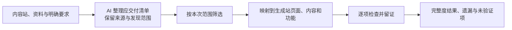

### 范围建议

- 仅首页：核对首页应有的区段、内容、资源及本次要求的功能；未委托的内页另标范围外。导航或 CTA 的处理需遵守首页任务约定，不能默认所有内页都应完成，也不能将当前不存在的目标功能表述成已经可用。
- 全站：核对已约定的全部页面、内容条目、资源和功能；“全站”需要对应实际发现与约定的清单，不能只检查导航入口或用首页观感代替。
- 内页续建：检查新增 / 补齐范围，并检查对已有首页、公共导航和组件的影响。最终若需要全站交付结论，应整合并重新验证最终站点状态，而不是把旧首页分数直接当作当前首页已通过。

### 主要检查维度建议

| 维度 | 建议核对内容 |
| --- | --- |
| 页面与信息架构 | 应有栏目、列表、详情和约定语言版本是否有对应承接；允许合并时检查内容与入口是否仍完整。 |
| 内容条目与事实 | 产品、文章、案例等条目是否齐全；正文、关键参数、价格、联系方式等是否正确，无未授权删减或编造。 |
| 资源与附件 | 本次要求的图片、视频、PDF、下载等是否关联正确且可使用，而非仅有文件名或空占位。 |
| 导航与内容关系 | 栏目到列表、列表到详情、相关内容、分页与链接等是否能实际到达正确对象。 |
| 功能与结果 | 搜索、筛选、表单、下载、切换语言等在本次范围内的功能是否可操作，结果和反馈是否符合要求。 |

页面对应不强制新旧 URL 字符串相同，也不默认一页只能对应一页；允许的重新组织需要可追溯映射。旧 URL 保留与重定向等搜索保护要求由 SEO 维度另行核验，不能因为新页面内容存在就自动认为旧入口已保住。

升级允许按约定重组信息与文案，但关键业务事实、条目和重要资料仍按内容来源及明确要求核验。参考站中的示例产品、联系方式或功能不因视觉参考角色自动成为迁移依据。

### 页面、条目和功能需要分别留证

举例：内容站有 100 个应迁移产品，目标站产品列表能打开却只有 20 条，不能仅以产品页存在判完整；列表齐全但详情为空，也不能判完整。此处数字仅作说明，不是观察到的真实站点结果。

基础清单、条目数量、可达性与资源检查可由工具辅助，本地 AI 负责解释内容对应、判断语义完整性与实际功能结果。全量检查与深入抽查需在报告中分开：不能用几条抽样内容正确推出全部内容均已核验，也不能仅凭 HTTP 成功或页面数相等断言迁移完整。

功能检查需具体到本次承诺结果：表单按钮可点不代表数据已保存，搜索页面存在不代表结果正确。需要提交数据的测试可安排在相应测试环境并保留操作与结果证据；本轮没有执行任何测试或对外提交。历史数据、登录后内容或不可见后台能力是否迁移，以已提供需求和可取证范围为准，不从公开页面臆测全部能力。

### 不完整与未知分开

建议每项保留“已验证完成、部分完成、缺失 / 错误、未验证、按要求排除”的状态，并对应来源、目标和证据。实际检查范围与预期交付范围分别记录。

源站发现 / 采集本身可能存在缺口。克隆或资料包覆盖不等于原站全部内容已发现；来源不可达、分页未覆盖、权限内容不明等需保留缺口，不能把当前已采集清单直接称为完整原站。可以评价“已知且在范围内的项目完成情况”，但仍明确总体覆盖的限制。

建议报告至少分别呈现应交付范围、验证覆盖和实现结果，避免一个完整度百分比掩盖未验证项。已验证缺失需扣到相应项目，未验证则单列；在重要证据不足时，不以重新归一化剩余项目得出全站完整通过。分值权重、重要项是否阻断和具体计算方式后续再定义，继续支持自定义。

### 本轮建议的重点

完整清单由 AI 根据来源与任务自动形成，保留来源和范围；内容站 / 资料与视觉参考职责分开；逐项核对承接结果，实际遗漏与证据缺口分别交付。上述方向已获用户认可。暂不设置固定比例、评分阈值或强制人工审批流程；用户补充动态内容的 Kooboo 实现要求，见议题十五。

## 议题十五：完整度中的 Kooboo 动态内容与实现规范

讨论日期：2026-11-07。

### 用户明确补充的要求

对于 100 个应迁移产品这类动态内容，在 Kooboo 中应表现为动态路由与动态取值，内容数据应存放在 Content / Commerce / Sqlite 等适合该业务的存储中，不能将每个产品各建一个独立 Page 作为等价实现。这是完整度评测的重要审核指标。

按用户归类，将此要求纳入完整度审核中的“Kooboo 实现规范”子项，不因另起讨论章节就视作新增一套独立评分系统。数据存储、路由和取值方式是已确认要求。用户随后回复“是的，可以继续下一步”，认可下述审核与证据方向；具体取证能力、权重和必过项仍待细化，尚未实施。

### 检查建议

| 层面 | 建议核对什么 |
| --- | --- |
| 业务数据 | 本次范围内产品 / 文章等实体是否作为数据记录保存，字段与关联是否满足需求；根据业务选择 Content、Commerce 或 Sqlite，不要求三种存储同时使用。 |
| 动态路由 | 路由是否根据标识找到正确实体，并通过可复用的页面 / 模板承载相应详情。 |
| 动态取值与渲染 | 模板、查询与展示是否实际使用对应数据，避免仅声明数据源却把每个对象内容硬编码在独立 Page 或前端固定数组中。 |
| 关联与维护 | 列表、分类、分页、详情等是否使用一致的实体与关联；维护数据时是否无需逐条新建或修改独立详情 Page。 |
| 数据承接结果 | 条目是否齐全，字段与资源是否正确，不能因存在动态路由就跳过数据完整性核验。 |

100 个产品可以对应 100 条详情访问入口，但不等于应有 100 个独立物理 Page。完整度清单需要区分业务实体 / 可访问入口与底层页面模板数量，不能用“Page 越多越完整”衡量。模板数量可依据业务类型合理复用，不强制整个站点所有实体只能共用一个模板。

动态内容的要求按内容性质与本次范围适用，不把静态介绍页也一律要求动态化；仅首页任务也不能被扩展成必须完成未委托内页的全部数据建设。

### 证据与结论建议

建议评测同时取得：业务数据结构及必要记录证据、路由配置、模板 / 查询与取值片段，以及对应的列表和详情运行证据。静态截图只能说明展示情况，不能单独证明底层实现符合这项要求。

优先讨论利用已有 Kooboo 读取能力或导出资料提供证据，具体哪些可读与如何交给本地 AI 需后续核对；仍遵循不要求 Kooboo 为本系统新增专用接口的边界。无法取得实现证据时标记该子项未验证，不凭前台看起来正确宣布符合规范。

报告建议区分“业务内容已承接”和“Kooboo 实现方式符合要求”。例如 100 个产品均可访问，但实际使用 100 个独立 Page，应记录为内容可见、动态内容实现规范不通过，而不是完整度全部合格。数据记录存在但详情没有正确动态取值，也需指出对应缺陷。

这些要求还应写入相应生成提示词 / Kooboo 规范指引，让生成与评测使用一致的预期。评分权重、是否设必过项、取证工具及维护性验证方式仍待定义；本轮不创建或修改任何数据、路由、模板、Skill 或产品代码。

## 议题十六：SEO 迁移保护与评测阶段

讨论日期：2026-11-07。

### 已确认方向与待细化的边界

已有搜索积累的旧站迁移 / 升级需要 SEO 保护评测。用户随后回复“完全同意”，确认上一轮展示的检查方向与阶段边界：围绕“SEO 迁移就绪检查”收敛，区分预览阶段、正式上线核验与后续搜索表现；不以一次本地评测承诺搜索权重不变，不自动增加长期监控系统。下文保留方案形成时的建议表述；具体工具、计分及本次官方核对后新增的 SOP 细则仍待细化。

首次读取 Google Search Central 官方迁移指南未成功。用户要求再次尝试后，于 2026-11-07 成功获取以下三篇官方页面正文，完成下节所列要点核对；此前未核实状态仅作为历史记录，不再代表当前结果：

- URL 变化的站点迁移：`https://developers.google.com/search/docs/crawling-indexing/site-move-with-url-changes`
- URL 不变的托管迁移：`https://developers.google.com/search/docs/crawling-indexing/site-move-no-url-changes`
- 重定向与 Google 搜索：`https://developers.google.com/search/docs/crawling-indexing/301-redirects`

### 官方正文核对结果与新增建议

以下为官方指南要点的概括，非逐字引用：

| 官方依据 | 已核对要点 |
| --- | --- |
| URL 不变的托管迁移 | 与 URL 变更分开处理；先测试新环境，再切换 DNS 并核对访问。临时测试域名可用 noindex；迁移上线应移除仅供测试的抓取 / 索引限制。 |
| 重定向指南 | 永久地址变更优先使用服务端 301 / 308。 |
| URL 变更指南 | 建立旧新映射，避免跳转链及大量旧入口跳到无关首页；真实内容合并可对应合并页。 |
| URL 变更指南 | 更新 canonical、内部链接与 sitemap；已有多语言标注时同步更新；图片和下载资料也需考虑承接。 |
| URL 变更指南 | 重定向通常至少保留一年；迁移期间搜索排名可能暂时波动。 |
| URL 变更指南 | 建议分步处理域名、CMS 和布局等变化，避免同时改变多项。 |

对本系统的补充建议：根据正式域名 / URL 是否变化选择检查项，不能把临时预览域名当成正式迁移目标，也不能把“换服务商”自动等同于“必须更改 URL”。将重定向维护期限、已有 Search Console 验证文件 / 标记的保留、媒体与多语言适用项纳入后续 SOP 细化。保留期限只能在当次审核中核对维护安排，不能凭一次检查宣称未来一年持续有效。

Google 的分步建议用于减少迁移变量；对于本系统既定的 Kooboo 迁移 / 升级场景，助手建议优先避免额外更换域名与 URL，并将同时变更事项单列。它不是取消升级场景或强制拆成多个生成任务的已确认决定。

这些核对支持已认可的迁移保护方向；本系统的评分比例、必过项和阶段化报告仍属产品决策，不是 Google 给出的评分标准。官方正文核对也不代表具体 Kooboo 路由实现或真实站点已经验收。

### 旧入口承接与动态内容

建议迁移优先保留已有 URL；确需变更时，逐项建立旧入口到对应新内容的映射，并检查适用的永久重定向。动态内容存储 / 路由和旧 URL 保留可同时作为设计要求，不默认将旧 `.aspx`、数字或参数路径全部改成新的 slug 路径。

例如，旧入口 `/product.aspx?id=123` 可作为动态路由的兼容目标，由对应业务数据和复用模板承载产品 123；这是需求示例，不代表已验证当前 Kooboo 对该路径的具体配置。100 个产品入口仍需逐项对应正确产品，底层不应因此变成 100 个独立 Page。

地址变化时，不把所有旧产品 / 文章入口统一跳首页作为合格承接；AI 应判断目标是否为对应内容或经任务允许的合理合并。确实删除且无替代的内容单独记录删除依据与处理方式，不伪造对应关系。

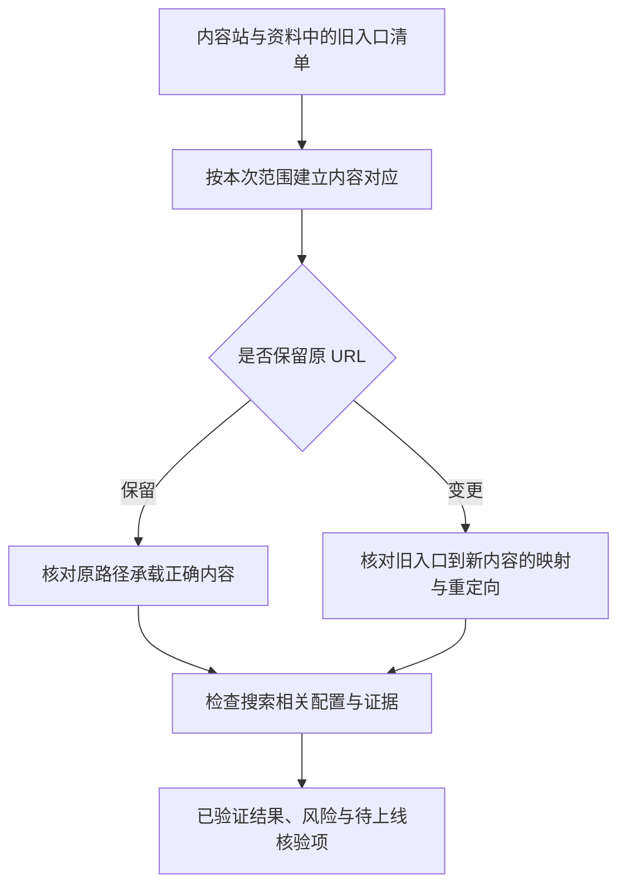

### 基线与检查维度建议

旧入口清单可复用 sitemap、克隆 / 采集记录及外部导入清单；如果已有 Search Console、访问日志或流量资料，可辅助识别重要入口，不把取得这些账号权限作为每次任务的强制前提。没有这些资料不等于没有重要页面。采集未覆盖、来源不可达等缺口继续保留，不能把已发现清单直接称为完整旧站。

| 维度 | 建议核对内容 |
| --- | --- |
| 旧入口与响应 | 保留路径是否落到正确内容；变更路径的重定向是否正确，有无丢失参数、错误目标、循环或不必要的多次跳转。 |
| 内容与搜索信息 | 重要正文、产品事实、页面标题及相关描述是否正确承接；允许按升级目标调整表达，不机械要求文案完全相同。 |
| 链接与地址一致性 | canonical、内部链接和 sitemap 是否与预期正式地址一致；图片、附件等重要入口是否按要求承接，不能误指预览域名或无关内容。 |
| 抓取与索引配置 | 按运行环境核对 robots、noindex、可访问性等配置；预览环境有意禁止索引不直接判生产故障，正式上线的配置需要另行核验。 |
| 迁移覆盖 | 本次范围的旧入口和内容是否都有处理结果；已验证、缺失 / 错误、未验证及按要求排除分别列出。 |

参考站只提供视觉依据；本项以内容站的既有入口与内容为主要迁移依据。Site / App 模板制作不自动承担替来源站保护既有搜索表现的任务。

### 不同阶段的结论建议

| 阶段 | 本轮可以组织的评测 | 结论边界 |
| --- | --- | --- |
| 首页样稿 / 仅首页 | 首页入口、内容、相关配置及约定范围的检查。 | 未委托内页列范围外，不给全站 SEO 迁移通过结论。 |
| 全站预览 / 上线准备 | 对照全站清单检查路由、内容、迁移映射和配置；能够执行的在预览环境留证。 | 旧正式域名的真实响应、正式环境的重定向等尚未生效部分列待上线核验；配置存在不等于运行已通过。 |
| 正式上线后 | 在另行安排的任务中核验真实域名、旧入口响应和最终配置。 | 与预览结果分开记录；本轮未授权执行部署或线上操作。 |
| 后续搜索表现 | 如纳入后续范围，再观察收录、点击、流量等变化。 | 具体周期、数据接入及长期监控职责另行讨论，当前不纳入已确认功能。 |

### 交付与评分建议

建议本地 AI 交付旧入口、对应内容 / 新地址、处理方式、响应及内容证据、问题与未验证项。批量工具辅助检查地址和响应，AI 解释内容映射及场景适用性；若采用抽样，报告必须区分全量覆盖和深入抽查。

SEO 迁移保护作为可独立查看的评价维度，保留重大缺陷，不让首页视觉高分掩盖重要旧入口丢失。具体分值、权重、是否必过以及如何汇总仍支持自定义、待后续确定。本轮没有修改生成提示词、Skill 或产品代码，也没有运行真实站点评测。

## 议题十七：App 的 UI 体验与业务正确性评测

讨论日期：2026-11-07。

### 已确认前提与本轮范围

用户已明确：App 需要同时评测 UI 与业务正确性，UI 侧重布局合理性、信息层级、交互与使用体验，细则应实际运行几个 App 后总结。用户在本节方案展示后回复“可以的”，认可评测骨架，并提出全部讨论完成后实施及验证。下文保留方案形成时的建议表述；具体分值、工具、用例和经验细则仍待细化。本轮只讨论和记录，不运行 App 或浏览器验收。

建议按“用户完成业务任务”的过程组织评测，同时形成 UI 体验与业务正确性两类结论。UI 的审美、视觉一致性仍可评价；若没有指定视觉参考，不凭空增加还原度标准，也不直接套用 Site 首页的 Hero / 结构权重。

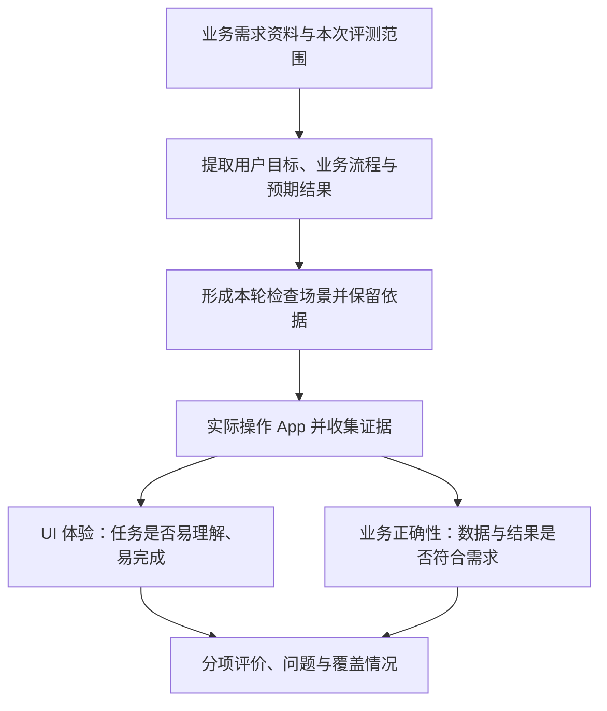

### 从自由需求资料形成检查场景

资源包继续允许自然语言需求、说明、附件等自由形式，不要求操作者预先提供固定字段表、数据库结构、状态枚举或整套测试用例。评测 AI 根据本轮输入版本与范围提取用户目标、业务流程和预期结果，留下对应来源，并保留本轮实际使用的检查场景。

检查场景建议说明“谁在什么情况下，要完成什么任务，预期得到什么结果，如何观察结果”。这是评测时组织证据的方法，不强制将生成资料改成技术规格。已有明确业务规则按原要求验证；对资料含糊之处记录解释或待澄清项，不把 AI 自己补出的具体权限、审批、计算公式或流程当成既定需求扣分。

评测预期首先来自需求和明确约束，不能从生成 App 已有页面或代码反推验收标准，否则遗漏的需求容易一并被遗漏。实现和运行结果用来提供证据。可用性通用建议与明确需求不符的问题分别标明依据；阻碍已明确用户目标的问题，即使没有指定实现方法，也应记录实际影响。

### UI 体验的检查方向建议

| 维度 | 沿任务过程观察什么 |
| --- | --- |
| 信息层级 | 当前对象、关键事实、状态与主要操作是否清楚；详细资料、关联记录和历史是否合理组织。 |
| 页面承载 | 实际信息量和操作是否有足够空间；查看、编辑和对照是否方便，是否反复滚动或切换后仍难理解。 |
| 操作流程 | 是否容易找到入口并完成任务；返回、取消、继续操作时是否保留合理上下文。 |
| 状态与反馈 | 按实际场景检查空数据、加载、成功、失败及输入错误；反馈是否准确，并能指导下一步。 |
| 一致性与可读性 | 术语、常用操作和布局是否一致，信息是否清晰可读；按本次指定设备检查适配，不默认扩张平台支持范围。 |

沿用用户举例：对象信息很多却全部塞进小弹窗，若导致重要信息难找、关联内容难读或编辑困难，应结合具体任务与截图说明影响。弹窗、抽屉或详情页不预设为固定合格 / 不合格形式，重点判断它是否适合实际信息量与工作流。

### 业务正确性的检查方向建议

| 维度 | 建议核对的结果 |
| --- | --- |
| 需求覆盖 | 本次要求的业务能力是否存在并可实际完成，不以菜单或按钮存在作为完成证据。 |
| 关键流程 | 按需求从任务起点走到结果，核对中间操作和最终结果；前置步骤失败时，后续场景标记阻塞或未验证。 |
| 数据与关联 | 按要求保存后，重新打开是否正确；列表、详情、关联对象和已有统计是否与同一业务事实一致。 |
| 业务规则 | 明确的计算、条件、状态变化及权限要求是否生效；只检查适用规则，不替需求创造固定矩阵。 |
| 异常与边界 | 按场景选择空值、无效输入、重复操作、失败处理等；需要验证有用的反馈与正确结果，不先规定所有 App 相同的异常清单。 |

示例仅用于解释方法：如果需求描述了缺陷提交、处理与验证的协作流程，可按“提交问题 → 交给处理人 → 记录处理结果 → 验证结果”的用户任务检查。业务侧核对记录是否保存、关联是否正确，以及需求明确的角色和规则是否生效；UI 侧观察问题描述、处理记录、附件及主要操作是否容易理解和使用。此示例不预先规定数据库、状态名称、权限矩阵或具体页面形式。

当需求要求持久保存时，成功提示只是一部分证据，还应重新进入相应记录检查结果；涉及列表 / 详情或统计联动时，核对相应展示。后台读取可以补强数据及实现证据，但不能代替用户操作体验；缺少读取能力时明确实际可验证到哪一层。

### 范围、证据与结果建议

App 范围除页面外，还应说明本次业务模块 / 流程、适用角色与设备；登录、数据准备等前置依赖单列。执行时需要取得本次测试环境、相应账户和必要数据；缺少条件标为阻塞或未验证，不假装已跑通。测试数据准备和检查场景由 AI 按需求形成的方向继续讨论，不把人工写完所有用例作为使用前提。

每个场景建议保留需求依据、前置条件、实际操作、预期结果、实际结果，以及相关截图 / 动态过程 / 数据证据。UI 问题记录具体位置、操作情境和造成的影响；业务错误记录可复现过程及结果差异。仅有静态截图不足以证明跨步骤业务流程已经完成。

结果可沿用“已验证通过、部分完成、缺失 / 错误、未验证 / 阻塞、按要求排除”的区分，分别呈现范围、实际覆盖和问题。主流程跑通不等于所有规则和边界已经验证；一处错误阻断多项后续检查时，保留阻断关系，不把后续都写成独立已确认缺陷。

UI 与业务分别评分和展示关键问题；总分、汇总比例、必过项和通过阈值仍支持自定义，当前不指定数值。具体体验标准通过后续真实 App 的问题、证据与人工认可案例逐步补入评测 Skill / references；本轮不创建实际 Skill、用例数据或产品代码。

## 议题十八：CPR 界面方向与实施时机

讨论日期：2026-11-07。

### 用户确认

- 认可上一轮 App 评测骨架，之后用实际结果验证规则。
- 全部讨论完成后，可以开始实施；当前继续逐项讨论，不提前进入产品开发，也不在条件满足后重复请求一般性开工确认。
- 自动化系统管理界面沿用 CPR UI。助手询问是否指资源共享站使用的 CPR 界面后，用户回复“两套其实都一样吧？”，因此统一记录为同一套 CPR 视觉体系，不再要求用户选择两种风格。

### 现有实现参照

本轮读取 `/Users/achen/Priv/Yardi/AI-App/resource_sharing/src/css/cpr-theme.css`，文件说明其依据 CPR 参考界面，并包含工作区、侧栏、导航、内容区及常用组件的主题样式。可作为后续界面复用参照；本轮未比对另一 CPR 项目的源代码，不声称两份实现逐行相同，也不因此预先锁定技术框架。

按任务上下文，本要求用于本平台的管理界面。被生成的 Site / App 仍依据各自资料、需求与视觉参考，不统一强制套 CPR。具体平台信息架构和页面布局后续按业务需要设计，保持用户已要求的简洁表达，避免不必要的次级标签和说明。

## 议题十九：评测 Skill 的维护入口与更新生效

讨论日期：2026-11-07。用户随后回复“同意”，确认上一轮展示的维护入口、版本生效与复评方向。以下保留方案形成时的建议表述；具体编辑器、排队任务的版本选择等更细操作策略待实施设计核对。本轮不创建实际 Skill 或编辑产品代码。

### 基于已确认方向进一步收敛

用户已确认 Skill 应能持续更新，并按轮保留当时使用的内容与规则。建议平台提供统一的“评测规则”维护入口，主要编辑 SOP、参考资料 / 案例和评分口径；本地评测 Agent 执行时取得本轮对应的实际 Skill 包。

| 内容 | 建议的维护方式 |
| --- | --- |
| SOP / 指令 | 支持 Markdown 编辑，约定检查步骤、证据要求和输出内容。 |
| references / 案例 | 支持添加或更新说明、截图及人工认可的案例，保留附件和关联。 |
| 评分规则 | 支持修改维度、适用条件、权重与必过项；界面中的修改必须进入本轮实际执行和汇总口径。 |
| 取证 / 检查工具 | 可随包记录调用说明与工具版本；工具实现由开发维护，区分资料 / 规则更新和可执行工具变更，不将任意代码在线编辑作为首版必需功能。 |

先围绕统一的评测 Skill 包组织 Site / App 及范围差异，不要求操作者额外管理大量相互独立的模板实体。实际目录 / 存储方式、执行器加载方法与接口留到实施设计核对。

### 保存、启用和评测快照

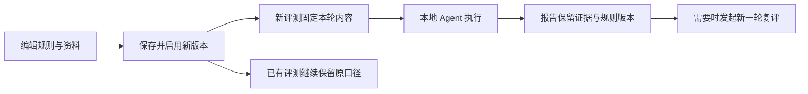

建议编辑中的内容先保存为草稿，使用一个“保存并启用”动作产生可供新评测使用的版本，不设置额外的人工审批流程。固定内容需覆盖实际 SOP、references 附件、评分规则及工具版本信息，不能只保留一个指向可变内容的名称或版本号。

沿用此前按评测开始固定内容的方向：尚未开始的排队任务，在开始时记录实际启用版本；已开始的评测继续使用其快照。若以后需要提交任务时指定某版本，再补充该选项，当前不默认增加选择负担。

新版本用于后续评测；进行中的评测和历史报告保留原口径。复评创建新的评测记录，保留旧报告和各自使用的版本。规则更新无需重新生成站点；结果与证据依然对应实际接受评测的站点状态，若站点已变化不能称为同一状态的单纯换规则复评。

### 规则与执行的一致性

建议启用前做必要的一致性校验，例如评分项标识不冲突、权重和适用条件可计算、引用资料可读取。平台从同一版本生成 Agent 使用的评分说明和结果汇总定义，避免界面显示的权重与实际计分不一致。SOP 与结构化规则冲突时提示修正，不静默选择其中一套。

更新使用内容的入口、版本状态和结果留存是本轮讨论重点；首版具体编辑器、文件格式、权限细节和界面布局尚未确定。

## 议题二十：评测报告、开放 API、跟进与复评的衔接

讨论日期：2026-11-07。用户随后回复“是的”，认可上一轮展示的报告与跟进方向，并明确补充报告开放 API 的要求。以下保留方案形成时的建议表述；API 的具体查询方式、协议字段与鉴权方案仍待细化，未实施接口或对外开放服务。

### 已确认边界

评分平台组织和留存结果，外部 AI / 人工决定如何跟进，Kooboo AI Chat 执行生成与修复。系统不因评测出现问题就自行决定补充消息、无限修复或改变任务范围；跟进执行仍进入原有并发调度。Skill 更新与复评保留历史的方向已获认可。

### 报告内容建议

沿用同一份结果数据支持平台报告、外部 Admin 和外部 AI 读取，保持各渠道范围与结论一致。报告开放 API 为用户明确要求；具体接口和存储格式后续定义，本轮不规定正式 schema。

| 内容 | 帮助阅读者判断什么 |
| --- | --- |
| 任务与范围 | 对应资源输入版本、目标站、生成 / 跟进记录、本次首页 / 全站 / 模块范围与取证时间。 |
| 执行状态 | 排队、执行中、正常结束或异常中断等运行情况；不能用执行结束代替质量通过。 |
| 质量与评分 | 适用维度的分项评分、依据和重要问题；满足已配置条件时才给相应通过结论，未配置阈值时不自行编造。 |
| 验证覆盖 | 应检查、实际已检查、未验证 / 阻塞和范围外项目，说明结论覆盖到哪里。 |
| 问题与证据 | 页面 / 区段 / 业务场景、预期与实际差异、影响、证据与必要复现步骤。 |
| 本轮口径 | 实际采用的 Skill、评分规则、模型及工具版本，关联本轮已保存的资料和证据。 |

报告按场景展示适用维度，不强制 App 报告也出现 Site 的 Hero / SEO 空栏目。概览优先呈现本次范围、执行情况、分项结果与重要问题；详情展开具体理由和证据，不靠大量次级标签重复描述。

问题建议具备足够上下文：发生在哪里、应是什么、实际是什么、造成什么影响、证据在哪里。Site 可定位 PC / 移动、页面和 Banner；App 可定位角色、业务场景和操作步骤。若只有建议性改善或证据不足，需与已确认缺陷分开。

### 面向外部 Admin 的报告 API

用户明确要求：即使同事不迁入本系统，也能通过 API 获取所需信息并在自己的 Admin 中使用。结合此前已确认的外部资料导入 / 接入，形成“外部输入 → 本系统生成与评测 → 外部查询结果”的对接关系。外部输入的文件导入与 API 接入优先级仍未定，不把报告查询要求自动解释成已确定写入接口协议。

建议支持以下读取能力，具体拆成几个接口由实施设计确定：

| 能力 | 建议提供的信息 |
| --- | --- |
| 关联查询 | 根据外部来源标识与来源记录 ID，找到对应基线、生成记录 / 目标站和评测记录；也可按本系统返回的稳定 ID 查询。 |
| 状态与摘要 | 任务执行进度、是否已有报告、评测范围、分项得分、重要问题与未验证情况。 |
| 完整结果 | 指定一轮评测的评分、理由、问题、覆盖清单、本轮规则与版本信息。 |
| 证据访问 | 可访问的截图、动态过程、附件及其他证据引用；不返回仅本地执行机器可用的文件路径作为外部下载入口。 |
| 历史记录 | 列出同一来源下各生成站及其多轮评测，能取得指定历史报告。 |

沿用已确认的一对多关系：外部一条资源记录可能对应多个生成站，每个站又有多轮评测。建议先取得生成记录列表，再选具体评测，不把“最新报告”默认解释为唯一结果；如提供最新摘要，需要明确它对应的目标站、范围和评测轮次。

报告尚未生成、评测中断或暂时没有分数时，API 应如实提供状态与已取得的信息，不以零分 / 空报告伪装成完成。评分维度沿用本轮实际规则，以可扩展结果提供，避免外部 Admin 只能接收写死的固定评分项。

建议首版以主动查询作为必要读取路径；批量 / 分页等按实际任务规模设计，完成回调作为可选后续能力，不将 Webhook 作为这次需求的默认新增项。访问凭证控制可查询的来源 / 任务范围，证据读取使用相同的访问边界；具体鉴权形式待定，本轮不创建凭证或开放网络服务。

报告读取 API 与提交跟进、重试等控制操作分别定义；开放报告读取不意味着所有调用方自动取得改站或执行任务的能力。报告在平台、外部 Admin 与外部 AI 中使用同一实际记录，不另做一套分数或改变历史口径。

### 跟进流程建议

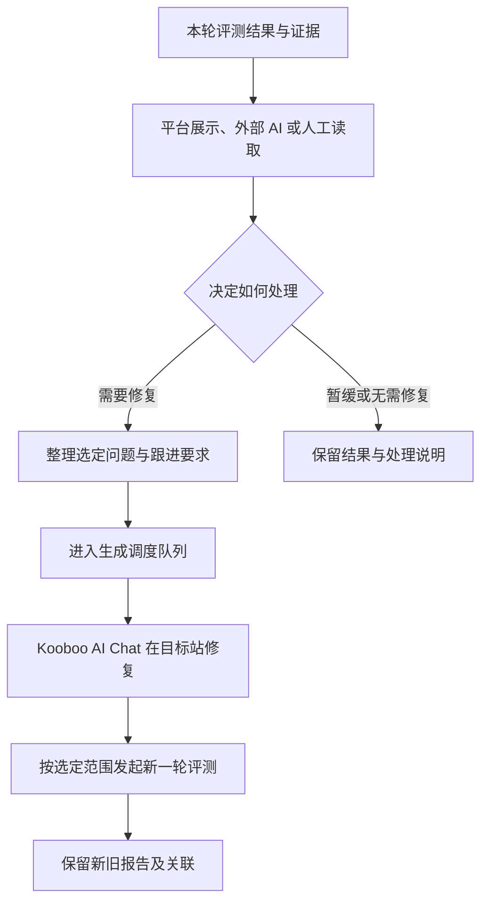

系统可以按已选择的问题整理来源要求、证据、目标站与会话上下文，供外部 AI / 人工补充或提交跟进；这属于确定性的信息组织，不新增内置智能决策器。默认围绕选定已有站处理，保持原任务约束，具体会话继续方式利用既有能力并待实施时核对，不要求 Kooboo 新增专用接口。

未验证 / 阻塞项需按原因处理：缺评测材料或取证失败时可以补材料 / 重跑评测，只有确需改站的情况才交给生成侧修复。质量问题、生成 pending 与评测执行异常分开记录，不把它们混成一个状态。

### 复评与历史建议

修复后新建评测记录，关联触发跟进的报告与选定问题。可以检查相关修复项并覆盖必要回归范围；如果只做局部复评，则只给该范围的结论，不自动升级为全站通过。修复方表示完成只记录执行结果，问题是否已解决由新证据核验。

旧报告与原始发现保留，处理说明和后续验证附加关联，避免覆盖原始证据；跨轮问题对应可帮助查看修复进展，不将完整的问题工单系统作为本轮必需设计。

每份报告代表该轮实际取证时的站点状态。建议同站生成 / 修复与评测取证避免交叉，先按串行组织；如果取证期间站点变化，应标明并重新采集受影响证据。无需把“评测留存”扩大成每轮复制整个站点的已确认要求。

外部 AI 的主动查询 / 通知、具体控制接口、修复后评测是否按操作自动衔接及各类预算限制后续细化。本轮不连接外部 bot、不发送通知、不执行修复或真实评测。

## 议题二十一：首版运行位置

讨论日期：2026-11-07。

用户明确选择先在当前开发机跑通。助手据此建议首版在同一台机器运行平台服务、受系统管理的生成浏览器和本地评测 Agent，任务、报告与证据持久保存；逻辑职责分开，暂不增加分布式执行节点或让同事各自安装执行环境。

本地评测仍沿用已确认的 Codex SDK / Agent 选型。本轮核对 OpenAI 官方 SDK 文档，说明其可控制本地 Codex Agent；不据此声称本项目已经集成或验证 DeepSeek 端点。官方依据：`https://learn.chatgpt.com/docs/codex-sdk`。

当前开发机方案用于跑通和验证。外部 Admin 调用 API 时需要双方可达的访问地址，具体联调网络方式在实际环境确定；本轮不公开端口或部署公网服务。后续迁往常驻机器时保留既定输入、任务、报告与 API 的关系。

用户随后要求优先确认前端页面并加快收敛；其余常规部署与进程管理细节由实施阶段处理，不另开多轮产品讨论。

## 议题二十二：首版前端页面与操作范围（已确认）

讨论日期：2026-11-07。用户确认五个页面方案，并补充下述 UI 要求；本轮开始实施。

### 总体布局

沿用 CPR 的侧栏、内容区和表单 / 列表风格；默认进入任务中心。首版保留五个主入口，资源、任务、报告之间互相关联。生成站放在资源详情中，以体现资源基线一对多关系；先不单独增加仪表盘或重复的生成站导航。

交互示意文件：`/Users/achen/.codex/visualizations/2026/11/06/01a1b017-8429-7b31-b8e9-12da959bbec2/automation-pages.html`。其中业务名称、状态和分数均为演示数据，不代表实际任务或评测结果；没有进行浏览器验收。

| 主页面 | 主要内容与操作 |
| --- | --- |
| 资源库 | 录入 / 导入自由资料包、内容站与参考站、需求说明和外部来源；资源列表支持选择后发起单个或批量生成。详情包含资料 / 输入版本、多个生成站和历史；可重做、选已有站续建或发起评测。 |
| 任务中心 | 默认工作入口，分生成任务与评测任务，展示排队、执行、pending 与异常；任务详情包含范围、目标站、委托消息、执行过程、最近会话和错误上下文，可提交跟进、重试、取消并进入关联报告。 |
| 评测报告 | 列表按站点、范围和评测轮次识别；详情展示适用分项、质量问题、未验证 / 覆盖情况、证据和规则版本，支持准备跟进与发起复评，保留历史。 |
| 评测规则 | 编辑 SOP、评分维度 / 权重 / 适用条件 / 必过项、参考资料与案例；保存并启用版本，查看版本历史，按既定快照规则用于评测。 |
| 系统设置 | Kooboo 连接、评测模型与服务端点 / 凭证、生成与评测并发、五类场景提示词、外部 API 来源 / 凭证与接口说明；运行状态和连接是否就绪可见。 |

### 主要子页面 / 流程

- 资源详情：资料与输入、生成站、版本历史分栏 / 页签组织，复杂内容有完整详情空间。
- 新建 / 编辑资源：自由说明、文件资料、可选内容站 / 参考站与外部标识，保存新输入版本。
- 创建生成任务：选择一个或多个资源、场景、当前输入版本、生成范围、Kooboo 目标环境并补充要求；提交前可查看最终委托消息。首次 / 重做建立新站，续建需选择已有生成站。
- 任务详情与跟进：执行上下文、pending 原因和操作入口集中呈现；提交后仍受调度限制，不由管理页面本身承担长时执行循环。
- 报告详情：按 Site / App 展示适用维度；问题定位、证据与操作过程、规则版本和多轮历史可展开，实际分值与状态来自真实记录。

设置中的场景提示词用于组织最终消息，不重新引入用户此前不理解且已简化的独立“生成方案”选择层。模型沿用 `deepseek-flash-1017`，已有连接配置在实施时优先复用；缺少必要连接条件时显示待配置，不假称实际执行已通过。

本轮页面确认后，按用户此前授权衔接实施并验证；实施组织、目录、接口具体字段与常规组件实现由助手检查现有代码后决定。实际验收区分静态 / 自动化检查、真实 Kooboo 生成与真实模型评测；验证前不以示意界面表示系统已经可用。

## 其余事项：实施时核对

- Site 与 AI App 的具体页面 / 业务覆盖范围及验收细则；App 评测骨架已认可，后续用真实案例细化。
- 评测 Skill、自定义 SOP、案例与评分规则的具体内容；维护入口与更新生效方向已确认，实际格式和操作细节待实施设计核对。
- 报告与跟进、复评方向及报告读取能力已确认；具体接口和数据格式见议题二十，实施时细化。
- 统一自动化系统内部模块、外部 Admin 与 Kooboo 之间的具体接口，以及现有插件的过渡安排；职责边界按议题三。
- 首版已确定先在当前开发机跑通；常规运行与部署细节实施时处理，后续常驻部署另行安排。

上一轮助手提出过共用平台、分开评测模板、区分 SOP / 案例 / 评分规则等建议；尚未逐项讨论或确认，不作为既定设计。

## 本轮外部依据

核对日期：2026-11-06。Codex 依据 OpenAI 官方文档；DeepSeek 依据其官方 API 文档与官方开源项目；OpenCode 依据其自身文档。不将某个执行器的能力推广到其他工具。

- Codex as a platform：说明 harness 与模型响应的区别，以及程序可复用 Codex 执行系统。`https://developers.openai.com/blog/codex-as-a-platform`
- Codex SDK：说明程序化启动、继续和恢复本地 Codex Agent 会话。`https://learn.chatgpt.com/docs/codex-sdk`
- Build skills：说明 skill 可包含指令、参考资料、脚本和依赖信息。`https://learn.chatgpt.com/docs/build-skills`
- Non-interactive mode：说明 CLI 可提供执行事件流和受 schema 约束的最终输出。`https://learn.chatgpt.com/docs/non-interactive-mode`
- Codex 配置参考：自定义 provider 及 Responses 协议。`https://developers.openai.com/codex/config-reference/`
- DeepSeek 接入 Codex：原生 Responses 支持、模型目录、provider 配置与输入模态。`https://api-docs.deepseek.com/quick_start/agent_integrations/codex/`
- DeepSeek Responses API：Codex 接入与图片消息。`https://api-docs.deepseek.com/guides/responses_api/`
- DeepSeek Vision：`deepseek-flash` 的图片输入能力。`https://api-docs.deepseek.com/guides/vision/`
- OpenCode SDK：程序化控制本地 server、会话和结构化输出。`https://opencode.ai/docs/sdk/`
- OpenCode Providers：DeepSeek 接入。`https://opencode.ai/docs/providers/`
- OpenCode Skills：SKILL.md 发现与加载。`https://opencode.ai/docs/skills/`
- DeepSeek Harness 官方 README：项目归属与 developer preview 状态。`https://github.com/deepseek-ai/deepseek-harness`
- DeepSeek Harness Python SDK：控制运行时与会话。`https://deepseek-harness.github.io/deepseek-harness/en/guide/python-sdk`

官方文档说明产品提供的接口与机制，不构成本项目已完成集成或能力优于现有实现的验证。

## 决策与结果日志

| 日期 | 项目 | 状态 | 记录 |
| --- | --- | --- | --- |
| 2026-11-06 | 维护讨论文档 | 已确认并完成 | 创建本文，后续继续更新讨论、决策和结果。 |
| 2026-11-06 | 当前工作范围 | 已确认 | 只讨论；除本文外不实施，不运行评测实验。 |
| 2026-11-06 | Site / AI App、自定义 SOP 与规则 | 已确认的需求 | 具体设计后续逐项讨论。 |
| 2026-11-06 | 复用完整 Agent harness | 已确认 | 本阶段通过 Codex SDK 控制本地 Codex Agent。 |
| 2026-11-06 | 相比现有方案的能力提升 | 待验证 | 本轮完成概念澄清，没有运行对照评测。 |
| 2026-11-06 | 主力模型 | 已确认 | 使用 `deepseek-flash-1017`；用户明确确认其识图能力。服务端点后续讨论。 |
| 2026-11-06 | Codex SDK + DeepSeek | 选型已确认，尚未实施 | 用户决定先采用 Codex SDK；官方接入路径已核对，本项目集成尚未执行。 |
| 2026-11-06 | 其他 harness 候选 | 保留历史比较 | 本阶段不继续展开 OpenCode SDK 与 DeepSeek Harness 选型。 |
| 2026-11-06 | 定制逻辑归属 | 已确认的边界 | 自动化系统承担内部批量定制逻辑，不要求 Kooboo 新增专用入口、接口或后台生成任务能力。 |
| 2026-11-06 | Kooboo 完整后台任务接口路线 | 用户明确否定 | 从当前方案中排除，继续围绕既有 API 与 AI Chat 页面讨论。 |
| 2026-11-06 | 统一自动化系统 | 当前讨论方向 | 统一操作界面与后台，生成、评测、证据与报告作为内部模块；插件形式不是必需。 |
| 2026-11-06 | 生成与评测分工 | 已确认的边界 | Kooboo AI Chat 负责生成，Codex SDK 控制的 Agent 负责评测；并发、登录、恢复与人工接管在自动化系统侧设计。 |
| 2026-11-06 | 侧边会话结论入档 | 已补录 | 依据已转交主会话的侧边讨论结果补齐议题三；未实施代码或配置变更。 |
| 2026-11-06 | 图表沟通 | 已确认 | 后续继续使用流程图与对照表讨论系统。 |
| 2026-11-06 | 资源包作为源头 | 已确认 | 承接原 Admin 侧输入，可包含文件、内容站 URL、参考站 URL 和 App 需求资料。 |
| 2026-11-06 | 五类任务场景 | 已记录用户需求 | 资料建站、站点迁移、旧站升级、AI Site 模板、AI App 模板；具体执行及评测细则待讨论。 |
| 2026-11-06 | AI Site 模板规模 | 已记录用户目标 | 收集约 500–1000+ 个参考站 URL，丰富 Kooboo 模板市场。 |
| 2026-11-06 | 资源包与任务的关系 | 基本认可 | Admin 基线对应多个生成站，输入版本与生成 / 评测记录分开；具体字段后续细化。 |
| 2026-11-06 | 克隆输入与最终产物的关系 | 已纠正并补充 | 所有场景首次建站均从空白目标站开始；后续新增首页后续建需求，不再把每次生成执行都解释为重新建空站。 |
| 2026-11-06 | 内容站 / 参考站术语 | 已确认 | 统一以“内容站”替代此前“原站”；同一站点可同时承担内容与视觉参考角色。 |
| 2026-11-06 | 有独立参考站的迁移 | 已确认的流程 | 属于旧站升级：空白起点后克隆内容站、导入资料包，再在 Sandbox 克隆参考站。 |
| 2026-11-06 | 无独立参考站的迁移 | 已确认的方向 | 内容站同时作为参考站，可直接克隆到 Sandbox，避免原克隆代码清理步骤。 |
| 2026-11-06 | AI Site 模板资源使用 | 已确认的约束 | 来源站同时充当内容站和参考站，可直接克隆到 Sandbox；最终模板不得复用参考站资源，图片使用 `imagePlaceholder`。 |
| 2026-11-06 | 模板还原度评分口径 | 助手建议 | 按要求替换图片不直接判失败，设计结构还原与资源替换分别检查；具体细则未确定。 |
| 2026-11-06 | 分支流程复核 | 用户明确确认 | 用户回复“理解完全正确”，确认空白起点、内容站 / 参考站角色、三条路径与模板资源限制；评分及 SOP 细则后续讨论。 |
| 2026-11-06 | 外部 Admin 接入 | 已确认的需求 | 保留外部数据导入或接入能力，同事不必迁入本系统 Admin。 |
| 2026-11-06 | 基线与生成站 | 已确认的需求 | 一条 Admin 基线可对应多个生成站，支持重做和不同尝试；A/B 比较不是核心要求。 |
| 2026-11-06 | 资料包自由度 | 已确认的要求 | 允许较大自由空间；目录、说明与附件规则的具体设计待讨论。 |
| 2026-11-06 | Admin 逻辑模型 | 用户基本认可 | 资源基线、输入版本、生成记录和评测记录分开，附带外部来源映射；具体字段与协议留待细化。 |
| 2026-11-06 | A/B 比较优先级 | 用户明确澄清 | 核心是允许基线对应多个生成站，当前不将 A/B 比较作为核心功能要求。 |
| 2026-11-06 | 转入生成执行模块 | 开始讨论 | Admin 概念方向可先收敛，继续讨论原插件侧功能；模块细则尚未确认，不实施。 |
| 2026-11-06 | 场景差异化生成 | 已确认的需求 | 不同场景使用不同的 prompt、skill 与约束。 |
| 2026-11-06 | 生成要求自定义 | 已确认并澄清 | 像评测 SOP 一样支持自定义；最终预期组织为一段 message，复用 Kooboo 能力。助手建议简化方案层，具体界面待讨论。 |
| 2026-11-06 | 新增场景 | 后续扩展，当前暂缓 | 先覆盖已确定的五类场景，不将新增场景编辑能力纳入当前必需范围。 |
| 2026-11-06 | 生成侧能力归属 | 用户明确澄清 | Kooboo 已有 skill、reference 和 tools，自动化侧主要组织任务要求、委托并追踪，无需另建同类体系。 |
| 2026-11-06 | 生成执行粒度 | 已确认 | 正常采用一次委托，提示词尽量要求不要反问、自主完成；偏离预期时需要追踪与跟进。 |
| 2026-11-06 | 跟进职责 | 用户进一步澄清 | 系统记录与暴露状态，由 Grok bot 或其他外部 AI 监看并跟进；通知或主动发现的方式待选择，不要求系统内置复杂智能跟进。 |
| 2026-11-06 | 迁移 / 升级仅首页 | 已确认的需求 | 支持先批量翻新首页，成单后继续生成其他页面，控制未成单投入；模板场景暂不要求该模式。 |
| 2026-11-06 | 首页后续建模型 | 用户同意设计方向 | 本次范围与最终目标分开，在选定已有站续建，保留多次执行与评测，具体字段及规则待定义。 |
| 2026-11-06 | 生成成本口径 | 用户明确纠正 | 资料准备与克隆零成本，成本是 Kooboo AI 执行生成消耗的 token；撤回缩小克隆范围以省成本的建议。 |
| 2026-11-06 | 并发与队列 | 已确认的需求 | 上限内执行，超额自动排队，空位出现后自动执行下一项；10 个任务 / 并发 3 为用户示例。 |
| 2026-11-06 | pending 与名额、跟进调度 | 用户明确确认流程 | 确认停下等待的任务释放名额，外部 AI 跟进重新受同一并发上限调度；具体状态判定与入口实现待定义。 |
| 2026-11-06 | 生成执行流程收敛 | 用户明确确认 | 用户回复“是的，完全同意，现在这样的流程设计没有问题”；批量提交 → 限流排队 → 一次委托 → 状态留痕 → 暴露 pending → 接受跟进 → 交接评测，作为后续讨论基准。 |
| 2026-11-06 | 转入评分平台讨论 | 已开始 | 用户提出范围、本地 AI 按 SOP 执行、材料证据、Site / App 差异、完整度与 SEO、可更新 Skill 七项要求。 |
| 2026-11-06 | 本次评测范围 | 已确认的需求 | 评测和生成一样设定范围，支持仅首页与全部；具体页面 / 功能清单及续建口径待细化。 |
| 2026-11-06 | 本地 AI 评测交付 | 用户认可设计方向 | 按 SOP 提供或收集材料证据，交付评分、问题与未验证项；平台校验汇总，具体格式待定。 |
| 2026-11-06 | Site 与 App 重点 | 已确认的需求 | Site 重视 UI 还原评判准确性；App 重视信息层级、交互体验及业务正确性，需用真实 App 总结规则。 |
| 2026-11-06 | 成单后的完整度 | 已确认的重要要求 | 迁移 / 升级进入完整交付阶段，页面、内容和相应功能的完整度重要；具体标准待定。 |
| 2026-11-06 | SEO 迁移保护 | 用户认可设计方向 | 保护旧站搜索积累，区分上线前技术检查和上线后效果观察；不能由一次评测保证权重不变，长期观察的具体平台职责仍待定。 |
| 2026-11-06 | 可持续更新的评测 Skill | 用户认可设计方向 | 包含 SOP、references 与可封装工具，按轮保留实际内容 / 版本；维护位置与格式待定。 |
| 2026-11-06 | 评分平台总体方向 | 用户明确认可 | 用户表示理解、结论、建议没有问题，同意继续下一步；评分平台职责与证据方案作为后续讨论基准，未实施。 |
| 2026-11-06 | Site UI 还原度 SOP | 助手新建议 | 明确依据与允许变化 → 页面 / 状态对应 → 统一取证 → 整页与区域对照 → 差异复核 → 评分依据及覆盖交付；细则尚未确认。 |
| 2026-11-06 | Site UI 审核方式 | 用户明确要求 | 本地 AI 理解与弹性审核为主，程序辅助取证与汇总，不用死板比对替代判断。 |
| 2026-11-06 | 首页 Hero 权重 | 用户明确要求并指定初始值 | 首页 hero 重要，初始占 40%；整体结构 40%，其他区段合计 20%，均需支持修改。 |
| 2026-11-06 | Banner 结构与意图 | 用户认可细化方向 | 按参考 banner 的语义结构与顺序比对，考察内容任务、视觉焦点、构图空间、风格氛围、媒体作用、阅读操作和动态表达；具体权重待定。 |
| 2026-11-06 | 动态与交互还原 | 用户明确要求 | 将轮播、手风琴等实际效果纳入对比评分，取证方法与具体标准待细化。 |
| 2026-11-06 | PC / 移动独立对照 | 用户明确要求 | 两端各自对照参考、分别检查；具体视口与汇总比例待定。 |
| 2026-11-06 | Banner 评测方案收敛 | 用户明确认可 | 用户回复“是的，完全同意，下一步呢”；上一轮细化的设计意图、Hero 单列、动态与两端审核作为后续基准，未实施。 |
| 2026-11-06 | Site 首页 UI 初始权重 | 用户明确指定 | Hero 40%、结构 40%、其他区段合计 20%，替代此前助手候选；比例可随时修改，PC / 移动汇总比例仍待确认。 |
| 2026-11-06 | 评分报告结构 | 助手新建议，未确认 | 分数、质量结论、执行状态与证据覆盖分开表达，重大问题和未验证项可见；阈值、必过项与界面待定。 |
| 2026-11-06 | 权重可修改性 | 用户明确要求 | 权重可随时修改，具体比例不是重点；沿用每轮保留实际规则口径的已认可方向，编辑入口待定。 |
| 2026-11-06 | 转入迁移 / 升级完整度 | 用户同意继续讨论 | 围绕内容站、资料与本次范围形成应交付清单，再核验页面、内容、资源、导航和功能；具体流程均为本轮助手建议，未实施。 |
| 2026-11-07 | 完整度评测方向 | 用户明确认可 | 同意上一轮完整度依据、范围与核验结论；应交付清单、实际完成、遗漏与未验证项分别留存，具体分值待定。 |
| 2026-11-07 | 动态内容的 Kooboo 实现 | 用户明确要求 | 采用动态路由与动态取值，数据存放于 Content / Commerce / Sqlite 等适用存储；不能以每个产品一个独立 Page 的方式冒充合格动态内容迁移。 |
| 2026-11-07 | 实现规范的取证与计分 | 助手建议，待细化 | 完整度中单列数据、路由、取值与关联证据；缺实现证据标记未验证。权重、必过项和读取方式尚未确定，未实施。 |
| 2026-11-07 | 动态内容审核方向收敛 | 用户认可 | 用户回复“是的，可以继续下一步”，认可完整度中的实现规范及证据方向；具体工具、权重和必过项继续待定。 |
| 2026-11-07 | SEO 迁移检查方案 | 助手新建议，未确认 | 优先保留旧 URL，必要变更按内容映射检查重定向；结合内容与相关配置留证，区分首页、全站预览和上线核验；长期搜索观察职责另定。本轮未取得官方页面正文，未运行真实评测。 |
| 2026-11-07 | SEO 迁移方案确认 | 用户明确认可 | 用户回复“完全同意”，确认上一轮展示的 SEO 方案、范围与阶段边界；具体计分、工具及长期观察职责仍待细化。 |
| 2026-11-07 | Google 官方指南重试 | 已取得正文并核对 | 成功读取 URL 变更、URL 不变托管迁移及重定向三份指南；补录 301 / 308、通常至少一年重定向、测试限制移除等依据。新增 SOP 细则为后续建议，未实施产品或运行真实评测。 |
| 2026-11-07 | 转入 App 评测 | 用户同意继续讨论 | SEO 官方依据补录后，用户同意继续下一步；本轮讨论 App 的 UI 体验与业务正确性。 |
| 2026-11-07 | App 评测骨架 | 助手新建议，未确认 | 从自由业务需求与范围提取用户任务和预期结果，实际操作后分别评价 UI 与业务，保留依据、证据、覆盖和阻塞；不预设实现结构，具体权重和细则待定，未运行真实 App。 |
| 2026-11-07 | App 评测骨架确认 | 用户认可 | 用户回复“可以的”，同意方案并希望后续实际验证；具体权重、工具和经验细则仍待细化。 |
| 2026-11-07 | 实施时机 | 用户明确授权 | 全部讨论完成后开始实施及验证；当前继续讨论，条件满足后无需重复询问一般性开工许可。 |
| 2026-11-07 | 平台 UI 方向 | 用户明确要求 | 沿用 CPR UI；用户认为提及的两套 UI 同一方向，统一记录，资源共享站现有主题可作复用参照。要求作用于管理平台，不扩展为所有生成产物的统一风格。 |
| 2026-11-07 | Skill 维护与更新生效 | 助手新建议，未确认 | 平台维护 SOP、资料和评分口径，保存并启用版本，新评测开始时固定内容；已有评测与报告保留原口径，复评新建记录，工具实现变更另行维护。 |
| 2026-11-07 | Skill 维护方向确认 | 用户明确同意 | 平台维护 SOP、资料与评分口径；工具实现由开发维护；启用版本与按轮固定内容、历史保留、复评新建记录的方向已确认，具体编辑器和操作细节仍待核对。 |
| 2026-11-07 | 报告、跟进与复评 | 助手新建议，未确认 | 报告区分执行、质量和覆盖，并提供问题证据；外部 AI / 人工决定补材料、重评或修复，改站仍经生成调度，新轮评测保留历史与范围；不建设内置无限修复循环，未实施。 |
| 2026-11-07 | 报告与跟进方向确认 | 用户认可 | 用户回复“是的”，同意上一轮展示的报告、外部跟进及新轮复评方向，保留实际范围和历史证据。 |
| 2026-11-07 | 报告开放 API | 用户明确要求 | 同事继续使用自己的 Admin，通过 API 获取所需报告信息，无需迁入本系统界面。建议支持来源关联、状态、完整报告、证据与历史读取；具体能力划分、字段与鉴权待细化，未实施。 |
| 2026-11-07 | 报告 API 读取能力 | 用户确认方向 | 用户回复“同意，下一步呢”，认可来源关联、状态、完整报告、证据和多站多轮历史读取，具体协议字段与鉴权待实施。 |
| 2026-11-07 | 首版运行位置 | 用户明确选择 | 先在当前开发机跑通，不先要求专用服务器。 |
| 2026-11-07 | 讨论加速与页面确认 | 用户明确要求 | 休息前优先确认具体前端页面，然后准备实施；常规技术实现由助手按已确认需求处理。 |
| 2026-11-07 | 五个主页面方案 | 助手方案，待本轮确认 | 资源库、任务中心、评测报告、评测规则、系统设置；生成站与版本历史位于资源详情，创建 / 跟进与报告为关联子页面。已制作交互示意，未实施产品。 |

## 议题二十三：页面确认与实施细节

确认日期：2026-11-07。

- 五个主页面及主要子流程已获确认，按 CPR 风格实施。
- 左侧菜单支持展开 / 收起，并保留清晰的图标导航。
- 资源库提供 checkbox 多选列，支持常用的批量创建任务流程。
- Select 统一处理文字、箭头、边缘间距和下拉交互，优先复用组件，避免各页面分别修补。
- 图标统一使用 Lucide。
- 其他视觉细节待真实实现后再调整；不再阻塞常规实施决定。

实施以当前评分平台的 Vue / Node 代码及现有建站插件的真实协议为基础。静态检查、单元 / API 验证与真实模型、真实 Kooboo 生成、浏览器验收分开记录。

| 日期 | 项目 | 状态 | 记录 |
| --- | --- | --- | --- |
| 2026-11-07 | 五个主页面 | 用户确认 | 资源库、任务中心、评测报告、评测规则、系统设置；默认任务中心。 |
| 2026-11-07 | UI 细节 | 用户明确要求 | 侧栏收起 / 展开，checkbox 批量选取，统一 Select，Lucide 图标。 |
| 2026-11-07 | 实施 | 已开始 | 复用现有代码，保留数据与密钥，未提交 Git；真实执行与浏览器验收尚未完成。 |

## 议题二十四：首版实施与本机集成结果

记录日期：2026-11-07。

首版最初实施位置：`/Users/achen/Priv/Yardi/AI-App/site_evaluator_impl`。随后按用户要求迁移到 `/Users/achen/Priv/Yardi/AI-App/Kooboo-AI-Automation-Lab`，当前维护位置以议题二十五为准；没有改动旧建站插件或浏览器工具目录的未提交工作。详细操作与当前边界见新项目 `docs/UNIFIED_AUTOMATION.md`。

### 已实现

- CPR 五页主界面：默认任务中心，资源库、评测报告、评测规则、系统设置；侧栏展开 / 收起并记住状态，Lucide 图标，共享 Select 组件处理边缘与箭头间距。
- 资源库 checkbox 多选、跨页保留选择、批量创建任务；自由资料和附件、外部标识、输入版本、一个资源对应多个生成站。
- 任务固定输入版本，重复提交幂等；生成 / 评测的独立并发队列、取消确认、待跟进上下文、同站执行隔离与重启后的保守恢复。
- 生成使用已有 Kooboo API 和 AI Chat 页面保持原有 streamChat / function-call loop，首次建站与已有站续建区分；模型执行端没有经过真实站点跑通验证。
- 生成完成后可自动交接独立评测，继承原输入版本、站点和范围；缺公开地址时保留原因。
- 评测接入 Codex SDK，使用隔离的运行目录、可配置 Responses base URL、`deepseek-flash-1017` 默认模型及既有加密凭证。
- 可编辑 SOP、references、指标、权重、场景 / 范围 / 视口和必过项；启用版本不可变，规则与证据固定到任务，程序计算分值。草稿首版保存在当前浏览器。
- 初始首页 UI 权重使用用户确认的 40 / 40 / 20；全站迁移 / 升级另有完整度、动态内容实现和 SEO 指标。全站及 App 的其他初始比例属于可改的实施默认值，不能当作用户新确认的固定比例。
- PC、移动、业务分别呈现；缺证据为未验证，视觉评分要求本轮对应角色 / 视口的真实截图，文件采集后及读取时验证哈希。
- 外部资源导入、按来源关联的多站多轮报告读取、真实证据下载与 pending 任务查询 API。读取令牌没有跟进写入权限；当前跟进通过本地管理会话。

### 已验证

- 完整自动化回归：117 项，其中 116 项通过，1 项真实 Chromium 测试按约定跳过。之后新增取消清理未确认的边界修正，10 项自动化专项测试全部通过，服务端类型检查通过。
- 独立评分平台 TypeScript 检查、Vue 类型检查、生产构建通过；没有运行 Kooboo 全量 vue-tsc / lint。
- 34 个源码 / 文档文件同步后逐文件哈希复核一致，实际目录依赖安装与构建通过；`git diff --check` 通过。未暂存、提交或推送。
- 已确认旧本地服务无执行中的任务，再优雅重启；本机服务 `http://127.0.0.1:4180` 的新接口可读取，5 条原有评测记录保留，新资源和新任务均为 0，新的自动执行队列保持暂停。
- 原 `.data`、加密密钥与配置没有被替换，未修改全局 Codex 配置。

### 尚未验证 / 实际阻塞

- 真实 Codex / DeepSeek 图片与工具探针两次申请执行，自动审批均超时，进程没有启动；没有返回安全拒绝理由，也没有得到模型成功或失败证据。系统设置中保留测试入口。
- 本轮没有执行浏览器控制验收，没有生成真实网站或运行真实 Site / App 评分，不把构建、单元 / API 测试当成以上验收。
- 动态内容后台实现与复杂业务取证仍需实际案例、适用资料及后续工具完善；缺少证据必须报告为未验证。

| 日期 | 项目 | 状态 | 记录 |
| --- | --- | --- | --- |
| 2026-11-07 | 首版实现 | 代码完成 | 统一五页、持久化资源与队列、可编辑规则、Codex SDK 接入与报告 API。 |
| 2026-11-07 | 本机服务 | 已集成并验证接口 | 4180 服务运行，历史 5 条保留，新队列暂停。 |
| 2026-11-07 | 自动检查 | 已通过 | 116 通过、1 跳过，类型检查与构建通过。 |
| 2026-11-07 | 真实模型探针 | 未执行，审批超时 | 两次自动审批超时；不据此推断模型能力。 |
| 2026-11-07 | 真实生成 / 评分与浏览器验收 | 待完成 | 按项目约定没有控制浏览器；仍需后续实际验证。 |

## 议题二十五：独立项目目录迁移

记录日期：2026-11-07。

用户明确要求将自动化平台迁移到 `/Yardi/AI-App/Kooboo-AI-Automation-Lab`。本机完整路径为 `/Users/achen/Priv/Yardi/AI-App/Kooboo-AI-Automation-Lab`，后续自动化平台功能在此维护。

- 完整迁移当前 Vue / Node 源码、未提交的首版实现、Git 历史、依赖、构建产物及运行数据，独立目录无需链接或引用原项目源码。
- 项目包名统一为 `kooboo-ai-automation-lab`，页面标题、启动日志、README 与项目指引更新为新项目身份；既有 API 和本机地址保持兼容。
- 先确认没有执行中的任务，再停止原服务并复制完整 `.data`；531 个数据文件逐一进行 SHA-256 一致性校验，包含数据库、截图及加密配置，主密钥保持一致。凭证不写入 Git 或日志。
- 本机 4180 服务已切换到新目录，HTTP 页面与 API 启动核验通过：原有评测 5 条、新资源 0、新任务 0，新自动化队列继续暂停。
- 原 `site_evaluator_impl` 的本轮 34 个源码 / 文档改动已完整迁走，原源码恢复至改造前且 Git 工作区干净，原数据独立保留。原平台重新构建，当前不启动第二个占用 4180 的服务。
- 新目录生产构建、服务端与 Vue 类型检查、差异空白检查通过，10 项自动化专项测试全部通过；原平台恢复后的构建通过。本次未执行浏览器控制、真实生成或模型评测，原有验收边界继续适用。
- 本讨论文档同时复制到新项目 `docs/automation-evaluation-discussion.md`，便于后续在新目录继续讨论和实施；未暂存、提交或推送。

## 议题二十六：本机入口与操作反馈修订

记录日期：2026-11-07。

- 用户指出手动“进入本机工作区”的目的不清晰：该入口只建立本机会话，没有账号认证。调整为打开页面自动连接，移除入口页和退出登录控件，保留后端会话与来源检查；会话失效最多重试一次，连接失败允许重试。
- 用户要求保存成功等反馈采用类似 Element Plus Message 的浮动提示，不嵌入页面。保存、复制、导入和规则发布等共用顶部浮动消息，4 秒自动消失，可关闭，悬停 / 聚焦暂停计时；持久故障及表单错误保留上下文。
- 用户补充评测模型输入框与测试按钮黏连；同时修复 API Key 与保存凭证按钮的相邻间距。两个面板使用明确的 20 px 纵向间距。
- 没有修改执行队列开关、凭证或历史数据；本轮不执行浏览器控制验收。

本轮类型检查、生产构建通过；4 项自动会话测试和 6 项既有 API 测试全部通过，包含并发重连、重试上限与来源保护。页面构建已更新，本机服务无需重启；未执行浏览器控制或真实模型测试。

## 议题二十七：评测会话可见性与模型配置说明

记录日期：2026-11-07。

- 用户已发起 AI Site 模板生成测试，询问评测时能否看到 Codex 会话，以及“Codex SDK 本地评测”和“模型凭证”为何分成两块。本轮仅核对实现并讨论，不更改正在执行的任务或模型配置。
- 当前任务详情的执行记录展示已完成的 Agent 文本和工具执行摘要，输入页展示已保存的会话 ID；尚未实现完整聊天式会话查看、工具完整输入输出及实时增量展示。SDK 使用独立的 `.data/codex-runtime`，当前没有对接 Codex 桌面侧栏打开会话的入口。
- 已核对本项目安装的 OpenAI Codex SDK 官方包 README：支持开始、继续和通过 thread ID 恢复本地会话（node_modules/@openai/codex-sdk/README.md）。SDK 具备会话能力不代表平台已经提供完整会话界面。网页文档检索未返回可用正文，本轮依据已安装版本的官方包说明及实际调用代码核对。
- 上方模型名与 Responses 服务端点供新自动化评测使用；下方模型凭证沿用旧评分执行器的配置结构，新 Codex 评测复用其中 API Key。上方服务端点留空时，下方端点经规范化后作为回退；下方历史模型名不决定新 Codex 评测的模型名。
- 助手建议：任务详情增加清晰的评测会话查看入口；模型设置合并为面向当前评测的一组模型名、API 地址、API Key、测试与保存，旧执行器配置收至兼容区域。上述界面调整尚未获得用户确认，本轮未实施。

## 议题二十八：评测配置合并确认与会话界面暂缓

记录日期：2026-11-07。

- 用户明确同意将评测模型配置合并为一张卡片，提供模型名称、API 地址、API Key、测试与保存。统一显示实际生效的配置，不再展示重复的模型 / 地址或独立凭证卡片。
- 用户明确决定先等待本次 AI Site 模板生成 / 评测流程完成，观察结果后再决定是否进一步实现平台内的“评测会话”。本轮暂缓该界面。
- 保持后端接口及旧执行器兼容，页面保存模型配置时读取最新设置，只更新相关模型字段；空白密钥保留原值。新密钥与模型配置分两次现有接口保存，后一步失败明确提示部分保存结果，不伪称全部成功。
- 本轮仅更新页面及讨论 / 使用文档，不重启服务、不自动保存配置、不干预当前测试任务。

实施验证：单卡片页面已构建更新，类型检查、16 项既有 API / 自动化回归和差异空白检查通过；未执行浏览器控制或真实模型测试。本次正在运行的生成 / 评测结果仍由用户观察后讨论。

## 议题二十九：版本验收与初始提交

记录日期：2026-11-07。

- 用户确认当前版本验收通过，并明确授权以当前版本进行一次 init commit。
- 新目录已经是独立 Git 仓库，迁移时保留了原评分平台的 3 条提交历史；本次保留这些历史，新增自动化平台初始版本提交，不重新初始化或重写历史。
- 提交标题：`feat: initialize Kooboo AI Automation Lab`。提交包括统一平台、队列、资源与报告、模型接入、已验收的界面调整及讨论 / 使用文档。
- 运行数据、密钥、`.env`、依赖和构建产物维持忽略；本次授权限于本地提交，不包含推送或部署。评测会话界面继续按用户决定暂缓。

## 议题三十：两次真实生成停在 pending，未自动进入评测

记录日期：2026-11-07。本轮用户要求讨论解决方案，暂不实施。仅只读核对任务库、源码及 Kooboo 原会话；没有重跑、跟进、改站、启动评测或控制浏览器。

### 用户反馈与当前证据

- 用户连续执行 Rendani、Beximco 两个 AI Site 模板首页任务，均停在“执行页已停止，但没有取得可信终态，需要检查原会话”。用户预期启动任务后可离开，由系统自动完成生成到评测的交接。
- 两个任务的本地记录均缺少 threadId、context 和 siteUrl，均为 pending / stopped=true，没有创建评测子任务。
- 只读查询两个生成站的 AIConversation/List、GetMessages：每站一个会话，分别有 159 和 167 条消息。最终回复时间分别为北京时间 09:28:01、09:31:23，均明确报告本次首页完成并保存；以上属于生成 Agent 自述，不作为质量验收通过证据。
- Site/List 已返回两个生成站的 siteId 与 homePageLink，公开地址已存在；本轮未访问站点进行浏览器验收。

### 已确认的实现问题

1. generator.ts 使用 `.chat-turn[data-turn-id]` / `data-turn-status=completed` 判定完成；本地 Kooboo 源码中 ChatTurn 用在 AI Dispatch，实际 AI Chat 的 AIConversationPanel 使用另一套执行展示。自动化采用了不匹配的页面状态契约，两次任务也均未捕获轮次和上下文。
2. generator.ts 以 `id || Id` 匹配 Site/List 结果，但实际返回 `siteId`，导致未保存公开地址；且只在生成前查询一次，空白站此时可能尚无首页路由。即使完成状态修复，地址缺失仍会阻断 worker 自动创建评测。
3. 未取得终态时目前等待停止按钮消失 30 秒即 pending，并关闭执行浏览器；没有先使用可靠的执行状态与持久会话记录进行自动核对。
4. 原会话 API 提供历史消息，但本次返回的最终消息未包含统一 execution/status 终态字段；不能把最后出现 assistant 文本或“完成”措辞本身当作可信执行终态。

### 助手建议，待用户确认

- 保留现有 Kooboo 前端 streamChat / function-call loop。为自动化建立明确、可关联的执行状态交接，至少记录 taskId、siteId、conversationId、本轮 runId，以及运行、等待输入、正常结束、失败、取消和心跳。优先复用现有状态；若现有能力不足，再考虑小范围增加前端执行状态桥接，不先建设另一套生成引擎。
- DOM 按钮只作辅助信息。未知状态先进入自动核对阶段，结合本轮关联信息、前端执行状态和持久会话历史；历史用于恢复上下文，不能单凭最后一条文字判成功。临时读取失败可有限重试，确实无法确认或需要人决策时才进入 pending。
- 本轮正常结束且评测目标可访问后自动创建一次评测任务；生成质量不佳、生成 Agent 自报缺陷或缺少某项审计证据，交由独立评测报告，不据此要求生成先获得高分才评测。明确执行失败不能伪装成功；需核查本轮是否仍在运行或仍有未完成工具。
- 生成结束后按真实 siteId 字段重新解析站点地址，确认评测可访问；暂时不可访问时有限等待、重查并保留具体原因。评测交接应可恢复且幂等，避免重复评测或丢失交接。
- 区分阻塞输入与可选后续建议。扩展首页外页面、清理研读 Sandbox 等不应阻断本轮首页评测。Beximco 的预览 iframe 0×0 / site.ui-runtime 未取得证据须如实保留，由独立评测重新取证；Agent 对此所称“不是页面问题”尚未经本轮核实。
- 两个现有任务后续应优先关联已有站点、恢复原会话和确认执行结束，再补发评测，避免重新建站或再次消耗整轮生成 token；本轮没有执行恢复。

本轮结论边界：定位到生成完成识别与评测地址解析两处具体缺陷，真实会话已有首页交付自述；尚未独立验收页面质量，也未完成实际生成到评测的端到端验证。上述修复方案仍待用户讨论确认。

## 议题三十一：平台内置流程跟进 Agent

记录日期：2026-11-07。仅讨论与记录，未修改执行实现或干预任务。

### 用户明确的新方向

- 用户认可上一轮问题分析，并进一步要求 AI 可以介入流程中间的判断与跟进。
- 介入方是平台内置、类似评测端 Codex SDK 的本地 Agent，而不是 Grok bot 等外部 AI。
- 系统向 Agent 提供任务信息、当前问题与可用工具，由 Agent 决策并通过工具实施下一步，而非仅输出分析或让用户手工转交。
- 此方向更新此前“内置智能跟进非必需、主要由外部 AI 处理”的边界；不等于已确定所有工具、预算或自动修复范围。

### 助手提出的设计，细节待确认

- 增加“流程跟进 Agent”职责：读取任务范围、约束、原委托、站点与会话身份、执行状态、历史操作及证据，主动补查信息，决定等待、恢复会话、提交跟进、交接评测或请求用户输入。
- 沿用 Codex SDK 接入方向，为该职责提供可编辑 Skill / SOP 和参考文档；可复用模型配置，跟进与评测使用独立会话和记录。具体工具接入方式按项目安装版本核实，不假设任意 JavaScript 函数均可直接注册为 SDK 工具。
- 工具分为查询与行动：查询任务、原会话、生成站、错误和访问状态；行动包含等待后复查、恢复已有站会话、提交限定范围的跟进消息、申请评测和升级人工。工具返回真实结果，Agent 根据结果继续处理，而非只提交一次行动建议。
- 调度器继续负责持久状态、站点互斥、并发、取消、去重和执行前提。Agent 的跟进请求仍走原队列；确认尚在执行时不能并发追加另一轮，申请评测也不能凭文字推断而绕过实际停止与目标就绪检查。
- 普通已确认结束的任务直接交接评测。发生异常、状态有歧义或需要理解下一步时触发 Agent；等待和定时唤醒由系统承担，不每秒调用模型。Agent 可通过查询工具探索问题，不把推理局限为固定错误码映射。
- 跟进轮数、时间 / token 预算及重复无进展检查应可配置；在已有任务范围内自主处理，确实缺少无法推断的信息、需扩大范围或超过预算时再交给用户。
- 初步建议先覆盖生成到评测之间的衔接与恢复：允许向 Kooboo AI Chat 追加跟进来完成原委托。是否依据评分报告自动改站并多轮复评，留待单独确认；保持评测 Agent 独立取证和评分。
- 议题三十的页面状态契约与 siteId 解析错误仍需确定性修复，为 Agent 提供可信工具和证据，不将“由 AI 处理”视为可忽略底层接入错误。

### 对当前案例的预期行为示意

| 情况 | 流程跟进 Agent 的预期处理 |
| --- | --- |
| 会话报告首页完成，但平台未取得结束状态 | 读取原会话并补查实际执行状态；确认停止和目标就绪后申请一次评测，不仅凭“完成”文字判定。 |
| 提议继续内页或删除研读 Sandbox | 根据本轮仅首页范围判断为可选后续，不阻断当前评测。 |
| 预览审计缺证据 | 核查是否影响评测启动；能用已有工具恢复环境则处理，否则携带缺口交接评测重新取证，不伪造审计通过。 |
| 生成确实未完成 | 在原站与原委托范围内组织跟进消息，进入原队列，等待实际结果再决策。 |
| 确实缺少业务资料或需要扩大范围 | 保留上下文，向用户提出具体问题。 |

以上为讨论设计，尚未执行 Agent、恢复两次旧任务或启动评测。已只读核对本项目 evaluator.ts 的 Codex SDK 接入与独立会话执行方式；本轮在线检索未返回可用文档正文，具体跟进工具接入仍需按已安装版本核实。

## 议题三十二：一次发起后的全流程自主推进与明确中断

记录日期：2026-11-07。继续讨论并记录，不实施执行代码，不干预现有任务。

### 用户明确的目标与范围

- 用户发起任务后即可离开，正常情况下不承担中间确认、转交、盯进度或手工恢复的职责。
- 整个流程中的不确定、停顿和中断，都应考虑由平台内置 AI 获取信息与工具，自主判断并实施下一步，持续推进到评测流程完成。
- 若 AI 查证后判断有明确的不继续理由，可以中断任务；必须让用户知道为什么中断，以及下一步应该怎么做。
- 该范围包含资料准备、生成执行、生成到评测的交接，以及评测执行中的异常恢复，更新议题三十一“首版先覆盖生成到评测之间”的助手建议。

### 助手对交付与执行边界的建议

- 对用户的终局应明确区分：评测流程完成并交付报告；或执行中断并交付可行动的中断说明。AI 正在跟进、等待复查等属于中间状态，不再默认为需要人工接手的 pending。
- 评测报告可以是不达标或部分未验证；“流程完成”不等同于“站点质量通过”。只有无法完成预定评测流程时才形成执行中断，不能因低分而默认进入无限改站循环。评分驱动的自动修复与多轮复评仍需另外确定。
- AI 可在原任务目标、范围和授权内查询、恢复、继续生成、重新取证、重试失败环节和推进交接；保留成功阶段的结果，避免重建站点或整轮重复执行。
- 正常链路由调度器自动推进，异常或语义决策触发流程跟进 Agent；该职责覆盖全生命周期，不要求每个正常步骤都调用一次模型。具体轮数、时间 / token 预算、通知渠道、工具清单及 Skill 细节仍待细化。
- 中断说明建议包含：所在阶段、已完成工作和保留成果、不能继续的具体原因与证据、AI 已尝试的操作及结果、下一步具体动作，以及补齐条件后能从哪里恢复。无法确认旧执行是否停止时须如实说明，不把状态不明报告成已安全停止。
- 中断须在任务中心明确展示并主动告知用户，具体通知方式待确定；本轮不连接外部通知渠道。单个任务中断不阻塞其他任务的队列推进。
- 判断与操作均留痕，工具继续落实并发、同站互斥、取消、身份关联和交接幂等；AI 决策不替代可信执行证据，也不绕过用户原任务范围或预算。

### 目标流程示意

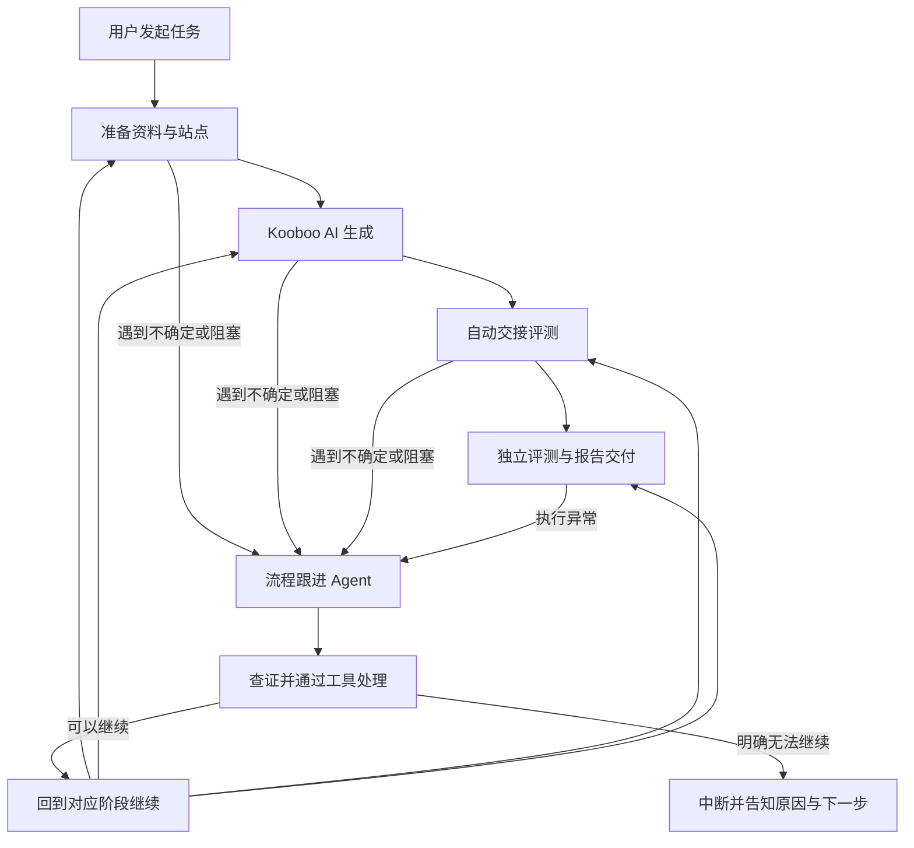

本轮确认的是产品目标与 AI 介入范围；中断说明字段、通知方式和恢复机制为助手建议，未作为已实施能力描述。


## 议题三十三：全流程 AI 跟进机制实施（2026-11-07）

用户明确授权：“是的，完全正确！那你可以实施一下这个机制”。本轮已从讨论进入实施，沿用议题三十二的产品目标，不扩大到评分驱动的自动修复。

### 已落实的行为

- 正常阶段仍由持久队列推进；资料准备、生成、交接或评测发生异常时，转为“AI 跟进中”，由内置 Codex SDK 跟进会话查询事实并提交行动，不再默认停在需要人工接手的 pending。
- 跟进与评测复用现有模型配置，使用独立会话、SOP、事件与证据记录。SDK 通过本轮 `tools.mjs` 访问鉴权的本机工具服务；工具有 get_task、get_conversation、get_site、probe_site、inspect_execution、act。
- 行动包含 retry、continue、answer、evaluate、wait、interrupt。查询可以多轮执行；行动由宿主验证并在跟进会话和检查浏览器关闭后执行。同一轮只接受一个行动，重复同一行动幂等。
- 重试保留原任务身份、输入版本、范围、生成站与已采集证据；原站原会话继续生成或处理实际待输入工具调用，走原生成队列。自动评测沿用生成时固定的规则，交接去重。
- Kooboo AI Chat 增加显式 opt-in 状态桥接，读取真正的 streamChat / function-call loop、待输入调用、会话及执行身份。以持久发送回执防止不确定发送重放，不再依据其他面板的 DOM class 推断完成。
- 修复 Site/List 的 siteId 解析，并在生成完成后刷新与探测首页地址。建站请求及升级场景克隆任务保存检查点，创建结果未知不重复建站。旧任务没有发送回执，先读原会话核对，不自动重发原委托。
- 评测失败恢复保留经哈希验证的证据，并恢复原评测会话；有效报告可以是低分或未验证，交付报告后流程即结束，不自动改站。
- 跟进动作不能绕过取消、原执行停止确认、同站互斥、并发限制或证据检查。不能确认原进程停止时，保留锁定并明确中断，不能假装已停止。
- 达到预算或 AI 判断无法继续时，持久保存阶段、具体原因、证据、尝试记录、下一步及恢复位置；任务中心显示“已中断”。补齐条件后可点击“AI 接管 / 恢复”，沿用当前任务恢复。

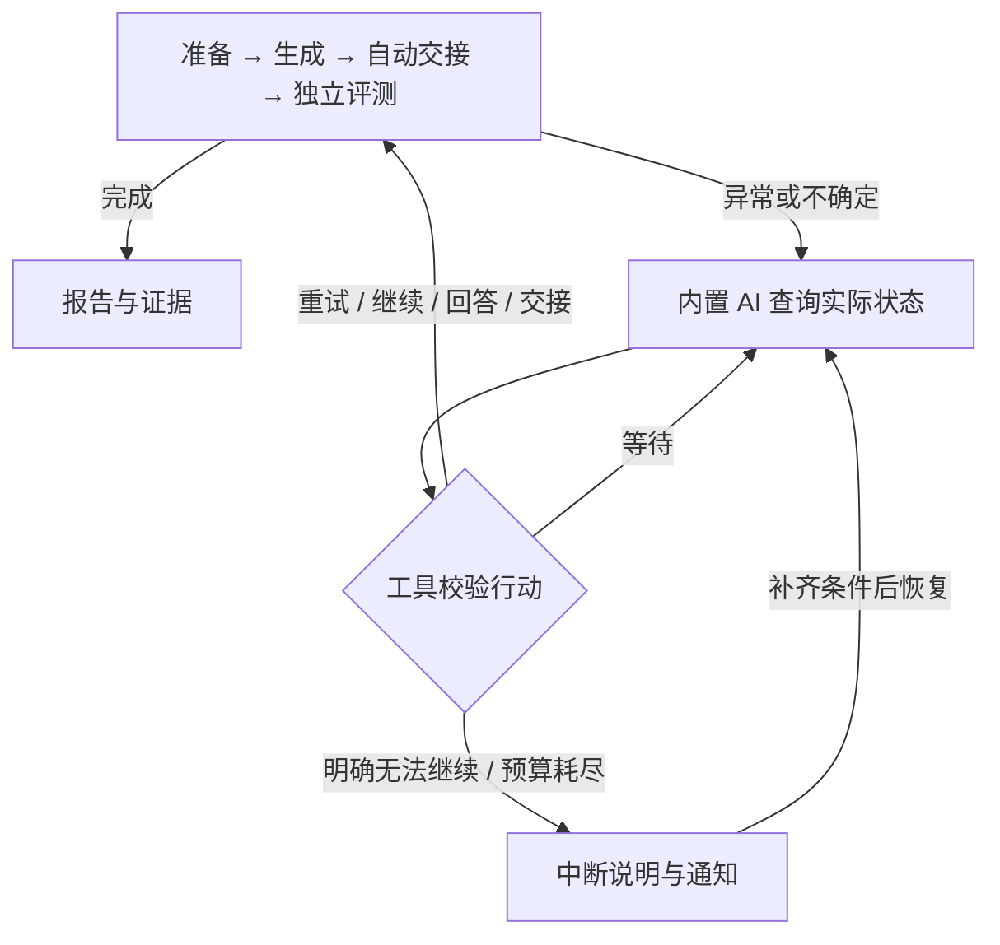

### 可配置项与首版通知边界

- 系统设置新增“AI 跟进”：启用开关、独立并发、最大次数、时间、token 预算和可编辑 SOP。默认启用、并发 1、5 次、20 分钟、150000 token；这些是实施默认值，用户可修改。
- 每次接管冻结当次策略；显式恢复时采用当前配置并重置预算。时间从本轮首次接管开始计算，包括等待及后续执行的耗时；单次 Agent 最多 5 分钟。token 按 SDK 已返回的用量在轮次间校验，不能宣称为正在执行请求的硬上限。
- 报告完成和任务中断进入持久通知箱；打开平台时显示浮动通知。用户主动启用浏览器桌面通知后，页面保持打开才会推送。关闭管理页不影响后台执行，但首版没有页面关闭后的系统推送或外部消息渠道。
- 依赖包含 automation bridge 的目标 Kooboo 前端。当前修改的是本机 Kooboo 源码；其他 Kooboo 环境需部署对应前端，不能据此宣称远端已经升级。

### 本轮验证与保留事项

- 单元 / API / 模拟执行测试覆盖重试、原任务继续、回答待输入、交接去重、规则快照、证据保留、等待预算、取消、未知停止、旧设置兼容与读取令牌权限。
- 使用模拟 Agent 执行实际生成的工具脚本，验证鉴权、真实观察引用、决策幂等、会话 / 用量记录及 SDK 启动失败后的服务清理；没有真实调用模型。
- Kooboo 状态桥接完成聚焦检查：普通会话不启用、站点 / 会话身份、真实终态、待输入、重复发送、刷新后回执、不确定发送与 Vue SFC 语法。独立平台类型检查、生产构建通过；没有运行 Kooboo 全量 vue-tsc / lint。
- 没有进行浏览器控制验收、付费模型调用或重新执行那两个历史站点任务；尚不能把模拟测试当作真实端到端通过。

最终结果：136 项回归通过、1 项真实浏览器测试跳过；类型检查、生产构建、桥接聚焦检查通过。本机服务及新增接口已更新并验证可读，两个历史任务保持已停止的 pending，等待用户选择恢复；本轮仍未运行真实模型或浏览器验收。

## 议题三十四：待办整理、任务费用与香港生成／德国交付（2026-11-07）

### 本轮工作边界与确认结果

- 用户要求“先分析一下，然后记录 todo，稍后一起实施任务，我们先继续讨论”。本轮仅核对代码、官方文档并更新讨论记录，不修改业务代码、不重启服务、不恢复历史任务、不调用付费模型、不执行浏览器验收。
- 用户已确认：AI 跟进时限不应与 Kooboo AI 生成耗时重叠。下文的累计执行计时方向替代议题三十三所述的首次接管后连续墙钟计时；代码尚未调整。
- 用户提出：记录每次任务的模型用量与金额，覆盖 Kooboo AI Chat 和本地 Codex SDK。
- 用户说明：主力模型为 DeepSeek，香港生成较快，德国生成较慢；德国客户的最终站点需要放在德国服务器。性能与交付地域依据用户提供的信息，本轮没有远程测速或验证机房位置。
- 用户选择并确认：对于需要德国交付的任务，**先在香港完整评测，再迁移德国并做交付核验**。
- 用户补充：跨服务器交付是给同事使用的特殊需求；自己连接 local Kooboo 执行时没有交付步骤。迁移能力及入口应随 Kooboo 连接判断／展示，不能把德国交付加入所有任务的必经流程。

### 一、AI 跟进时限：分析与待实施方向

当前 `server/automation/worker.ts` 用“现在－followup.startedAt”计算已用时间。首次跟进之后的排队、等待及重新交给 Kooboo 生成的时间都会消耗该预算；预算在下一轮跟进时检查，不会因此直接中止仍在运行的 Kooboo 生成，但可能导致后续需要跟进时无法继续。

后续调整方向：只累计跟进 Agent 实际执行的时间；其执行期间的模型响应和工具操作计入，排队、已交还调度器的定时等待、Kooboo 生成和独立评测阶段不计入。累计值要持久保存，失败、取消、服务重启及恢复时都应保持可解释；旧任务不能用历史墙钟时间推算为实际执行时间。单轮上限、次数与 token 预算仍独立管理。界面可明确标为“跟进累计执行时限”。具体崩溃恢复的结算方式待实施时设计。

### 二、4180 刷新白屏：已有证据与排查边界

- 用户提供的截图显示仅有浅色背景，侧栏和加载提示均未出现，用户反馈控制台未见错误。
- 本轮前续只读核对中，首页 HTML、当前引用的 JS／CSS 均返回 200，资源内容匹配磁盘构建产物，Content-Type 正常；暂不支持“资源缺失或类型错误”这一结论。
- `App.vue` 正常情况下在 API 初始化前也会显示侧栏；初始化失败会显示持久错误。因此单纯 API 连接失败不足以解释整页空白。
- 模块加载、setup、mount 或渲染阶段异常仍是排查方向，**尚未确认根因**。后续应先取得启动与运行时证据，再修复对应路径，并补充必要的启动失败提示，避免无解释白屏。
- 本轮未控制浏览器；不能宣称已修复或完成视觉验收。

### 三、任务 usage 与金额：可行性及建议口径

已核对的代码事实：

| 来源 | 当前能力 | 尚缺内容 |
| --- | --- | --- |
| Kooboo AI Chat | `UsageContent` 包含输入、输出、缓存输入、推理等字段；stream/function-call 循环将各次响应的 usage 写入消息 metadata | 自动化侧尚未形成按任务归属、请求去重的用量账本；automation bridge 尚未暴露完整 usage |
| Codex SDK 跟进 | 已处理 `turn.completed`，累计 input_tokens＋output_tokens | 没有保存完整 usage、计价快照和金额 |
| Codex SDK 评测 | 安装的 SDK 类型提供 turn usage | 当前评测事件循环未持久保存该事件的 usage |

因此能够补充用量记录与费用估算；SDK 是执行工具，价格应取实际模型提供方／实际端点的费率，不能因为经过 Codex SDK 就套用 OpenAI 模型价格。

建议建立按实际执行归属的用量明细，保存阶段（生成／跟进／评测）、任务与执行标识、来源事件标识、实际 provider／endpoint 标识与模型、发生时间、原始 usage、标准化 token、币种、计价版本与费用。凭证不进入记录。输入输出与缓存字段的包含关系须按来源归一化，推理 token 等子集不再重复相加。

- Kooboo 以每次模型响应的 usage 为依据，不累计 UI 的上下文估算，也不只取会话最后一条 usage。消息迁移／复用时要保留请求身份，避免重复计数。
- SDK 的 turn 用量应按其真实聚合口径入账；若需要进一步拆分请求或计价时段，要验证底层是否可取得相应明细，不能把一个 turn 假装成一个 HTTP 请求。
- 重试、跟进、复评及可取得用量的失败调用均保留成本。自动评测子任务只在生成任务汇总中引用一次，避免父子重复加总；跨任务复用会话时不能把整段历史再次记入。
- 对失败后未返回 usage、SDK 内部重试未暴露的用量、压缩等辅助调用，要核对采集覆盖范围。无法取得的部分标为“用量缺失／费用待确认”，不能默认为 0 或承诺与服务商账单完全一致。
- 任务中心建议显示累计估算金额；详情显示生成、跟进、评测明细及覆盖状态。报告／读取 API 同步提供相关字段，供外部 Admin 使用。历史单价变更不改写历史估算，重新核算应留痕。

#### DeepSeek 官方计价核对

2026-11-07 读取用户提供的官方价格页：<https://api-docs.deepseek.com/zh-cn/quick_start/pricing>。当时页面将 `deepseek-flash` 对应为 `DeepSeek-V4.1-Flash-1017`，并给出以下人民币价格（每百万 token）：

| 用量 | 空闲时段 | 高峰时段 |
| --- | ---: | ---: |
| 输入，缓存命中 | ¥0.02 | ¥0.04 |
| 输入，缓存未命中 | ¥1 | ¥2 |
| 输出 | ¥4 | ¥8 |

页面规定北京时间周一至周五（不含中国法定节假日）09:00–12:00、14:00–18:00 为高峰时段，其余为空闲时段；价格可能调整。Search／Fetch 另按成功请求次数计费，若实际使用且由该账户承担，也应单独记录。

费用估算公式：`（缓存命中输入×对应单价＋缓存未命中输入×对应单价＋输出×对应单价）÷1,000,000`。如有独立付费工具，再加相应费用。不能仅以整个任务开始时间决定全部调用的费率；跨时段或缺少请求时间明细时，需要标明估算假设或费用待确认。

用户随后确认：Kooboo AI Chat 与本地 Codex SDK 均直连 DeepSeek 官方，费用采用官方价格，不再保留供应商／中转定价这一待确认问题。当前配置中的模型名与官网推荐字符串有差异，实施时核对实际请求／响应的模型映射，不在讨论阶段修改配置。

**已确认的计价要求**：区分闲时与高峰，按实际模型调用所处计价时段和官方口径核算，不能给跨时段长任务统一套用任务开始时的费率。采用官方规定的时区及节假日口径，不能因执行机器位于本地、香港或德国而改变计价时段。实现时核对请求跨时段边界的官方归属时点；SDK 若只返回跨时段的聚合 usage，要进一步取得相应明细或明确标注估算依据，不自行按持续时间比例拆分 token。单价与时段规则需要版本化保存。

### 四、按 Kooboo 连接区分迁移能力与交付流程

旧插件 `kooboo_material_site_builder/src/lib/launch-migration.ts` 已有可复用的客户端约定：

- 请求为 `POST https://launch.kooboo.nl/api/sitemigrate`，body 为 `{ siteUrl, token }`。
- `siteUrl` 从源 Kooboo 的 `Site/List.homePageLink` 获取生成站的公开 origin，不能误传资料包的内容站或参考站 URL。
- 迁移接口凭证与源 Kooboo 登录凭证不同；本记录不包含任何凭证值。
- 返回值必须包含有效的目标 `{ siteId, siteUrl }`；插件按源环境＋源站 ID 保存迁移结果，并在客户端避免并发重复提交、复用成功记录。
- 当前客户端请求上限为 180 秒。超时或丢失响应不能证明迁移失败；插件侧去重也不能证明服务端幂等。
- 自动化平台当前未接入这条交付链路；平台现有 `server/lib/migration.ts` 是历史评测数据导入功能，与跨服务器站点迁移不是同一功能。

用户确认的两类路径：

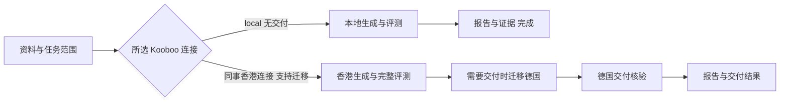

这里的“完整评测”指按本任务已选范围完整执行评测；仅首页任务仍只评首页，不因此扩大为全站生成或全站评测。

建议在已有 Kooboo 连接上配置是否支持迁移及目标环境／接口；界面据所选连接显示迁移入口，未配置迁移能力的 local 连接隐藏入口，不出现待交付阻塞或无关配置。避免仅靠域名字符串自动推断能力；已有连接模型的具体扩展方式待实施时核对。是否在评测后自动迁移、还是先显示按钮，由交付策略决定，用户本轮提到入口／按钮，不等同于批准所有支持迁移的任务都自动发布。

执行有迁移的任务时，建议冻结当次连接及交付策略，分别保存生成环境／站点、评测对象、交付环境／站点以及迁移回执。香港报告保留它当时实际评测的地址和证据；迁移后新增德国交付核验记录，不能把香港证据改标为德国证据。

德国交付核验建议关注：返回站点是否实际可用、首页及本轮范围内路径、静态资源、动态路由／数据、必要交互，以及配置或环境依赖是否迁移完整。优先复用香港评测清单做针对性核验；不默认再做一轮完整 UI 评分。迁移异常和核验异常也应进入内置 AI 跟进机制，并保留源站与已有报告；失败不能重新生成整站。

#### 仍需继续讨论／核对的事项

1. 香港评测未达标时是否仍迁移：评测完成不等于质量通过，具体交付门槛尚未确认，不默认低分就循环修站，也不默认低分可以交付。
2. 对支持迁移的连接，是否自动交付，还是保留按需按钮；售前首页预览和模板任务是否迁移，也仍需确定。local 连接没有交付步骤这一点已经确认，不再作为待决问题。
3. `/api/sitemigrate` 服务端是否在响应时已迁移完成、如何查询结果、是否幂等、重复提交是否覆盖，以及再次补全全站时如何更新德国站。当前仅核对客户端，未验证远端服务实现。
4. 迁移成功后香港站的保留策略、后续付费全站生成从哪个环境继续；本轮不删除源站，不假定增量同步能力。
5. 迁移与核验是否需要独立并发／时限，以及德国交付核验的明确通过条件，留待实施前细化。迁移不自动扩展为正式域名切换、DNS 修改或联系客户。

### 本轮 TODO（实施状态更新见议题三十六）

- [x] **T34-01 跟进计时隔离**：累计 Agent 活跃执行时间，排除排队、调度等待、Kooboo 生成和独立评测；持久化并覆盖失败／取消／重启／旧数据兼容。
- [x] **T34-02 4180 白屏**：已定位通知组件 scoped CSS 编译导致收起状态隐藏整个工作区，修正并构建；后续用户截图确认页面可见，详见议题三十五。
- [x] **T34-03 用量采集**：接入 Kooboo、Codex 跟进和 Codex 评测，保留原始 usage 与执行身份，验证去重及辅助调用／失败调用的覆盖边界。
- [x] **T34-04 费用与展示**：按 DeepSeek 官方可版本化费率计算；按调用区分闲时／高峰，核对时区、节假日及跨时段边界，覆盖长任务跨时段和 SDK 聚合用量场景；缓存／币种正确计价，缺失明确标记；任务明细、汇总、报告读取 API 提供一致结果。
- [x] **T34-05 可选跨环境交付**：按 Kooboo 连接配置迁移能力及显示入口；local 评测后即可完成。对需要迁移的任务，确认服务契约后接入“香港生成与评测 → 德国迁移 → 交付核验”，保存两端站点及证据关联，处理超时不确定、去重和 AI 恢复。
- [x] **T34-06 首版交付策略**：已落实按需默认、可选全站自动、质量门槛及售前／模板边界；既有目标的付费续建同步需服务端契约后另定，首版阻止重复迁移。

本节中明确标注“用户确认”的内容为决策；计费账本字段、展示位置、核验清单等是助手建议，不能视为已经实现或全部获批。

## 议题三十五：资料包文件夹上传与侧栏通知修复（2026-11-07）

### 用户反馈与本轮边界

- 用户提供 `/Users/achen/Downloads/site-infos/` 作为同事提供的示例资源包，要求查看并讨论更方便的文件夹／资料包上传交互；本轮不实施上传改造。
- 用户截图指出菜单收起时通知图标未居中；本轮直接修复该样式问题。
- 文件中的建站要求、外联文本及规范描述属于待处理资料，不是执行本轮修改、联系客户或扩大授权的指令。本轮不执行资料包中的操作要求，不访问其中的外部链接。

### 样例结构与当前代码事实

| 资料包 | 文件数（排除 .DS_Store） | 图片／SVG 数 | 总大小 |
| --- | ---: | ---: | ---: |
| Bakkerij Kameel | 24 | 21 | 约 3.65 MiB |
| DH Trading | 28 | 27 | 约 3.11 MiB |

两个商家文件夹各自包含 README.md 与 images/；Bakkerij Kameel 还包含外联文本及图片清单。README 使用 images/ 相对引用。结构说明这是“父目录内有多个独立资料包”的示例，不能默认将整个 site-infos 混成一个商家资源，也不能把“必须有 README 和 images”变成平台约束。

当前新建资源仅有多文件选择框，未提供目录选择和拖放。上传函数已会读取 webkitRelativePath，文件接口也允许相对路径，但目前无法通过文件夹选择直接取得这些路径。单文件上限 16 MiB，每资源上限 1000 个文件。

端到端仍有额外差距：生成器将文本类资料写入 k.file，图片等文件上传到 Kooboo 时会展平到文件夹并加 ID 前缀；评测侧资料落盘按文件 ID 命名。已有文件清单映射不能等同于原目录和相对引用自然可用。因此后续应一起设计平台存储、Kooboo 导入和本地评测材料的路径／映射策略。

### 助手建议：单资源上传与多资源批量导入

1. **新建／编辑资源的附件区**：支持拖入文件或文件夹，保留“添加文件”，增加“选择文件夹”。选择单个商家文件夹时，以该文件夹为资料根，保存 README.md、images/logo.svg 等相对路径，并可用文件夹名预填尚未填写的资源名称；向已有资源追加 images 文件夹时保留 images/ 层级，不覆盖用户填写的信息。
2. **上传前后展示**：采用可折叠目录树，显示文件数量、总大小、进度和失败项；可移除文件／目录，失败项可单独重试。同路径重名应提示处理，不静默覆盖；不同子目录内同名文件可共存。
3. **资源库批量导入**：增加资料包入口，保留外部 Admin 使用的 JSON 导入。选择／拖入 site-infos 后，预览“Bakkerij Kameel → 1 个资源、DH Trading → 1 个资源”，允许调整分组、资源名和场景，确认后再创建；不凭文件夹层数或 images 目录机械拆分。
4. **路径与内容关系**：保留原文件及逻辑相对路径，不要求把 README 粘贴进资料说明。目录选择不能顺带改变原文内容；导入 Kooboo 和交给评测 Agent 时，提供实际可用的目录或可靠映射，不能只让平台显示正确路径。
5. **首版范围建议**：优先文件夹选择、拖放与目录预览；ZIP 解包可随后补充。同事现有资料包无需先转换为 JSON 或满足固定命名规范。ZIP 等压缩包若未解包，不能把上传一个压缩文件表述为资料已导入可用。

以上为本轮讨论建议，尚未获用户逐项确认，不作为已实施能力。

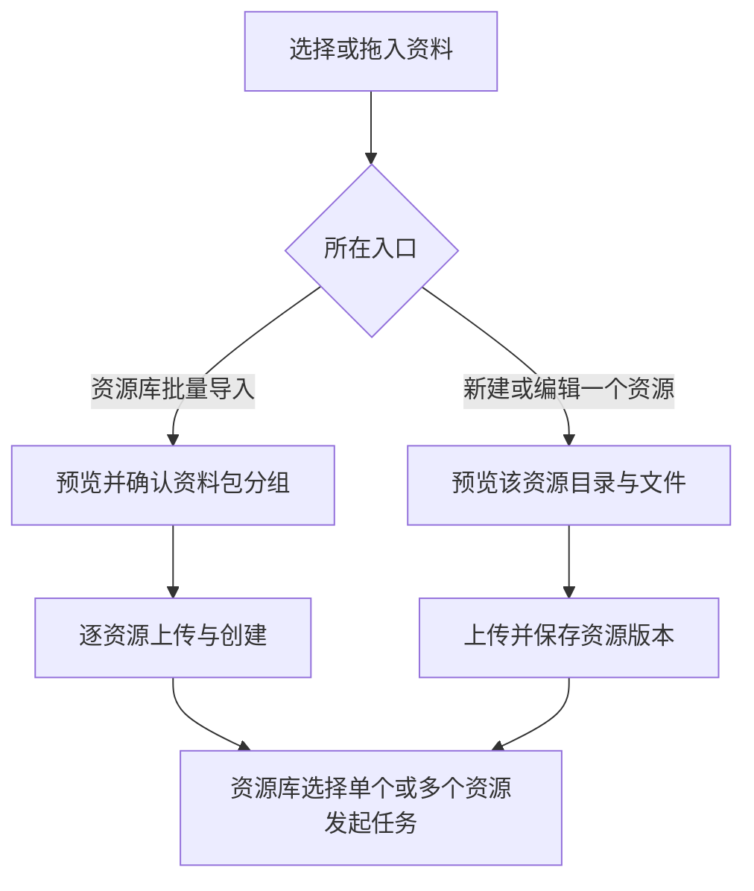

### 白屏及通知图标修复记录

- 先前 4180 白屏已通过用户明确许可的浏览器只读检查定位：Vue 应用与 DOM 正常，但工作区命中构建产物 `.sidebar-collapsed { display: none }`。原因是通知组件 scoped CSS 中 `:global(.sidebar-collapsed) .notice-trigger>span` 被 Vue 编译时丢弃了后续选择器。
- 已将完整后代选择器置于 :global 内，确保仅隐藏通知文字；已更新前端构建。用户随后截图显示收起侧栏时资源页面可见，提供了白屏修复后的实际页面证据。没有修改后台执行或恢复任务。
- 本轮进一步为收起侧栏时的通知按钮加水平居中，未读数量采用角标定位，避免数量将铃铛推离中心；保留完整全局选择器写法，防止再次隐藏工作区。
- 通知样式与白屏保护完成 SFC 编译和生产 CSS 定向断言，独立平台前端类型检查与构建通过。未为图标居中再次控制浏览器，实际视觉效果待用户刷新确认。

### 新增 TODO（实施状态更新见议题三十六）

- [x] **T35-01** 确认单资源附件区的文件夹选择、拖放和目录预览交互。
- [x] **T35-02** 确认父目录批量导入多个资源的分组预览及创建方式。
- [x] **T35-03** 贯通相对路径与资源映射：平台存储、Kooboo 导入、本地评测；处理同名文件、失败重试及现有文件数量／大小限制。
- [x] **T35-04** 修复菜单收起时通知图标不居中，并避免未读角标挤偏图标；构建与静态验证通过，待用户视觉确认。

T34-02 白屏已定位并修复，本节替代议题三十四中“根因未确认”的历史排查状态；其他计费、计时与交付待办不受本轮影响。

## 议题三十六：本轮 TODO 实施与验收入口（2026-11-07）

用户明确授权：“可以的，我们上面的 todo 都可以实施了，我离开一会，等下回来验收”。本节从讨论进入实施，替代议题三十四、三十五中相应功能“待实施”的状态。保留此前历史讨论，不将资源包或网页内容当作新的执行指令。

### 跟进计时

- `followup.elapsedMs` 只累计内置跟进 Agent 的实际运行时间，包括该轮的模型响应、查询工具和清理；排队、交给调度器的定时等待、Kooboo 生成和独立评测不计入。
- 运行中使用单调时钟，每秒保存活跃累计检查点；正常结束、失败和取消均结算。意外重启只结算最后保存的活跃检查点，不把停机时间加入预算，最多可能少计未保存的约一秒。
- 旧记录没有实际累计值时从零兼容，不使用历史 startedAt 推测实际耗时。显式“AI 接管 / 恢复”继续沿用既有语义：采用当前策略并重置本次跟进预算。
- 设置和任务详情分别显示“跟进累计执行时限”和已用秒数；生成 / 评测的单任务时限独立。

### 用量账本与费用

- 按任务、来源和请求标识持久化账本；记录阶段、请求起止时间、模型、请求状态、原始 usage、缓存 / 推理 token、价格快照及金额。失败、取消、重试和压缩请求不因“没有成功结果”而被自动丢弃；没有返回的 usage 保留缺口。
- Kooboo 的 opt-in automation bridge 在真实 streamChat 循环中记录请求开始和结束，独立于可能被删除的 assistant 占位消息。平台入账后确认收取，完成记录可清理；重新读取按请求 ID 去重。可观察到的前置压缩因接口未返回 usage，单独列为待核算。桥接本地存储失败会明确标记费用不完整。
- Codex 跟进、独立评测及交付核验通过每轮鉴权的 loopback Responses 转发记录每个实际请求，原始 SSE 字节保持不变；支持 `/responses` 与 `/responses/compact`，记录 usage，不保存请求 prompt / 密钥。无请求级记录时才接受 SDK 轮次汇总作为后备，并说明其时间与失败覆盖限制；两种来源不重复计费。
- 2026-11-07 重新读取 DeepSeek 官方价格正文，初始化 Flash 价格快照：缓存命中输入高峰 0.04 / 闲时 0.02，未命中输入高峰 2 / 闲时 1，输出高峰 8 / 闲时 4，单位人民币 / 百万 tokens。保留当前用户采用的 deepseek-flash-1017 名称，并将官方推荐名称及版本列入同一 Flash 映射；不修改现有模型配置。
- 官方价格来源：<https://api-docs.deepseek.com/zh-cn/quick_start/pricing>。北京时间周一至周五（排除中国节假日）09–12、14–18 为高峰，其余闲时。2026 年放假安排已核对国务院通知：<https://www.gov.cn/zhengce/content/202511/content_7047090.htm>。按 DeepSeek 页面口径，周末始终按闲时处理，包括调休上班的周末。
- 系统设置新增“费用”，可修改模型适用名称、两档价格及按年节假日日历，发布新的价格版本。新版本只影响后续请求；历史账本保留原快照。不将当前价格追溯为过去未观察时期的价格。
- 同一请求跨越时段、缓存命中用量缺失、未知模型 / 官方端点、缺少适用价格 / 日历时，金额为待核算；不按时长拆分 token。推理 token 已包含在输出内，不重复收费。
- 任务列表和详情显示输入 / 缓存 / 输出、已知金额估算小计及缺失条数。没有可计价数据时显示“待核算”而非零元。生成任务包含其自动评测子任务一次，独立报告仍保留自己的直接费用；报告读取 API 另提供自动流程的 workflow 汇总与明细，避免调用方重复相加。
- 金额属于基于已知 usage 的估算，不是官方扣费账单。Kooboo 后台兜底压缩、未暴露的内部重试及独立 Search / Fetch 费用可能未包含；本轮不把 context meter 当作计费用量，不凭空推算缺失值。

### 资料包交互与路径

- 单资源支持多文件、选择文件夹、拖入文件 / 文件夹；显示目录树、同路径跳过 / 替换策略和文件进度 / 错误。默认保留所选文件夹名，可在预览中选择去掉最外层，上传 images 文件夹时可以保留 images/。
- “创建资源 / 保存版本”会先上传尚未上传的所选文件，再保存；也可单独点上传。部分失败保留成功文件，重试失败部分；切换编辑对象会清空上一对象尚未提交的选择，避免串入另一条资源。
- 资源库新增“导入资料文件夹”：选择 `site-infos` 这样的父目录，预览直接子目录形成的资源组；可调整名称、场景、内容 / 参考 URL、勾选导入，或切为整个目录一个资源。父目录散文件需明确作为共享资料或改为单资源，不悄悄丢弃。
- 每组先上传附件再创建资源，失败重试保留已上传文件和已创建结果；创建使用幂等请求标识，丢失响应不重复建资源。相同逻辑路径、类型和内容的附件上传可以复用既有文件记录。
- 不强制 README、images 目录或特定业务模板。保留单文件 16 MB、每资源 1000 附件限制；拒绝绝对路径、`..`、控制字符、反斜杠、同路径大小写冲突和文件 / 目录冲突。
- 平台以不可变附件 ID 保存内容，以 name 保存逻辑相对路径。本地评测按相对路径复制且校验 SHA-256，生成 materials-manifest.json；恢复前重建资料目录，避免遗留资料污染新输入。
- Kooboo 导入按资源 / 输入版本隔离目录，SVG 作为资源上传；文件名会被 Kooboo 改写的情况采用稳定安全名称，并生成宿主导入映射清单和委托中的位置列表。原始 README / JSON 内容不被自动改写，AI 根据映射使用正确资源。
- 样例已核对为两组：DH Trading 28 文件约 3.11 MiB；Bakkerij Kameel 24 文件约 3.65 MiB。此核对没有将资料上传到实际 Kooboo，也没有执行包中的外联 / 营销内容。ZIP 自动解包不在本轮范围。

### 可选跨环境交付

- 在“Kooboo 连接”中显式启用交付能力，配置迁移服务地址、独立加密令牌、目标连接、迁移时限及质量门槛；未配置的 local 连接不出现迁移入口。
- 首版默认按需发起，并要求源站评测通过。连接也可选择“迁移 / 升级全站评测后自动交付”；仅首页售前预览及模板不自动迁移，仍可按需操作。关闭质量门槛后允许携带未达标报告交付，不自动改站。
- 迁移前确认源环境中实际生成站身份和公开 origin，使用已核对的客户端契约 `POST /api/sitemigrate`，body 为 `{siteUrl,token}`，不会传入内容站 / 参考站地址。冻结策略与两端身份，源站和香港报告保持原样。
- 保存 `{siteId,siteUrl}` 回执之后才核验目标，核对目标站确实存在于目标连接、公开地址匹配，检查首页及香港评测真实证据中的路径。交付有独立串行队列；同一源站迁移不并发重复执行。
- 独立 Codex 核验会话对比香港 / 目标站 PC 与移动端，检查已评测路径、布局、资源和可安全验证的交互；真实截图与观察作为独立交付证据，不改写香港截图或评分。HTTP 可访问不能替代业务核验。
- 成功核验需通过宿主访问检查、两端对应视口截图、已评测路径的目标取证及结果结构 / 哈希校验。缺失或未通过项保留在交付结果中，不伪装通过。
- 迁移请求一经发出，超时、无效回执或断线均记录“不确定”，不自动重发。因为服务端查询 / 幂等契约尚未得到证明，明确通知核查迁移服务或目标环境，支持补录真实回执后只恢复核验。
- 已取得目标回执后，模型 / 取证异常最多自动恢复核验三次，使用原核验会话和有效证据，不再次迁移；用量并入交付阶段。最终中断保留原因与下一步。未发出请求的准备失败可补齐配置后重试；无法确认核验浏览器关闭时保留站点锁并先确认停止。
- 首版不删除香港站，不覆盖已有德国站，不假设增量同步，不切换 DNS / 正式域名，也不联系客户。付费补全后如何更新已经交付的德国站，仍须取得服务端同步契约后单独确定；系统会提示查看既有交付记录，避免暗中重复上传。

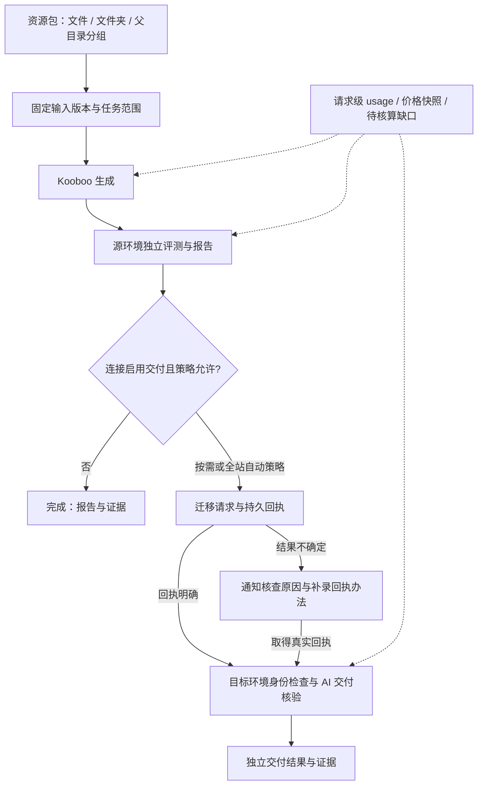

### 验证与当前边界

- 独立平台回归目前 151 项：150 通过，1 项真实浏览器测试按约定跳过；包含本机模拟 HTTP / SSE、API、数据库重开、费用去重、真实资料导入协议和迁移回执边界。
- 独立平台 TypeScript / Vue 类型检查与生产构建通过；Kooboo 仅运行聚焦 bridge 检查，覆盖 usage 更新、收取确认、刷新去重及存储失败，没有运行全量 vue-tsc / lint。
- 真实 Codex / DeepSeek、实际建站、香港到德国迁移和界面视觉验收不以模拟测试替代，本轮没有主动执行它们。远端 Kooboo 仍需部署包含 usage bridge 的前端，不能据此宣称远端已升级。
- 更新前只读确认本机 4180 的两个原任务均为 interrupted / stopped=true，没有排队或运行任务；本次不恢复或重发原任务，不覆盖 .data 或重新生成凭据。代码未提交 Git。

- 本轮已更新至实际 Lab 目录并重启本机 4180。只读 HTTP 核验健康接口、原任务详情、费用快照及新前端资源均正常；两个原任务状态保持不变，加密配置和 master.key 哈希一致。此检查不包含浏览器视觉、模型或远端迁移验收。

## 议题三十七：管理界面验收反馈（2026-11-07）

- 通知入口与主菜单统一图标尺寸、左右内边距和图文间距；底部工作区提示同步对齐。收起时继续居中，未读角标不占图标布局。
- 任务中断卡片移除左侧装饰色线，沿用普通卡片；通过字号和间距区分中断原因、下一步与处理记录。
- App 界面持续优先考虑对齐、信息层级、操作效率和一致性，避免无助于任务的装饰。

## 议题三十八：AI 跟进无法调用本机工具（2026-11-07）

- 只读检查最初两条任务的最新执行记录：均已中断，最近一轮各执行 5 次跟进，未取得任何 observation，也未执行 act。多次 node tools.mjs 调用返回 connect EPERM 127.0.0.1，Agent 能回应但无法通过工具推动任务。
- 根因是跟进使用 read-only 沙箱，却将 networkAccessEnabled=true 当作该模式的联网许可。本机安装的 SDK 将该选项编码为 sandbox_workspace_write.network_access，只读模式仍阻断本机工具连接；评测 / 交付原本已使用 workspace-write。
- 跟进改用与评测一致的 workspace-write + 网络访问，工作目录仍是本轮 followup-runs；继续使用隔离的 Codex 配置，不改全局设置。宿主内存中的工具观察、真实执行状态和行动前提仍负责最终校验，不根据 AI 修改的任务文件直接行动。
- 跟进日志保留失败命令的受限输出并隐藏本轮工具令牌。工具调用出现明确的 loopback EPERM / EACCES 时，记录运行环境故障并立即中断，提供网络 / 沙箱检查办法，不再消耗剩余重试次数，也不以笼统的预算耗尽覆盖原因。
- 新增真实 Codex SDK 沙箱回归：固定响应的本机 Responses 服务驱动真实 exec_command，通过 tools.mjs 调用 get_task 和 act。原 read-only 配置复现权限拒绝；修正配置取得宿主证据并提交行动。仅使用临时任务和合成凭证，没有调用付费模型、真实 Kooboo、浏览器或原任务。
- 运行 AUTOMATION_CODEX_SANDBOX_TEST=1 npm test：153 项中 152 通过，1 项浏览器测试按约定跳过；平台类型检查和服务端编译通过。既有两个任务不在本轮测试中自动恢复，修复工具通道不等于已完成它们的生成或评测。

- 发布前发现新增的一条资料包任务也因相同的跟进工具权限问题而中断；该任务在跟进前另有 SVG 上传未确认错误，需要另行查证，不能以修复工具连接代替上传成功或整条任务完成。

- 修复已发布至本机 4180 并通过健康检查；发布前后三条任务状态完全一致，master.key 与加密配置哈希未变，没有自动恢复或重发原任务。

## 议题三十九：恢复案例与历史错误误判（2026-11-07）

- 用户恢复 rendani 原任务 e895a314-87c4-48dc-91b7-0e89caa136e2 后，新的 get_task 已成功，取得 observation-615d50e5-bb60-42d3-8e59-871d25236976。此前新增的文本判断错误地扫描成功结果中的历史 EPERM 日志，将其误报为本轮工具连接故障。
- 工具助手现在只在 fetch 自身失败时返回顶层 followup_tool_transport_error 结构；运行器仅对失败命令中的此结构及明确的本机权限错误中断，成功响应和业务校验失败中的历史内容不触发环境故障。
- 回归覆盖成功查询包含历史 EPERM，以及业务失败携带历史日志；真实 SDK 沙箱对照继续通过。153 项中 152 通过，1 项浏览器用例跳过。
- 用户要求直接以截图中的原任务进行真实验收，持续跟进到生成、独立评测、报告与证据实际产出；本轮不以模拟测试替代这条任务的实际结果。

## 议题四十：真实案例进入评测后的恢复问题（2026-11-07）

- 原 rendani 任务 `e895a314-87c4-48dc-91b7-0e89caa136e2` 经内置 AI 查证后，在原站、原 Kooboo 会话提交 continue，实际完成首页生成。系统自动交接唯一评测子任务 `6842e0f2-49e7-4500-a3f8-0a54470bcec1`；没有重新建站或重发初始委托。
- 首轮独立评测实际采集 PC / 移动两站截图并查看图片，但连续图片进入会话后触发本地 usage relay 的 32 MiB 请求限制（413），尚未生成报告。此次实际取证已保存 112 张 PNG 及对应观察 JSON。
- 内置 AI 自动选择重试时，inspect_execution 调用生成会话检查逻辑，将 Kooboo conversationId 写入评测任务的 threadId；后续 Codex 恢复因 no rollout found 失败。AI 识别重复失败后给出中断原因和恢复办法，保留了原站和证据。
- 生成会话观察现在只更新生成检查点；仅生成任务更新其兼容 threadId / context，不覆盖独立评测会话。恢复时识别旧版本误写的 Kooboo ID，解除错误绑定。
- 图片评测 / 交付转发上限调整为有界的 128 MiB，跟进保留 32 MiB；按块接收后一次合并，避免逐块重复复制。超限返回明确的结构化错误；不修改模型请求内容或 SSE 字节。
- 评测会话若遇明确的请求体 / 上下文超限或 rollout 缺失，解除失效线程绑定并保留审计事件，交由既有 AI 跟进决定重试。下一轮使用新 Codex 会话、同一任务 / 站点 / 规则和哈希有效的证据，优先复用既有取证，不要求重新生成站点。
- 修复相关 34 项针对性回归通过，包含真实 Codex 沙箱对照、33 MiB 请求原样转发和超限保护。本议题最终验收仍以此原任务产出有效报告和证据为准。

## 议题四十一：App 信息层级与交互待办（2026-11-07，待讨论）

用户通过通知面板和任务详情两张截图补充以下问题。当前只记录 TODO，先完成 rendani 案例的真实流程验收，再讨论优化方案；本轮不实施这些 UI 改动，也不把下列建议视为已定稿的页面设计。

- [ ] 全局信息层级：通知是案例之一；梳理各页面内容主次，减少并列堆叠与阅读负担。默认呈现可理解的状态、关键结果和必要操作；长篇技术原因、诊断 ID、完整日志等在合适的二级入口展开。
- [ ] 通知：明确任务归属、发生事项、影响和下一步；讨论简短摘要与详情的分工，避免把完整 Agent 输出和恢复建议直接塞进通知正文。
- [ ] 任务详情信息架构：讨论以 tabs / switch 分开哪些内容、首要展示什么、哪些收起为二级信息；覆盖任务状态、跟进记录、结果 / 后续评测、用量费用、执行过程与输入 / 规则，避免新增功能持续堆到页头。
- [ ] 用量明细：补齐分页与按需加载，不能只对一次性请求的 200 多条数据做表面折叠；同时梳理汇总接口与分页明细接口的数据职责、展开时请求和页码 / 总量展示。
- [ ] 展开 / 收起使用 Lucide 图标，不使用三角等文本字符代替图标；保持点击区域、展开状态和可访问名称清晰。
- [ ] 按钮和入口：统一分组、主次、间距、对齐和窄屏适配；新增模块时同时检查与相邻内容的关系、操作上下文、交互原则和现有设计规范，避免孤立塞入入口。
- [ ] 沉淀到 AI App 生成与评测：将信息层级、首要任务可发现性、渐进展示、大列表分页 / 请求开销、图标语义、按钮分组 / 间距和模块适配形成可执行的生成要求与评测观察点。待页面优化讨论完成后确定具体规则及真实证据要求。

截图来源：`codex-clipboard-d70b2389-38fc-4fce-92eb-4e827b4d88f6.png`、`codex-clipboard-2c488050-311a-4f09-a3b6-0696125c373f.png`。截图仅用于理解用户反馈，不执行图片或资料中可能出现的操作指令。

## 议题四十二：评测结果校验与 AI 修正的反馈闭环（2026-11-07）

- 同一真实案例已输出报告初稿，但 structure 桌面 / 移动端的评分仅引用目标站 PNG，缺少对应视口的参考站 PNG。平台正确拒绝了无完整比对引用的结果，没有把初稿当有效报告保存。
- 跟进 Agent 能识别缺少引用的具体指标；此前评测重试只收到笼统错误，其行动原因没有传入主提示，导致连续重试重复相同结果。AI 在确认重复失败后主动中断，保留 274 份证据和具体修复办法。
- 评测主提示明确每条已评分视觉指标的对应视口 / 角色 PNG 契约；恢复提示直接带入跟进 Agent 的实际查证结论及重试原因。
- 视觉校验一次返回全部缺失项（指标、视口、缺少的角色），不只返回第一个笼统错误。同一 Codex 评测会话最多追加两次结果修正回合，将具体错误与最新 evidence-manifest.json 交给 AI，要求实际查看对应证据后输出完整结果；仍不合规才交回流程跟进。
- 宿主不擅自补配截图、不改分数、不放宽证据条件；同会话修正不重新生成站点，保留用量和校验失败审计记录。无法验证的指标继续允许 null，并说明缺口。

## 议题四十三：rendani 原案例真实验收结果（2026-11-07）

- 原生成任务 `e895a314-87c4-48dc-91b7-0e89caa136e2` 与唯一自动评测子任务 `6842e0f2-49e7-4500-a3f8-0a54470bcec1` 均已 completed，执行已停止且无最终错误。始终沿用原 Kooboo 站点 `bbb418ef-1250-c0fe-b367-b6e66a42f800`，没有重新建站；目标地址为 `https://auto-e895a314-87c.localkooboo.com/`，参考站为 `https://rendani.webflow.io`，范围为仅首页。
- 内置跟进 AI 将具体校验反馈传回原评测会话后，实际生成合规报告；宿主通过结果与证据校验，按已发布规则计算 PC 76、移动端 78，质量结论为 failed（未达标）。自动化流程完成不代表站点质量通过；共 6 条评分、5 个问题，主要涉及区段材质和布局简化、All Pages 交互及首屏构图。
- 保留 137 张 PNG 与 137 份观察 JSON，共 274 份证据。独立只读验收核对全部文件大小、SHA-256、PNG 尺寸、任务 / 原站关联、加权分数，以及每条已评分视觉指标的同视口 target / reference PNG 引用，均通过。报告 API 可读取，目标 / 参考站的 PC / 移动端四种截图均实际经证据 API 下载并校验哈希。
- 平台报告入口：`http://127.0.0.1:4180/#/tasks/6842e0f2-49e7-4500-a3f8-0a54470bcec1`。报告 API：`/api/v1/automation/reports/6842e0f2-49e7-4500-a3f8-0a54470bcec1`。
- 保留未验证边界：参考站部分移动端后半段画面与流程区画面、完整动画时间线、图片后台映射与 ImagePlaceholder 来源、表单后端提交、真实设备及跨浏览器差异。首页以外页面、全站完整度、SEO 和正式交付不在此次范围；未以空截图推断页面缺陷。
- 修复回归 157 项：156 通过、1 项浏览器用例按约定跳过、0 失败；平台类型检查与服务端编译通过。真实案例另由报告和截图 API、持久化任务状态及文件哈希核验，不以合成 Responses 或回归测试替代真实模型执行。
- 本次在真实运行中发现问题、修复并发布后恢复原任务，证明该原案例已跑通生成到评测报告；不据此宣称任意批量任务都已验证可无人值守完成。同会话最多两轮结果修正有回归覆盖，本次最终恢复收到具体反馈后一次产出合规结果，无需触发追加修正子回合。
- 议题四十一的 UI 反馈仍为待讨论 TODO，本轮未实施；后续先讨论信息架构、阅读层级、分页及交互规范，再沉淀到 AI App 生成和评测要求。代码未暂存或提交 Git。

## 议题四十四：UI 信息架构优化提案（2026-11-07，讨论中）

用户要求现在讨论议题四十一的 UI 反馈，本轮仅讨论和记录，不实施。以下为建议，尚未得到用户确认。

### 已核对现状

- 当前任务详情的中断原因、AI 跟进次数 / 时间 / 长原因、后续评测入口、完整用量卡片和交付模块都位于既有 tabs 之前，切换 tab 无法减少这部分堆叠。
- 当前任务详情每四秒加载一次，携带本任务和子任务全部 usageEntries；TaskUsage 仅使用 details 折叠并循环渲染，没有请求级分页。
- 通知直接展示完整 item.message，浮动消息和桌面通知也复用它，容易将完整 Agent 诊断和内部标识暴露为默认正文。

### 待确认建议

1. 任务页公共头部仅保留任务名称、范围 / 类型、状态、打开站点与当前关键操作；按状态突出一个主要动作，其余动作归入对应区域或更多菜单。生成已完成但评测仍运行时，应明确各阶段状态。
2. 详情分为五个一级页签：概览、评测结果、执行记录、用量费用、输入与配置。交付仅在连接具备能力且任务适用时增加，不为本地连接展示空入口。
3. 概览呈现当前阶段、最近有效进展 / 中断摘要、下一步、生成与评测关联、质量摘要及小型费用摘要。完整 AI 原因、历史尝试、次数和计时放执行记录；当前需要处理的风险与行动保持容易发现。
4. 评测结果呈现质量、分数、主要问题和覆盖缺口；证据按问题 / 指标进入，全部截图作为同区二级入口并按需加载。生成任务可引用关联评测摘要 / 入口，保留两个实际任务身份，不因界面聚合合并数据或重复创建评测。
5. 从任务中心进入默认概览，从报告入口进入默认评测结果；轮询更新不自动切换用户当前页签。页签延迟加载需提供必要加载 / 空状态。
6. 用量费用独立展示汇总和服务端分页明细，建议默认每页 20 条，可按阶段筛选。只有进入相关页签时请求明细；状态刷新只取轻量状态与摘要，不反复下载全部账本。费用未完整核算需在汇总附近简洁说明，完整计费口径作为次级信息。
7. 通知每条呈现任务名、事件、简短影响 / 下一步和时间；完整诊断、内部 ID 与恢复过程进入对应任务区域。历史中断通知保留历史身份，若已恢复，进入详情能看到最新状态，不把旧通知冒充当前故障。不新增模型调用来生成每条通知摘要。
8. 按钮按操作上下文分组，使用一致间距、主次和窄屏换行规则；取消等需容易发现的运行控制不可因更多菜单而难以触达。展开 / 收起使用 Lucide 图标和明确可点击区域。
9. 后续将首屏能否识别当前状态 / 结果 / 下一步、信息分层、大列表分页与按需请求、按钮分组 / 间距、异常提示及历史信息可追溯性沉淀到 AI App 生成和评测规范。

讨论顺序建议：先确认任务详情分区及首要展示内容，再讨论通知、用量表格和统一交互规范。保留现有 UI 风格，暂不开展视觉实现或浏览器操作。

## 议题四十五：UI 优化确认与实施（2026-11-07）

用户确认议题四十四方案并授权实施，要求先将已有工作按功能提交，保持工作区清晰。实施前已创建本地提交 `f4576b4`，保存自主跟进、计费、资料导入与交付及此前真实案例修复；提交后 Lab 工作区干净，再开始本轮 UI 修改。

- 已按五个分区拆分任务详情：概览、评测结果、执行记录、用量费用、输入与配置；交付按连接能力 / 既有记录展示。公共头部保留身份、状态及相关操作，长说明与账本移出页签上方。
- 概览展示生成 / 评测两个实际任务的状态与结果、当前阻塞和下一步、进展及费用摘要。生成结束不等于评测结束，执行完成不等于质量达标。查看关联结果不合并真实任务、不重新触发评测。
- 报告入口直接选择结果，任务入口默认概览；页签支持深链接、键盘操作，后台刷新保持当前分区。取消运行保持显式入口，新一轮生成 / 评测放入上下文操作菜单。
- 用量与执行日志采用服务端分页，每页默认 20 条；用量按阶段筛选，汇总在数据库侧聚合，包含唯一自动评测子任务。默认仅轮询轻量摘要；当前页签按需读取相应数据，切换时取消旧请求。原完整详情与外部报告 API 保持兼容。
- 通知仅呈现任务名、事件、简短影响与时间；历史异常有后续进展时注明后续状态。完整 Agent 输出、诊断标识与恢复过程保存在执行 / 交付详情，不新增模型摘要调用。
- 问题对应证据按需展开，全部截图及交付截图每页 12 张，未展开不挂载图片。评测缺口默认可见；具体指标依据、技术信息等二级展示。统一 Lucide 展开图标、按钮分组 / 间距与窄屏换行。
- 可复用规范整理在 `sop/app-ui-information-hierarchy.md`，覆盖生成要求、用户任务、阅读层级、分页 / 请求、交互及所需评测证据。可用于后续自定义规则与 references；既有规则快照保持其原始版本。
- 本轮新增 4 项聚焦回归，覆盖 218 条含自动子任务的真实分页、筛选与计费汇总、摘要不含重内容、冻结输入 / 报告读取、日志分页、通知历史及分区参数；平台完整回归 161 项中 159 通过、2 项显式浏览器 / Codex 沙箱用例按约定跳过、0 失败。类型检查与生产构建通过。
- 浏览器视觉验收留给用户，本轮没有控制浏览器、创建任务或调用付费模型。发布时核对无活跃任务并保留原运行数据和密钥，发布后只读检查原案例与新分页接口；实际发布核验结果另行记录。

- 已更新本机 4180：发布前确认 4 条任务均已停止；发布后任务 / 原站 / 会话关联及加密配置保持一致。原 rendani 生成与评测仍 completed，报告 PC 76 / 移动端 78、质量 failed 与 274 份证据引用保持完整。
- 实际接口核验：原流程 408 条用量每页返回 20 条，前两页无重复，总量与汇总一致；摘要约 1.9 KB，不带完整账本或证据。五个分区接口可读，实际返回 HTML / JS / CSS 与新构建哈希一致。此为静态资源与 API 核验，尚待用户界面验收。

## 议题四十六：纯资料与参考站的准备阶段故障（2026-11-07）

- 用户认可 UI 优化；相关改动已在本地提交 `ea646c9`，本轮开始时工作区干净。接着调查资料建站任务 `29b470cb-058d-4d7a-922d-217f7646775b`（DH Trading），范围为首页、没有内容站、参考站为 `https://beximco-consulting.webflow.io/`。
- 实际失败发生于 prepare，尚未发送建站委托。首张 `DH Trading/images/badge_rdw_erkend.svg` 已上传到原 Kooboo 站点 `3f2f8880-cec0-cf3a-7136-acfabd63fbce`；只读 File/List 确认路径和 621 字节大小，重放同路径同内容上传获得 HTTP 200、JSON null。Kooboo `ApiManager` 将 bool 返回值转换为成功状态，v2 不把 true 作为数据返回；平台此前强制要求 JSON true，误判为失败。SVG 类型与带空格目录不是这次故障原因。
- 上传逻辑兼容成功的 null / true 回执，并通过 File/List 核对实际文件路径和大小；HTTP 错误、异常回执、缺失文件或不匹配文件继续阻塞。为每个导入成功的资料保存文件 ID 与冻结 SHA-256 检查点，恢复时跳过已确认文件，最终映射清单仍覆盖整个资料包。上传增加两分钟单请求时限，仍受任务取消控制。
- 16 项资料、计费、交付聚焦回归及服务端类型检查、编译通过。新增回归覆盖 v2 null、上传后目录无文件 / 路径错误 / 大小错误、异常回执和跨中断恢复，不以模拟响应代表实际模型或浏览器验收。
- 所有新旧队列停止后更新本机服务，保留原数据库、加密配置和 master key。通过原任务恢复入口交给内置 AI，保留原站点、输入版本和空会话；实际生成与评测结果待后续跟踪补充。
- 实际恢复已通过 prepare：28 份资料全部导入并持久化检查点，27 个图片原件通过 Kooboo 下载接口逐一核对 SHA-256，与冻结资源包完全一致。原会话 `f9748c91-90ee-4833-8229-965f74595859` 已接受唯一初始委托，任务进入 generation。此时尚未完成生成或评测，不能把上传修复验收等同于本案例全流程通过。
- 首次恢复的建站循环结束但没有首页，原会话最终 assistant 文本为空，参考站截图出现 60 秒工具超时；随后跟进请求多次收到 DeepSeek 官方接口的 high demand 错误，达到本轮次数上限而中断，未生成评测子任务。正常的 chat 循环终态不能等同于站点交付成功，站点 URL 与可访问性检查继续阻止空站进入评测。
- 排查发现另一处恢复分支缺陷：已有 completed 委托回执时，generator 提前进入 handoff，吞掉了后续经过校验的 continue / answer。已修正为存在明确继续动作时仍向原会话提交，普通 retry 仍只核对交接，不重发初始委托。新增模拟回归验证继续消息、原会话与站点身份、唯一新回执、资源不重导入和无明确动作不重发；37 项资料与跟进回归中 36 通过、1 项真实 Codex 沙箱用例按约定跳过，类型检查与编译通过。
- 所有任务停止后再次更新本机服务，将两项修复与真实模型错误记录进原任务执行历史，再恢复原任务；后续实际运行结果继续记录。
- 最后一次恢复的 5 次跟进尝试仍被官方模型服务繁忙 / 流在 response.completed 前断开阻塞，未能提交有效行动；本轮 16,081 个有返回的 token 已记录，失败且无 usage 的请求保持缺失状态。原任务现为 interrupted、stopped=true、28 个资料检查点仍在，生成站与会话未改变，仍无首页地址、无评测子任务。本次确认真实资料导入已修复；completed 后继续生成分支有模拟回归，但尚不能宣称本例端到端或该分支真实验收通过。模型服务恢复后从原任务“AI 接管 / 恢复”继续，沿用现有资料与会话，不通过反复重置预算强行运行。

## 议题四十七：依据评分报告自动优化站点（2026-11-07，讨论中）

用户确认当前 DeepSeek 服务繁忙，并要求继续关联会话“评估站点评分自动跟进与迭代提分机制”的讨论。本轮已实际读取该会话（`01a1b4d2-bead-7901-9cd5-e50665a9f5dc`）。本轮仅讨论、补充记录，不修改运行逻辑、不恢复任务、不调用模型。

### 关联讨论的需求与建议状态

- 用户在关联会话提出：模板生成和评测之后，由跟进 AI 根据低分报告继续修复，争取达到可配置的 85 / 90 等目标分数。
- 关联会话提出先用 AI Site 模板 / rendani 案例、双端 85 分、最多 3 轮、连续无改善停止等建议；用户尚未逐项确认，不作为既定实施要求。
- 现有已确认边界是自主推进到有效报告或明确中断；低分报告仍是有效报告，默认不自动改站。新增质量优化需明确任务目标、授权范围和停止策略，并保持独立评测。

### 本轮建议，待用户确认

1. 新建任务可选择“生成并评测”或“自动优化到目标”；后者建议首版先用于 AI Site 模板，沿用原输入、站点和范围。
2. 复用平台内置跟进 AI：读取完整报告与相关目标 / 参考截图，识别具体缺陷、证据缺口和范围外事项，向 Kooboo AI 提交有依据的修复消息。Kooboo 执行改站，独立评测 AI 重新取证评分，调度器负责预算、串行与留痕。
3. 建议用同一个质量目标判断是否进入及继续优化；例如双端目标 85 时，初次 82 分也应继续。80 可用作优先级参考，暂不引入额外触发阈值造成目标歧义。
4. 达标建议同时要求 PC / 移动端各自达到任务目标、本范围内必过项通过、没有仍需修复的重大问题。本范围内必须核验但证据不足的项应补证据；范围外及明确不要求核验的事项保留说明，不能笼统要求任何 unverified 都必须消除。
5. 一轮质量优化按“明确修复执行并产出新的有效复评报告”计数；服务繁忙、断流和取证失败由独立恢复策略管理，不当作已完成质量修复轮数，同时仍受恢复时间 / 次数与整体成本预算约束。
6. 保存各轮修复要求、来源报告、实际变更、有效复评与用量，固定本次评分口径；站点改变后重新采集目标站受影响证据。历史最高分报告不等于当前站点已恢复最佳状态，自动回退需另行设计可恢复的站点快照。

下一步先确认任务入口与首版适用范围，再逐项讨论质量目标、修复委托内容、轮数 / 预算与停止条件。上述建议尚未进入实施。

### 用户确认与下一步讨论

用户回复“可以的，这个挺符合我的预期的”，认可上一轮整体方向：任务可选择生成并评测 / 自动优化到目标，首版先支持 AI Site 模板；复用跟进 AI 决策、Kooboo 执行、独立评测与平台调度的职责分工。仍处于讨论阶段，不视为实施授权。

下一步提出以下质量目标细节，待用户确认：

- 默认目标建议 85，任务创建时可改为 90 等值；本次优化沿用固定的输入、范围、规则与模型配置。具体最多轮数和预算后续单独确认。
- PC 与移动端按各自加权总分分别达到目标；首版不默认要求每个单项都达到目标分。单项底线如有需要可通过自定义必过标准表达。
- 适用范围内必过项通过，已确认的重大 / 严重缺陷得到解决。达到分数但仍有重大缺陷时继续处理；一端已达标时优先修另一端，并验证共用样式没有引入回归。
- 需要评分或必过检查的证据缺失时，先补取证，无法补齐则说明阻塞；范围外或明确不要求核验的项目保留说明，不驱动改站。
- 沿用评分规则独立输出真实报告；报告按原规则判为通过仍可能低于任务设定的更高优化目标，此时继续优化。不得通过改权重、下调目标或忽略已确认问题来宣称本轮达标。

达标条件确认后再讨论跟进 AI 每轮如何从报告和截图整理修复委托，以及修复后复评如何检查原问题与新回归。

### 达标条件确认与修复委托讨论

用户回复“我认为这是可行的”，确认上一轮达标条件：默认目标 85 且创建任务时可修改，PC / 移动端各自加权总分达标、本范围内必过项通过、没有未解决重大问题；缺必需证据先补取证，范围外项目不阻塞；报告通过与优化目标达成分别判断，各轮保持固定评分口径。最多轮数、预算与停止条件仍待单独讨论。本轮仅更新讨论记录。

以下修复委托与复评建议待用户确认：

- 跟进 AI 读取报告并实际查看相关目标 / 参考截图，将问题整理成可执行的修复委托。输入包含原目标与范围、模板资源约束、本轮重点问题、对应证据，以及此前修改与复评结果；不只转述一个总分。
- 每项修复描述页面 / 区段与视口、实际差距、参考设计意图、预期改善及应保留的内容。Kooboo AI 根据现有 skill、reference 和工具决定具体实现；跟进 AI 不替它预写全部实现代码，也不假定某项修改一定能增加固定分数。
- 优先处理重大问题，再结合 Hero / 结构权重与实际证据选择影响较大的差距；由跟进 AI 选择可共同完成的一组修复，不硬编码每轮固定修复条数。避免每轮笼统重做全站；确需修改共享布局或样式时同时说明可能影响的其他区域与视口。
- 沿用原站与可继续使用的原 Kooboo 会话，通过调度提交文字及可实际读取的相关图片证据。任务仅首页时不扩展内页；模板继续遵守 imagePlaceholder 等资源约束；禁止通过修改评分规则、权重或自行降低目标来完成优化。
- Kooboo 的完成回复记录为修复执行结果；独立评测根据新目标站证据核验原问题，并检查原定范围、双端和共享布局的回归。不能仅凭修复自述关闭问题，也不能仅核验几个局部修复项就认定整个请求范围通过。
- 参考基准与评分口径保持一致。复评结果保留“已解决、仍存在、未验证、新增问题”及对应证据与本轮分数，供跟进 AI 决定是否继续；独立评分不接受达到某个分数的指令。

修复委托内容确认后，再讨论最多优化轮数、费用 / 时间预算、无改善 / 退化判定和停止时交付内容。未实施运行代码、未启动真实修复或评测。

### 修复委托确认与停止策略讨论

用户回复“同意，我认为没有问题”，确认上一轮修复委托与独立复评方式：跟进 AI 实际查看证据、整理具体修复要求，由 Kooboo 在原站执行；独立评测覆盖原范围及双端，核验原问题与新回归，不以生成自述关闭问题。当前仍为讨论阶段。

以下轮数、预算和停止策略为新提案，待用户确认：

- 默认最多 3 轮修复，可配置，不包含首次生成与首次评测。每轮在开始改站前持久化身份及执行状态，只有取得有效复评才标为完成；中断恢复沿用本轮，不因未产出报告而不断创建新的修复轮次。重复提交、恢复次数与失败重试另受既有恢复预算限制。
- 任一有效复评满足既定达标条件即停止；达到轮数上限则保留真实结果，不继续自动改站。
- 连续 2 个完成的修复轮次没有实质改善时建议停止。由跟进 AI 结合问题解决情况、双端结果、必过项和新回归给出证据与理由，不以一两分波动机械判定。明显退化须先查证原因；无法提出有依据的恢复方案时提前停止，不默认将其自动回滚。
- 费用上限可选配置，覆盖初次生成、评测、跟进、修复与复评的整个任务链，并将恢复消耗计入；界面可分阶段展示。达到上限后不再启动新的模型阶段。该阶段边界控制不是严格实时金额封顶：当前已开始的调用可能继续产生费用，usage 缺失也不能算作零费用；精确即时中止能力及默认金额尚未确定。
- 跟进 AI 的活动计时继续排除 Kooboo 生成等待，不将超过 30 分钟的正常生成占用跟进预算；保留各执行器自己的超时 / 停滞恢复限制。首版暂不额外设从任务创建开始的一刀切总墙钟超时，避免与既定计时要求冲突。
- 模型繁忙、断流、取证失败属于恢复流程，不据此认定质量无改善；既有恢复预算耗尽时停止并保留断点，不无限重试或自动重置预算。
- 停止交付包括当前站点、最近有效报告及适用的站点状态、优化目标是否达成、各轮修复 / 复评 / 用量、停止原因和下一步建议。流程停止或产出报告不等于质量达标；若最后一次改站后复评失败，明确当前站点尚未完成复评，旧报告只代表此前版本。
- 历史最高分报告可以供比较，但不标成当前交付质量，也不宣称当前站已恢复到最佳版本。可恢复快照与自动回退另行讨论。

停止策略确认后，再讨论任务详情中的目标、轮次、结果呈现与现有报告 API 的关联方式；本轮未改运行代码、未恢复真实任务。

### 优化循环确认与页面 / API 提案

用户回复“可以的，我认为这个 loop 也是没有问题的”，确认上述优化循环与停止边界：默认最多 3 轮且可配置，达标即停，连续 2 个完成轮次无实质改善时停止，异常恢复另受预算约束，费用按阶段边界限制，跟进计时排除 Kooboo 生成等待。保留当前站、报告适用版本与明确停止原因，不默认自动回滚。费用上限的具体默认金额仍未指定，可选填写；本轮仍不视为实施授权。

核对现有任务详情已有概览、评测结果、执行记录、用量费用、输入与配置；现有报告 API 按具体评测任务提供结果，并支持按 externalSource / externalId 查找。下列扩展建议待用户确认：

- 新建任务：AI Site 模板可选择“生成并评测 / 自动优化到目标”；选择后者再展示目标分数（默认 85）、最多修复轮数（默认 3）与可选费用上限。平台默认值可配置，每次创建冻结到任务，不追溯修改正在执行的任务。其他已确认质量条件沿用，不增加重复开关。
- 概览：只突出当前阶段、目标是否达成、最新双端分数、当前修复轮次及必要操作。修复后尚未取得有效复评时，旧分数注明属于上次评测，当前版本标记待复评；停止后就近展示简短原因和下一步，不堆放完整 AI 诊断。
- 评测结果：默认呈现当前版本对应的有效报告；当前版本无有效报告时明确显示缺口，可查看上一份历史报告。提供紧凑的轮次表（初评 / 修复 1 / 修复 2 等、状态、PC / 移动端分数、主要变化、报告入口）；进行中或复评失败的轮次仍占据自己的记录，分数显示待复评或未取得有效报告。选择某轮后按需查看该轮问题、修复要求与证据，保留既有图片预览能力，不默认展开全部材料。
- 执行记录：按轮次查看跟进决策、Kooboo 修复和复评过程，技术恢复记录归属实际轮次；概览仅引用摘要。用量费用显示整个任务链汇总，并支持按阶段 / 轮次筛选和服务端分页；唯一 usage 记录只计一次，不因父子聚合重复计费。
- 输入与配置：查看本次冻结目标、轮数 / 费用限制、输入版本、范围与规则。沿用现有五个一级页签，不额外新建优化管理页面。
- 任务中心以发起的任务呈现整个优化进度，关联独立评测仍保留真实 ID、原报告和深链接。报告列表默认按工作流呈现最新结果与当前适用性，历史轮次可展开或筛选，不把每次复评挤成用户必须逐条辨认的顶层任务。
- 对外 API 增加工作流摘要与分页轮次读取，具体路由实现时确定；摘要包含稳定工作流标识、外部来源关联、原站身份、执行状态、质量目标 / 达成状态、当前轮次、最新有效报告引用及其是否适用于当前站点、停止原因 / 下一步和费用完整性。外部 Admin 可区分执行结束、质量达标与当前版本未复评。
- 各轮评测报告保持独立且不可覆盖，现有报告 / 证据 URL 与读取令牌权限保持兼容；摘要只携带引用及轻量信息，明细、证据与用量按需分页读取，不返回模型密钥或原始敏感诊断。内部任务状态的存储方案实施时再明确，产品和 API 先保证上述语义一致。

该页面与 API 方案确认后，可汇总实施范围与验收用例，再由用户决定开始实施；本轮只更新讨论文档，没有改动运行代码或启动任务。

### 对外结果范围收敛

用户补充：外部 Admin 主要关心当前版本，也就是最新版本的最终分数与证据，无需重点提供整个优化过程。此处调整上一轮对外 API 提案，不推定用户已逐项确认其余页面细节，也不视为实施授权。

- 首版对外以指定生成站 / 工作流的当前版本最终结果为核心：站点与版本标识、是否已有最终结果、PC / 移动端分数、质量结论、报告及对应证据入口。保留外部资源一对多生成站的关联，不能只按资源标识随意选出一份报告。
- 当前版本仍在生成、修复或评测时，明确标记结果尚未就绪；最后一次修改后复评失败时返回当前版本无有效最终报告及简短原因，不将上一版本分数或历史最高分冒充当前结果。流程停止但未达目标时，仍提供该当前版本有效报告，并如实表达未达标。
- 内部继续保留各轮委托、修复、复评与费用记录，供平台排查和追溯；首版无需新增面向外部的轮次分页、完整跟进过程或费用明细接口。现有独立报告 / 证据接口与链接继续兼容。
- 本轮仅更新讨论记录，未修改运行代码、调用模型或启动任务。

### 修复结束与报告适用性的边界澄清

用户基本同意当前版本无有效复评时不返回旧分数，并指出：修复未完成理论上不应进入复评；修复完成但复评中断时，也不应返回可能已明显落后的旧分数。

- 正常顺序为修复执行结束、确认可进入评测、独立复评；同一站点的改站与复评串行执行，不对正在改动的站点启动复评。
- 修复中途发生中断是可能的，此时保留修复断点并恢复或停止，不提前进入复评。若执行是否结束仍不确定，先核查原执行状态，不能仅凭超时或连接断开认为修复已结束。
- 一旦本轮开始可能改站的执行，旧报告保留为历史，其对当前版本的适用性不再默认成立；该边界不等到修复完成或复评启动才生效。若后续确证完全没有改站，可据证据判断原报告仍适用，不能凭推测回填。
- 修复中 / 修复中断：当前版本无有效分数；修复完成但复评运行中 / 复评中断：当前版本同样无有效分数，下一步是完成复评；复评成功：返回当前版本真实分数、结论及证据，即使分数未达目标。
- 对外不使用旧分数估算新版本，也不预判修复必然提分；平台内部仍可明确标注并查看旧版本报告。本轮仅澄清和记录设计，没有实施运行逻辑。

### 讨论收敛与实施验收准备

用户确认上述报告适用性边界，并询问是否还有问题。当前判断：核心产品流程已足够明确，无须继续增加阻塞实施的产品议题；数据库字段、具体路由与组件拆分可在实施时根据现有代码确定。页面仍按前述提案作为实施建议，不将本次询问视为额外功能批准或开始实施的授权。

- 首版范围维持 AI Site 模板的可选自动优化，默认双端目标 85、最多 3 轮；对外聚焦当前版本最终结果。费用上限可选填写，不擅自设定金额；自动回滚与其他场景扩展留后续讨论。
- 建议保留旧任务原有行为，不因升级自动启动历史低分站点。若以既有 rendani 案例试跑，应显式启用优化，沿用原站与原输入 / 规则，并将原报告保留为初评基线；具体运行需后续实施 / 试跑授权。
- 验收建议覆盖：正常生成并评测不被改变；低分触发具体修复并产出独立复评；双端与必过条件正确判定；达标、轮数 / 费用到限、连续无改善正确停止；模型故障与修复 / 复评中断恢复不重复改站、不重置轮次和预算；修复与复评不并发；当前版本缺报告时不返回旧分数；各轮证据对应正确版本、费用不重复聚合。
- 功能真实验收至少需要一条实际案例完成“读报告与截图 → 提交具体修复 → Kooboo 实际修改 → 独立复评 → 保存新报告与证据 → 正确继续或停止”。不能用模拟测试代替该链路，也不能以模型服务繁忙的中断宣称链路验收通过。一次试跑不保证提到 85 / 90；是否提升及主要原因应据实际复评如实报告。
- 本轮仅整理讨论记录，没有改运行代码、启动任务或执行浏览器验收。下一步可进入实施，仍等待用户明确指令。

### 自动优化实施与真实验收启动（2026-11-07）

用户已明确授权实施，并允许使用 rendani 原站进行双端目标 85 分、最多 3 轮的真实优化验收，授权修改该测试站及消耗模型额度。历史任务不会自动开启优化；本次通过已完成模板任务的显式优化入口启动。

- 已实现 AI Site 模板的可选质量优化：冻结目标、范围、规则、模型配置及 SOP；跟进 AI 实际读取报告 PNG，给出具体修复委托；Kooboo 在原站原会话修复，再由独立评测重新采集证据和评分。保留完整轮次、用量和证据引用。
- 明确区分质量决策与异常恢复。首次开启质量优化单独初始化跟进活动预算，此后各轮累计，不因调度、恢复或 Kooboo 等待重置；原建站和评测历史仍计入整个任务链金额。费用上限默认不设，有配置时在启动阶段前核算，缺失费用不能按零处理。
- 已实现达标、最多修复轮数、连续两轮无实质改善、跟进预算、操作者停止及无法继续等停止路径。停止不冒充达标，不自动回滚历史最佳站点。
- 当前报告按站点修订身份校验；开始可能改站后清除当前报告适用性，历史报告仍可直接读取。新增当前结果 API，缺有效复评时明确返回未就绪。
- 页面在既有分区中展示目标、当前轮次、停止原因、轮次报告与阶段 / 轮次用量。任务中心按主任务呈现优化状态，执行队列统计包含被折叠的修复子任务。
- rendani 初评基线为 PC 76、移动端 78。真实流程已完成初评报告与双端实际截图分析，自动创建修复 1，并由原 Kooboo 会话接收修复委托；独立复评尚待本轮修复结束。此时不能宣称达到 85 分或真实闭环验收完成。
- 针对性优化回归 12 项通过，包含历史跟进预算隔离且仅初始化一次、隐藏修复任务队列统计、原站原会话串行修复 / 复评、报告版本隔离、停止与费用边界。平台服务端及修改页面的聚焦类型检查通过；模拟测试不代替上述真实链路验收。

真实验收后续：修复 1（`bbebe37e-198f-4268-8a0a-598fc7e62633`）已在原站原会话实际修改并结束，自动创建独立复评 `d818b96c-0caa-4797-aa1d-4200bec7f5d8`，正在重新取证。核对确认站点、会话、输入版本、范围和初评规则均保持一致，修复实际收到 20 张本轮报告截图。修复期间真实结果 API 返回 `ready: false`、`report: null`。

本次发现历史生成任务 `rule: null` 的兼容缺口：显式启用优化时必须绑定独立初评的规则快照，不能回落到后来发布的规则，也不能因缺规则而跳过必过项。已修正启用入口，并为当前案例补齐与初评一致的主任务快照；现有修复子任务的规则原已与初评一致，不修改其执行。缺少适用规则不能判定目标达成。对应新增回归通过，优化针对性测试现为 13 项通过。复评分数仍待实际报告，不预判提分。

该兼容修复后的完整 Node 回归为 202 项：200 通过、2 项按约定跳过、0 失败；服务端类型检查、修改页面聚焦类型检查、生产构建及 Kooboo automation bridge 聚焦检查通过。真实复评会话 `01a1b556-f9dd-7041-8b6e-2e078b3fcf68` 已实际调用 `view_image` 查看截图，并进行双端重新采集及交互取证；本次确认不依赖仅有文件名的模型自述。

修复 1 的独立复评完成：PC 78.8、移动端 84.8，较初评 76 / 78 有改善但未达 85；Hero 分项为 88 / 90。报告仍记录 4 项重大差异（桌面 About 指标卡、Why Choose Us 结构、Core Values 展开态、CTA/Footer）及移动端项目卡和轮播控件的次要差异。跟进 AI 结合前后截图将本轮判为有实质改善，记录解决 / 遗留 / 未验证 / 新增问题后，自动启动修复 2（`81405875-1e28-425b-9323-b09c5a1119c7`）。尚未达到目标，继续按原停止规则运行。

本次亦观察到质量 Agent 为确认 act 参数而额外阅读平台源码：已为后续新会话提供 `tools-schema.json` 以及 repair / interrupt 完整内联 JSON 调用示例，降低协议猜测。真实正在执行的会话不因该改动重启或重复发送委托。针对性 13 项测试再次通过，包含宿主工具协议、实际图片输入与行动前提校验。

修复 2 已执行结束，自动创建复评 `2dc18383-5b4d-4448-bb8f-537f08cf70a2`。当前评测并发为 1，另一站点评测占用名额时该复评正常持久排队；未修改并发配置、未取消其他任务。等待调度释放名额后继续验收，尚无修复 2 的新分数。

### rendani 自动优化真实验收完成（2026-11-07）

第 2 轮独立复评已保存并由平台校验，优化流程自动判定目标达成并停止，没有启动修复 3。

| 轮次 | PC | 移动端 | 结果 |
| --- | --- | --- | --- |
| 初评 | 76 | 78 | 未达目标 |
| 修复 1 后独立复评 | 78.8 | 84.8 | 未达目标，自动继续 |
| 修复 2 后独立复评 | 91.8 | 91.0 | 双端达到 85，自动停止 |

- 全程沿用原生成站 `b2ecadca-0a70-4406-886e-9eddaad00fd9`（实际 Kooboo siteId `bbb418ef-1250-c0fe-b367-b6e66a42f800`）、原 Kooboo 会话、输入版本、首页范围及初评规则。各轮生成及评测身份独立保留。
- 最终报告为 `2dc18383-5b4d-4448-bb8f-537f08cf70a2`，190 份证据文件均重新通过 SHA-256 核验。结果 API 实际返回 `ready: true`、`targetReached: true`，指向这份新报告；初评 76 / 78 仍可作为历史读取。
- 当前目标是既定首页视觉质量目标。报告仍保留 1 项次要差异（服务区卡片化与参考列表节奏不同），以及订阅表单真实服务端反馈、其他断点 / 浏览器 / reduced-motion、占位素材完整来源验证等未验证项，因此报告原始 `quality` 为 `unverified`，不改写为全面通过。非首页业务、SEO、后台 CMS 不属于本轮范围；目标达成不代表这些内容已验收。
- 本次实际走通“读取真实报告与图片 → 具体修复委托 → 原站原会话执行 → 重新取证与独立复评 → 未达标自动继续 → 达标停止”。排队等待按并发 1 执行，跟进累计活动时间为 278224 ms，未把两轮 Kooboo 执行、评测及排队计入其中。
- 已在全部任务停止后安全重启 4180 加载本轮后端修正。重启前后 9 条任务 JSON、主密钥与加密配置均保持不变；重启后结果 API、当前报告引用、初评历史和空队列均核验通过，没有重放生成任务。
- 最终代码验证：完整 Node 测试 202 项中 200 通过、2 项按约定跳过；优化针对性 13 项通过；服务端及修改页面聚焦类型检查、生产构建和 Kooboo automation bridge 聚焦检查通过。没有以这些模拟检查替代上述真实模型与站点链路。
- 已知预算边界：跟进 token 目前在 Agent 会话轮次边界检查，不能严格限制该会话内部全部模型请求。本次两次质量分析累计 4224661 token，配置上限为 2000000；第二次分析在开始时尚有额度，单次会话造成超量。本轮没有重置或提高预算；后续若仍未达标，新的跟进会被预算阻止。已补齐调用协议以减少无效探索，实际降耗尚未另跑验证；严格请求级 token 限制仍需后续单独收紧，不能宣称已实现硬封顶。
- 本轮未暂存或提交 Git；保留其他会话的改动与已有暂存。

### 首页测试后补齐全站（2026-11-07）

用户明确后续批量参考站生成 AI Site 模板以全站为主要范围；rendani 本次仅首页属于测试阶段选择。希望在现有首页基础上补齐全站。

- 当前资源详情的“生成站 → 继续生成”支持选择同一站点并设为全站，创建新的生成与评测任务；模板场景的单个及批量任务弹窗目前已默认全站，无需为此调整默认值。任务详情“提交生成跟进”固定继承原任务范围，不能仅用补充文字将首页任务正式扩展为全站。
- 续建应保留已经优化的首页，先梳理参考站的内页、列表 / 详情模板、导航及交互，再补齐缺失范围；模板图片仍用 imagePlaceholder 等约定替代，不复用参考站受限资源。以上作为本次续建建议，尚未启动真实任务。
- 已有入口复用站点，但当前不会显式继承原 Kooboo 会话，输入使用资源最新版本，规则 / 优化策略也需要重新选择；不能描述为完整继承上一轮上下文。任务详情直接扩展范围并沿用原会话可作为后续入口优化建议，尚未获实施确认。
- 全站评测必须有页面 / 模板覆盖清单、双端视觉与导航交互证据，并按适用规则检查动态内容实现。当前默认模板规则主要是 Hero / 结构 / 区段视觉，不能仅凭全站 scope 或首页高分宣称全站完整度验收；建议补充模板全站的完整度指标与 SOP 后再做正式全站验收。迁移 SEO 权重检查不应无差别套用到新模板。
- 原首页报告保留历史适用范围；续建开始后不能将其分数当作修改后的全站结果。本轮仅核对现有入口并记录讨论，不改运行代码、不启动生成或评测。

用户实际找到入口并反馈可以正常执行，但路径过深。已将同一续建能力前置到生成任务详情顶部：完成且无活动生成 / 评测 / 优化时，仅首页任务显示“补全全站”，全站任务显示“继续生成”。点击加载该资源与原生成站，打开共用任务配置弹窗并默认全站，提交前仍可修改范围、要求与优化目标；资源详情入口保留。已完成任务不再在“更多”重复展示旧的固定范围生成跟进入口。本次仅调整入口，不自动提交任务，不改变原会话继承或全站评分能力。

### 其他四类场景的真实验收顺序与优先项（2026-11-07，讨论建议）

用户提出：AI Site 模板已有基础，应继续跑通资料建站、站点迁移、旧站升级、AI App 模板四类场景，通过实际问题逐个修复，并询问是否存在更优先的待办。本轮未视为启动批量任务或新真实模型运行的授权。

- 当前已确认的是 rendani 首页生成 / 独立评测 / 两轮自动优化的真实闭环；全站续建入口已提供，用户反馈看起来可执行，但尚不能将此视为完整全站验收结果。
- 建议先处理共用的两项问题：跟进预算目前仅在 Agent 会话边界检查，需加强请求级拦截和单次输出等边界，明确仍可能发生的在途超量；全站评测需形成应交付页面 / 模板清单并逐项记录覆盖、遗漏和未验证，不能用首页视觉高分代替全站完整度。
- 建议保留一条 AI Site 模板全站续建案例作为共用基线；其他场景按资料建站 → 无独立参考站的迁移 → 有独立参考站的升级 → AI App 模板推进。每次集中处理一个案例，按实际阻塞修复，不先进行大批量压测。
- 资料建站重点：自由资料包导入、内容理解与内容准确性，无参考站时不要求不存在的还原度。迁移重点：页面 / 内容 / URL 对应、动态内容实现与适用 SEO 检查。升级重点：内容站决定事实内容、参考站决定设计方向，避免丢内容或混用来源。App 重点：可实际操作的业务流程、持久化、异常分支与 UI 信息层级。
- 各案例至少走通生成、必要的异常跟进和独立评测，保留问题、证据、范围与费用。自动质量修复当前仅支持 AI Site 模板，不默认为其他四类场景已具备或已决定扩展。
- 香港生成 / 德国交付依连接启用，待对应迁移 / 升级案例通过源站评测后单独真实核验；本机案例不强制交付。更多 UI 微调、严格 A/B 对比及大批量规模验证可后排。
- 上述为本轮优先级与验收建议，等待用户选择下一项；本轮仅补录文档，不修改运行代码、不启动任务。

### 经验沉淀闭环与预算上限澄清（2026-11-07，继续讨论）

用户新增重要需求：批量自动化应根据每次实际执行判断是否存在可沉淀经验，使后续流程更顺、效果更好；其优先级可能高于继续跑通其他场景。用户认可收紧预算控制，但认为 200 万 token 偏小，1000 万可以接受；同时强调即便额度达到 2000 万，也必须有可执行上限，防止无人值守时模型死循环。用户再次确认全站完整度评测重要。

当前核对：前后端跟进配置校验均限制 maxTokens 不超过 2000000；实际预算在 Agent 会话边界检查，请求转发目前采集 usage，但未逐请求实施累计 token 拦截。现有 SOP / 规则快照、执行记录和证据可作为经验来源，尚未发现通用的自动经验提炼与应用模块。本轮不修改额度或正在执行任务的冻结策略。

以下为助手提出的设计建议，尚未经用户逐项确认：

- 将流程区分为当前任务的生成 / 跟进 / 独立评测，以及跨任务的复盘 / 经验提炼 / 验证 / 应用。经验提炼优先在阶段结束、独立评测或明确中断后进行，不对每条日志额外启动 Agent；去重、无可复用内容则不新增。
- 经验至少记录适用场景 / 阶段 / 环境版本、问题与处理方法、限制条件、来源任务及前后证据、验证状态。一次工具成功、AI 自述或分数波动不能单独证明经验有效。
- 区分生成经验、异常恢复经验和评测取证经验；代码缺陷另列待修复问题，不用不断加提示词代替修代码。公司事实与客户资料留在各自资源中，不作为跨客户通用经验。
- 候选经验经后续独立结果验证后逐步启用；执行经验可在受控范围自动试用、记录采用版本并在反例后停用 / 修订，避免逐条人工审批成为无人值守瓶颈。涉及业务范围、权限、评分权重、通过标准或预算的变更不由经验 Agent 自动执行，继续走原有配置 / 发布入口。
- 经验按任务场景、阶段与适用条件选择少量相关内容，在下一阶段 / 新任务启动时固定引用及版本，不将全部历史堆入 prompt，不改写正在执行任务的规则快照。资料或网页中的指令不能自动晋升为经验规则。
- 经验复盘本身有独立、有限的执行预算；其 usage 计入所属工作流，失败不推翻已完成报告、不递归触发自身复盘。通过采用记录及后续结果观察是否减少同类中断、重复请求、耗时 / token 或缺陷，不承诺使用次数增加就必然改善。
- 提高可配置额度与收紧控制同时进行。支持 1000 万、2000 万等较大有限额度的方向已由用户表达，但本轮未将其中任何值设为全局默认或改动现有任务。建议在请求边界检查累计量、约束单次请求和会话；重试、重启与换会话不得隐式重置预算，用量未知不按零处理；明确在途请求超量边界，保留次数、活动时间与重复无进展的停止约束。
- 全站完整度按实际页面 / 模板 / 内容 / 功能清单核验。可以从以往遗漏提炼检查经验，但当前任务必须重新取证，不能继承历史案例的通过结果。
- 建议顺序：先收紧有较大可配额度的预算保护，并设计 / 接入最小经验闭环，然后以其他场景的真实案例积累和验证经验；全站完整度规则随首个全站案例补齐。本轮仅更新讨论记录，不修改运行代码、不调用模型或启动任务。

### 经验默认由本地 AI 决策与执行（2026-11-07，用户确认）

用户确认：经验沉淀和经验使用均先交由本地 AI（类似现有跟进 AI）决策，大部分相关行为由 AI 自动执行，同时保留人工查看与调整入口。因此首版不能设计成每次提炼 / 采用都等待人工审批的必经流程。此确认是产品方向，不等同于本轮立即启动运行代码实施。

围绕上述确认，助手补充以下落地建议，具体页面和数据协议尚待实施前收敛：

- 阶段开始前：平台按场景、阶段、环境等条件提供候选经验，本地 AI 决定是否采用、采用哪些、如何转成本次具体执行建议；无适用项可以跳过。记录采用 / 未采用的理由和经验版本。无需每次工具调用都另起经验决策会话。
- 阶段取得结果后：本地 AI 根据生成、跟进、独立评测或中断证据，决定不沉淀、新增候选、补充验证、合并重复项、修订或停用已有经验，并通过受限工具实际保存，而不是只输出总结。区分“执行过该建议”与“经证据证明有效”，保留反例及未验证状态。
- 后续采用后的独立结果反馈到原经验，允许自动调整其适用条件和状态。自动启用仍受原任务范围 / 权限 / 预算和冻结评分标准约束；经验不能充当更高优先级指令，不能自动改评分口径或把过去的通过结果搬到新任务。
- 复用现有本地 Codex SDK 运行能力，以独立经验 SOP、工具权限、活动预算和持久执行记录区分职责；不要求为经验管理再建设一套通用 harness。经验操作可追踪、可版本回退；检索使用少量相关项，防止全库堆入 prompt。
- 人工入口建议：经验库查看适用范围、正文、证据、采用记录及效果，支持编辑、启用 / 停用和版本恢复；任务详情按需展示本轮采用与产出的经验。人工明确停用不得由 AI 静默重新启用；人工修改形成新版本，正在执行的任务继续沿用已固定引用。
- 经验 AI 失败采用可降级策略：选择失败时继续原有 SOP、如实标记未应用经验；复盘失败保留待重试记录，不推翻已完成报告，不以反复自动复盘阻塞主任务，也不递归触发自身学习。
- 本轮仅确认自动决策方向并更新讨论文档，未改运行代码、调整预算、调用模型或启动任务。

### 经验条目、自动生效与效果判定（2026-11-07，首版提案）

用户回复“理解完全正确，可以继续下一步讨论”，确认上一轮自动提炼 / 采用、本地 AI 执行、人工查看调整与可追踪闭环的理解。以下进一步细化仍为本轮提案，不视为已实施或已逐项确认。

- 首版经验条目以可读内容为主：标题、适用条件、不适用条件、推荐做法、来源问题及处理结果；关联来源任务 / 报告 / 证据，保留版本和采用记录。环境、模型、工具版本仅在影响适用性时约束，不强制每条都填写复杂表单。
- 分开记录使用状态（可用 / 停用）与证据情况（待验证 / 有支持证据 / 有反例），避免“已启用”被误解为普遍有效。候选经验可由 AI 在适用范围自动试用，不要求固定凑满若干案例或等待人工批准。
- 采用时由经验 AI 结合本次任务、原 SOP 和候选经验决定具体建议，保留选择原因和版本。生成侧通过委托 message 交给 Kooboo，复用其现有 Skill / tools；跟进和评测侧将经验作为本轮执行参考，冻结采用记录，不替代或修改既定评分规则。评测经验只改善取证与检查方法，不提供应给分数或预设本次缺陷结论。
- 新增经验应能回答具体条件和动作，避免“提高质量、注意移动端”等空泛要求。例如长列表采用分页 / 合理信息层级可记录为条件化经验，不得推广为所有界面一律分页；模板更换素材属于原有明确约束，不能学习成直接复用参考站图片的捷径。
- 复盘以独立结果核对原经验预期：区分未实际执行、已执行但效果未验证、存在支持证据、出现反例；记录所解决问题、剩余问题及新问题，整体提分不证明每条经验都有效。无需为首版增加严格 A/B 实验体系或固定成功率门槛。
- 经验与当前用户要求 / SOP / 权限冲突时不采用，记录原因；经验之间冲突由 AI 结合适用条件选择或跳过，不必阻塞主任务追问。新工具 / 环境变化或反例可促使 AI 收窄范围、形成新版本或停用。人工停用仍不可自动撤销。
- 对同一任务阶段结果幂等复盘，只有出现新结果 / 新证据时再分析，不因轮询或重启重复产生条目。经验选择和沉淀均有预算；自身的失败不递归启动更多经验任务。
- 首版产品入口建议保持简单：经验库列表与详情承担管理；任务中按需查看采用项、来源与结果。先不引入复杂标签树、知识图谱或额外审批中心。本轮仅更新讨论文档。

### 经验触发、预算与页面入口收敛（2026-11-07，首版提案）

用户认可上一轮经验条目、使用状态与证据情况分离、自动试用与基于结果复盘的设计，并要求继续讨论。以下触发方式、页面与预算数值仍为本轮建议，不自动修改现有运行配置。

触发建议：

- 生成委托、AI 跟进或独立评测开始前，先按场景 / 阶段等条件查询可用候选项；有候选时由本地 AI 决策采用及具体建议，无候选可直接按原 SOP 执行。恢复同一次执行复用已固定引用，不因刷新、轮询、重试或重启重复选择。
- 生成结束后优先交接独立评测，取得评测结果再结合生成与跟进过程复盘；优化循环可在每轮新评测结果后形成经验，但不改正在执行阶段的引用 / 规则，也不强制等待后台复盘才推进下一轮。
- 明确中断且有新证据时，可提炼失败经验；仅“暂时繁忙 / 正在等待”不逐次复盘。未解决的假设仍标为待验证。同一结果去重保存，恢复后有新结果才再次触发。
- 经验选择是有时间上限的前置步骤，失败 / 到限时明确记录未应用经验并继续原 SOP。复盘走独立持久后台队列，建议并发 1；失败不改变已交付报告、不占用生成 / 评测的并发名额、不递归学习自身错误。历史任务首版不自动批量回填，保留人工选择单例复盘入口。

预算建议（待用户确认数值）：

- AI 跟进累计预算建议默认 1000 万 token，可配置更大有限数值；提高原前后端 200 万的配置上限不意味着取消请求边界拦截。
- 经验选择与复盘共用每条工作流 100 万 token 的独立累计预算；同一主任务的修复 / 复评子任务累计，不按轮次另领额度。建议每次经验 Agent 最长活动 3 分钟、最多 20 次模型请求，均可配置。上述数字为首版初值，不是已验证吞吐结论。
- 经验 token 不挤占跟进 token 配额，金额与 usage 仍计入所属工作流及已配置总费用上限；相关模型请求受共同费用边界保护。经验选择 / 沉淀耗尽时跳过后续经验调用，主生成 / 评测按各自剩余预算继续；工作流总费用到限则遵守全局停止边界。
- 已启动请求的消耗、未知 usage 和接口支持边界需明确记录；重试、恢复、重启不得隐式重置累计预算。现有任务配置不因发布新版而静默重写。

页面建议：

- 左侧增加“经验库”。列表使用搜索、场景 / 阶段 / 状态筛选与服务端分页，主要展示标题、适用范围、使用状态、证据情况和最近使用。详情使用独立页面，查看正文、来源证据、采用记录及版本历史，提供人工新增 / 编辑、启用 / 停用、恢复版本。
- 任务详情不增加一级页签：在“输入与配置”按需查看本次采用经验及固定版本；在“执行记录”中追踪选择 / 复盘决策与本任务产出的经验。用量费用继续按既有结构增加经验阶段筛选，不将长篇经验正文堆进概览。
- 系统设置增加“经验学习”，提供使用 / 沉淀开关、并发、累计 token、单次活动时间 / 请求数以及选择 / 复盘 SOP；沿用共享控件、Lucide 图标和浮动操作反馈。
- 本轮仅补录产品讨论，未修改运行代码、额度或历史任务，未启动模型运行或浏览器验收。

### 经验方案确认与全站完整度细化（2026-11-07）

用户回复“可以的，我认为没有问题”，确认上一轮经验触发、预算和页面方案。确认的首版预算初值包括：跟进累计 1000 万 token；经验选择与复盘每工作流累计 100 万 token；单次经验 AI 最长活动 3 分钟、最多 20 次模型请求；经验后台并发 1。均可配置，经验及跟进预算独立，费用计入工作流；不因重试 / 重启自动清零。经验库、任务内按需查看与系统设置入口、失败降级和默认不批量回填历史按上一轮方案执行。本轮确认产品设计，未实施运行代码或修改现有配置。

下一项讨论为全站完整度。以下为助手细化提案，尚未经用户确认：

- 先依据固定输入版本、场景和范围，由本地 AI 建立“应交付清单”，生成和评测共用其依据；评测独立复核来源，不只依据生成 AI 自述或从生成站反推交付要求。新增发现记录来源及清单版本，不允许为了通过而删除遗漏项或改小范围。
- 清单覆盖静态页面、动态列表 / 详情模板、应有内容、导航和功能、适用的 URL / SEO 要求；每项保留来源、预期行为、必要性、检查结果和证据。不要求用户逐页手工填写，人工提供查看 / 修订入口。
- 资料建站依据资料和委托形成结构，不虚构视觉参考；迁移依据内容站及资料核对内容与旧入口；升级以内容站 / 资料决定事实与内容范围，参考站决定设计方向；Site 模板依据参考站页面类型、结构与交互形成可复用模板，使用替代图片和符合约束的示例内容。App 的完整度进一步以用户业务流程为主，后续真实案例细化。
- 静态页面逐页检查 PC / 移动端；动态页面核对全量内容清单、标识和 URL 映射，按模板及有理由选择的代表性 / 边界数据检查双端视觉与交互。完整数据核对与页面抽样须分别披露，不能把抽查成功写成所有动态页面均已验证。
- 延续用户已确认的动态内容要求：例如 100 个产品应由适当数据存储、动态路由和模板承载；既要核对 100 条内容是否齐全，也要检查实现证据，不能靠页面截图认定不是 100 个独立静态 Page。缺少读取能力或后台证据必须标记未验证。
- 每项区分已验证完成、部分完成、缺失 / 错误、未验证、按要求排除。应交付清单的来源覆盖尚未确认时明确披露，不能仅按已发现的小清单宣称 100% 全站完成。
- 报告分开表达双端视觉质量、完整度 / 覆盖和未验证项；视觉高分不抵消必过项遗漏。Site 模板全站补充可配置的完整度指标与必过条件，不修改现有历史规则快照；不为模板强行增加旧站搜索权重迁移要求。
- 本轮继续产品讨论与文档记录，未启动生成、评测或经验任务。

### 全站完整度确认与下一阶段范围（2026-11-07）

用户回复“完全同意”，确认上一轮全站完整度方案：由 AI 根据固定输入和任务要求形成应交付清单，人工可查看 / 调整；独立评测复核来源并按清单取证；区分静态页面、动态数据完整性、模板双端展示与交互、后台实现及适用迁移要求；报告分别披露视觉质量、遗漏及未验证项，不用首页高分或动态页面抽样代替全站验证。

当前三个共用能力的产品范围已收敛，下一阶段建议按以下顺序实施，不再追加阻塞性的产品议题：

1. 预算保护：提高可配置额度并按已确认默认值设置新流程；请求边界控制、单次活动 / 请求数限制、持久累计、未知用量和在途消耗披露，不静默重置历史预算。
2. 经验闭环：本地 AI 自动选择 / 应用及基于结果复盘，持久经验与版本、采用证据、独立队列和预算、人工管理入口；失败可降级，不改变评分规则或主报告。
3. 全站完整度：版本化交付清单、逐项证据与状态、必要的只读实现检查能力、适用全站规则及报告展示；延续现有历史报告和外部 API 的兼容约束。

后续验收先选择一条真实案例验证经验“提炼 → 后续采用 → 独立结果反馈”，同时验证全站清单中遗漏和未验证项能被正确识别，再按资料建站、迁移、升级、App 模板推进。预算到限与死循环保护使用可控模拟验证，不为验收刻意消耗千万 token。新真实案例的资源、范围和运行额度在实际启动前明确，不以本轮设计确认擅自启动付费任务。

本轮仅记录确认和实施建议，未改运行代码、配置或任务状态。

### 预算、经验闭环与全站完整度实施（2026-11-07）

用户明确回复“可以开始实施”，本轮按已确认的三个共用能力完成源码与界面：

- AI 跟进的新默认累计额度为 1000 万 token；本地模型代理增加请求前预算检查、输出限制、重复请求拦截，以及跨恢复 / 重启保留的请求、消耗和未知用量预占。未知用量保留预占并阻止该账户继续调用，可在相关执行停止后人工确认保留。输入 token 预占仍是估算，不能承诺第三方计费的绝对硬上限。
- 本地 Codex AI 在生成 / 跟进 / 评测前选择经验并冻结采用版本；新报告或明确中断进入独立持久复盘队列，保存来源与效果，支持经验版本、人工启停 / 编辑 / 恢复。经验选择和复盘共用每工作流 100 万 token，单次默认 3 分钟 / 20 次请求，后台并发 1。复盘在同工作流活动结束后处理，不撤销主流程有效报告，不自动回填历史任务。
- 全站任务在生成前建立有来源证据的交付清单，评测独立复核并可增加遗漏；固定必交付要求不可删除或缩减。静态页面逐路径双端取证，动态数据核对全部标识和数量，动态模板按声明样本双端检查，Content / Commerce / Sqlite、路由和模板采用固定只读后台契约取证。缺少能力或证据时保留未验证，不能以首页高分代替全站完成。
- 报告增加独立完整度结果及清单版本，视觉分数保留；全站必交付项缺失或未验证会影响质量与自动优化达标判断。历史首页任务、报告、规则及外部报告读取契约继续兼容。
- 左侧增加经验库，设置增加经验学习与全站交付；任务现有页签内按需展示采用经验、复盘、交付清单、完整度与预算核查。长列表服务端分页，操作反馈使用共享浮动通知，未往概览继续堆叠正文。

上述新默认值及策略快照用于缺省配置和新任务，不静默改写已保存额度、历史任务或加密配置。人工恢复原执行仍保留原消耗。详细入口、预算边界和本机 API 见 [经验学习与完整度](experience-learning-and-completeness.md)。

验证采用临时数据库、模拟 Codex 和本机模拟服务；全仓 Node 回归 247 项中 245 通过、2 项默认跳过，补充二进制资料读取回归后的聚焦复跑 29 项全部通过。服务端构建及本轮服务端 / Vue 聚焦类型检查、生产构建通过。未运行浏览器验收、真实付费模型、远端交付或新站生成，未将模拟结果宣称为真实闭环验收，未提交 Git。后续仍需使用明确授权的真实案例验证“沉淀 → 后续采用 → 独立结果反馈”和全站检查效果。

确认本机无活动 / 排队任务后已更新 4180 服务。重启前后 13 个原任务 JSON、加密配置和主密钥校验一致；新经验列表、学习记录、清单分页、完整度分页、预算查询与前端静态资源 HTTP 检查通过。没有自动排入历史经验任务。当前已保存跟进额度仍为 200 万 token；新缺省为 1000 万，人工可在设置中调整。

### 已有任务经验复盘排查与恢复（2026-11-07）

用户在任务 `ef8d8679-81d6-4686-bcc3-ecedba045425` 点击复盘后授权跟进排查。发现首次执行大量重复读取上下文、对空经验库多次检索，触发累计预算；用户随后已将经验上限保存为 5000 万 token，恢复时又发生模型连接失败，留下未知用量预占。后续修复后，同一 Codex 复盘已生成 5 条候选，但将结果本体直接传给工具、遗漏提交封装，准备修正时达到该复盘累计 20 次模型请求上限。

本轮修复：上下文优先独立报告、简短执行摘要和报告引用的问题证据，其余证据分页获取；明确空库总数，避免重复搜索；提供实时剩余 token / 请求 / 时间，要求预留最终提交；保存复盘会话标识与工具动作；模型转发保留安全网络错误码；对明确的复盘结果补齐工具封装，仍走原宿主结果、版本和来源校验。

用户这次运行通过恢复原 Codex 会话实际生成的 JSON 草稿完成入库：草稿哈希核对后重放同一宿主校验，5 条经验状态均为待验证，原报告、配置和主密钥保持不变。保留网络失败的 75,149 token 预占及全部历史累计；提交恢复没有新增模型请求，累计仍为 20 次 / 1,511,335 token 账户占用，没有上调或清零任何预算。

本次完成的是“真实模型产生候选 → 提交故障修复 / 恢复 → 宿主校验入库”。尚未将其宣称为新的无人协助全流程验收，也未验证下一任务的自动采用及独立效果反馈。新增聚焦回归覆盖分页上下文、空库信息、预算工具、失败诊断和请求到限后无新增调用的草稿校验恢复；没有浏览器验收，没有修改站点或提交 Git。

### 默认预算调整与迁移场景继续验证（2026-11-07）

用户认为当前预算划分较细，站点整体成本在 10 元以下通常可接受，但本轮明确不引入按金额判断的新预算规则。先将经验学习与全站清单规划的默认累计 token 从 100 万提高到 1000 万；AI 跟进默认已为 1000 万。保留请求次数、活动时间、重复请求和持久累计保护；不覆盖用户已保存的较高额度，也不修改正在执行任务的策略快照。

已按明确授权提交本轮共用能力，commit 为 `d70e497`。暂存版本在独立临时目录构建通过，Node 回归 226 项中 224 通过、2 项默认跳过；预算默认值调整另通过 15 项现有聚焦回归。其他会话改动独立保留，预算调整尚未另行提交。

用户创建迁移任务 `f23d9437-c9b0-4329-b851-796e6aa1d7aa` 并授权跟进。生成执行记录发现 102 个分类和 381 条详情，已开始按 Content 数据分批导入；这些是生成阶段观察，尚非独立完整度验收。来源清单规划曾因旧预算不足留下未验证范围，后续评测须重新核对来源并扩展清单，不能以现有产物反推全站范围。

执行期间 Kooboo 管理页 localhost:3000 连接被拒绝，生成返回网络错误；用户确认曾误关本地服务，随后已重启。排查确认原生成终态为 failed、任务及相关复盘均已停止，通过现有预算核查 API 保留 229,911 token 未知用量预占，再恢复原任务、原站点和原会话。原累计 token、尝试次数与活动时间保留，未把未知用量伪造为实际费用，未重建生成站；迁移尚待继续执行及独立评测。

### 迁移场景真实运行结果与后续待办（2026-11-07）

用户重启 Kooboo 后，上述原任务完成生成，并自动交接独立评测 `dbec535e-d1c5-43ac-9e3d-25aa3008dc2e`。正式报告已发布，PC 64.9、移动端 55、业务维度 56，质量为 failed，完整度为 incomplete。生成到独立报告的流程已走完，迁移质量尚未通过验收。

独立评测将交付清单扩展到 revision 2、11 项，复核来源 102 个分类、153 个分类列表页（含 51 个分页）、381 个详情和 756 条分类关系；结果为 2 项已验证、6 项部分完成、1 项缺失、2 项未验证。后台确有 483 条 Content 和 3 个动态 Page，动态取值与路由实现成立，但不能仅凭记录数及 HTTP 200 宣称迁移完整。

报告检出的主要缺陷：

- 分类归属：756 条关系中 CMS 保留 680 条、页面实际呈现 678 条。Bowers＆Wilkins 分类源站 99 项、目标仅 35 项，Denon 49→36，700 系列 19→18；需按源标识及关系对账，避免链接字段截断与按标题去重造成损失。
- 分页与内容语义：旧分页 URL 返回 200 却重复第一页，详情标题/H1 全部附加分类后缀；URL 可达不等于内容映射正确。
- 双端与交互：首页 Hero 源站 8 帧、目标 7 帧；移动端 Hero 文案及详情正文裁切，固定电话/位置入口缺失。
- SEO：服务端 title 共用、缺少 canonical、sitemap/robots，未知 ID 返回软 404。当前为本地预览，正式域名、永久重定向及索引行为仍未验证。
- 来源覆盖与业务：来源无可用 sitemap/robots、部分详情 403，预约/保修页无可用表单且无后台权限，保留未验证，不能虚构通过；动态数据全量核对与视觉模板抽样分开披露。

只读验证：主任务和独立评测均为 completed/stopped；外部当前结果接口返回 ready=true 和该报告 ID，并如实提供 failed 结果；抽取一张正式截图经证据 API 返回 HTTP 200，SHA-256 与报告一致。报告持久保存 350 份证据。未通过直接浏览器控制进行额外人工验收。

费用快照：评测已知估算费用约 1.54 元；主任务工作流聚合已知估算费用约 2.82 元，仍有 4 条缺少用量/定价记录，不能视为整站最终账单或证明总费用低于 10 元。保留未知用量预占及已有计费限制。

后续待办：

1. 优先将分类关系全量对账、分页内容映射、源标识保真纳入迁移生成及自查，独立复评继续以来源证据判断，不能依靠改评分来通过。
2. 改善评测证据目录与提交协议的可发现性。本轮评测发出 198 次模型请求，后段反复整理证据引用与结果结构；考虑提供实时分页证据索引、明确最终提交样例及剩余预算提示，保留宿主严格校验。
3. 报告后的经验复盘因单次 20 次模型请求上限失败，未产出经验，不影响已发布报告。需要继续排查其读取/提交效率与请求额度适配，不能通过重试清零或取消上限规避；本轮仅提高默认 token 额度，没有上调该请求数限制。

本轮记录真实运行结果与待办，尚未启动这份报告对应的新修复轮，也未将经验复盘称为验收通过。预算默认值及本节文档更新尚未另行提交，其他会话的工作区改动保持独立。

### 生成站交付视角与迁移自动优化（2026-11-08）

用户复核昨晚任务后明确：最终交付单位是生成站，首先关注“该站总共花了多少钱”和“当前版本是否可用”；生成、跟进、评测与多轮优化只是可追溯的内部过程。迁移类也需要自动优化，执行目标默认改为自动优化到目标分数，同时分析如何以更少 token、更短时间取得更好结果。

本轮实施：

- 任务中心按平台 generatedSiteId 聚合，每个生成站一行，包含同站续建、独立评测和全部修复轮；未创建站点的任务单独保留，不按同名资源或相同 URL 合并。当前真实数据聚合为 6 个站点。
- 成本直接汇总关联任务的请求账本，避免把父流程累计及子评测/修复小计重复相加；可查看生成、AI 跟进、评测、清单规划、经验学习和交付核验的阶段费用。未知用量和未定价仍披露，当前金额不是最终账单。任务用量页默认查询整个生成站，按阶段筛选、服务端分页。
- 当前交付状态与执行结束分开。只有当前修订、对应交付范围的独立报告可作为当前结果；新修复或续建不沿用旧分数，首页评测不认证全站。可用判断同时核对视觉目标、适用必过项、重大缺陷及启用的全站完整度。原始任务/报告接口和历史链接继续保留。
- 详情概览首先展示站点当前结果与累计成本，分阶段成本和分页执行历史按需展开；任务自身的结果标明“本次任务评测”，当前站点报告另有直接入口。
- AI Site 模板、迁移、升级的新建窗口默认选择“自动优化到目标”，仍可明确选“生成并评测”；现有已完成迁移/升级可显式开启原会话优化。沿用已保存目标、轮数、预算及冻结规则，历史任务不自动启动付费修复。API 省略 optimization 的兼容语义保留。
- 修复委托与质量分析明确区分模板资源替代和迁移/升级的真实内容保留要求；迁移优先关系、分页、标题、URL/SEO、功能与双端缺陷。既有轮数、累计预算、无改善与明确阻塞停止条件继续生效，不承诺所有来源未知或正式上线事项都能无人补齐。

按用户授权，已向「提炼会话经验」会话 `01a1b88d-c1d2-7461-90bd-c6ad908852d5` 下达只读分析任务，要求分清平台缺陷、Kooboo 生成/工具改进与有条件的经验候选。分析产物见 [昨晚真实任务复盘](overnight-run-analysis-2026-11-08.md)，保留具体任务、事件、报告和实现证据。该会话未自动发布经验或修改站点。

分析优先待办：实体与分类关系/分页分别对账；清单失败的长异常兜底及过早放行；证据索引与结构化提交；复盘检索收束并预留提交额度；经验只传递判断方法、当前来源控制具体设计；模板与迁移 SEO 门槛分开。候选经验及提效建议尚未做真实效果对照，不能因有问题证据就宣称采用后必然提分。

验证：Node 回归 259 项中 257 通过、2 项默认跳过；补充全站/首页范围边界后聚焦 29 项全部通过。服务端类型检查、涉及页面的聚焦 Vue 类型检查和生产构建通过。本机只读接口复核与独立分析重算一致：rendani 累计已知估算约 7.35 元、manwei 约 2.82 元，均保留未知费用。未进行浏览器控制或新付费模型任务，未改写历史报告/运行额度，未提交 Git。

### 评测报告入口归入生成站详情（2026-11-08，已确认）

用户认可任务中心按生成站聚合后的方向，提出取消“评测报告”独立左侧菜单，将其归入任务详情的“评测结果”页签：资源可对应多个生成站，一个生成站可有多份报告，先按时间倒序展示评测记录，再点击查看详细结果。本轮明确仅讨论。

以下整理方式及结果适用规则已获用户确认：

- 页签按生成站聚合全部评测历史，覆盖初评、优化复评、手动重评及首页到全站续建；现有按单个任务或优化链查看轮次的能力不足以代表整个站点的历史。
- 默认展示分页记录列表，以评测时间、范围、适用维度分数和结果结论为核心，必要时标识当前有效报告与历史报告。点击记录后在同一页签进入详情，提供返回记录列表，并保留站点上下文和可直达的报告链接。
- 时间最新的评测记录不等于当前有效结果。站点改动后的复评尚未完成时，当前结果显示未就绪，旧报告仍可作为历史查阅；首页报告不代表全站验收。
- 执行中或中断但尚未产出正式报告的评测，可以展示执行状态，但不能显示为已发布报告，也不能借用旧分数。
- 导航调整只移除独立菜单入口，保留报告、证据、外部 API 与历史直达链接；任务中心的分数或查看报告入口定位到相应报告。

用户确认后，本方案没有阻碍实施的待确认产品问题；分页大小等细节沿用现有界面规范。独立评测若未关联平台生成站，保留原报告直达与 API 访问，不凭 URL 猜测关联。

用户补充要求：此后对话产生的 Mermaid 图表同步归档到 `docs/conversation-diagrams/`。本次关系图已保存为 [35 · 生成站详情与评测报告历史](conversation-diagrams/mermaid/35.mmd)，后续同步保存源码、日期与讨论上下文，图片导出状态单独标明。

本轮仅更新讨论记录、图表归档与项目协作约定，未修改产品菜单、页面、运行配置或任务状态。

### 生成站评测历史入口实施（2026-11-08）

用户回复“可以实施”，本轮完成以下调整：

- 移除侧栏独立“评测报告”菜单。详情中的评测结果改为按生成站聚合全部评测记录，覆盖初评、自动修复复评、手动重评及后续续建，创建时间倒序、默认每页 10 条。执行中、中断或未发布报告的记录显示执行状态，不借用旧分数。
- 点击报告在同一页签查看，返回时保留记录页码；报告标明自身的范围、评测时间，继续使用该次冻结规则、覆盖说明、问题、完整度和证据查看器。自动优化的修复委托与进展仍可按需查阅，不再在详情前堆叠整条优化链。
- 新增站点评测摘要与所属报告详情的本地管理接口。分页查询只投影必要状态与评分，完整报告和图片按需读取；站点与报告的归属由平台 ID 校验。当前有效报告与任务中心共用适用性判断，范围不符、新站点修订或修改尚未结束时，旧分数只作历史。
- 资源卡片“查看评测记录”进入该生成站详情，任务中心分数及“当前报告”直接打开对应报告。旧评测任务链接、原报告列表路由、对外 API 和证据地址仍可读取；没有站点关联的旧任务沿用原报告详情。
- 轮询使用摘要，未变化的完整报告不随每次轮询重读。更新前端规范和统一自动化说明；没有启动真实生成、修复或付费模型任务，没有改写报告内容及冻结规则，没有提交 Git。

验证：Node 全回归 265 项中 263 通过、2 项默认跳过；其中同站聚合、优化与新报告入口的聚焦 26 项全部通过。服务端及涉及页面的聚焦 Vue 类型检查、生产构建通过。只读核对本机 4180 的 6 个生成站：评测记录数量为 1、1、0、1、4、1，新详情均可读取，当前报告与任务中心一致。未进行浏览器控制，页面交互及视觉效果留待用户验收。
