# 主对话流程图归档

来源对话：**梳理自动化插件与评分平台需求**。归档日期：2026-11-07（北京时间）。

已读取主对话的 69 个历史轮次，提取 32 条助手回复中的 **34 张 Mermaid 图**，按原消息顺序保留。图中内容未重写；标题与历史说明为归档时整理。早期建议可能已被后续讨论修订，本归档用于回看过程，不代表全部已实施或仍是当前方案。

SVG / PNG 根据原始 Mermaid 源码重新渲染，使用 beautiful-mermaid + ELK 布局，并按用户提供的 Codex 截图调整深色配色、圆角节点、留白、中文字体、细线与圆角折线。原始源码未改变；自动布局与聊天内显示仍可能不同，本归档不推断 Codex 内部使用的渲染库。离线图集及图片均不依赖外部 CDN 或在线字体。

- **直接浏览**：[离线图集](index.html)，支持搜索、目录跳转和放大。
- **查看全部图源码**：本文下方，或 `mermaid/` 中的独立 `.mmd`。
- **保存图片**：`svg/` 为矢量图，`png/` 为图片。
- **回看原话**：[包含图表的原始回复](source-messages.md)。
- **来源索引**：[diagrams.json](diagrams.json)，含原消息 / 轮次 ID 与图源码。

2026-11-08 起按用户要求持续归档主对话新增的 Mermaid 图表：保留原始 `.mmd` 源码，同步更新本文和 `diagrams.json` 的日期、来源上下文与状态。最初 34 张为历史快照；后续追加记录不改写历史原图，也不伪造未采集的消息 ID。尚未导出 SVG/PNG 的图表明确标为“仅源码”，不计入已渲染图集数量。

如需重新渲染：将 `mermaid@11` 和 `beautiful-mermaid@1.1.3` 安装到独立目录，在项目已安装 Playwright / Chromium 的环境中运行：

```sh
node docs/conversation-diagrams/render.mjs /绝对路径/node_modules/mermaid /绝对路径/node_modules/beautiful-mermaid
```

无需修改项目依赖或启动平台服务。渲染脚本会在临时目录创建版本固定的样式适配器，调整该版本尚未完整公开的字体度量、节点内边距和连线合并设置；不会修改安装包。升级该库时需重新适配。节点圆角和折线圆角在 SVG 输出阶段处理。

34 张图均与 Mermaid 官方解析器逐项核对节点文本、连线端点与标签，同时检查导出节点/连线数量和文字边界；导出后校验 SVG、PNG、文件校验和及 ZIP 完整性。渲染参数与结果见 `render-results.json`。

## 目录

- [01 · 初始架构：Admin、插件、评分平台与评测执行器](#diagram-01)
- [02 · 资源包驱动的统一自动化流程](#diagram-02)
- [03 · 内容、视觉与业务评测依据](#diagram-03)
- [04 · 空白站点起步与三类克隆路径](#diagram-04)
- [05 · 内部录入、外部导入与资源基线](#diagram-05)
- [06 · 资源基线、输入版本与多个生成站](#diagram-06)
- [07 · 生成执行模块的职责与人工接管](#diagram-07)
- [08 · 早期生成方案分层提案](#diagram-08)
- [09 · 首页样稿、成单与内页续建](#diagram-09)
- [10 · 并发队列与早期外部 AI 跟进方案](#diagram-10)
- [11 · 评分平台、评测 Skill 与本地 AI](#diagram-11)
- [12 · Site UI 还原度评测 SOP](#diagram-12)
- [13 · 按 Banner 设计意图进行双端评测](#diagram-13)
- [14 · 全站完整度清单与逐项核验](#diagram-14)
- [15 · SEO 迁移与旧 URL 承接](#diagram-15)
- [16 · AI App 用户目标、体验与业务评测](#diagram-16)
- [17 · 评测 Skill 发布与版本快照](#diagram-17)
- [18 · 报告、问题跟进、修复与复评](#diagram-18)
- [19 · Site 模板生成到独立评测](#diagram-19)
- [20 · 生成状态识别与自动交接评测](#diagram-20)
- [21 · 平台内置流程跟进 Agent](#diagram-21)
- [22 · 一次发起后的自主推进与明确中断](#diagram-22)
- [23 · 异常恢复、预算停止与报告交付](#diagram-23)
- [24 · 按连接选择跨环境迁移与交付核验](#diagram-24)
- [25 · 按独立报告自动修复与提分](#diagram-25)
- [26 · 具体修复委托、重新取证与回归检查](#diagram-26)
- [27 · 自动优化轮数与停止条件](#diagram-27)
- [28 · 早期外部 Admin 轮次 API 提案](#diagram-28)
- [29 · 修复与复评串行及报告适用性](#diagram-29)
- [30 · 首页完成后补齐全站](#diagram-30)
- [31 · 其余四类场景的建议验收顺序](#diagram-31)
- [32 · 跨任务经验沉淀与反馈闭环](#diagram-32)
- [33 · 本地 AI 自动选择、复盘与维护经验](#diagram-33)
- [34 · 经验试用、效果验证与修订停用](#diagram-34)
- [35 · 生成站详情与评测报告历史（仅源码）](#diagram-35)

- [36 · 迁移清单驱动生成、对账与独立评测（仅源码）](#diagram-36)

- [47 · 完整站点与平台执行档案的一键排障导出（仅源码）](#diagram-47)

<a id="diagram-01"></a>

## 01 · 初始架构：Admin、插件、评分平台与评测执行器

[SVG](svg/01.svg) · [PNG](png/01.png) · [Mermaid](mermaid/01.mmd) · [原始回复](source-messages.md#message-0fd86e5805944d32016aed97ddf2d487d0be572cf882f21877)

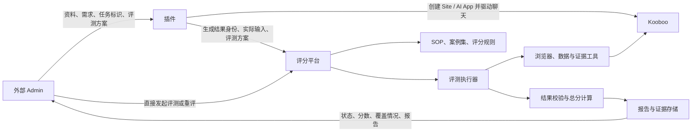

<a id="diagram-02"></a>

## 02 · 资源包驱动的统一自动化流程

> 历史说明：此处为早期总体提案，克隆与站点起点的澄清见第 04 图。

[SVG](svg/02.svg) · [PNG](png/02.png) · [Mermaid](mermaid/02.mmd) · [原始回复](source-messages.md#message-0fd86e5805944d32016aeda4534fac87d0ac78d0893d6596f3)

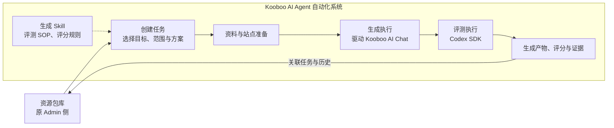

<a id="diagram-03"></a>

## 03 · 内容、视觉与业务评测依据

> 历史说明：此处保留当时使用的“原站”称呼，后续统一称为“内容站”，并明确了内容站与参考站的角色。

[SVG](svg/03.svg) · [PNG](png/03.png) · [Mermaid](mermaid/03.mmd) · [原始回复](source-messages.md#message-0fd86e5805944d32016aeda4534fac87d0ac78d0893d6596f3)

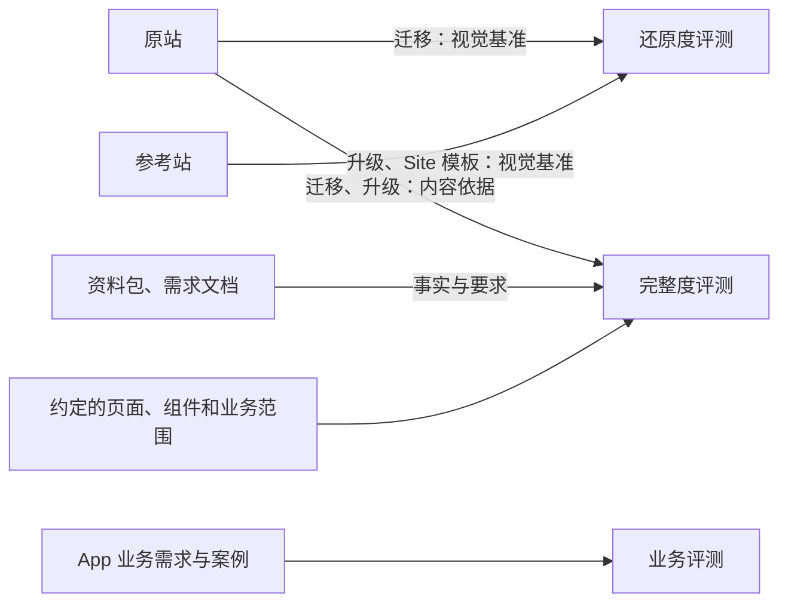

<a id="diagram-04"></a>

## 04 · 空白站点起步与三类克隆路径

[SVG](svg/04.svg) · [PNG](png/04.png) · [Mermaid](mermaid/04.mmd) · [原始回复](source-messages.md#message-0fd86e5805944d32016aeda862054c87d088a01d101029947b)

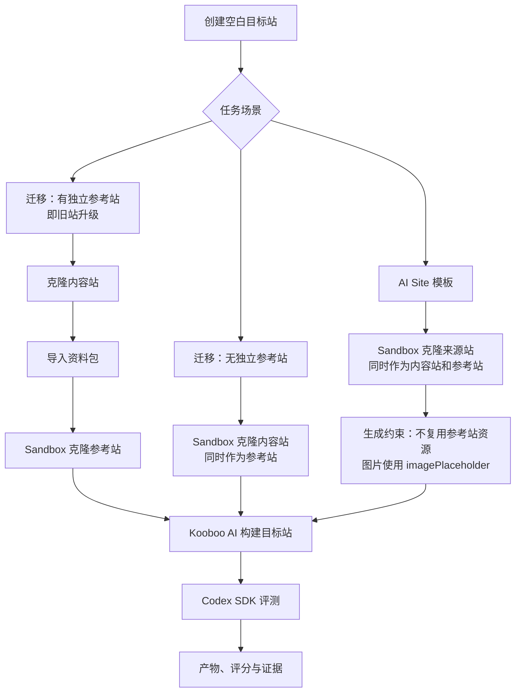

<a id="diagram-05"></a>

## 05 · 内部录入、外部导入与资源基线

[SVG](svg/05.svg) · [PNG](png/05.png) · [Mermaid](mermaid/05.mmd) · [原始回复](source-messages.md#message-0fd86e5805944d32016aedac05a8e487d08370e2bc2540fcfe)

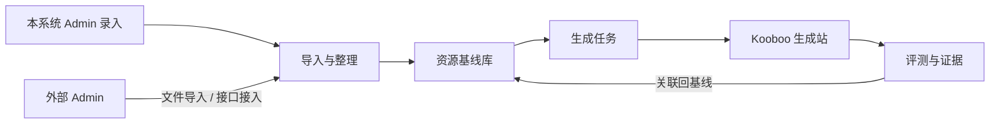

<a id="diagram-06"></a>

## 06 · 资源基线、输入版本与多个生成站

[SVG](svg/06.svg) · [PNG](png/06.png) · [Mermaid](mermaid/06.mmd) · [原始回复](source-messages.md#message-0fd86e5805944d32016aedac05a8e487d08370e2bc2540fcfe)

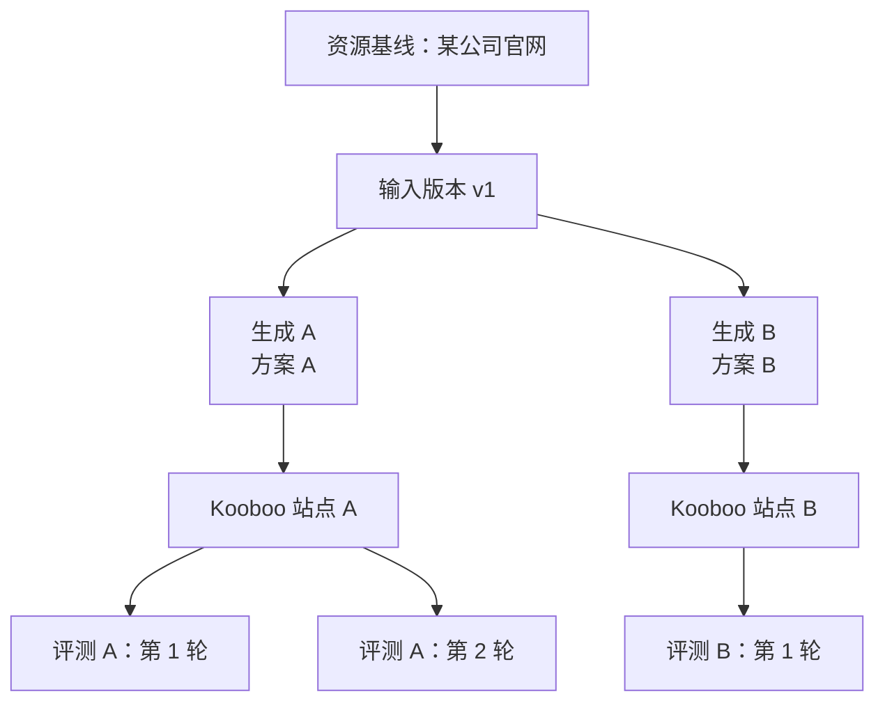

<a id="diagram-07"></a>

## 07 · 生成执行模块的职责与人工接管

[SVG](svg/07.svg) · [PNG](png/07.png) · [Mermaid](mermaid/07.mmd) · [原始回复](source-messages.md#message-0fd86e5805944d32016aedaf37cecc87d099dad6f776c3d340)

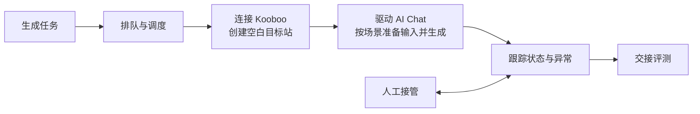

<a id="diagram-08"></a>

## 08 · 早期生成方案分层提案

> 历史说明：历史提案；后续已收敛为场景提示词与一次完整 message 委托，不单独引入复杂生成方案层。

[SVG](svg/08.svg) · [PNG](png/08.png) · [Mermaid](mermaid/08.mmd) · [原始回复](source-messages.md#message-0e6a4eb398885f36016aedb15d9fa887d083d1b54f3a0805c7)

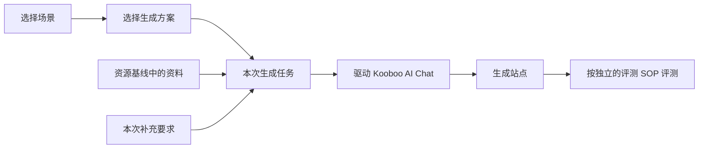

<a id="diagram-09"></a>

## 09 · 首页样稿、成单与内页续建

[SVG](svg/09.svg) · [PNG](png/09.png) · [Mermaid](mermaid/09.mmd) · [原始回复](source-messages.md#message-0e6a4eb398885f36016aede73784e087d097d3fd890288d3b8)

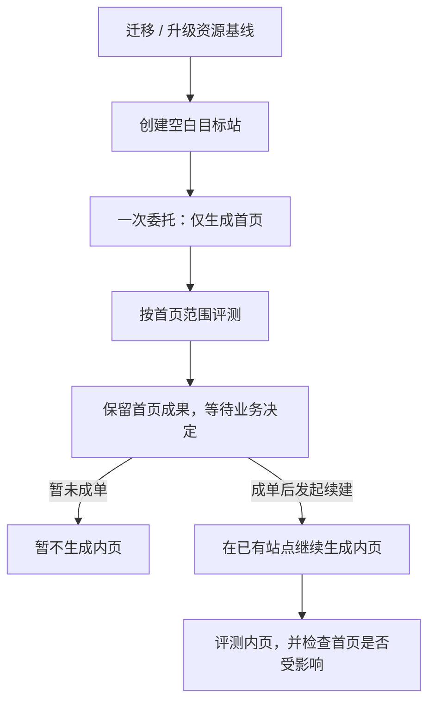

<a id="diagram-10"></a>

## 10 · 并发队列与早期外部 AI 跟进方案

> 历史说明：历史方案；后续已将跟进决策纳入平台内置本地 AI，见第 21—23 图。

[SVG](svg/10.svg) · [PNG](png/10.png) · [Mermaid](mermaid/10.mmd) · [原始回复](source-messages.md#message-0e6a4eb398885f36016aede91aa28887d0bfc4bd60394cd900)

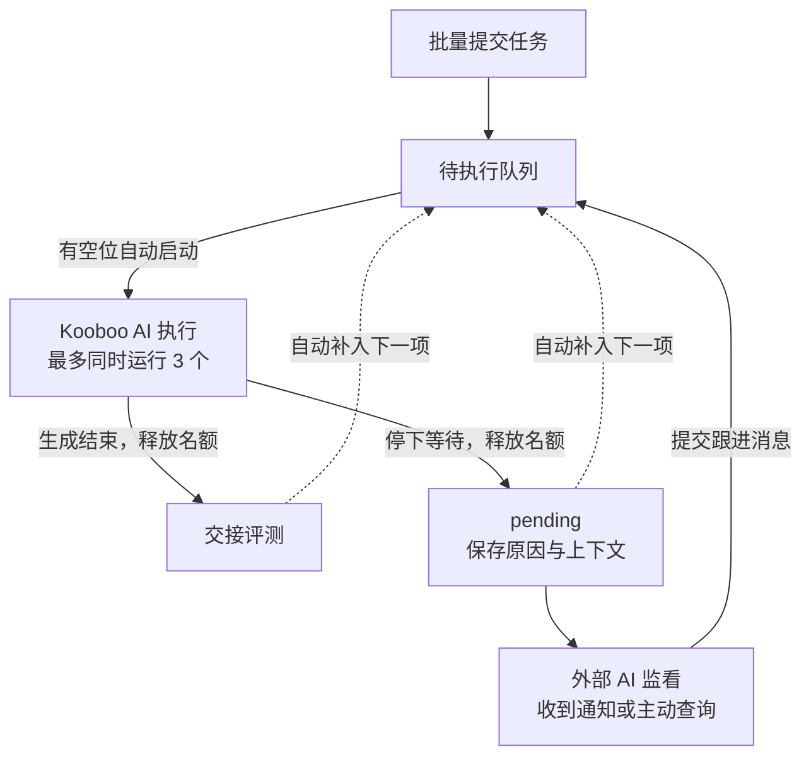

<a id="diagram-11"></a>

## 11 · 评分平台、评测 Skill 与本地 AI

[SVG](svg/11.svg) · [PNG](png/11.png) · [Mermaid](mermaid/11.mmd) · [原始回复](source-messages.md#message-0e6a4eb398885f36016aeded62aef887d0ae9a93c4f23b7ebf)

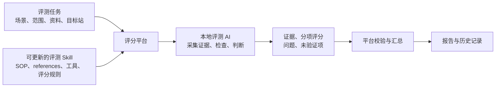

<a id="diagram-12"></a>

## 12 · Site UI 还原度评测 SOP

[SVG](svg/12.svg) · [PNG](png/12.png) · [Mermaid](mermaid/12.mmd) · [原始回复](source-messages.md#message-0e6a4eb398885f36016aedeeefe31887d0a48ee3434cc35dff)

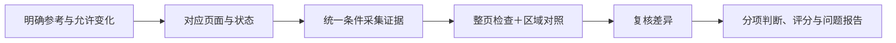

<a id="diagram-13"></a>

## 13 · 按 Banner 设计意图进行双端评测

[SVG](svg/13.svg) · [PNG](png/13.png) · [Mermaid](mermaid/13.mmd) · [原始回复](source-messages.md#message-0e6a4eb398885f36016aedf1f852c487d0a75066897ed9ed1d)

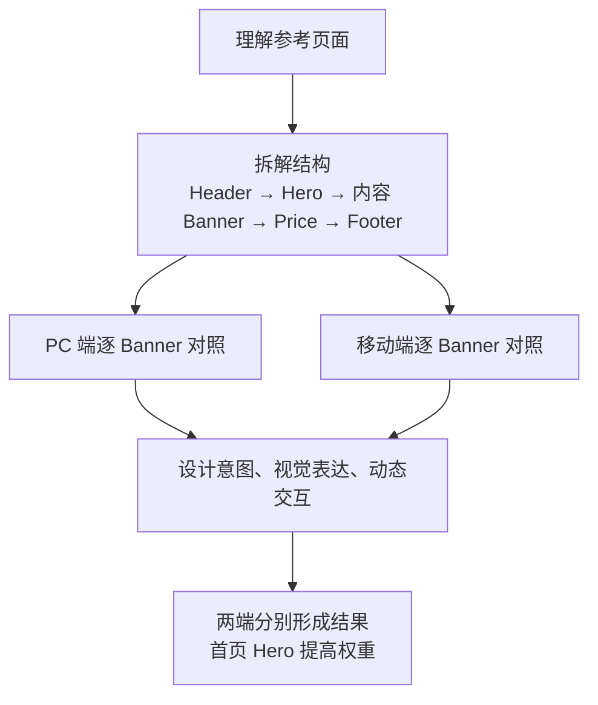

<a id="diagram-14"></a>

## 14 · 全站完整度清单与逐项核验

[SVG](svg/14.svg) · [PNG](png/14.png) · [Mermaid](mermaid/14.mmd) · [原始回复](source-messages.md#message-0e6a4eb398885f36016aedf78a3df887d08eb54497eef5792a)

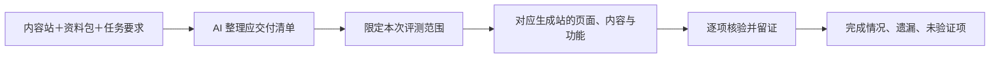

<a id="diagram-15"></a>

## 15 · SEO 迁移与旧 URL 承接

[SVG](svg/15.svg) · [PNG](png/15.png) · [Mermaid](mermaid/15.mmd) · [原始回复](source-messages.md#message-06763e789848107c016aedfbf933bc87d0ac316ca60f1d1f88)

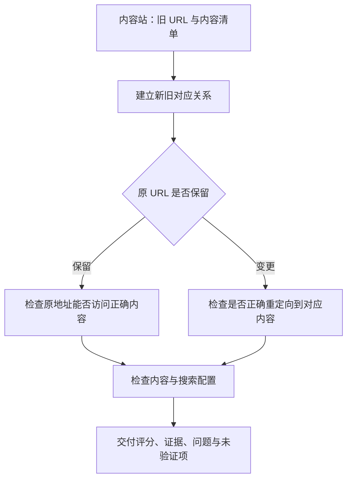

<a id="diagram-16"></a>

## 16 · AI App 用户目标、体验与业务评测

[SVG](svg/16.svg) · [PNG](png/16.png) · [Mermaid](mermaid/16.mmd) · [原始回复](source-messages.md#message-06763e789848107c016aedff3c38a487d0bd4818872ac46300)

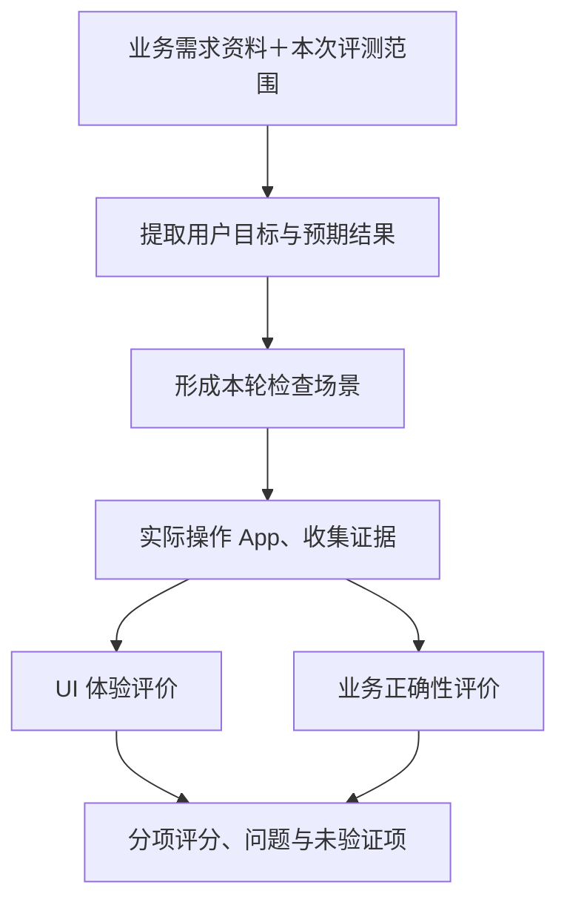

<a id="diagram-17"></a>

## 17 · 评测 Skill 发布与版本快照

[SVG](svg/17.svg) · [PNG](png/17.png) · [Mermaid](mermaid/17.mmd) · [原始回复](source-messages.md#message-06763e789848107c016aee0097353487d08bd253edfd0ffef9)

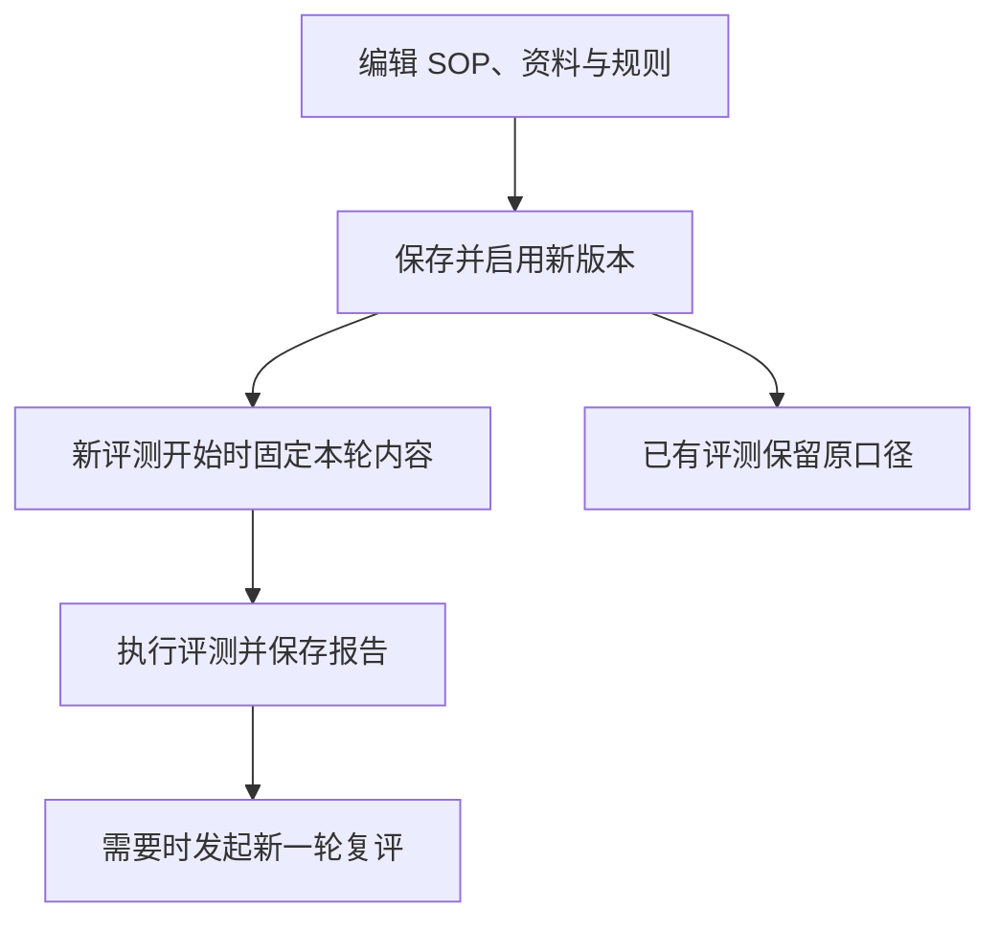

<a id="diagram-18"></a>

## 18 · 报告、问题跟进、修复与复评

> 历史说明：保留当时外部 AI / 人工跟进方案；后续增加了内置跟进与自动质量优化。

[SVG](svg/18.svg) · [PNG](png/18.png) · [Mermaid](mermaid/18.mmd) · [原始回复](source-messages.md#message-06763e789848107c016aee02370e8087d0bc7a966ba638bc60)

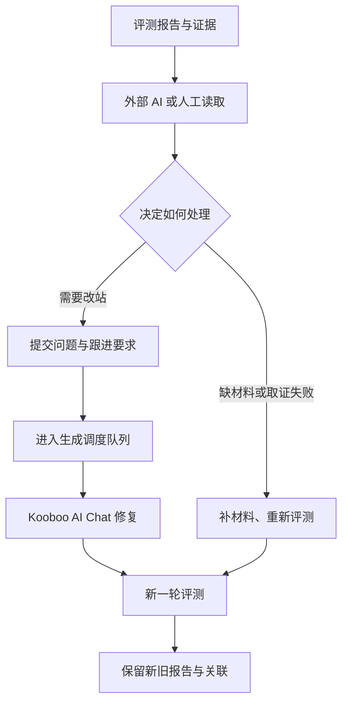

<a id="diagram-19"></a>

## 19 · Site 模板生成到独立评测

[SVG](svg/19.svg) · [PNG](png/19.png) · [Mermaid](mermaid/19.mmd) · [原始回复](source-messages.md#message-02a05bd5a435cb87016aee7cf3a9bc87d08105400348559a58)

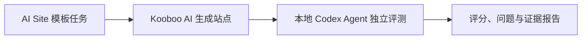

<a id="diagram-20"></a>

## 20 · 生成状态识别与自动交接评测

[SVG](svg/20.svg) · [PNG](png/20.png) · [Mermaid](mermaid/20.mmd) · [原始回复](source-messages.md#message-0ea4717fbae34248016aee8210aff487d0984eba1a724107ba)

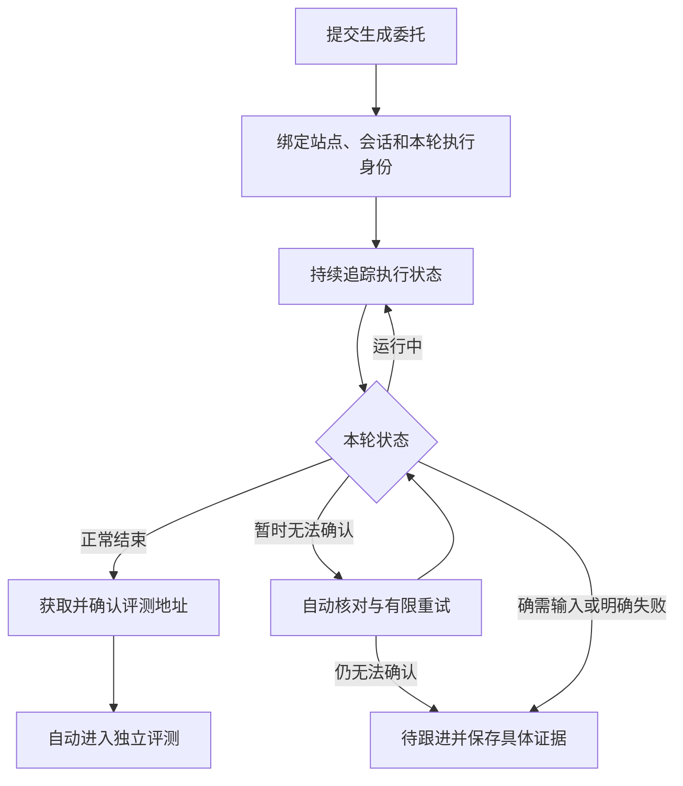

<a id="diagram-21"></a>

## 21 · 平台内置流程跟进 Agent

[SVG](svg/21.svg) · [PNG](png/21.png) · [Mermaid](mermaid/21.mmd) · [原始回复](source-messages.md#message-0ea4717fbae34248016aee83a01e7c87d08d78a19f6a464089)

```mermaid
flowchart TD
    A[Kooboo AI 执行生成] --> B{执行状态}
    B -->|正常结束| E[独立评测 Agent]
    B -->|异常、停顿或状态不明| C[流程跟进 Agent]
    C --> D[读取会话、状态和站点证据]
    D --> F{决定下一步}
    F -->|继续观察| D
    F -->|需要继续生成| G[通过调度器跟进原会话]
    G --> A
    F -->|确认可以评测| E
    F -->|确需用户输入| H[保留上下文并提出具体问题]
```

<a id="diagram-22"></a>

## 22 · 一次发起后的自主推进与明确中断

[SVG](svg/22.svg) · [PNG](png/22.png) · [Mermaid](mermaid/22.mmd) · [原始回复](source-messages.md#message-0ea4717fbae34248016aee8415eedc87d0abe1f3d2e735b2a3)

```mermaid
flowchart TD
    A[你发起任务] --> B[系统推进：准备 → 生成 → 评测]
    B -->|顺利完成| C[交付评测报告]
    B -->|出现不确定或阻塞| D[内置 AI 查证并调用工具处理]
    D --> E{是否能够继续}
    E -->|能够继续| F[从对应阶段恢复]
    F --> B
    E -->|明确不能继续| G[中断并通知你：原因与下一步]
```

<a id="diagram-23"></a>

## 23 · 异常恢复、预算停止与报告交付

[SVG](svg/23.svg) · [PNG](png/23.png) · [Mermaid](mermaid/23.mmd) · [原始回复](source-messages.md#message-096d87c3fae9720a016aee8d2e5f1887d09dc5873057d85215)

```mermaid
flowchart TD
    A[准备 → 生成 → 评测] --> B[报告与证据]
    A -->|异常或停顿| C[内置 AI 查证并处理]
    C -->|重试 / 继续 / 回答 / 交接| A
    C -->|无法继续或预算耗尽| D[中断原因、下一步与通知]
```

<a id="diagram-24"></a>

## 24 · 按连接选择跨环境迁移与交付核验

[SVG](svg/24.svg) · [PNG](png/24.png) · [Mermaid](mermaid/24.mmd) · [原始回复](source-messages.md#message-084a5bc7650ffc0e016aee900437f887d0940022f5ee8ea7a6)

```mermaid
flowchart TD
    A[选择 Kooboo 连接] --> B[生成 → 完整评测]
    B --> C{是否需要迁移交付}
    C -->|Local 无交付| D[报告完成]
    C -->|香港连接 需要交付| E[迁移德国 → 交付核验]
    E --> D
```

<a id="diagram-25"></a>

## 25 · 按独立报告自动修复与提分

[SVG](svg/25.svg) · [PNG](png/25.png) · [Mermaid](mermaid/25.mmd) · [原始回复](source-messages.md#message-025d59537abc1714016aeed61b661887d0b1e2c9d96f51bbb3)

```mermaid
flowchart TD
    A[生成站点] --> B[独立评测]
    B --> C{任务目标}
    C -->|生成并评测| D[交付报告]
    C -->|自动优化| E{达到质量目标？}
    E -->|达到| D
    E -->|未达到| F[跟进 AI 查看报告与截图]
    F --> G[Kooboo AI 在原站修复]
    G --> B
    F -->|预算耗尽或无法继续| H[保留成果并说明停止原因]
```

<a id="diagram-26"></a>

## 26 · 具体修复委托、重新取证与回归检查

[SVG](svg/26.svg) · [PNG](png/26.png) · [Mermaid](mermaid/26.mmd) · [原始回复](source-messages.md#message-025d59537abc1714016aeed700937087d097443e9fc264c983)

```mermaid
flowchart LR
    A[报告与截图] --> B[跟进 AI 选择本轮重点]
    B --> C[组织修复委托]
    C --> D[Kooboo 原站修复]
    D --> E[重新取证与独立复评]
    E --> F[核对改善与回归]
```

<a id="diagram-27"></a>

## 27 · 自动优化轮数与停止条件

[SVG](svg/27.svg) · [PNG](png/27.png) · [Mermaid](mermaid/27.mmd) · [原始回复](source-messages.md#message-02e58a7082d6478b016aeeda40b5a887d0baab220b00f0a3e4)

```mermaid
flowchart TD
    A[取得有效评测报告] --> B{达到质量目标？}
    B -->|是| C[完成：目标达成]
    B -->|否| D{轮数、费用及改善情况允许继续？}
    D -->|是| E[委托修复 → 独立复评]
    E --> A
    D -->|否| F[停止：保留结果并说明原因和下一步]
```

<a id="diagram-28"></a>

## 28 · 早期外部 Admin 轮次 API 提案

> 历史说明：历史 API 提案；后续用户将对外范围收敛为当前版本最终结果，不再要求对外分页读取完整轮次。

[SVG](svg/28.svg) · [PNG](png/28.png) · [Mermaid](mermaid/28.mmd) · [原始回复](source-messages.md#message-02e58a7082d6478b016aeedae4f96c87d0b8be9f95ca27443d)

```mermaid
flowchart LR
    A[外部 Admin] --> B[流程摘要：进度、目标、当前结果、费用、停止原因]
    B --> C[分页读取各轮记录]
    C --> D[独立报告与证据]
```

<a id="diagram-29"></a>

## 29 · 修复与复评串行及报告适用性

[SVG](svg/29.svg) · [PNG](png/29.png) · [Mermaid](mermaid/29.mmd) · [原始回复](source-messages.md#message-02e58a7082d6478b016aeee2d2913887d0b358273b0bf5b4a4)

```mermaid
flowchart LR
    A[修复中] --> B[修复完成]
    B --> C[独立复评]
    C --> D[当前版本分数与证据]
    A -->|中断| E[恢复修复或明确停止]
    C -->|中断| F[恢复复评]
```

<a id="diagram-30"></a>

## 30 · 首页完成后补齐全站

> 历史说明：表示目标续建流程；当时全站完整度验收仍待真实验证。

[SVG](svg/30.svg) · [PNG](png/30.png) · [Mermaid](mermaid/30.mmd) · [原始回复](source-messages.md#message-0ae283427fb0864b016aef00b6a3b887d091f701db0c7e4760)

```mermaid
flowchart LR
 A[现有首页] --> B[同一站点继续生成]
 B --> C[补齐内页、导航和交互]
 C --> D[全站独立评测]
 D --> E[按需继续优化]
```

<a id="diagram-31"></a>

## 31 · 其余四类场景的建议验收顺序

> 历史说明：当时建议顺序；后续新增经验沉淀与预算保护作为优先议题。

[SVG](svg/31.svg) · [PNG](png/31.png) · [Mermaid](mermaid/31.mmd) · [原始回复](source-messages.md#message-0ae283427fb0864b016aef05e10ae087d09f102c71764463dd)

```mermaid
flowchart LR
 A[资料建站] --> B[站点迁移]
 B --> C[旧站升级]
 C --> D[AI App 模板]
```

<a id="diagram-32"></a>

## 32 · 跨任务经验沉淀与反馈闭环

> 历史说明：经验闭环为讨论方案；后续确认默认由本地 AI 决策与执行。

[SVG](svg/32.svg) · [PNG](png/32.png) · [Mermaid](mermaid/32.mmd) · [原始回复](source-messages.md#message-0ae283427fb0864b016aef072252f487d0bc7719991f924a4c)

```mermaid
flowchart LR
 A[生成与跟进] --> B[独立评测或明确中断]
 B --> C[结合证据复盘]
 C --> D[提炼候选经验]
 D --> E[后续案例验证]
 E --> F[按适用条件采用]
 F --> A
 E --> G[修订或停用]
```

<a id="diagram-33"></a>

## 33 · 本地 AI 自动选择、复盘与维护经验

> 历史说明：已确认的产品方向，图本身不证明对应运行机制已实施。

[SVG](svg/33.svg) · [PNG](png/33.png) · [Mermaid](mermaid/33.mmd) · [原始回复](source-messages.md#message-0ae283427fb0864b016aef0833195887d0bf28046c9821865e)

```mermaid
flowchart TD
 A[即将执行某个阶段] --> B[本地 AI 选择适用经验]
 B --> C[生成 / 跟进 / 独立评测]
 C --> D[本地 AI 根据结果复盘]
 D --> E[新增、合并、修订或停用经验]
 E --> F[经验库]
 F --> B
 H[人工查看与调整] <--> F
```

<a id="diagram-34"></a>

## 34 · 经验试用、效果验证与修订停用

> 历史说明：经验条目与效果判定的首版讨论提案。

[SVG](svg/34.svg) · [PNG](png/34.png) · [Mermaid](mermaid/34.mmd) · [原始回复](source-messages.md#message-0ae283427fb0864b016aef08b102ec87d08f448e3ee829931c)

```mermaid
flowchart LR
 A[提炼经验] --> B[AI 判断适用并试用]
 B --> C[检查实际执行与独立结果]
 C --> D[补充支持证据]
 C --> E[收窄条件、修订或停用]
 D --> B
 E --> B
```

<a id="diagram-35"></a>

## 35 · 生成站详情与评测报告历史

2026-11-08 追加。来源：主对话关于取消独立评测报告菜单、归入生成站详情的讨论；用户已确认方案，产品功能待实施。

[Mermaid](mermaid/35.mmd) · [来源上下文](source-messages.md#report-history-2026-11-08)

状态：仅源码，尚未导出 SVG/PNG；离线图片图集仍为前 34 张。

```mermaid
flowchart LR
    A[资源] --> B[生成站 A]
    A --> C[生成站 B]
    B --> D[详情 · 评测结果]
    D --> E[评测记录列表]
    E --> F[某次报告与证据]
```

<a id="diagram-36"></a>

## 36 · 迁移清单驱动生成、对账与独立评测

2026-11-08 追加。来源：「提炼会话经验」会话；用户已确认迁移清单方向，本图的细化流程为讨论提案，尚未实施。

[Mermaid](mermaid/36.mmd) · [来源上下文](source-messages.md#migration-manifest-2026-11-08) · [讨论记录](../migration-manifest-discussion-2026-11-08.md)

状态：仅源码，尚未导出 SVG/PNG。

```mermaid
flowchart TD
    A[冻结的来源资料与迁移要求] --> B[建立迁移清单 v1]
    B --> C[Kooboo 按清单生成]
    B --> D[程序逐项对账]
    C --> D
    D -->|缺失或不一致| E[按具体 ID 和 URL 修复]
    E --> C
    D -->|数据与路由检查通过| F[独立评测复核来源与目标]
    F -->|发现遗漏或质量问题| E
    F -->|必交付项验证通过| G[结合质量与上线条件判定交付]
```

<a id="diagram-47"></a>

## 47 · 完整站点与平台执行档案的一键排障导出

2026-11-08 追加。方案已具备实施基础，尚未实现或真实验收。

[Mermaid](mermaid/47.mmd) · [来源上下文](source-messages.md#diagnostic-export-2026-11-08) · [讨论记录](../diagnostic-export-discussion-2026-11-08.md)

状态：仅源码，未导出 SVG/PNG。

```mermaid
flowchart TD
    A[生成站或失败任务：导出排障包] --> B[固定关联范围与导出截止时间]
    B --> C[收集平台记录与已有证据]
    B --> D{Kooboo 站点可导出吗}
    D -->|可以| E[原生全部导出：完整模式]
    D -->|离线、未建站或失败| F[记录站点包缺失与原因]
    C --> G[整理目录、脱敏平台凭证并核对文件]
    E --> G
    F --> G
    G --> H[生成摘要、索引与校验信息]
    H --> I[下载一个 ZIP]
    I --> J[离线分析站点与执行过程]
```
