# 主对话流程图归档

来源对话：**梳理自动化插件与评分平台需求**。归档日期：2026-11-07（北京时间）。

已读取主对话的 69 个历史轮次，提取 32 条助手回复中的 **34 张 Mermaid 图**，按原消息顺序保留。图中内容未重写；标题与历史说明为归档时整理。早期建议可能已被后续讨论修订，本归档用于回看过程，不代表全部已实施或仍是当前方案。

SVG / PNG 根据原始 Mermaid 源码渲染，使用 beautiful-mermaid + ELK 布局，并按用户提供的 Codex 截图调整深色配色、圆角节点、留白、中文字体、细线与圆角折线。原始源码未改变；自动布局与聊天内显示仍可能不同，本归档不推断 Codex 内部使用的渲染库。离线图集及图片均不依赖外部 CDN 或在线字体。

- **直接浏览**：[离线图集](index.html)，支持搜索、目录跳转和放大。
- **查看全部图源码**：本文下方，或 `mermaid/` 中的独立 `.mmd`。
- **保存图片**：`svg/` 为矢量图，`png/` 为图片。
- **回看原话**：[包含图表的原始回复](source-messages.md)。
- **来源索引**：[diagrams.json](diagrams.json)，含原消息 / 轮次 ID 与图源码。

2026-11-08 起按用户要求持续归档主对话新增的 Mermaid 图表：保留原始 `.mmd` 源码，同步更新本文和 `diagrams.json` 的日期、来源上下文与状态。最初 34 张为历史快照；后续追加记录不改写历史原图，也不伪造未采集的消息 ID。本轮已补齐全部 63 张图的 SVG/PNG；今后新增且尚未导出的图表仍需明确标为“仅源码”。

如需重新渲染：将 `mermaid@11` 和 `beautiful-mermaid@1.1.3` 安装到独立目录，在项目已安装 Playwright / Chromium 的环境中运行：

```sh
node docs/conversation-diagrams/render.mjs /绝对路径/node_modules/mermaid /绝对路径/node_modules/beautiful-mermaid
```

无需修改项目依赖或启动平台服务。渲染脚本会在临时目录创建版本固定的样式适配器，调整该版本尚未完整公开的字体度量、节点内边距和连线合并设置；不会修改安装包。升级该库时需重新适配。节点圆角和折线圆角在 SVG 输出阶段处理。

34 张图均与 Mermaid 官方解析器逐项核对节点文本、连线端点与标签，同时检查导出节点/连线数量和文字边界；导出后校验 SVG、PNG、文件校验和及 ZIP 完整性。渲染参数与结果见 `render-results.json`。

2026-11-08 整理：现有 **63 张图均具备 MMD、PNG 和 SVG**，实际文件统一为“编号-中文标题”。本次补导原缺少的 29 张 PNG；已有 34 张 PNG 与全部原始 MMD 的文件内容保持不变。业务状态与历史来源说明继续保留，不代表图中方案已经实施。

## 目录

- [01 · 初始架构：Admin、插件、评分平台与评测执行器](#diagram-01)
- [02 · 资源包驱动的统一自动化流程](#diagram-02)
- [03 · 内容、视觉与业务评测依据](#diagram-03)
- [04 · 空白站点起步与三类克隆路径](#diagram-04)
- [05 · 内部录入、外部导入与资源基线](#diagram-05)
- [06 · 资源基线、输入版本与多个生成站](#diagram-06)
- [07 · 生成执行模块的职责与人工接管](#diagram-07)
- [08 · 早期生成方案分层提案](#diagram-08)
- [09 · 首页样稿、成单与内页续建](#diagram-09)
- [10 · 并发队列与早期外部 AI 跟进方案](#diagram-10)
- [11 · 评分平台、评测 Skill 与本地 AI](#diagram-11)
- [12 · Site UI 还原度评测 SOP](#diagram-12)
- [13 · 按 Banner 设计意图进行双端评测](#diagram-13)
- [14 · 全站完整度清单与逐项核验](#diagram-14)
- [15 · SEO 迁移与旧 URL 承接](#diagram-15)
- [16 · AI App 用户目标、体验与业务评测](#diagram-16)
- [17 · 评测 Skill 发布与版本快照](#diagram-17)
- [18 · 报告、问题跟进、修复与复评](#diagram-18)
- [19 · Site 模板生成到独立评测](#diagram-19)
- [20 · 生成状态识别与自动交接评测](#diagram-20)
- [21 · 平台内置流程跟进 Agent](#diagram-21)
- [22 · 一次发起后的自主推进与明确中断](#diagram-22)
- [23 · 异常恢复、预算停止与报告交付](#diagram-23)
- [24 · 按连接选择跨环境迁移与交付核验](#diagram-24)
- [25 · 按独立报告自动修复与提分](#diagram-25)
- [26 · 具体修复委托、重新取证与回归检查](#diagram-26)
- [27 · 自动优化轮数与停止条件](#diagram-27)
- [28 · 早期外部 Admin 轮次 API 提案](#diagram-28)
- [29 · 修复与复评串行及报告适用性](#diagram-29)
- [30 · 首页完成后补齐全站](#diagram-30)
- [31 · 其余四类场景的建议验收顺序](#diagram-31)
- [32 · 跨任务经验沉淀与反馈闭环](#diagram-32)
- [33 · 本地 AI 自动选择、复盘与维护经验](#diagram-33)
- [34 · 经验试用、效果验证与修订停用](#diagram-34)
- [35 · 生成站详情与评测报告历史（源码与图片齐全）](#diagram-35)

- [36 · 迁移清单驱动生成、对账与独立评测（源码与图片齐全）](#diagram-36)

- [37 · 迁移清单的生成前核对与缺口处理（源码与图片齐全）](#diagram-37)

- [38 · 迁移 checklist 的逐轮检查与修复（源码与图片齐全）](#diagram-38)

- [39 · 迁移清单与目标快照的程序对账（源码与图片齐全）](#diagram-39)

- [40 · 平台与 Kooboo 的清单及修复交接（源码与图片齐全）](#diagram-40)

- [41 · message 优先与临时 kfile 的交付选择（源码与图片齐全）](#diagram-41)

- [42 · 迁移 checklist 的异常重试与停止（源码与图片齐全）](#diagram-42)

- [43 · 迁移 checklist 首批实施与后续接入（源码与图片齐全）](#diagram-43)

- [44 · manwei 原任务第1轮验证与后续修复（源码与图片齐全）](#diagram-44)

- [47 · 完整站点与平台执行档案的一键排障导出（源码与图片齐全）](#diagram-47)

- [49 · 第41图落实与manwei第3轮验证（源码与图片齐全）](#diagram-49)

- [50 · 迁移两段完整性与manwei经验复盘（源码与图片齐全）](#diagram-50)

- [51 · 参考site-harvest建立A段来源完整性检查（源码与图片齐全）](#diagram-51)

- [52 · 采集AI的输入产出与A段交接条件（源码与图片齐全）](#diagram-52)

- [53 · 跟进AI按缺口形成任务并判断继续或停止（源码与图片齐全）](#diagram-53)

- [54 · 完成优先的自动接续与防循环兜底（源码与图片齐全）](#diagram-54)

- [55 · 采集任务的检查点自动接续与目标级防循环（源码与图片齐全）](#diagram-55)

- [56 · site-harvest能力内置与Windows和macOS交付（源码与图片齐全）](#diagram-56)

<a id="diagram-01"></a>

## 01 · 初始架构：Admin、插件、评分平台与评测执行器

[SVG](svg/01-初始架构-Admin、插件、评分平台与评测执行器.svg) · [PNG](png/01-初始架构-Admin、插件、评分平台与评测执行器.png) · [Mermaid](mermaid/01-初始架构-Admin、插件、评分平台与评测执行器.mmd) · [原始回复](source-messages.md#message-0fd86e5805944d32016aed97ddf2d487d0be572cf882f21877)

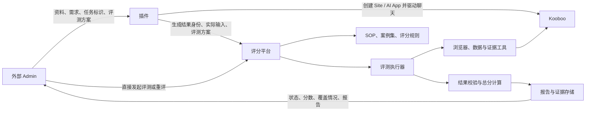

<a id="diagram-02"></a>

## 02 · 资源包驱动的统一自动化流程

> 历史说明：此处为早期总体提案，克隆与站点起点的澄清见第 04 图。

[SVG](svg/02-资源包驱动的统一自动化流程.svg) · [PNG](png/02-资源包驱动的统一自动化流程.png) · [Mermaid](mermaid/02-资源包驱动的统一自动化流程.mmd) · [原始回复](source-messages.md#message-0fd86e5805944d32016aeda4534fac87d0ac78d0893d6596f3)

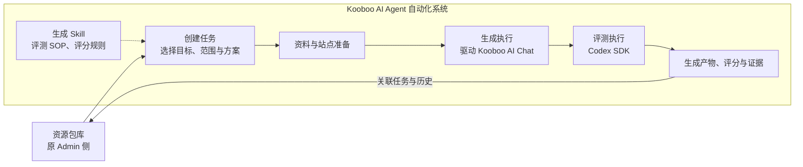

<a id="diagram-03"></a>

## 03 · 内容、视觉与业务评测依据

> 历史说明：此处保留当时使用的“原站”称呼，后续统一称为“内容站”，并明确了内容站与参考站的角色。

[SVG](svg/03-内容、视觉与业务评测依据.svg) · [PNG](png/03-内容、视觉与业务评测依据.png) · [Mermaid](mermaid/03-内容、视觉与业务评测依据.mmd) · [原始回复](source-messages.md#message-0fd86e5805944d32016aeda4534fac87d0ac78d0893d6596f3)

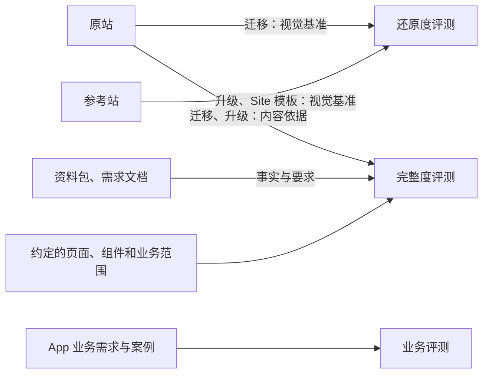

<a id="diagram-04"></a>

## 04 · 空白站点起步与三类克隆路径

[SVG](svg/04-空白站点起步与三类克隆路径.svg) · [PNG](png/04-空白站点起步与三类克隆路径.png) · [Mermaid](mermaid/04-空白站点起步与三类克隆路径.mmd) · [原始回复](source-messages.md#message-0fd86e5805944d32016aeda862054c87d088a01d101029947b)

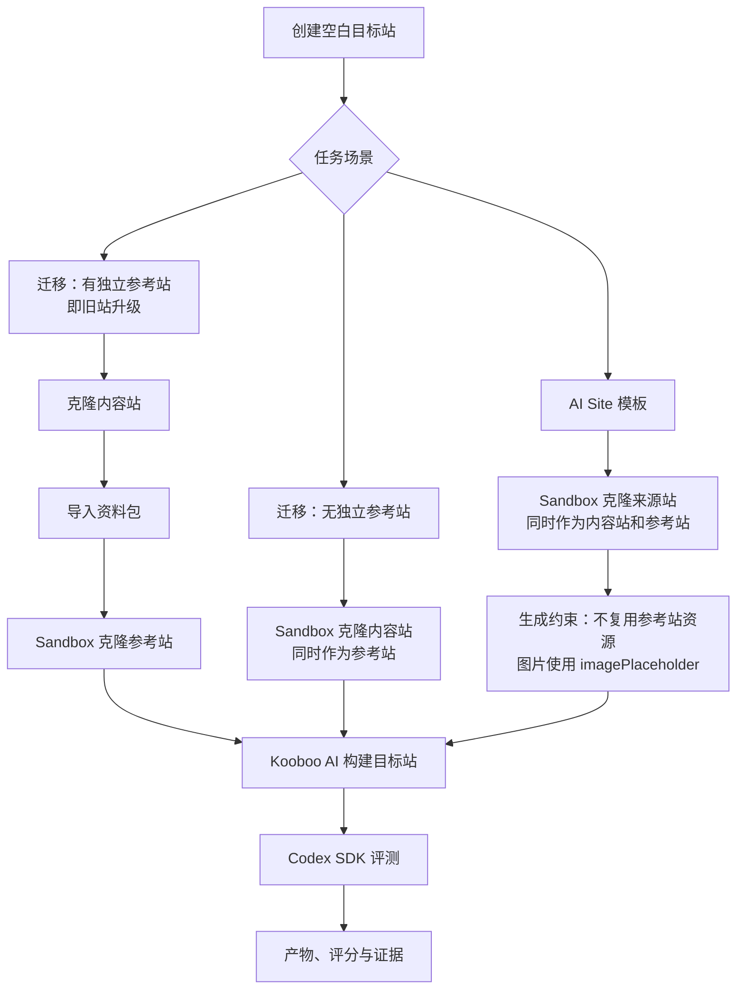

<a id="diagram-05"></a>

## 05 · 内部录入、外部导入与资源基线

[SVG](svg/05-内部录入、外部导入与资源基线.svg) · [PNG](png/05-内部录入、外部导入与资源基线.png) · [Mermaid](mermaid/05-内部录入、外部导入与资源基线.mmd) · [原始回复](source-messages.md#message-0fd86e5805944d32016aedac05a8e487d08370e2bc2540fcfe)

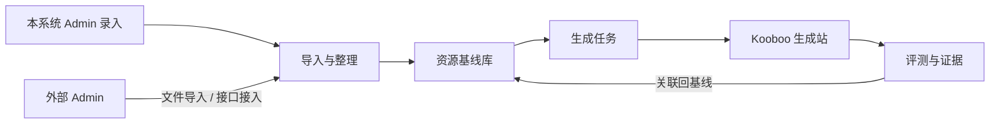

<a id="diagram-06"></a>

## 06 · 资源基线、输入版本与多个生成站

[SVG](svg/06-资源基线、输入版本与多个生成站.svg) · [PNG](png/06-资源基线、输入版本与多个生成站.png) · [Mermaid](mermaid/06-资源基线、输入版本与多个生成站.mmd) · [原始回复](source-messages.md#message-0fd86e5805944d32016aedac05a8e487d08370e2bc2540fcfe)

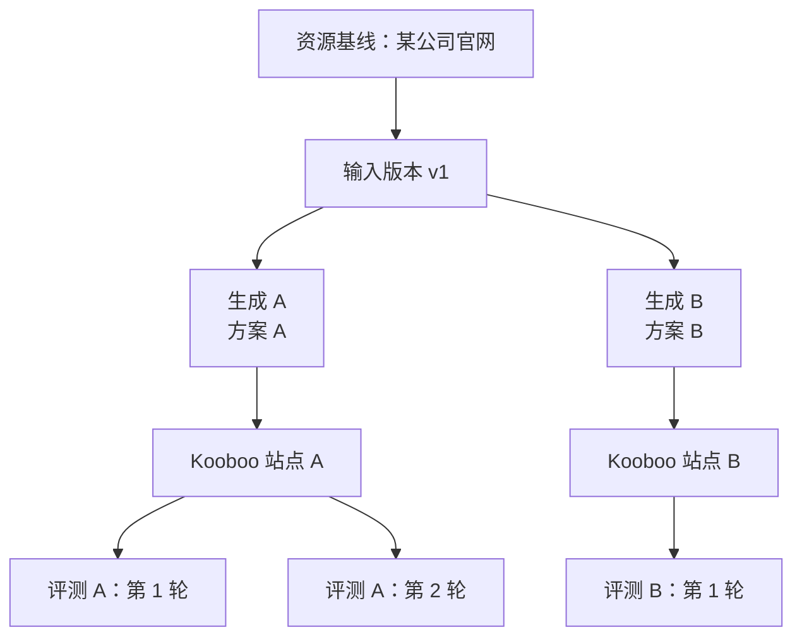

<a id="diagram-07"></a>

## 07 · 生成执行模块的职责与人工接管

[SVG](svg/07-生成执行模块的职责与人工接管.svg) · [PNG](png/07-生成执行模块的职责与人工接管.png) · [Mermaid](mermaid/07-生成执行模块的职责与人工接管.mmd) · [原始回复](source-messages.md#message-0fd86e5805944d32016aedaf37cecc87d099dad6f776c3d340)

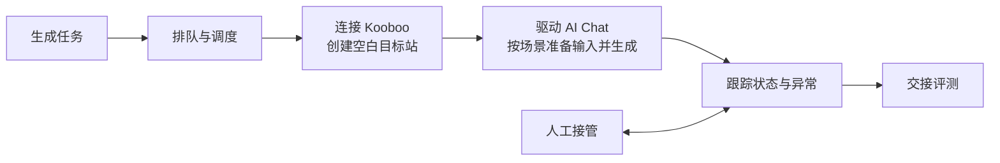

<a id="diagram-08"></a>

## 08 · 早期生成方案分层提案

> 历史说明：历史提案；后续已收敛为场景提示词与一次完整 message 委托，不单独引入复杂生成方案层。

[SVG](svg/08-早期生成方案分层提案.svg) · [PNG](png/08-早期生成方案分层提案.png) · [Mermaid](mermaid/08-早期生成方案分层提案.mmd) · [原始回复](source-messages.md#message-0e6a4eb398885f36016aedb15d9fa887d083d1b54f3a0805c7)

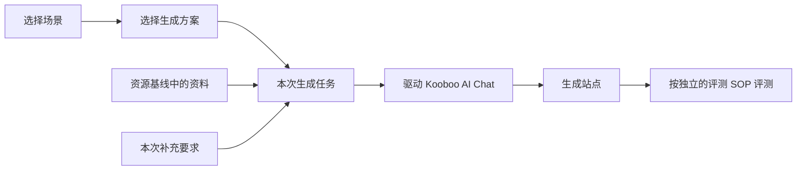

<a id="diagram-09"></a>

## 09 · 首页样稿、成单与内页续建

[SVG](svg/09-首页样稿、成单与内页续建.svg) · [PNG](png/09-首页样稿、成单与内页续建.png) · [Mermaid](mermaid/09-首页样稿、成单与内页续建.mmd) · [原始回复](source-messages.md#message-0e6a4eb398885f36016aede73784e087d097d3fd890288d3b8)

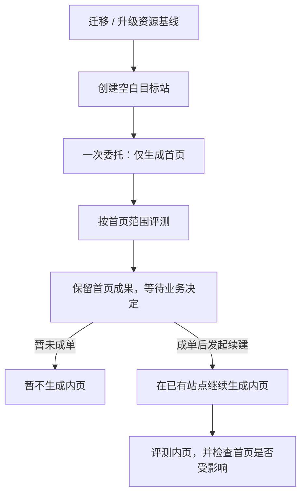

<a id="diagram-10"></a>

## 10 · 并发队列与早期外部 AI 跟进方案

> 历史说明：历史方案；后续已将跟进决策纳入平台内置本地 AI，见第 21—23 图。

[SVG](svg/10-并发队列与早期外部_AI_跟进方案.svg) · [PNG](png/10-并发队列与早期外部_AI_跟进方案.png) · [Mermaid](mermaid/10-并发队列与早期外部_AI_跟进方案.mmd) · [原始回复](source-messages.md#message-0e6a4eb398885f36016aede91aa28887d0bfc4bd60394cd900)

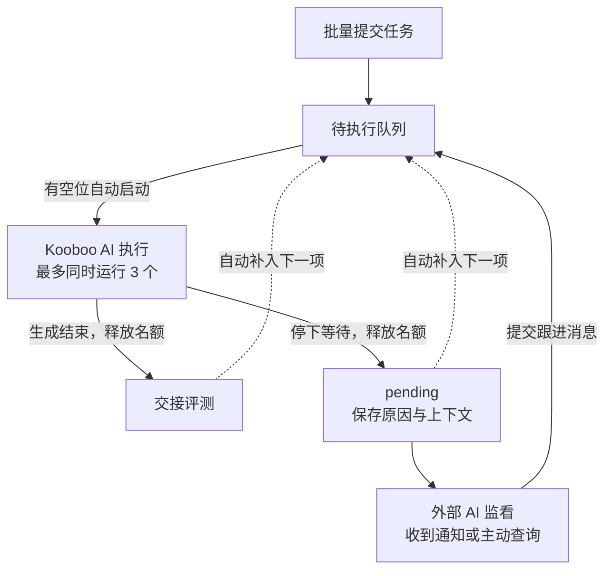

<a id="diagram-11"></a>

## 11 · 评分平台、评测 Skill 与本地 AI

[SVG](svg/11-评分平台、评测_Skill_与本地_AI.svg) · [PNG](png/11-评分平台、评测_Skill_与本地_AI.png) · [Mermaid](mermaid/11-评分平台、评测_Skill_与本地_AI.mmd) · [原始回复](source-messages.md#message-0e6a4eb398885f36016aeded62aef887d0ae9a93c4f23b7ebf)

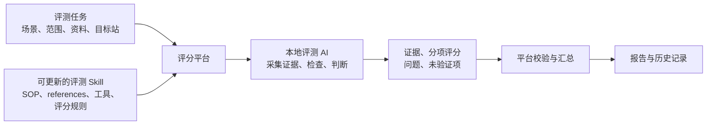

<a id="diagram-12"></a>

## 12 · Site UI 还原度评测 SOP

[SVG](svg/12-Site_UI_还原度评测_SOP.svg) · [PNG](png/12-Site_UI_还原度评测_SOP.png) · [Mermaid](mermaid/12-Site_UI_还原度评测_SOP.mmd) · [原始回复](source-messages.md#message-0e6a4eb398885f36016aedeeefe31887d0a48ee3434cc35dff)

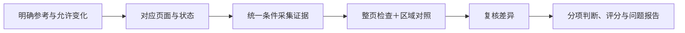

<a id="diagram-13"></a>

## 13 · 按 Banner 设计意图进行双端评测

[SVG](svg/13-按_Banner_设计意图进行双端评测.svg) · [PNG](png/13-按_Banner_设计意图进行双端评测.png) · [Mermaid](mermaid/13-按_Banner_设计意图进行双端评测.mmd) · [原始回复](source-messages.md#message-0e6a4eb398885f36016aedf1f852c487d0a75066897ed9ed1d)

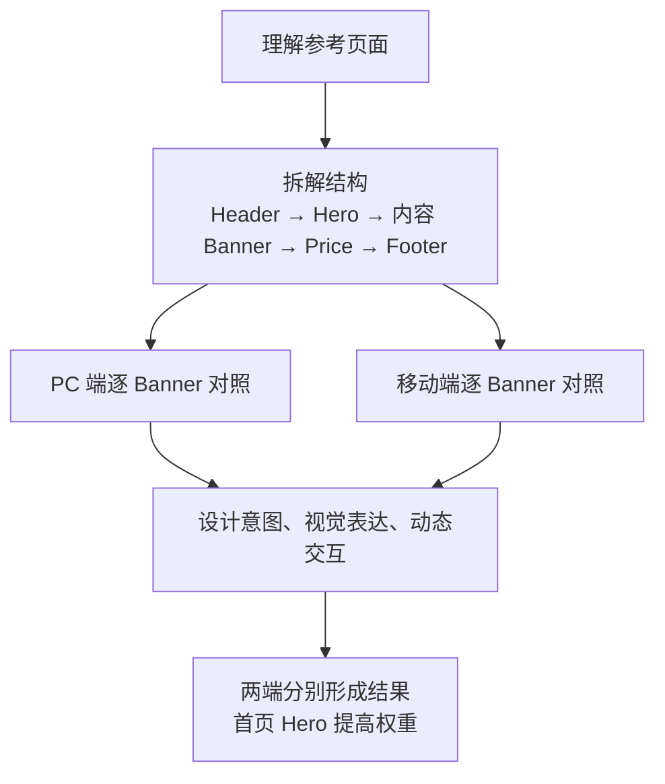

<a id="diagram-14"></a>

## 14 · 全站完整度清单与逐项核验

[SVG](svg/14-全站完整度清单与逐项核验.svg) · [PNG](png/14-全站完整度清单与逐项核验.png) · [Mermaid](mermaid/14-全站完整度清单与逐项核验.mmd) · [原始回复](source-messages.md#message-0e6a4eb398885f36016aedf78a3df887d08eb54497eef5792a)

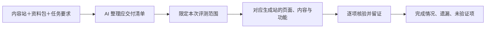

<a id="diagram-15"></a>

## 15 · SEO 迁移与旧 URL 承接

[SVG](svg/15-SEO_迁移与旧_URL_承接.svg) · [PNG](png/15-SEO_迁移与旧_URL_承接.png) · [Mermaid](mermaid/15-SEO_迁移与旧_URL_承接.mmd) · [原始回复](source-messages.md#message-06763e789848107c016aedfbf933bc87d0ac316ca60f1d1f88)

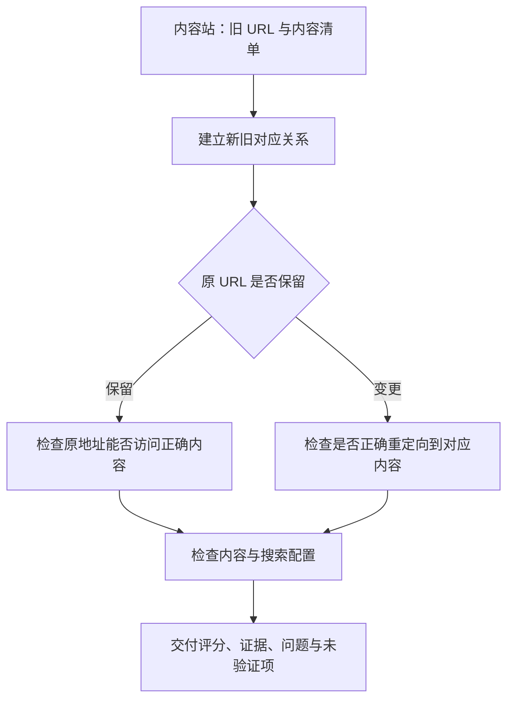

<a id="diagram-16"></a>

## 16 · AI App 用户目标、体验与业务评测

[SVG](svg/16-AI_App_用户目标、体验与业务评测.svg) · [PNG](png/16-AI_App_用户目标、体验与业务评测.png) · [Mermaid](mermaid/16-AI_App_用户目标、体验与业务评测.mmd) · [原始回复](source-messages.md#message-06763e789848107c016aedff3c38a487d0bd4818872ac46300)

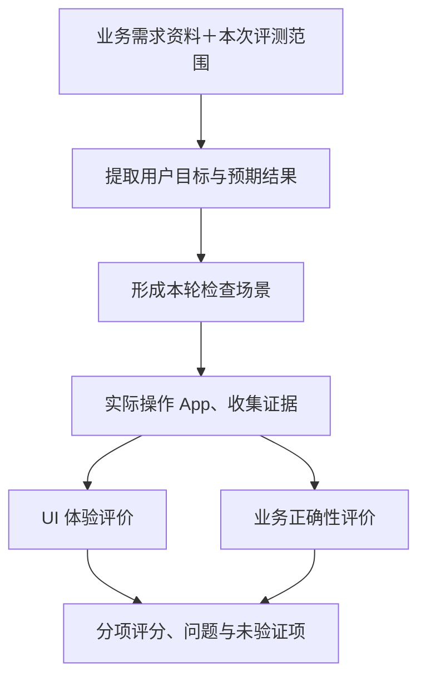

<a id="diagram-17"></a>

## 17 · 评测 Skill 发布与版本快照

[SVG](svg/17-评测_Skill_发布与版本快照.svg) · [PNG](png/17-评测_Skill_发布与版本快照.png) · [Mermaid](mermaid/17-评测_Skill_发布与版本快照.mmd) · [原始回复](source-messages.md#message-06763e789848107c016aee0097353487d08bd253edfd0ffef9)

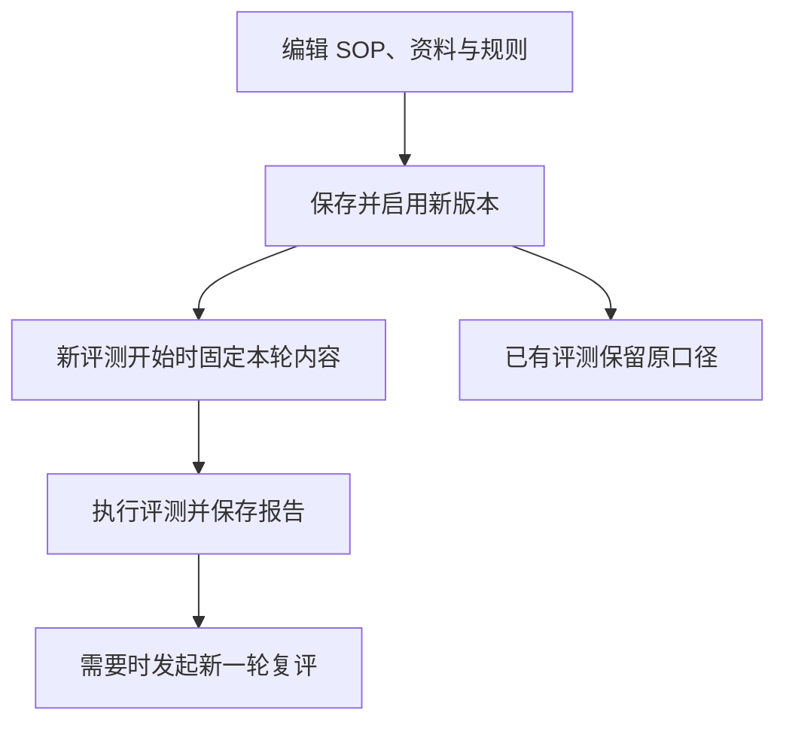

<a id="diagram-18"></a>

## 18 · 报告、问题跟进、修复与复评

> 历史说明：保留当时外部 AI / 人工跟进方案；后续增加了内置跟进与自动质量优化。

[SVG](svg/18-报告、问题跟进、修复与复评.svg) · [PNG](png/18-报告、问题跟进、修复与复评.png) · [Mermaid](mermaid/18-报告、问题跟进、修复与复评.mmd) · [原始回复](source-messages.md#message-06763e789848107c016aee02370e8087d0bc7a966ba638bc60)

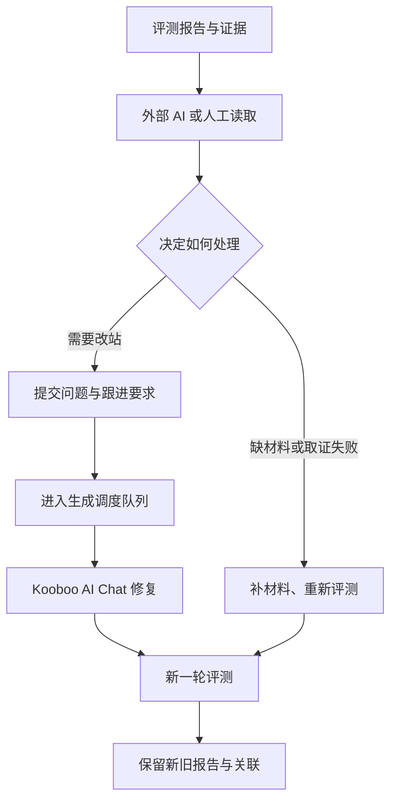

<a id="diagram-19"></a>

## 19 · Site 模板生成到独立评测

[SVG](svg/19-Site_模板生成到独立评测.svg) · [PNG](png/19-Site_模板生成到独立评测.png) · [Mermaid](mermaid/19-Site_模板生成到独立评测.mmd) · [原始回复](source-messages.md#message-02a05bd5a435cb87016aee7cf3a9bc87d08105400348559a58)

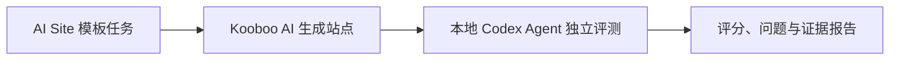

<a id="diagram-20"></a>

## 20 · 生成状态识别与自动交接评测

[SVG](svg/20-生成状态识别与自动交接评测.svg) · [PNG](png/20-生成状态识别与自动交接评测.png) · [Mermaid](mermaid/20-生成状态识别与自动交接评测.mmd) · [原始回复](source-messages.md#message-0ea4717fbae34248016aee8210aff487d0984eba1a724107ba)

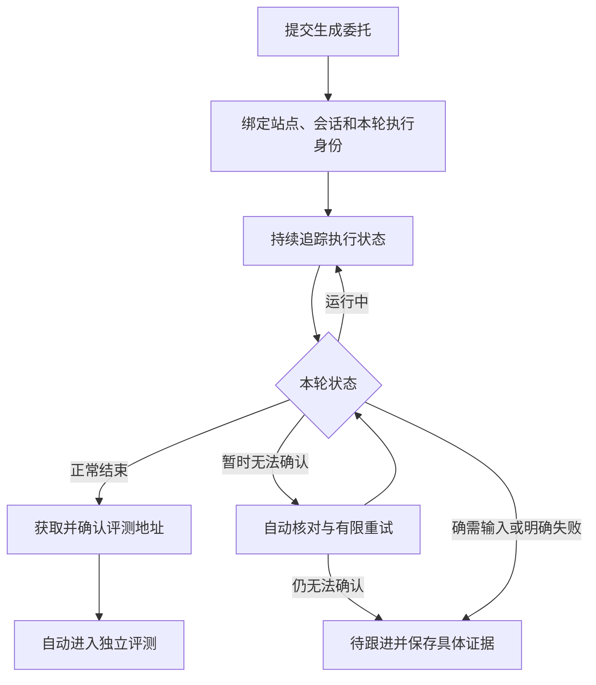

<a id="diagram-21"></a>

## 21 · 平台内置流程跟进 Agent

[SVG](svg/21-平台内置流程跟进_Agent.svg) · [PNG](png/21-平台内置流程跟进_Agent.png) · [Mermaid](mermaid/21-平台内置流程跟进_Agent.mmd) · [原始回复](source-messages.md#message-0ea4717fbae34248016aee83a01e7c87d08d78a19f6a464089)

```mermaid
flowchart TD
    A[Kooboo AI 执行生成] --> B{执行状态}
    B -->|正常结束| E[独立评测 Agent]
    B -->|异常、停顿或状态不明| C[流程跟进 Agent]
    C --> D[读取会话、状态和站点证据]
    D --> F{决定下一步}
    F -->|继续观察| D
    F -->|需要继续生成| G[通过调度器跟进原会话]
    G --> A
    F -->|确认可以评测| E
    F -->|确需用户输入| H[保留上下文并提出具体问题]
```

<a id="diagram-22"></a>

## 22 · 一次发起后的自主推进与明确中断

[SVG](svg/22-一次发起后的自主推进与明确中断.svg) · [PNG](png/22-一次发起后的自主推进与明确中断.png) · [Mermaid](mermaid/22-一次发起后的自主推进与明确中断.mmd) · [原始回复](source-messages.md#message-0ea4717fbae34248016aee8415eedc87d0abe1f3d2e735b2a3)

```mermaid
flowchart TD
    A[你发起任务] --> B[系统推进：准备 → 生成 → 评测]
    B -->|顺利完成| C[交付评测报告]
    B -->|出现不确定或阻塞| D[内置 AI 查证并调用工具处理]
    D --> E{是否能够继续}
    E -->|能够继续| F[从对应阶段恢复]
    F --> B
    E -->|明确不能继续| G[中断并通知你：原因与下一步]
```

<a id="diagram-23"></a>

## 23 · 异常恢复、预算停止与报告交付

[SVG](svg/23-异常恢复、预算停止与报告交付.svg) · [PNG](png/23-异常恢复、预算停止与报告交付.png) · [Mermaid](mermaid/23-异常恢复、预算停止与报告交付.mmd) · [原始回复](source-messages.md#message-096d87c3fae9720a016aee8d2e5f1887d09dc5873057d85215)

```mermaid
flowchart TD
    A[准备 → 生成 → 评测] --> B[报告与证据]
    A -->|异常或停顿| C[内置 AI 查证并处理]
    C -->|重试 / 继续 / 回答 / 交接| A
    C -->|无法继续或预算耗尽| D[中断原因、下一步与通知]
```

<a id="diagram-24"></a>

## 24 · 按连接选择跨环境迁移与交付核验

[SVG](svg/24-按连接选择跨环境迁移与交付核验.svg) · [PNG](png/24-按连接选择跨环境迁移与交付核验.png) · [Mermaid](mermaid/24-按连接选择跨环境迁移与交付核验.mmd) · [原始回复](source-messages.md#message-084a5bc7650ffc0e016aee900437f887d0940022f5ee8ea7a6)

```mermaid
flowchart TD
    A[选择 Kooboo 连接] --> B[生成 → 完整评测]
    B --> C{是否需要迁移交付}
    C -->|Local 无交付| D[报告完成]
    C -->|香港连接 需要交付| E[迁移德国 → 交付核验]
    E --> D
```

<a id="diagram-25"></a>

## 25 · 按独立报告自动修复与提分

[SVG](svg/25-按独立报告自动修复与提分.svg) · [PNG](png/25-按独立报告自动修复与提分.png) · [Mermaid](mermaid/25-按独立报告自动修复与提分.mmd) · [原始回复](source-messages.md#message-025d59537abc1714016aeed61b661887d0b1e2c9d96f51bbb3)

```mermaid
flowchart TD
    A[生成站点] --> B[独立评测]
    B --> C{任务目标}
    C -->|生成并评测| D[交付报告]
    C -->|自动优化| E{达到质量目标？}
    E -->|达到| D
    E -->|未达到| F[跟进 AI 查看报告与截图]
    F --> G[Kooboo AI 在原站修复]
    G --> B
    F -->|预算耗尽或无法继续| H[保留成果并说明停止原因]
```

<a id="diagram-26"></a>

## 26 · 具体修复委托、重新取证与回归检查

[SVG](svg/26-具体修复委托、重新取证与回归检查.svg) · [PNG](png/26-具体修复委托、重新取证与回归检查.png) · [Mermaid](mermaid/26-具体修复委托、重新取证与回归检查.mmd) · [原始回复](source-messages.md#message-025d59537abc1714016aeed700937087d097443e9fc264c983)

```mermaid
flowchart LR
    A[报告与截图] --> B[跟进 AI 选择本轮重点]
    B --> C[组织修复委托]
    C --> D[Kooboo 原站修复]
    D --> E[重新取证与独立复评]
    E --> F[核对改善与回归]
```

<a id="diagram-27"></a>

## 27 · 自动优化轮数与停止条件

[SVG](svg/27-自动优化轮数与停止条件.svg) · [PNG](png/27-自动优化轮数与停止条件.png) · [Mermaid](mermaid/27-自动优化轮数与停止条件.mmd) · [原始回复](source-messages.md#message-02e58a7082d6478b016aeeda40b5a887d0baab220b00f0a3e4)

```mermaid
flowchart TD
    A[取得有效评测报告] --> B{达到质量目标？}
    B -->|是| C[完成：目标达成]
    B -->|否| D{轮数、费用及改善情况允许继续？}
    D -->|是| E[委托修复 → 独立复评]
    E --> A
    D -->|否| F[停止：保留结果并说明原因和下一步]
```

<a id="diagram-28"></a>

## 28 · 早期外部 Admin 轮次 API 提案

> 历史说明：历史 API 提案；后续用户将对外范围收敛为当前版本最终结果，不再要求对外分页读取完整轮次。

[SVG](svg/28-早期外部_Admin_轮次_API_提案.svg) · [PNG](png/28-早期外部_Admin_轮次_API_提案.png) · [Mermaid](mermaid/28-早期外部_Admin_轮次_API_提案.mmd) · [原始回复](source-messages.md#message-02e58a7082d6478b016aeedae4f96c87d0b8be9f95ca27443d)

```mermaid
flowchart LR
    A[外部 Admin] --> B[流程摘要：进度、目标、当前结果、费用、停止原因]
    B --> C[分页读取各轮记录]
    C --> D[独立报告与证据]
```

<a id="diagram-29"></a>

## 29 · 修复与复评串行及报告适用性

[SVG](svg/29-修复与复评串行及报告适用性.svg) · [PNG](png/29-修复与复评串行及报告适用性.png) · [Mermaid](mermaid/29-修复与复评串行及报告适用性.mmd) · [原始回复](source-messages.md#message-02e58a7082d6478b016aeee2d2913887d0b358273b0bf5b4a4)

```mermaid
flowchart LR
    A[修复中] --> B[修复完成]
    B --> C[独立复评]
    C --> D[当前版本分数与证据]
    A -->|中断| E[恢复修复或明确停止]
    C -->|中断| F[恢复复评]
```

<a id="diagram-30"></a>

## 30 · 首页完成后补齐全站

> 历史说明：表示目标续建流程；当时全站完整度验收仍待真实验证。

[SVG](svg/30-首页完成后补齐全站.svg) · [PNG](png/30-首页完成后补齐全站.png) · [Mermaid](mermaid/30-首页完成后补齐全站.mmd) · [原始回复](source-messages.md#message-0ae283427fb0864b016aef00b6a3b887d091f701db0c7e4760)

```mermaid
flowchart LR
 A[现有首页] --> B[同一站点继续生成]
 B --> C[补齐内页、导航和交互]
 C --> D[全站独立评测]
 D --> E[按需继续优化]
```

<a id="diagram-31"></a>

## 31 · 其余四类场景的建议验收顺序

> 历史说明：当时建议顺序；后续新增经验沉淀与预算保护作为优先议题。

[SVG](svg/31-其余四类场景的建议验收顺序.svg) · [PNG](png/31-其余四类场景的建议验收顺序.png) · [Mermaid](mermaid/31-其余四类场景的建议验收顺序.mmd) · [原始回复](source-messages.md#message-0ae283427fb0864b016aef05e10ae087d09f102c71764463dd)

```mermaid
flowchart LR
 A[资料建站] --> B[站点迁移]
 B --> C[旧站升级]
 C --> D[AI App 模板]
```

<a id="diagram-32"></a>

## 32 · 跨任务经验沉淀与反馈闭环

> 历史说明：经验闭环为讨论方案；后续确认默认由本地 AI 决策与执行。

[SVG](svg/32-跨任务经验沉淀与反馈闭环.svg) · [PNG](png/32-跨任务经验沉淀与反馈闭环.png) · [Mermaid](mermaid/32-跨任务经验沉淀与反馈闭环.mmd) · [原始回复](source-messages.md#message-0ae283427fb0864b016aef072252f487d0bc7719991f924a4c)

```mermaid
flowchart LR
 A[生成与跟进] --> B[独立评测或明确中断]
 B --> C[结合证据复盘]
 C --> D[提炼候选经验]
 D --> E[后续案例验证]
 E --> F[按适用条件采用]
 F --> A
 E --> G[修订或停用]
```

<a id="diagram-33"></a>

## 33 · 本地 AI 自动选择、复盘与维护经验

> 历史说明：已确认的产品方向，图本身不证明对应运行机制已实施。

[SVG](svg/33-本地_AI_自动选择、复盘与维护经验.svg) · [PNG](png/33-本地_AI_自动选择、复盘与维护经验.png) · [Mermaid](mermaid/33-本地_AI_自动选择、复盘与维护经验.mmd) · [原始回复](source-messages.md#message-0ae283427fb0864b016aef0833195887d0bf28046c9821865e)

```mermaid
flowchart TD
 A[即将执行某个阶段] --> B[本地 AI 选择适用经验]
 B --> C[生成 / 跟进 / 独立评测]
 C --> D[本地 AI 根据结果复盘]
 D --> E[新增、合并、修订或停用经验]
 E --> F[经验库]
 F --> B
 H[人工查看与调整] <--> F
```

<a id="diagram-34"></a>

## 34 · 经验试用、效果验证与修订停用

> 历史说明：经验条目与效果判定的首版讨论提案。

[SVG](svg/34-经验试用、效果验证与修订停用.svg) · [PNG](png/34-经验试用、效果验证与修订停用.png) · [Mermaid](mermaid/34-经验试用、效果验证与修订停用.mmd) · [原始回复](source-messages.md#message-0ae283427fb0864b016aef08b102ec87d08f448e3ee829931c)

```mermaid
flowchart LR
 A[提炼经验] --> B[AI 判断适用并试用]
 B --> C[检查实际执行与独立结果]
 C --> D[补充支持证据]
 C --> E[收窄条件、修订或停用]
 D --> B
 E --> B
```

<a id="diagram-35"></a>

## 35 · 生成站详情与评测报告历史

2026-11-08 追加。来源：主对话关于取消独立评测报告菜单、归入生成站详情的讨论；用户已确认方案，产品功能待实施。

[SVG](svg/35-生成站详情与评测报告历史.svg) · [PNG](png/35-生成站详情与评测报告历史.png) · [Mermaid](mermaid/35-生成站详情与评测报告历史.mmd) · [来源上下文](source-messages.md#report-history-2026-11-08)

状态：已补导 SVG/PNG（2026-11-08）。

```mermaid
flowchart LR
    A[资源] --> B[生成站 A]
    A --> C[生成站 B]
    B --> D[详情 · 评测结果]
    D --> E[评测记录列表]
    E --> F[某次报告与证据]
```

<a id="diagram-36"></a>

## 36 · 迁移清单驱动生成、对账与独立评测

2026-11-08 追加。来源：「提炼会话经验」会话；用户已确认迁移清单方向，本图的细化流程为讨论提案，尚未实施。

[SVG](svg/36-迁移清单驱动生成、对账与独立评测.svg) · [PNG](png/36-迁移清单驱动生成、对账与独立评测.png) · [Mermaid](mermaid/36-迁移清单驱动生成、对账与独立评测.mmd) · [来源上下文](source-messages.md#migration-manifest-2026-11-08) · [讨论记录](../migration-manifest-discussion-2026-11-08.md)

状态：已补导 SVG/PNG（2026-11-08）。

```mermaid
flowchart TD
    A[冻结的来源资料与迁移要求] --> B[建立迁移清单 v1]
    B --> C[Kooboo 按清单生成]
    B --> D[程序逐项对账]
    C --> D
    D -->|缺失或不一致| E[按具体 ID 和 URL 修复]
    E --> C
    D -->|数据与路由检查通过| F[独立评测复核来源与目标]
    F -->|发现遗漏或质量问题| E
    F -->|必交付项验证通过| G[结合质量与上线条件判定交付]
```

<a id="diagram-37"></a>

## 37 · 迁移清单的生成前核对与缺口处理

2026-11-08 追加。来源：「提炼会话经验」会话。用户已确认自动建清单、补采和核对，无法补齐或范围冲突时等待处理。本图细化生成前放行与停止分支，属于讨论提案，尚未实施。

[SVG](svg/37-迁移清单的生成前核对与缺口处理.svg) · [PNG](png/37-迁移清单的生成前核对与缺口处理.png) · [Mermaid](mermaid/37-迁移清单的生成前核对与缺口处理.mmd) · [来源上下文](source-messages.md#migration-readiness-2026-11-08) · [讨论记录](../migration-manifest-discussion-2026-11-08.md)

状态：已补导 SVG/PNG（2026-11-08）。

```mermaid
flowchart TD
    A[自动采集并建立清单草稿] --> B{生成前核对}
    B -->|范围与必需证据齐备| C[冻结清单版本]
    C --> D[正式迁移生成]
    B -->|缺口仍可自动补齐| E[针对缺口补采]
    E --> B
    B -->|范围冲突或无法补齐| F[保存进度并等待处理]
    E -->|预算耗尽或持续无进展| F
    F --> G[用户补充来源或明确范围]
    G --> A
    F --> H[用户停止任务]
```

<a id="diagram-38"></a>

## 38 · 迁移 checklist 的逐轮检查与修复

2026-11-08 追加。来源：「提炼会话经验」会话。用户确认旧 URL 及原分页语义的默认保留规则，并要求完整度作为 checklist，在首次和每轮生成完成后由程序或 AI 检查。本图为逐轮执行细化提案，尚未实施。

[SVG](svg/38-迁移_checklist_的逐轮检查与修复.svg) · [PNG](png/38-迁移_checklist_的逐轮检查与修复.png) · [Mermaid](mermaid/38-迁移_checklist_的逐轮检查与修复.mmd) · [来源上下文](source-messages.md#migration-checklist-rounds-2026-11-08) · [讨论记录](../migration-manifest-discussion-2026-11-08.md)

状态：已补导 SVG/PNG（2026-11-08）。

```mermaid
flowchart TD
    A[固定版本的迁移 checklist] --> B[首次生成或本轮修复结束]
    B --> C[程序检查与必要的 AI 检查]
    C --> D[保存本轮检查结果与证据]
    D --> E{检查结论}
    E -->|存在缺失或错误| F[按具体差异定点修复]
    F --> B
    E -->|缺少验证证据| G[补充证据]
    G --> C
    E -->|来源缺口或范围冲突| H[保存进度并等待处理]
    E -->|必交付项验证通过| I[独立评测与交付判断]
```

<a id="diagram-39"></a>

## 39 · 迁移清单与目标快照的程序对账

2026-11-08 追加。来源：「提炼会话经验」会话。用户同意逐轮 checklist 的结论与建议，进入下一步讨论。本图细化实体、关系、URL/分页三类检查的证据和对账流程，属于提案，尚未实施。

[SVG](svg/39-迁移清单与目标快照的程序对账.svg) · [PNG](png/39-迁移清单与目标快照的程序对账.png) · [Mermaid](mermaid/39-迁移清单与目标快照的程序对账.mmd) · [来源上下文](source-messages.md#migration-check-contracts-2026-11-08) · [讨论记录](../migration-manifest-discussion-2026-11-08.md)

状态：已补导 SVG/PNG（2026-11-08）。

```mermaid
flowchart TD
    A[冻结的来源证据] --> B[规则提取与 AI 辅助识别]
    B --> C[版本化迁移清单]
    D[目标后台数据与页面实际响应] --> E[本轮目标快照]
    C --> F[程序对账]
    E --> F
    F --> G[逐项状态与具体差异]
    G --> H[AI 制定定点修复方案]
```

<a id="diagram-40"></a>

## 40 · 平台与 Kooboo 的清单及修复交接

2026-11-08 追加。来源：「提炼会话经验」会话。用户要求继续讨论清单如何交给 Kooboo。本图为摘要与任务资料、映射产物、独立核对及差异修复交接提案，尚未实施。

[SVG](svg/40-平台与_Kooboo_的清单及修复交接.svg) · [PNG](png/40-平台与_Kooboo_的清单及修复交接.png) · [Mermaid](mermaid/40-平台与_Kooboo_的清单及修复交接.mmd) · [来源上下文](source-messages.md#migration-kooboo-handoff-2026-11-08) · [讨论记录](../migration-manifest-discussion-2026-11-08.md)

状态：已补导 SVG/PNG（2026-11-08）。

```mermaid
flowchart TD
    A[平台固定清单版本与本轮目标] --> B[摘要消息与任务资料入口]
    B --> C[Kooboo 读取相关明细并执行]
    C --> D[保存目标映射与本轮产物记录]
    D --> E[平台独立读取目标并核对 checklist]
    E -->|存在差异| F[按问题原因组织修复任务包]
    F --> B
    E -->|必交付项通过| G[进入独立评测与交付判断]
```

<a id="diagram-41"></a>

## 41 · message 优先与临时 kfile 的交付选择

2026-11-08 追加。来源：「提炼会话经验」会话。用户提出 message 与 kfile 的站点残留差异，要求讨论选型。助手提出 message 优先、大批结构化明细按需使用临时 kfile，并由平台管理清理的替代提案，尚未确认或实施。

[SVG](svg/41-message_优先与临时_kfile_的交付选择.svg) · [PNG](png/41-message_优先与临时_kfile_的交付选择.png) · [Mermaid](mermaid/41-message_优先与临时_kfile_的交付选择.mmd) · [来源上下文](source-messages.md#migration-message-kfile-2026-11-08) · [讨论记录](../migration-manifest-discussion-2026-11-08.md)

状态：已补导 SVG/PNG（2026-11-08）。

```mermaid
flowchart TD
    A[平台保存版本化任务包] --> B[message 携带目标与必守规则]
    B --> C{明细适合直接发送和处理吗}
    C -->|是| D[明细随 message 发送]
    C -->|否| E[message 引用临时 kfile]
    D --> F[执行并核验结果]
    E --> F
    F --> G[平台归档结果与必要证据]
    G --> H[无执行依赖时清理本任务临时文件]
```

<a id="diagram-42"></a>

## 42 · 迁移 checklist 的异常重试与停止

2026-11-08 追加。来源：「提炼会话经验」会话。用户确认 message 优先、按需临时 kfile 的交付选择；本图继续细化只读重试、未知投递查证、缺陷修复和停止规则，属于本轮提案，尚未确认或实施。

[SVG](svg/42-迁移_checklist_的异常重试与停止.svg) · [PNG](png/42-迁移_checklist_的异常重试与停止.png) · [Mermaid](mermaid/42-迁移_checklist_的异常重试与停止.mmd) · [来源上下文](source-messages.md#migration-retry-stop-2026-11-08) · [讨论记录](../migration-manifest-discussion-2026-11-08.md)

状态：已补导 SVG/PNG（2026-11-08）。

```mermaid
flowchart TD
    A[出现异常或本轮未达标] --> B{按操作与证据分类}
    B -->|只读临时失败| C[预算内退避重试]
    B -->|写入或投递结果未知| D[核对原回执与实际目标]
    B -->|已验证的具体缺陷| E[按差异定点修复]
    B -->|来源或权限等阻塞| F[保存进度并等待处理]
    B -->|预算耗尽或连续无改善| G[停止自动推进并保存结果]
    C --> H[依据新证据重新检查]
    D --> H
    E --> H
```

<a id="diagram-43"></a>

## 43 · 迁移 checklist 首批实施与后续接入

2026-11-08 追加。来源：「提炼会话经验」会话。用户授权读取主会话 review 后实施。首批契约、纯程序对账与 manwei 保存证据离线复核已完成；自动取证、生成前放行、同一优化链修复和真实迁移验收尚未接入。

[SVG](svg/43-迁移_checklist_首批实施与后续接入.svg) · [PNG](png/43-迁移_checklist_首批实施与后续接入.png) · [Mermaid](mermaid/43-迁移_checklist_首批实施与后续接入.mmd) · [来源上下文](source-messages.md#migration-phase1-2026-11-08) · [实施说明](../migration-checklist-phase1.md)

状态：已补导 SVG/PNG（2026-11-08）。

```mermaid
flowchart TD
    A[已完成：迁移契约与证据校验] --> B[已完成：实体、关系、分页对账]
    B --> C[已完成：manwei 保存证据离线复核]
    C --> D[下一批：只读取证与生成前放行]
    D --> E[后续：同一优化链修复与交接]
    E --> F[后续：真实迁移验收与界面展示]
```

<a id="diagram-44"></a>

## 44 · manwei 原任务第1轮验证与后续修复

[SVG](svg/44-manwei_原任务第1轮验证与后续修复.svg) · [PNG](png/44-manwei_原任务第1轮验证与后续修复.png) · [Mermaid](mermaid/44-manwei_原任务第1轮验证与后续修复.mmd) · [上下文](source-messages.md#manwei-round1-validation-2026-11-08)

本案例已完成第1轮原站原会话修复与独立复评；程序对账确认分类184仍缺4条归属、旧分页404，正式AI报告未单独列出该缺陷。第2轮正在执行，整体尚未通过。新检查器仍为旁路。已补导 SVG/PNG（2026-11-08）；未采集消息ID。

```mermaid
flowchart TD
    A[原任务：桌面64.9 / 移动55] --> B[第1轮：原站原会话修复]
    B --> C[独立复评：桌面72.3 / 移动71.1]
    C --> D[第2轮修复中：仍未达标]
    C --> E[旁路程序对账：后台缺4条关系]
    E --> F[旧分页184_4.aspx返回404]
    F --> G[正式AI报告漏报：需接入宿主差异证据]
    C --> H[来源覆盖与真实业务仍未验证]
```

<a id="diagram-45"></a>

## 45 · manwei 第2轮正式复评与停止边界

[SVG](svg/45-manwei_第2轮正式复评与停止边界.svg) · [PNG](png/45-manwei_第2轮正式复评与停止边界.png) · [Mermaid](mermaid/45-manwei_第2轮正式复评与停止边界.mmd) · [上下文](source-messages.md#manwei-round2-final-2026-11-08)

本案例已完成两轮修复与独立复评，第2轮桌面71.9、移动65、业务85，完整性incomplete。正式报告确认4条归属及末页缺失，另有正文、内链和移动缺陷；累计跟进5/5次停止，未重置预算或启动第3轮。程序对账仍为旁路。已补导 SVG/PNG（2026-11-08）；未采集消息ID。

```mermaid
flowchart TD
    A[原初评：桌面64.9 / 移动55] --> B[第1轮：72.3 / 71.1]
    B --> C[第2轮：71.9 / 65，完整性未通过]
    C --> D[累计跟进5/5次，优化停止]
    C --> E[正式报告确认：4条归属及末页缺失]
    E --> F[另有正文缺失、错误内链和移动缺陷]
    D --> G[下一批：程序差异接入正式清单与原优化链]
    F --> G
    G --> H[保留来源未知、冻结范围与累计预算]
```

<a id="diagram-46"></a>

## 46 · manwei 两轮后评分未达标的原因

[SVG](svg/46-manwei_两轮后评分未达标的原因.svg) · [PNG](png/46-manwei_两轮后评分未达标的原因.png) · [Mermaid](mermaid/46-manwei_两轮后评分未达标的原因.mmd) · [上下文](source-messages.md#manwei-low-scores-causes-2026-11-08)

完整性占PC及移动归一化评分约57%；程序差异未自动进入修复委托、模板与移动回归不足，以及扩大核验发现旧缺陷，共同解释两轮后的分数。业务已达85，不代表完整迁移通过。本次仅诊断，未启动第3轮。 已补导 SVG/PNG（2026-11-08）；未采集消息ID。

```mermaid
flowchart TD
    A[两轮修复后仍未整体达标] --> B[完整性占端评分约57%]
    B --> C[正文、归属、分页及内链缺口仍在]
    A --> D[程序差异尚未自动进入修复委托]
    D --> E[第一轮已发现的4条归属未明确派修]
    A --> F[通用布局修改与回归不足]
    F --> G[案例模板不匹配、移动长侧栏先于内容]
    A --> H[第二轮扩大核验范围]
    H --> I[发现更多旧缺陷，轮间分数需结合证据解释]
    C --> J[先接入具体差异，再分模板修复与固定样本回归]
    E --> J
    G --> J
    I --> J
```

<a id="diagram-47"></a>

## 47 · 完整站点与平台执行档案的一键排障导出

2026-11-08 追加。方案已具备实施基础，尚未实现或真实验收。

[SVG](svg/47-完整站点与平台执行档案的一键排障导出.svg) · [PNG](png/47-完整站点与平台执行档案的一键排障导出.png) · [Mermaid](mermaid/47-完整站点与平台执行档案的一键排障导出.mmd) · [来源上下文](source-messages.md#diagnostic-export-2026-11-08) · [讨论记录](../diagnostic-export-discussion-2026-11-08.md)

状态：已补导 SVG/PNG（2026-11-08）。

```mermaid
flowchart TD
    A[生成站或失败任务：导出排障包] --> B[固定关联范围与导出截止时间]
    B --> C[收集平台记录与已有证据]
    B --> D{Kooboo 站点可导出吗}
    D -->|可以| E[原生全部导出：完整模式]
    D -->|离线、未建站或失败| F[记录站点包缺失与原因]
    C --> G[整理目录、脱敏平台凭证并核对文件]
    E --> G
    F --> G
    G --> H[生成摘要、索引与校验信息]
    H --> I[下载一个 ZIP]
    I --> J[离线分析站点与执行过程]
```

<a id="diagram-48"></a>

## 48 · 迁移程序差异接入修复与逐轮回归

[SVG](svg/48-迁移程序差异接入修复与逐轮回归.svg) · [PNG](png/48-迁移程序差异接入修复与逐轮回归.png) · [Mermaid](mermaid/48-迁移程序差异接入修复与逐轮回归.mmd) · [上下文](source-messages.md#migration-runtime-integration-2026-11-08) · [接入说明](../migration-checklist-integration.md)

用户授权继续实施。已接入宿主登记、程序取证、报告合并、修复消息完整附入与逐轮回归；原案例真实读取153条路径和13页后台目录，识别4条归属及末页404，保留正式报告6个问题。累计跟进5/5，未启动第3轮。真实新修复及复评未运行。已补导 SVG/PNG（2026-11-08）；未采集消息ID。

```mermaid
flowchart TD
    A[冻结清单及153条原路径] --> B[宿主程序对账并保存证据]
    B --> C[原案例确认5项差异，保留报告6个问题]
    C --> D{沿用原累计预算}
    D -->|额度允许| E[完整附入原站原会话修复消息]
    E --> F[独立复评与同清单程序回归]
    F --> G{证据及必交付项通过吗}
    G -->|否| D
    G -->|是| H[结合双端评分判断交付]
    D -->|本案例5次已用尽| I[保持停止，未启动第三轮]
```

<a id="diagram-49"></a>

## 49 · 第41图落实与manwei第3轮验证

[SVG](svg/49-第41图落实与manwei第3轮验证.svg) · [PNG](png/49-第41图落实与manwei第3轮验证.png) · [Mermaid](mermaid/49-第41图落实与manwei第3轮验证.mmd) · [上下文](source-messages.md#manwei-context-transport-round3-2026-11-08) · [案例记录](../manwei-migration-validation-2026-11-08.md)

第41图的资料载体分支已实际接入。manwei第3轮生成、独立复评及同冻结范围程序回归完成；migration-v3已知键与顺序差异为0，整体完整性仍未通过。按3轮上限停止，未重置预算。v2随包reader另经真实SHA-256还原和清理验证后更新服务，本轮AI修复使用v1。已补导 SVG/PNG（2026-11-08）；未采集消息ID。

```mermaid
flowchart TD
    A[短消息加临时kfile] --> B[原会话第3轮修复完成]
    B --> C[独立复评：82.2 / 79.3 / 84.5]
    C --> D[程序对账：483实体、756关系、153路径]
    D --> E[已知键对齐，完整性仍未通过]
    B --> F[临时文件清理，平台原件保留]
```

<a id="diagram-50"></a>

## 50 · 迁移两段完整性与manwei经验复盘

[SVG](svg/50-迁移两段完整性与manwei经验复盘.svg) · [PNG](png/50-迁移两段完整性与manwei经验复盘.png) · [Mermaid](mermaid/50-迁移两段完整性与manwei经验复盘.mmd) · [上下文](source-messages.md#migration-two-stage-completeness-2026-11-08)

讨论方案，尚未实施新流程。现有manwei适配器只验证保存证据可识别的基线到目标站，不证明全源站采齐；来源完整性与落地完整性必须分别保留状态。建议先补来源发现、原始采集及提取核验，再贯通版本化资料与目标对账。已补导 SVG/PNG（2026-11-08）；未采集消息ID。

```mermaid
flowchart TD
    A[原站与明确迁移范围] --> B[发现入口、分类、分页及内容全集]
    B --> C[保存原始响应并提取正文、资源与关系]
    C --> D{检查A：原站到资料}
    D -->|缺采或提取有误| B
    D -->|证据充分| E[冻结资料版本与迁移清单]
    D -->|来源全集仍未知| U[保留来源未知，不宣称全站完整]
    U -.->|可继续试迁移，继承未知状态| E
    E --> F[批量导入数据与资源，生成动态模板]
    F --> G{检查B：资料到Kooboo}
    G -->|实体、关系、正文或路由有差异| F
    G -->|对账通过| H[独立核验模板、双端与业务]
    H --> I[结合A、B及验收结果判断交付]
    U -.-> I
```

<a id="diagram-51"></a>

## 51 · 参考site-harvest建立A段来源完整性检查

[SVG](svg/51-参考site-harvest建立A段来源完整性检查.svg) · [PNG](png/51-参考site-harvest建立A段来源完整性检查.png) · [Mermaid](mermaid/51-参考site-harvest建立A段来源完整性检查.mmd) · [上下文](source-messages.md#source-completeness-site-harvest-2026-11-08)

A段方案讨论，尚未实施。已只读核对本机site-harvest的SKILL、参考契约及完整性和文件校验代码；没有启动采集或浏览器。复用其采集、证据、续采和缺口机制，建议补结构化栏目全集对账、提取复核及平台接入。已补导 SVG/PNG（2026-11-08）；未采集消息ID。

```mermaid
flowchart TD
    A[明确语言、域名与迁移范围] --> B[从导航、站点地图、分类和分页发现内容]
    B --> C[建立来源清单，记录各栏目预期量与依据]
    C --> D[采集原件，提取正文、资源与关系]
    D --> E[程序全量检查清单、引用、计数与异常]
    E --> F[AI按页面类型及异常复核原件与提取结果]
    F --> G{A段结论}
    G -->|有可补齐缺口| H[定向补采或修正提取，复用已有原件]
    H --> C
    G -->|范围内证据充分| I[冻结资料版本、清单及复核结论]
    I --> J[交给B段逐项落地与对账]
    G -->|仍有未知或无法补齐| K[保存草稿与缺口，不宣称来源完整]
```

<a id="diagram-52"></a>

## 52 · 采集AI的输入产出与A段交接条件

[SVG](svg/52-采集AI的输入产出与A段交接条件.svg) · [PNG](png/52-采集AI的输入产出与A段交接条件.png) · [Mermaid](mermaid/52-采集AI的输入产出与A段交接条件.mmd) · [上下文](source-messages.md#collection-ai-handoff-contract-2026-11-08) · [讨论记录](../source-collection-ai-discussion-2026-11-08.md)

方案讨论，尚未实施采集AI或自动放行。沿用现有来源覆盖和约定范围覆盖契约，区分执行结束与可正式交接；采集AI提交证据化结论，平台检查并冻结资料版本，缺口定向续采，无法补齐或预算耗尽保存进度。已补导 SVG/PNG（2026-11-08）；未采集消息ID。

```mermaid
flowchart TD
    A[平台提供来源、范围、已有资料与预算] --> B[采集AI判断发现策略与下一步]
    B --> C[程序执行发现、采集、提取和核对]
    C --> D[平台保存原件、清单及检查结果]
    D --> E[采集AI按类型和异常复核，提交结论与依据]
    E --> F{平台检查交接条件}
    F -->|证据充分且必需项通过| G[冻结资料与清单版本]
    G --> H[B段按固定版本迁移与验收]
    F -->|缺口可补且预算允许| B
    F -->|无法补齐、范围冲突或预算耗尽| I[保存进度、未知项和停止原因]
    H -->|发现来源遗漏| J[建立新资料版本，定向续采]
    J --> B
```

<a id="diagram-53"></a>

## 53 · 跟进AI按缺口形成任务并判断继续或停止

[SVG](svg/53-跟进AI按缺口形成任务并判断继续或停止.svg) · [PNG](png/53-跟进AI按缺口形成任务并判断继续或停止.png) · [Mermaid](mermaid/53-跟进AI按缺口形成任务并判断继续或停止.mmd) · [上下文](source-messages.md#gap-driven-task-decisions-2026-11-08) · [讨论记录](../source-collection-ai-discussion-2026-11-08.md)

本轮方案讨论，尚未实施。按来源、目标、核验和外部阻塞归类缺口，按共同原因和依赖形成明确任务；区分实际修复、核验进展和新增问题。沿用预算及修站两轮无改善停止规则，采集侧进展不清零修站计数。已补导 SVG/PNG（2026-11-08）；未采集消息ID。

```mermaid
flowchart TD
    A[当前版本的缺口、证据和上一轮结果] --> B[跟进AI判断归属、共同原因与依赖]
    B --> C[形成具体任务：目标、范围、验收和边界]
    C --> D{平台检查任务与执行条件}
    D -->|条件具备| E[交给采集AI、Kooboo或核验程序]
    D -->|任务依据不足| K[限次补齐依据，无法补齐则保存结果]
    E --> F[按任务目标重新取证并检查受影响范围]
    F --> G[分别记录实际修复、证据进展和新增问题]
    G --> H{平台结合证据和累计预算决定}
    H -->|阶段必需项通过| I[进入下一阶段]
    H -->|有可执行目标且允许继续| B
    H -->|无新依据、阻塞或达到限制| J[保存进度与原因，等待处理或停止]
    D -->|预算或执行状态不允许| J
```

<a id="diagram-54"></a>

## 54 · 完成优先的自动接续与防循环兜底

[SVG](svg/54-完成优先的自动接续与防循环兜底.svg) · [PNG](png/54-完成优先的自动接续与防循环兜底.png) · [Mermaid](mermaid/54-完成优先的自动接续与防循环兜底.mmd) · [上下文](source-messages.md#completion-first-loop-guards-2026-11-08) · [讨论记录](../source-collection-ai-discussion-2026-11-08.md)

用户纠正预算优先停止的方向：无人托管任务应优先完成，有效推进时自动接续，临时故障自动恢复，以循环和异常消耗兜底。累计记账不清空，单次执行可分段续接，用户明确硬限制仍遵守。替代图52/53中一般预算到限直接停止的建议；具体阈值与实现待定，当前代码未修改。已补导 SVG/PNG（2026-11-08）；未采集消息ID。

```mermaid
flowchart TD
    A[按明确目标执行一个有界批次] --> B[保存检查点，核验结果并累计记账]
    B --> C{整体任务已完成吗}
    C -->|是| D[交付结果与证据]
    C -->|否| E{当前推进情况}
    E -->|有实质进展| A
    E -->|暂时故障| F[退避后自动恢复，先核对原执行]
    F --> A
    E -->|停滞或重复| G[限次诊断并调整策略]
    G --> H{有依据的新方案吗}
    H -->|有| A
    H -->|无，或已形成循环| I[熔断受阻环节，保留成果与原因]
    B -->|用户硬限制或异常消耗兜底触发| I
```

<a id="diagram-55"></a>

## 55 · 采集任务的检查点自动接续与目标级防循环

[SVG](svg/55-采集任务的检查点自动接续与目标级防循环.svg) · [PNG](png/55-采集任务的检查点自动接续与目标级防循环.png) · [Mermaid](mermaid/55-采集任务的检查点自动接续与目标级防循环.mmd) · [上下文](source-messages.md#collection-checkpoint-recovery-2026-11-08) · [讨论记录](../source-collection-ai-discussion-2026-11-08.md)

用户认可完成优先方向后继续讨论。建议平台保存目标、待处理集合、产物、操作回执及失败历史，恢复先核对原执行，再接续未完成步骤。批次结束不等于任务结束，临时故障退避自动恢复，同一目标的重复失败及策略回转有限兜底。现有缓存和回执为基础，完整采集接续尚未实施。已补导 SVG/PNG（2026-11-08）；未采集消息ID。

```mermaid
flowchart TD
    A[接续任务或服务恢复] --> B[读取目标、检查点与失败历史]
    B --> C[核对原执行、实际文件与操作回执]
    C -->|原执行仍在运行或结果不明| D[按计划继续核对，避免重复执行]
    D --> C
    C -->|可安全接续| E[从首个未完成目标执行下一批]
    E --> F[保存实际产物与验证结果]
    F --> G{目标是否完成}
    G -->|已完成| H[交接下一目标或阶段]
    G -->|有进展，仍有余项| E
    G -->|临时故障| I[保存下次执行时间，退避后恢复]
    I --> B
    G -->|同一目标持续无进展| J[对照尝试历史，有限诊断或换策略]
    J -->|有依据的新路径| E
    J -->|形成循环或无法解除阻塞| K[保存阻塞与所需条件，继续无依赖工作]
    D -->|达到核对边界仍无法确认| K
```

<a id="diagram-56"></a>

## 56 · site-harvest能力内置与Windows和macOS交付

[SVG](svg/56-site-harvest能力内置与Windows和macOS交付.svg) · [PNG](png/56-site-harvest能力内置与Windows和macOS交付.png) · [Mermaid](mermaid/56-site-harvest能力内置与Windows和macOS交付.mmd) · [上下文](source-messages.md#portable-harvest-integration-2026-11-08) · [讨论记录](../source-collection-ai-discussion-2026-11-08.md)

用户要求同事电脑不依赖个人site-harvest skill，并已确认Windows和macOS都需要支持。建议将脚本核心、AI规则及资料契约收编为平台内置引擎、版本化SOP和结构化工具；采集运行环境由统一初始化和分平台组件交付。首版建议保留Python核心，具体运行时打包方式待验证，未实施或宣称跨平台验收。已补导 SVG/PNG（2026-11-08）；未采集消息ID。

```mermaid
flowchart TD
    A[site-harvest已有成果] -.->|迁入并版本化| B[平台采集SOP与资料契约]
    A -.->|收编采集代码| C[随平台分发的采集引擎]
    D[Windows或macOS统一初始化] --> E[平台管理的采集运行环境]
    E --> C
    B --> F[平台本地采集AI]
    F --> G[Node任务调度与受控工具]
    G --> C
    C --> H[原始证据、资料与检查点]
    H --> I[A段核验并冻结资料版本]
    I --> J[B段迁移]
```


<a id="diagram-57"></a>

## 57 · 采集AI与Python引擎的受控调用及证据交接

[SVG](svg/57-采集AI与Python引擎的受控调用及证据交接.svg) · [PNG](png/57-采集AI与Python引擎的受控调用及证据交接.png) · [Mermaid](mermaid/57-采集AI与Python引擎的受控调用及证据交接.mmd) · [上下文](source-messages.md#collection-engine-tool-boundary-2026-11-08) · [讨论记录](../source-collection-ai-discussion-2026-11-08.md)

用户已确认首版保留Python，不重写JS/TS。本图为下一步调用边界讨论建议，尚未实施或逐项确认：AI提出具体目标，平台校验并记录操作，Python执行批次，原件与资料落盘，工具返回短索引，AI按类型和异常读取证据，平台检查交接条件。已补导 SVG/PNG（2026-11-08）；未采集消息ID。

```mermaid
flowchart TD
    A[采集AI读取进度与缺口短索引] --> B[提出具体目标、对象与操作]
    B --> C[平台校验范围并保存操作记录]
    C --> D[Python引擎执行一个采集批次]
    D --> E[平台保存完整资料、原件与检查点]
    E --> F[程序核对产物、清单与证据引用]
    F --> G[返回摘要、缺口和证据索引]
    G --> H[采集AI按类型和异常读取证据并复核]
    H --> I{平台检查A段交接条件}
    I -->|仍有可补缺口| B
    I -->|满足条件| J[冻结共同版本并交接B段]
    I -->|阻塞或仍有未知| K[保存原因并按恢复规则处理]
```


<a id="diagram-58"></a>

## 58 · 采集工具异常处理与规则及核心修改边界

[SVG](svg/58-采集工具异常处理与规则及核心修改边界.svg) · [PNG](png/58-采集工具异常处理与规则及核心修改边界.png) · [Mermaid](mermaid/58-采集工具异常处理与规则及核心修改边界.mmd) · [上下文](source-messages.md#harvest-correctness-and-repair-permissions-2026-11-08) · [讨论记录](../source-collection-ai-discussion-2026-11-08.md)

用户追问工具正确性、故障处理和采集AI修改权限。已检查site-harvest源码与测试，未发现manwei域名专用分支；平台另有manwei保存证据专用适配器。新建议以独立样本预期、运行核验、版本追溯和隔离回归保障，区分站点规则与共享代码权限，尚未确认或实施。已补导 SVG/PNG（2026-11-08）；未采集消息ID。

```mermaid
flowchart TD
    A[发现采集异常或核验不一致] --> B[保留原件、版本与失败样本]
    B --> C{定位问题}
    C -->|临时请求故障| D[退避重试并复用已有结果]
    C -->|站点结构差异| E[采集AI提出站点规则候选]
    E --> F[按独立预期验证样本及影响范围]
    F -->|通过| G[记录规则版本并定向重处理]
    F -->|失败| H[保留缺口并有限诊断]
    C -->|共享引擎或核验器缺陷| I[形成可复现缺陷与候选补丁]
    I --> J[隔离修复、回归并按发布策略升级]
    J --> G
    D --> K[重新核验受影响资料]
    G --> K
    K --> L{平台检查交接条件}
    L -->|通过| M[冻结新资料版本]
    L -->|仍有问题| H
    H -->|有依据的新路径| C
    H -->|无可行路径或形成循环| N[暂停受阻环节，保存成果和原因]
```


<a id="diagram-59"></a>

## 59 · 站点规则的适用范围与自动验证采用

[SVG](svg/59-站点规则的适用范围与自动验证采用.svg) · [PNG](png/59-站点规则的适用范围与自动验证采用.png) · [Mermaid](mermaid/59-站点规则的适用范围与自动验证采用.mmd) · [上下文](source-messages.md#site-rule-validation-and-adoption-2026-11-08) · [讨论记录](../source-collection-ai-discussion-2026-11-08.md)

用户已认可工具正确性、故障处置与权限边界。本图继续提出站点规则的结构化配置、适用模板、独立预期、原件试跑、正常样本回归、当前任务自动采用及退步撤回；经验跨站复用仍需重新匹配验证。新细则尚未确认或实施。已补导 SVG/PNG（2026-11-08）；未采集消息ID。

```mermaid
flowchart TD
    A[采集AI定位异常并读取原件] --> B[提出站点规则、适用范围与验证预期]
    B --> C[平台校验规则类型、范围和冲突]
    C -->|规则不支持所需能力| D[记录工具扩展需求与缺口]
    C -->|允许试跑| E[用原件在独立目录试跑]
    E --> F[核对失败样本及正常回归样本]
    F --> G{原问题解决且验证依据充分}
    G -->|否| H[保留差异，有限调整或升级缺陷]
    G -->|是| I[自动采用到当前任务的声明范围]
    I --> J[重处理受影响资料并逐项核验]
    J -->|发现退步| K[撤回规则采用，保留未解决项]
    K --> H
    J -->|满足A段交接条件| L[冻结共同版本并交接]
    I -.-> M[沉淀为带适用条件的候选经验]
    M -.-> N[其他站点重新匹配并验证]
```


<a id="diagram-60"></a>

## 60 · 无人值守优先的自动诊断修复与接续

[SVG](svg/60-无人值守优先的自动诊断修复与接续.svg) · [PNG](png/60-无人值守优先的自动诊断修复与接续.png) · [Mermaid](mermaid/60-无人值守优先的自动诊断修复与接续.mmd) · [上下文](source-messages.md#unattended-recovery-and-quality-2026-11-08) · [讨论记录](../source-collection-ai-discussion-2026-11-08.md)

用户基本认可站点规则方案，并明确本地AI应在无人值守时应对意外、减少人工介入，同时保障交付质量、容错与自动跟进。图中自动诊断、隔离验证、任务内采用、恢复与最小人工请求为落实原则的进一步建议，尚未实现；隔离代码修复能力和发布策略仍待确定。已补导 SVG/PNG（2026-11-08）；未采集消息ID。

```mermaid
flowchart TD
    A[执行明确目标并保存检查点] --> B{结果核验}
    B -->|满足阶段交接条件| C[冻结版本并推进下一阶段]
    B -->|异常或质量不足| D[自动诊断并形成恢复目标]
    D --> E[恢复执行、调整规则或更换已授权方法]
    E --> F[隔离试跑并检查原问题和回归样本]
    F -->|验证通过| G[采用任务内版本并接续原任务]
    G --> A
    F -->|未通过| H{有依据的新路径或临时阻塞}
    H -->|有新路径| D
    H -->|临时阻塞| I[安排复查并推进无依赖工作]
    I --> D
    H -->|缺外部条件或无可行路径| J[保存成果与证据，提出最小必要请求]
    J -->|条件补足| D
    D -->|用户取消、硬限制或循环兜底触发| K[停止相应自动执行并保存原因]
```


<a id="diagram-61"></a>

## 61 · 站点迁移完整设计：A段采集与B段落地闭环

[SVG](svg/61-站点迁移完整设计-A段采集与B段落地闭环.svg) · [PNG](png/61-站点迁移完整设计-A段采集与B段落地闭环.png) · [Mermaid](mermaid/61-站点迁移完整设计-A段采集与B段落地闭环.mmd) · [上下文](source-messages.md#complete-design-two-stage-2026-11-08) · [完整设计](../site-migration-autonomous-design-v1-2026-11-08.md)

整合已确认的两段完整性、版本冻结、缺口路由及最终交付条件。全站覆盖与约定范围覆盖分开，源缺口回采集、目标缺陷定向修复。 实施前完整设计评审稿，不代表能力已实施或验收。已补导 SVG/PNG（2026-11-08）；未采集消息ID。

```mermaid
flowchart TD
    A[用户目标、来源与已授权范围] --> B[固定任务输入与执行策略]
    B --> C[A段：发现、采集、提取与核验]
    C --> D{A段交接条件}
    D -->|可定向修正| E[采集AI组织补采、规则或工具修复]
    E --> C
    D -->|满足| F[冻结资料、清单与证据共同版本]
    F --> G[B段：Kooboo按固定版本迁移]
    G --> H[实体、关系、内容、URL与分页对账]
    H -->|目标缺陷| I[跟进AI形成具体修复任务]
    I --> G
    H -->|来源缺口| E
    H -->|结构与内容项通过| J[独立质量评测与必要的交互检查]
    J -->|目标问题| I
    J -->|发现来源遗漏| E
    J --> K{当前范围的必交付项通过}
    K -->|通过| L[生成可追溯交付结果]
    K -->|需外部条件| M[最小必要请求并保留恢复点]
```


<a id="diagram-62"></a>

## 62 · 站点迁移完整设计：平台组件与AI职责

[SVG](svg/62-站点迁移完整设计-平台组件与AI职责.svg) · [PNG](png/62-站点迁移完整设计-平台组件与AI职责.png) · [Mermaid](mermaid/62-站点迁移完整设计-平台组件与AI职责.mmd) · [上下文](source-messages.md#complete-design-components-2026-11-08) · [完整设计](../site-migration-autonomous-design-v1-2026-11-08.md)

整合Node平台、Python引擎、采集AI、跟进AI、受控工具、证据存储、核验、Kooboo及独立评测的职责；不新增常驻AI角色或个人skill运行依赖。 实施前完整设计评审稿，不代表能力已实施或验收。已补导 SVG/PNG（2026-11-08）；未采集消息ID。

```mermaid
flowchart TD
    A[平台API与持久任务队列] --> B[采集AI：判断、诊断与证据复核]
    A --> C[跟进AI：缺口归属、目标与恢复计划]
    B --> D[受控工具与操作记录]
    C --> A
    D --> E[Node适配器与进程管理]
    E --> F[内置Python采集引擎]
    E --> G[已授权的浏览器采集能力]
    D --> H[规则试跑与隔离代码修复执行器]
    F --> I[原件、资料、检查点与版本索引]
    G --> I
    H --> I
    I --> J[程序核验与独立证据预期]
    J --> B
    J --> K[平台交接判定]
    K --> L[Kooboo生成与目标取证]
    L --> M[独立评测与经验学习]
    M --> C
```


<a id="diagram-63"></a>

## 63 · 站点迁移完整设计：隔离修复与无人值守恢复

[SVG](svg/63-站点迁移完整设计-隔离修复与无人值守恢复.svg) · [PNG](png/63-站点迁移完整设计-隔离修复与无人值守恢复.png) · [Mermaid](mermaid/63-站点迁移完整设计-隔离修复与无人值守恢复.mmd) · [上下文](source-messages.md#complete-design-isolated-repair-2026-11-08) · [完整设计](../site-migration-autonomous-design-v1-2026-11-08.md)

用户已接受首版采集模块/适配扩展的隔离修复、验证后当前任务自动采用；共享发布仍走独立流程。整合固定预期回归、任务内版本、回退、接续、最小外部请求及防循环。 实施前完整设计评审稿，不代表能力已实施或验收。已补导 SVG/PNG（2026-11-08）；未采集消息ID。

```mermaid
flowchart TD
    A[执行异常或质量核验未通过] --> B[保存原件、操作回执与失败证据]
    B --> C[自动诊断并形成明确恢复目标]
    C --> D{下一种有依据的方法}
    D -->|临时故障或执行中断| E[退避、核对原执行并从检查点接续]
    D -->|站点规则差异| F[在原件上试跑候选规则]
    D -->|采集代码能力缺口| G[在受限副本生成并运行候选补丁]
    F --> H[核对固定预期与正常回归样本]
    G --> H
    H -->|通过| I[记录并采用当前任务专用版本]
    H -->|未通过| J[保留差异并拒绝或撤回候选]
    I --> K[重处理受影响对象并重新核验]
    E --> K
    K -->|达到原目标| L[接续原任务与阶段交接]
    K -->|仍有问题| J
    J -->|存在新证据与新方法| C
    J -->|临时外部条件| M[安排复查并执行无依赖工作]
    M --> C
    J -->|无可行路径、需授权或用户决策| N[保留成果并提出最小必要请求]
    C -->|取消、硬限制或循环兜底触发| O[停止相关自动执行并保存原因]
```
