# 主对话图表原始回复

以下仅保存包含 Mermaid 图的助手原始回复，不包含工具输出或内部推理。原图与当时文字一并保留，历史建议不等于当前实现。各图标题由归档时整理，图源码未改写。

<a id="message-0fd86e5805944d32016aed97ddf2d487d0be572cf882f21877"></a>

## 01 · 原始回复

来源消息：`msg_0fd86e5805944d32016aed97ddf2d487d0be572cf882f21877`，任务轮次：`01a1b017-87c8-7f52-ac76-9b71ad27a72f`。

我建议把这套系统定位为：**插件负责生成和交接，评分平台负责组织评测，Agent 负责执行评测任务。评测方法由我们掌握，底层 AI 执行器可以替换。**

这样能同时容纳 Site、AI App，以及不同的 SOP 和评分规则。本轮仅讨论方案，没有修改代码或执行浏览器验收。

**1. 先明确现有基础**

结合你的图和当前代码，已经具备这些能力：

| 部分 | 当前情况 |
|---|---|
| 插件 | 建站、上传资料、驱动聊天，聊天停止后持久化投递评测请求；聊天停止不等于建站成功。[接入协议](/Users/achen/Priv/Yardi/AI-App/kooboo_material_site_builder/EVALUATION_INTEGRATION.md) |
| 评测 Agent | 已经是我们编写的工具调用循环，模型可以调用采集、看图、审查、提交评分等工具。[实现](/Users/achen/Priv/Yardi/AI-App/site_evaluator_impl/server/lib/agent.ts:33) |
| SOP | 从固定目录加载文件，并记录版本和哈希；还没有形成可自由选择、发布的 SOP 管理能力。[实现](/Users/achen/Priv/Yardi/AI-App/site_evaluator_impl/server/lib/sop.ts:4) |
| 评分规则 | 已支持自定义维度、标准、权重和发布版本，但规则里同时混有视口、采集策略、执行器等配置。[类型定义](/Users/achen/Priv/Yardi/AI-App/site_evaluator_impl/shared/types.ts:84) |
| 评测范围 | 当前主要覆盖首页静态视觉，尚不能据此认定全站功能或 AI App 业务流程通过。[项目说明](/Users/achen/Priv/Yardi/AI-App/site_evaluator_impl/README.md) |

所以接下来更适合在已有基础上调整边界，而不是重新建立一套完全独立的系统。

**2. 自己的 Agent，还是启动某个 AI CLI？**

这里需要区分“我们定义的评测 Agent”和“我们自己编写 Agent 运行机制”。

即使底层使用现成 CLI，只要任务、SOP、工具、评分标准和结果校验由平台定义，它仍然可以是我们的评测 Agent。

我的建议是：**平台自行管理评测，执行层优先考虑成熟的 Agent SDK / 非交互 CLI，现有自建 Agent 保留为可比较的执行器。**

以 Codex 为例，官方已经提供程序化 SDK，以及支持事件流和结构化输出的非交互模式，具备作为后台执行器接入的基础。具体能否满足我们的浏览器工具、证据交接和恢复要求，仍需要后续验证。([developers.openai.com](https://developers.openai.com/codex/sdk/))

建议的分工是：

| 我们的平台掌握 | 执行器承担 |
|---|---|
| 任务队列、并发、取消和重试 | 执行本轮任务 |
| SOP、评分规则、测试案例及版本 | 理解任务并选择工具 |
| 浏览器与证据工具的接口和约束 | 操作、观察、必要时补采 |
| 证据存储、结果校验、总分计算 | 提交分项判断和证据引用 |
| 历史记录、人工复核、对外查询 | 返回执行事件和诊断 |

**不能把“CLI 正常退出”作为评测完成条件。**我们应要求它交付符合约定的证据和结果，再由平台检查后接受。

选择具体执行器时，我建议用同一组 Site 和 AI App 样例比较：漏检情况、证据质量、重复运行的一致性、恢复能力、时间和成本。现在先确定可替换边界，不急着认定某一个执行器最好。

另外，“本地 AI”只描述执行环境，模型是否在本机运行是另一个决定。运营侧应保持“提交任务、查看结果”的操作，不增加手动开终端启动 AI 的步骤。

**3. Site 和 AI App 共用平台，分别定义评测方案**

我建议统一任务、执行记录、证据和报告机制，同时分别提供 Site 与 AI App 模板。

| 对比项 | Site 评测 | AI App 评测 |
|---|---|---|
| 主要依据 | 内容资料、视觉参考、页面要求 | 业务需求、角色、业务规则、验收案例 |
| 主要范围 | 页面、视口、导航和交互 | 业务场景、操作步骤、数据状态和权限 |
| 典型检查 | 内容准确性、视觉还原、响应式、链接可用性 | 创建、查询、编辑、审批、权限限制、数据持久化 |
| 证据 | 截图、页面信息、交互结果 | 步骤记录、截图、操作前后数据和实际结果 |
| 结果 | 各项质量分与页面覆盖情况 | 场景通过情况、阻断问题与质量分 |

两类评测都可以包含视觉和功能检查，只是重点不同。AI App 也不一定有参考产品，业务需求本身就可以作为验收依据。

例如评测一个项目管理 App：

> 创建项目 → 添加任务 → 分配成员 → 切换成员账号 → 更新任务 → 刷新后确认保存 → 验证无权限成员无法修改。

这需要账号、初始数据、预期结果和清理方式。仅增加一段“检查功能是否正常”的提示词，无法把这些条件补齐。

对于从业务描述自动推导的案例，建议保留它与原始需求的对应关系；没有明确依据的判断应标记为假设，避免 Agent 自己制定标准后再据此判定通过。

**4. 自定义 SOP 和评分规则，要成为两个独立对象**

我建议再加上“评测案例”，将三者分开：

| 对象 | 回答的问题 | 示例 |
|---|---|---|
| SOP | 怎么检查、按什么顺序、异常如何处理？ | 登录 → 准备数据 → 执行案例 → 收集证据 → 清理 |
| 评测案例 | 这次具体检查什么？ | 普通成员不能删除其他成员创建的项目 |
| 评分规则 | 根据检查结果如何评分和判定？ | 权限隔离为必过项，视觉一致性占 20% |

对于自定义能力，我建议采用 **可编辑说明 + 结构化配置**：

- SOP 允许编辑流程说明，同时配置阶段、所需工具、证据要求、重试和停止条件。
- 案例允许定义前置条件、角色、步骤、预期结果和清理要求。
- 评分规则允许定义维度、标准、权重、通过阈值、必过项，以及“不适用”和“证据不足”的处理方式。

用户不必第一阶段就使用复杂的流程画布；模板、表单和 Markdown 编辑可以先满足主要需求。但平台需要知道每个阶段是否实际完成，不能只依赖 Agent 最后写一句“已按 SOP 执行”。

**自定义的边界也要明确：编辑 SOP 可以组合现有能力；增加全新的能力仍需要工具支持。**例如目前只有截图工具，修改 SOP 并不会自动获得账号切换、数据查询或文件上传能力。

版本关系建议采用：

> 评测方案 = 适用类型 + SOP 版本 + 案例集版本 + 评分规则版本 + 所需工具能力

每次执行冻结这些版本，并记录模型、执行器和实际输入。Site 与 AI App 分别设置默认方案，避免发布一个 App 规则后影响所有新建 Site 任务。

重评时也应明确区分“按原方案重跑”和“使用新方案重新评测”。修改评分权重可以考虑复用兼容证据；新增业务步骤则需要重新执行相关案例。

**5. 你的流程图可以这样扩展**

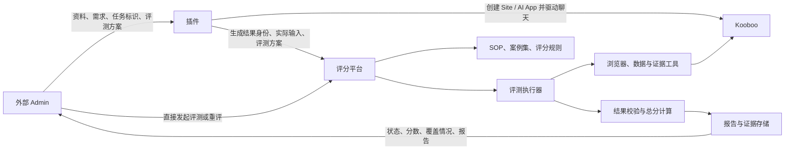

这里有几处值得确定：

- **插件交接评测上下文。**除站点身份外，需要知道这是 Site 还是 AI App、依据哪份需求、选择哪个评测方案。
- **平台可以独立发起评测。**已有产品、人工修改后的产品，都应能直接重评。
- **用稳定的产物身份关联历史。**建议以 Kooboo 环境与 `siteId` 关联产物，域名作为访问地址，并记录每轮实际评测的版本或时间状态。
- **总分和通过结论分别输出。**例如 App 得到 85 分，但关键审批流程失败，仍应判定不通过；证据不足则进入待复核状态。

我目前倾向于先确定这四个方向：**插件保持生成与交接职责；平台统一管理两类评测；SOP、案例和评分规则独立版本化；底层执行器可替换。**

接下来最需要你确认的是：**AI App 第一阶段要达到“按明确案例执行验收”，还是“让 Agent 根据业务需求自主探索并发现问题”？**我的建议是先把明确案例作为稳定验收依据，再增加自主探索，用来发现案例没有覆盖的问题。


---

<a id="message-0fd86e5805944d32016aeda4534fac87d0ac78d0893d6596f3"></a>

## 02 / 03 · 原始回复

来源消息：`msg_0fd86e5805944d32016aeda4534fac87d0ac78d0893d6596f3`，任务轮次：`01a1b046-df96-78e0-b9f6-57db8e7fc33f`。

可以，后续继续用流程图和对照表沟通。**系统的业务源头现在可以明确为“资源包”，原 Admin 侧承担的就是资源整理和任务发起的角色。**

这里我建议把“资源包”理解为一个逻辑资料集合：可以包含图片、文案、需求文档，也可以只有 URL，不强制对应一个本地文件夹。

整体关系可以先调整成这样，图中按职责划分：

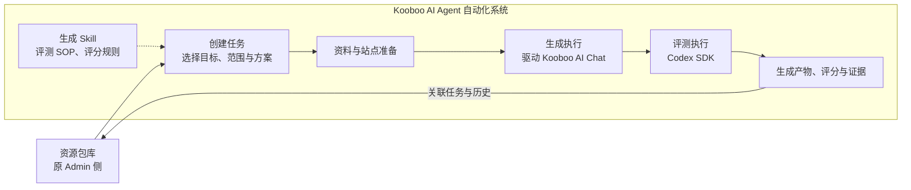

**资源包描述“有什么”，任务描述“这次要做什么”。**我建议把两者分开，因为同一个站点 URL，既可以用于迁移，也可以用于制作模板；相同资料也可能需要多次尝试，分别保留生成结果和评分。

按你提出的五类场景，可以这样整理。其中，纯资料建站的生成和评测方式是我补充的建议。

| 任务类型 | 输入 | 生成路径 | 评测重点 |
|---|---|---|---|
| **资料建站** | 图片、文案等资料 | 根据资料从零生成 Site | UI 质量、资料要求完成度 |
| **站点迁移** | 原站 URL，可附资料包 | 克隆原站 → AI 重构为符合 Kooboo 规范的代码 | 对原站的还原度、内容与页面完整度 |
| **旧站升级** | 原站 URL + 参考站，可附资料包 | 克隆原站和参考站 → AI 重构 | 对参考站的视觉还原度、对原站和资料的内容完整度 |
| **AI Site 模板** | 收集的参考站 URL | 克隆参考站 → redesign skill → AI 从零构建 Site | 视觉还原度、约定模板范围内的完整度 |
| **AI App 模板** | 业务需求文档等资料 | 根据需求从零构建 App | UI 质量、业务需求与流程完成情况 |

你提出的 **500～1000+ 个参考站 URL**，属于 AI Site 模板场景的批量资源来源；App 模板则以整理好的业务需求作为来源。

这里最需要统一的是：**每种任务的“还原度”和“完整度”，比较对象不同。**

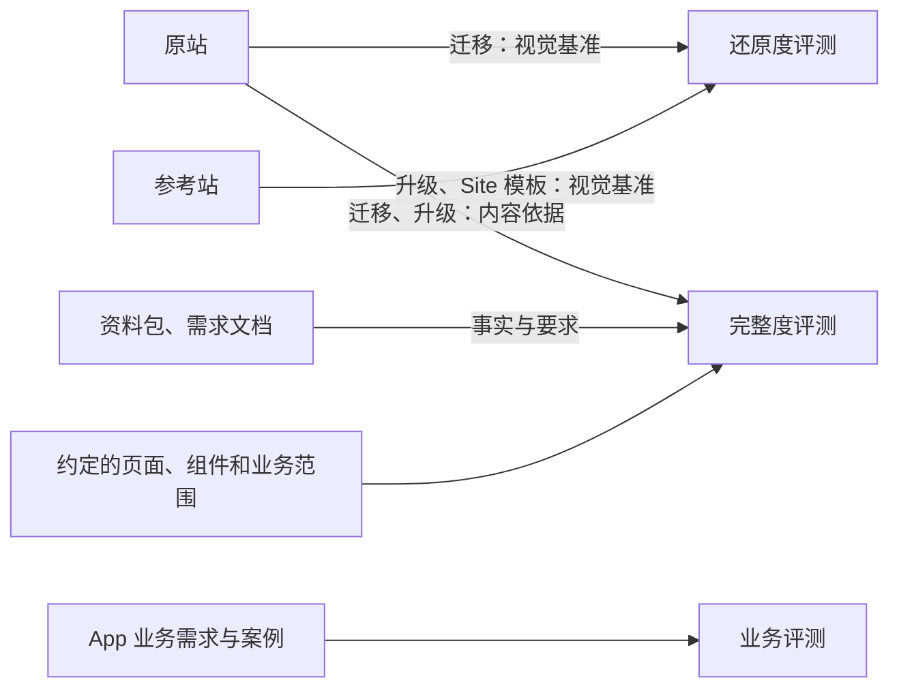

例如，旧站升级时，视觉可以发生很大变化，但原有内容应按任务要求保留；因此，视觉评测看参考站，内容完整度看原站和资料。AI Site 模板的完整度则需要先约定模板范围，不能直接等同于参考站全部业务。

另外，迁移和升级都要求生成符合 Kooboo 规范的代码，我建议将**规范检查**单列为验收项，视觉还原度无法单独证明这一点。

已将这些内容补入[讨论记录的「议题四」](/Users/achen/Priv/Yardi/Kooboo/docs/automation-evaluation-discussion.md)，并区分了你的需求与我的建议。

我想先确认一个影响生成路径的点：**迁移、升级是在“原站克隆结果”上重构；AI Site 模板则把“参考站克隆结果”作为参考输入，另外新建最终模板站——这个区分符合你的意思吗？**

---

<a id="message-0fd86e5805944d32016aeda862054c87d088a01d101029947b"></a>

## 04 · 原始回复

来源消息：`msg_0fd86e5805944d32016aeda862054c87d088a01d101029947b`，任务轮次：`01a1b057-502a-7823-acac-5a9289b490f4`。

对，我之前把目标站的起点和克隆输入混在一起了。**所有场景都从空白目标站开始；差别在于内容站、参考站如何准备，以及最终允许使用哪些资源。** :codex-annotation{index="1"}

按你的澄清，这三条路径应改成：

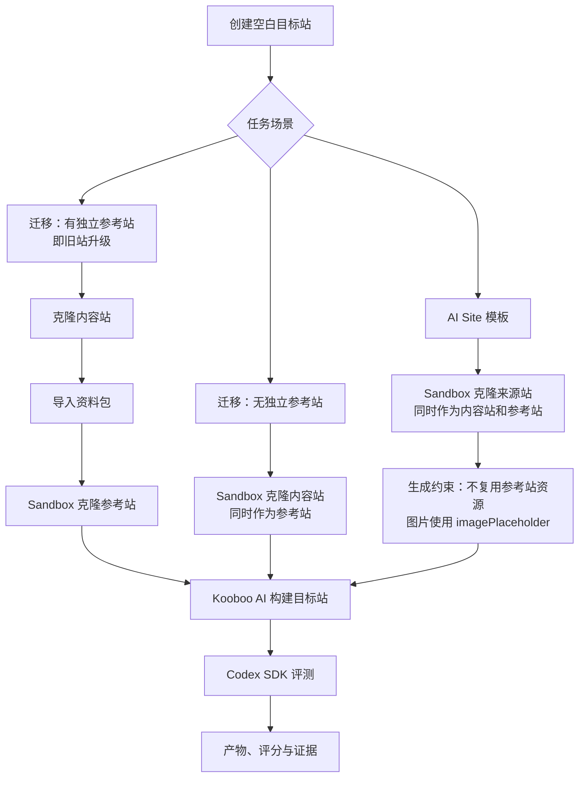

**内容站和参考站是两个角色，可以由同一个站点承担。**

| 场景 | 内容依据 | 视觉依据 | 准备方式 |
|---|---|---|---|
| 迁移，有独立参考站 | 内容站、资料包 | 参考站 | 克隆内容站、导入资料、Sandbox 克隆参考站 |
| 迁移，无独立参考站 | 内容站、可选资料 | 同一个内容站 | 内容站直接克隆到 Sandbox |
| AI Site 模板 | 同一个来源站提供内容与结构线索 | 同一个来源站 | 来源站克隆到 Sandbox，最终模板替换参考资源 |

无独立参考站的迁移，确实可以通过 Sandbox 路径省去“先把原代码克隆进目标，再清理原克隆代码”的操作。AI Site 模板采用类似路径，但增加了明确的资源使用限制。

这也会影响模板的评分规则：**按要求使用 `imagePlaceholder`，不应直接被判为缺图或还原失败。**我建议重点比较图片区域的位置、比例及整体布局，同时检查占位是否正确、是否仍引用参考站资源；具体评分细则后面再讨论。

已修正[讨论文档](/Users/achen/Priv/Yardi/Kooboo/docs/automation-evaluation-discussion.md)，撤回上一轮假设，并记录这次确认的术语、流程和模板资源限制。

---

<a id="message-0fd86e5805944d32016aedac05a8e487d08370e2bc2540fcfe"></a>

## 05 / 06 · 原始回复

来源消息：`msg_0fd86e5805944d32016aedac05a8e487d08370e2bc2540fcfe`，任务轮次：`01a1b065-5fa8-7543-b0a1-723ffeab8d35`。

我建议把 Admin 的核心对象称为**“资源基线”**：它保存资料与要求，关联多次生成和评测。内部录入与外部导入，共用这套模型。

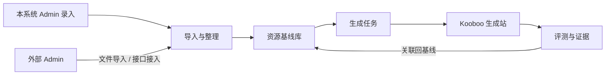

这样，同事继续使用原 Admin 时，可以把数据交给我们；使用本系统的人，也可以直接管理资料。外部字段通过导入映射处理，不要求同事修改成我们的内部数据结构。

**数据关系上，我建议分成四类对象。**这是逻辑模型，暂不涉及具体数据库设计。

| 对象 | 保存什么 | 关系 |
|---|---|---|
| **资源基线** | 名称、自由说明、资料、内容站与参考站、外部来源、扩展信息 | 一个基线对应多次生成 |
| **输入版本** | 本次实际使用的资料与要求、文件版本、来源采集记录 | 同一版本可用于多个生成方案 |
| **生成记录** | 输入版本、任务类型、生成方案、A/B 标记、执行状态、Kooboo 站点身份 | 每次重新建站单独记录 |
| **评测记录** | 对应生成记录、评测时的证据、SOP 与规则版本、分数和报告 | 同一个生成站可多轮评测 |

例如，你想比较两个生成方案：

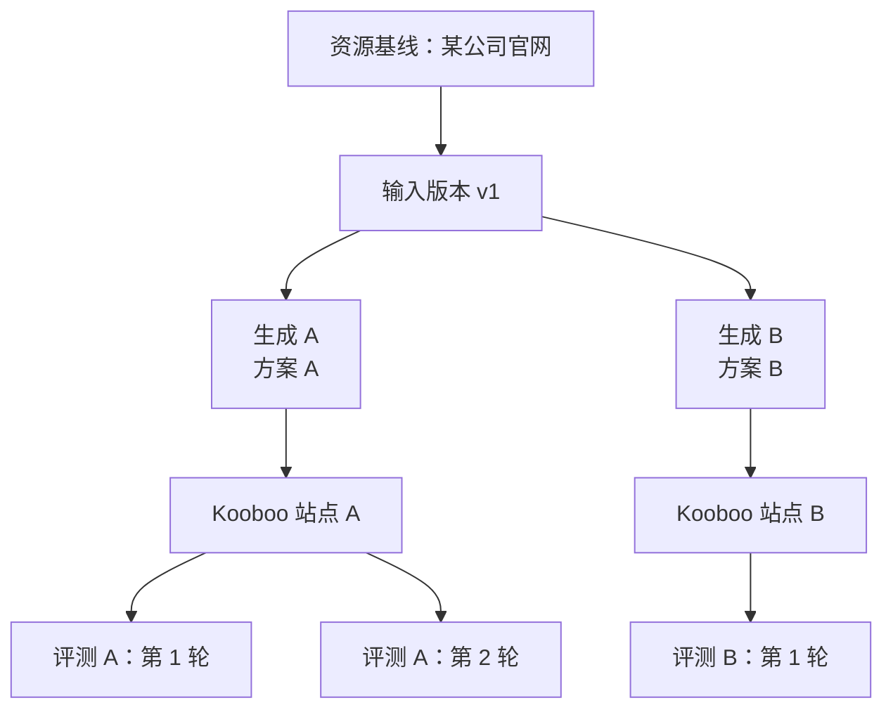

基线上可以展示多个生成结果，选择其中满意的结果。**不建议只保存一个 `siteId` 和一个评分，否则后一次尝试容易覆盖前一次的关联。**

“输入版本”可以在发起生成时自动保存，用户不需要手工管理版本文件。它用于区分：结果变化来自生成方案，还是资料本身发生了变化。对于网站来源，还应记录实际使用的克隆或采集批次；仅保存 URL，并没有固定当时的网页内容。

**资料包的自由度，我建议主要体现在以下几处：**

- **目录自由**：文件名、目录层级不用统一。
- **输入组合自由**：可以只有 URL、只有需求说明、只有附件，也可以混合。
- **说明自由**：允许用自然语言描述背景、资料优先级和特殊要求。
- **字段可扩展**：外部 Admin 的额外业务字段保留下来，不必提前全部设计成固定表单。
- **不强制包格式**：不要求必须有 `README.md`，也不要求用户编写固定 JSON 清单。

系统内部仍维护少量明确的信息：

| 信息 | 用途 |
|---|---|
| 基线 ID、名称、来源 | 找到资料，识别外部记录 |
| 文件、链接、说明 | 保存实际输入 |
| 内容站 / 参考站角色 | 确定输入的用途，同一个 URL 可承担两个角色 |
| 任务目标、范围、方案 | 发起生成时选择 |
| 输入版本与结果关联 | 追溯每次生成、评测的依据 |

这里我倾向于**允许资料先入库，再在发起具体任务时补齐必要信息**。例如迁移需要内容站，App 生成需要可用的业务需求；资料不完整时，可以先整理，不必阻止保存。

外部导入还需要保留“来源系统 + 来源记录 ID”的映射。再次导入同一记录时，关联到同一基线；资料变化则形成新输入版本，历史生成结果继续关联旧版本。附件也需要随导入提供，或者有执行环境能够获取的入口。

最终，几个操作就能明确区分：

- **重新生成**：同一基线下新增生成记录，从空白站开始。
- **重新评测**：对已有生成站新增评测记录。
- **调整资料**：形成新输入版本。
- **A/B 比较**：同一输入版本使用不同生成方案，并按一致的评测口径比较。

已补入[讨论记录的「议题五」](/Users/achen/Priv/Yardi/Kooboo/docs/automation-evaluation-discussion.md)。外部接入、一对多、资料自由度记为确认需求；上述四类对象及版本策略仍标记为建议。

---

<a id="message-0fd86e5805944d32016aedaf37cecc87d099dad6f776c3d340"></a>

## 07 · 原始回复

来源消息：`msg_0fd86e5805944d32016aedaf37cecc87d099dad6f776c3d340`，任务轮次：`01a1b072-27c6-7eb2-a9dd-43b0d180a74d`。

**Admin 侧目前没有必须先解决的核心问题，可以进入原插件侧讨论。**导入格式、具体字段、附件存储和页面布局，后续再细化。

已记录你的调整：**核心是一个基线对应多个生成站，A/B 比较降为非核心需求。**Admin 的逻辑模型和资料自由度方案记为“基本认可”。

原插件侧在统一系统中对应**“生成执行模块”**。我建议先按下面的职责划分讨论：

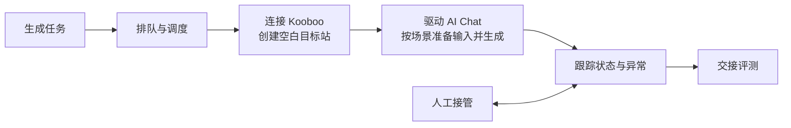

| 环节 | 要讨论的功能 |
|---|---|
| 接收任务 | 取得基线输入、任务场景、目标环境与生成方案 |
| 批量调度 | 排队、并发、暂停、取消和恢复 |
| 环境与站点 | 登录 Kooboo、创建空白站、保存实际站点身份 |
| 驱动生成 | 发送要求、处理约定交互，完成各场景的资料准备与生成 |
| 异常处理 | 保存进展、重试、恢复、人工接管 |
| 交接评测 | 保存生成记录，将目标站和实际输入交给评测模块 |

其中，**聊天停止是交接评测的信号，生成质量和完成情况由评测判断。**

我建议先讨论**“生成方案”**：不同场景使用哪些 prompt、skill 和执行约束，是否也需要像评测 SOP 一样支持自定义？这会直接决定生成执行模块采用怎样的流程组织方式。

已同步到[讨论记录的「议题六」](/Users/achen/Priv/Yardi/Kooboo/docs/automation-evaluation-discussion.md)。

---

<a id="message-0e6a4eb398885f36016aedb15d9fa887d083d1b54f3a0805c7"></a>

## 08 · 原始回复

来源消息：`msg_0e6a4eb398885f36016aedb15d9fa887d083d1b54f3a0805c7`，任务轮次：`01a1b07a-9c24-7453-b32d-a3a0841bd9a7`。

这三点已经记入[讨论文档](/Users/achen/Priv/Yardi/Kooboo/docs/automation-evaluation-discussion.md:380)：**生成方案支持自定义，先覆盖现有五类场景，新增场景暂缓。**

我建议把“场景”和“生成方案”分开：场景描述要做什么，生成方案描述如何指导 Kooboo AI 完成。同一场景可以有多份方案，调整方案不必新增场景。

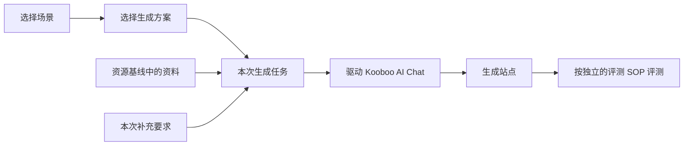

生成方案的内容，我建议先这样划分，**这些具体配置项还属于建议**：

| 内容 | 作用 | 示例 |
|---|---|---|
| Prompt | 说明任务目标与输入如何使用 | 根据内容站资料，参考另一站点的设计进行升级 |
| Skill | 提供完成任务的方法与规范 | redesign、Kooboo 开发规范 |
| 约束 | 明确必须遵守的要求 | Site 模板图片使用 `imagePlaceholder` |
| 步骤指引 | 描述工作的先后关系 | 准备资料 → 分析参考 → 构建 → 自检 |
| 交付要求 | 明确需要完成什么 | 页面范围、交互范围、未完成项说明 |

这里还要区分：**方案里写了哪些 Skill，与现有 Kooboo 如何接收和使用这些 Skill，是两个问题。**接入方式后续核对现有能力，不在这里假定已经支持任意动态加载。

接下来最值得先确定的是：**这些步骤由谁推进？**

| 方式 | 自动化系统的工作 | Kooboo AI 的工作 |
|---|---|---|
| 一次委托 | 发送完整方案和资料，跟踪执行 | 自行完成准备、构建、自检 |
| 分阶段驱动 | 分次发送阶段要求，判断何时进入下一步 | 完成当前阶段，再接受下一阶段要求 |

例如旧站升级，“先准备内容，再分析参考站，最后构建”，既可以写在一份完整要求中，也可以由系统分三次驱动。两者对异常恢复、人工接管的设计会有明显影响。

**我的初步建议是先采用一次委托，在方案中保留清晰的步骤指引；遇到确实需要停下来检查或人工处理的节点，再引入分阶段驱动。**这样可以先控制系统复杂度。

你预期的生成过程更接近这种“一次委托”，还是希望系统从一开始就逐阶段推进？

---

<a id="message-0e6a4eb398885f36016aede73784e087d097d3fd890288d3b8"></a>

## 09 · 原始回复

来源消息：`msg_0e6a4eb398885f36016aede73784e087d097d3fd890288d3b8`，任务轮次：`01a1b14c-eee3-7840-a61d-85c373a9da1c`。

理解了，**我上一轮把“生成方案”拆得过重了。**按你的预期，生成侧可以收敛为：组织一段完整 message，委托 Kooboo AI 完成，系统负责追踪和必要的跟进。

已更新[讨论文档](/Users/achen/Priv/Yardi/Kooboo/docs/automation-evaluation-discussion.md:384)，记录了本轮澄清和首页生成需求。

**关于场景和生成方案，可以先简化成“每种场景有可编辑的提示词”。**

我之前区分它们，只是想表达“迁移是什么任务”和“如何要求 AI 迁移”有区别。但产品里完全可以放在一起，不必让操作者分别选择两层配置。

最终 message 可以由这些内容组成：

> 场景提示词 + 实际资料与 URL + 本次生成范围 + 补充要求

Skill、reference、tools 复用 Kooboo 已有能力。需要使用某项能力时，在 message 中表达要求即可，自动化侧先不另建一套管理体系。

正常情况下，这条 message 就是一次完整委托；AI 反问、提前停止或偏离要求时，才进入跟进处理。**“一次委托”与“持续追踪”可以同时成立。**

你补充的首页需求，则意味着要引入一个独立于场景的配置：**本次生成范围**。同样是旧站升级，可以先做首页，也可以直接做全站。

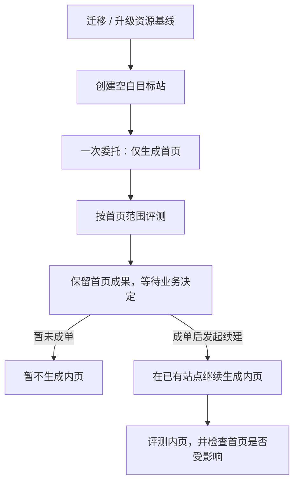

这里我建议同步调整三个地方：

| 位置 | 建议 |
|---|---|
| Admin | 保留完整资料，发起任务时选择“仅首页”或“全站”；已有首页结果可以发起续建 |
| 生成记录 | 同一个生成站允许多次执行，分别记录首页生成和内页续建 |
| 评测 | 只委托首页时，未生成内页不作为本次完整度缺失；续建后再检查相应范围 |

因此，此前“所有场景从空白站开始”应更准确地写成：**首次建站从空白站开始；成单后的续建，建议沿用已生成首页的站点和设计。**这样也能保留客户看到的首页成果。

另一个与成本直接相关的点是：**仅做首页时，资料准备和克隆也应尽量围绕首页所需范围。**具体怎样利用现有 tools 控制这部分，留到执行细节再讨论。

接下来可以聚焦“追踪和跟进”：对于 AI 的重复确认、反问或提前停止，你是否期望系统先尝试自动跟进，无法解决时再交给人工？

---

<a id="message-0e6a4eb398885f36016aede91aa28887d0bfc4bd60394cd900"></a>

## 10 · 原始回复

来源消息：`msg_0e6a4eb398885f36016aede91aa28887d0bfc4bd60394cd900`，任务轮次：`01a1b154-eb11-7ed0-b30f-e44e96714ed0`。

这几条把职责进一步明确了：**系统负责排队、执行和记录状态；外部 AI 负责理解 pending 并决定如何跟进。**已更新[讨论文档](/Users/achen/Priv/Yardi/Kooboo/docs/automation-evaluation-discussion.md:459)，仍只做讨论。

**并发限制与队列作为明确需求。**按你的例子，提交 10 个任务，并发设为 3，就先运行 3 个，其余 7 个等待，空出名额后自动补入。

我建议同一个执行池共用并发上限，连续提交多个批次也受这个上限约束。外部 AI 发起的继续执行、重试，同样经过调度。

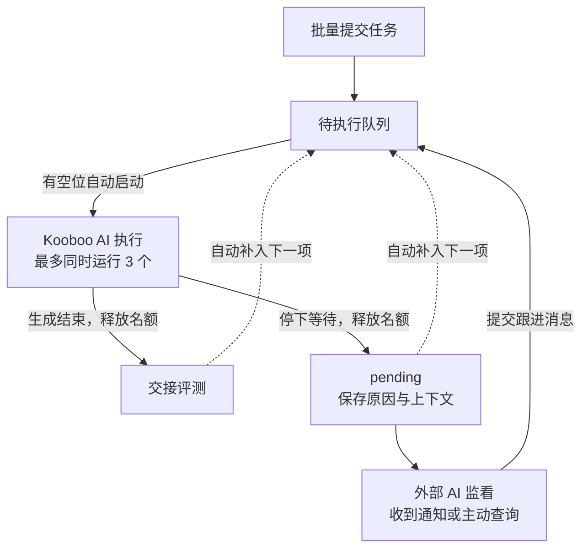

图中的 **pending 释放名额**属于我的建议：确认 AI 已停下等待后，让其他站点继续跑；后续跟进时重新等待执行名额。短暂没有流式输出，还不能直接当成 pending。

**首页需求的设计按你认可的方向保留，成本口径也修正。**资料准备和克隆按零成本处理，我撤回上一轮围绕缩小克隆范围节省成本的建议。

因此可以提前准备完整资料，首次只要求生成首页，把其余页面的 **Kooboo AI 生成 token** 留到成单后再投入。

**外部 AI 接管的方向，我也赞同。**我们先把系统做成可被监看和操作的执行系统，跟进方可以是 Grok bot、其他 AI，也可以是人工。

它需要获得的信息和操作，我建议先收敛为：

| 能力 | 内容 |
|---|---|
| 查看任务 | 目标、资料、本次范围、站点和会话 |
| 查看状态 | 排队、运行、pending、生成结束、失败 |
| 理解阻塞 | pending 原因、最近消息、工具错误、最后活动时间 |
| 请求跟进 | 补充消息、继续执行、重试或取消 |
| 查看结果 | 生成产物与独立评测结果 |

具体通过界面、接口还是其他方式提供，可以后续再定；通知和主动查询也先保留为两种接入方式。

对于你说的“睡前启动 100 个站点”，设计目标就是：**个别任务进入 pending 后，其余队列继续推进，外部 AI 可以逐个处理阻塞。**同时，承载 Kooboo 前端循环的执行环境需要持续运行，监看 AI 与生成执行是两个职责。

这样，插件侧当前的核心范围就比较清晰了：**批量提交 → 限流排队 → 一次委托 → 状态留痕 → 暴露 pending → 接受跟进 → 交接评测。**

---

<a id="message-0e6a4eb398885f36016aeded62aef887d0ae9a93c4f23b7ebf"></a>

## 11 · 原始回复

来源消息：`msg_0e6a4eb398885f36016aeded62aef887d0ae9a93c4f23b7ebf`，任务轮次：`01a1b164-cc91-7b93-9e78-71c18f6af374`。

这七点可以把评分平台的定位明确为：**组织本地 AI 按评测 Skill 工作，交付可复核的证据、评分和问题报告。**

已记入[讨论文档](/Users/achen/Priv/Yardi/Kooboo/docs/automation-evaluation-discussion.md:511)。下面的职责拆分和细则是我的建议，继续逐项讨论。

**平台负责组织与留存，Skill 规定方法，AI 执行检查。**

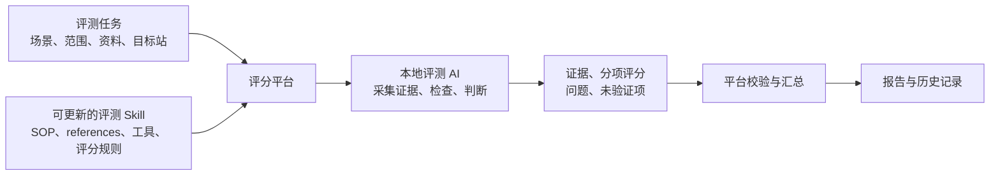

平台主要负责发起任务、跟踪状态、保存证据和展示结果；具体怎样检查，尽量放进 Skill。分项判断可以由 AI 提供，分数计算和权重汇总建议由程序校验。

**范围要成为每次评测的明确输入。**可以默认继承生成任务的范围，并记录实际检查了哪些页面和功能。

| 任务 | 评测重点 |
|---|---|
| Site 仅首页 | 首页视觉、参考还原、内容与基本交互 |
| 成单后的迁移／升级 | 全部约定页面、内容、资源和功能的完整度，视觉与 SEO 迁移保护 |
| Site 模板 | 设计还原、约定模板范围、资源替换要求 |
| App | UI 合理性、信息层级、交互体验、业务正确性 |
| 内页续建 | 新增范围，以及是否影响首页和公共组件 |

仅首页的评测不应因为没有内页而扣完整度分，但报告也不能因此宣布全站迁移合格。“全站”则需要对应页面或内容清单，避免 AI 看了几个页面就认定完整。

**Site 的还原度准确性，需要让判断过程可复核。**我建议 SOP 要求：

- 参考站与生成站使用对应页面、相同视口和约定状态。
- 保存两侧截图，指出具体区域、差异和扣分理由。
- 区分“是否还原参考”与“设计是否好看”。
- Site 模板按既定的 `imagePlaceholder` 政策评测，避免把要求中的图片替换误判为失败。

正式使用前，建议拿几组人工已经判断过的案例校准：AI 是否看到了我们认为重要的问题，分数是否符合人的判断。**不能只凭 AI 能解释自己的评分，就认定评分准确。**

App 则按你说的方向，从实际任务出发。例如“大量信息塞进弹窗”，评测应说明信息量、阅读或编辑操作为什么受到影响，而不是简单规定“使用弹窗就扣分”。业务评测也应操作关键流程、核对结果。具体规则先通过几个真实 App 积累，再补进 references。

**SEO 建议单列为“SEO 迁移保护”。**上线前重点检查旧 URL 和重要内容有没有承接、必要的永久重定向、canonical、内部链接、sitemap，以及抓取和索引配置。Google 官方迁移指南也要求处理这些事项。citeturn174482view0

这里需要区分“迁移准备是否妥善”和“实际搜索表现是否保住”：后者需要上线后观察收录、流量等数据。Google 明确说明迁移期间排名可能波动，因此一次本地评测只能评价可检查的保护措施，不能保证权重不变。citeturn174482view0

**评测 Skill 可以成为持续维护的核心。**建议包里包含：

- SOP：先检查什么、怎样检查。
- References：规范、正反例、场景差异。
- 工具：可复用的采集和验证能力。
- 评分与交付约定：怎样计分，需要交付哪些证据。

维护入口可以之后再定。建议每轮评测固定实际使用的 Skill 内容与规则版本；更新用于后续评测，历史结果保留原口径，需要时显式复评。

最终报告建议至少交付：**评测范围、实际覆盖、证据、分项评分、问题及复现方式、未验证项。**

下一步我建议先深入 **Site UI 还原度的评测 SOP**，把“如何取得可信证据、怎样判断差异”讨论清楚，再确定分数和权重。

---

<a id="message-0e6a4eb398885f36016aedeeefe31887d0a48ee3434cc35dff"></a>

## 12 · 原始回复

来源消息：`msg_0e6a4eb398885f36016aedeeefe31887d0a48ee3434cc35dff`，任务轮次：`01a1b16b-33e2-71b0-97d1-ee615a10e703`。

上一轮评分平台的方向已记为**已确认**。接下来讨论 **Site UI 还原度 SOP**，草案已写入[讨论文档](/Users/achen/Priv/Yardi/Kooboo/docs/automation-evaluation-discussion.md:600)。

我建议先确定这条原则：**每个还原度判断，都能找到对应的参考、目标证据和差异说明。**

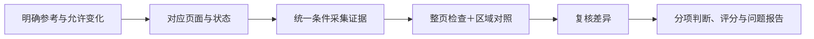

**1. 先明确“哪些地方需要还原”。**

这一步可以从任务信息和 Skill 默认规则中取得，无需每次人工填写。

| 场景 | 对照依据 |
|---|---|
| 无独立参考站的迁移 | 内容站同时提供内容与视觉依据 |
| 有独立参考站的升级 | 视觉对照参考站，内容核对内容站与资料 |
| Site 模板 | 按约定设计要求对照，考虑图片占位等资源替换要求 |

例如升级任务中，两站文案不同，不应直接当作还原失败；模板按要求使用 `imagePlaceholder`，也不能因图片内容不同直接扣分。

对于允许 redesign 的任务，需要从生成要求中明确允许哪些变化，评测 AI 不能自行决定豁免范围。

**2. 建立可比较的页面与状态。**

SOP 应明确页面对应关系、视口、语言，以及菜单、轮播、弹窗等状态，同时记录字体、图片是否正常加载。

我建议默认考虑桌面与移动端，具体尺寸由 Skill 配置。**“仅首页”包含整个首页，而不只是首屏。**

参考无法访问、证据采集失败，应记录为未验证；有证据显示目标站出现空白、缺图等问题，则记录为实际缺陷。

**3. 证据分成整体、区域和状态三个层次。**

| 证据 | 用途 |
|---|---|
| 整页截图 | 检查区块顺序、缺漏、整体比例 |
| 对应区域截图 | 检查页头、主视觉、内容区、页脚等细节 |
| 交互状态证据 | 检查展开菜单、移动导航等约定状态 |

区域按实际内容对应，不强制所有站点使用同一套区块划分。

例如主视觉高度错误，导致后续内容整体下移：应指出这个原因及影响，再检查后续区域内部有没有独立问题，避免把同一个错误重复扣分。

**4. AI 先记录具体差异，再形成评分判断。**

问题记录应该能表达成这样：

> 首页／桌面视口／主视觉区域：目标站文字区域明显变窄，标题由两行变为四行，按钮被推到首屏之外。附参考和目标截图，说明对布局的影响。

建议初步检查这些方向：

- 区块结构、顺序与缺漏。
- 布局、尺寸比例与间距。
- 字体、信息层级与颜色。
- 图片区域、裁切与显示。
- 移动端布局及约定交互状态。

每个差异还要判断属于**实际缺陷、允许变化，还是取证条件不一致**。证据不足时保留未验证项，不补出一个看似完整的结论。

**5. 最后复核，再汇总分数。**

重要扣分先复核页面对应、截图状态和允许变化；分数由平台按固定规则汇总。

正式使用前，我建议用少量人工已经判断过的案例校准：明显缺区块、布局偏差、细节差异，以及合理的图片替换等。重点观察 AI 有没有漏报重要问题、误判允许变化，再调整 SOP 和 references。

这轮先讨论上述**取证与判断流程**。具体分值、权重和通过线，可以在流程认可后继续确定。

---

<a id="message-0e6a4eb398885f36016aedf1f852c487d0a75066897ed9ed1d"></a>

## 13 · 原始回复

来源消息：`msg_0e6a4eb398885f36016aedf1f852c487d0a75066897ed9ed1d`，任务轮次：`01a1b177-312f-77c3-8465-345df276bf86`。

你的补充让评测方式更清晰了：**由本地 AI 理解参考设计，按页面结构、banner 设计意图和实际交互进行审核，工具负责辅助取证。**这六点已记入[讨论文档](/Users/achen/Priv/Yardi/Kooboo/docs/automation-evaluation-discussion.md:673)。

我建议把 SOP 调整成下面的结构：

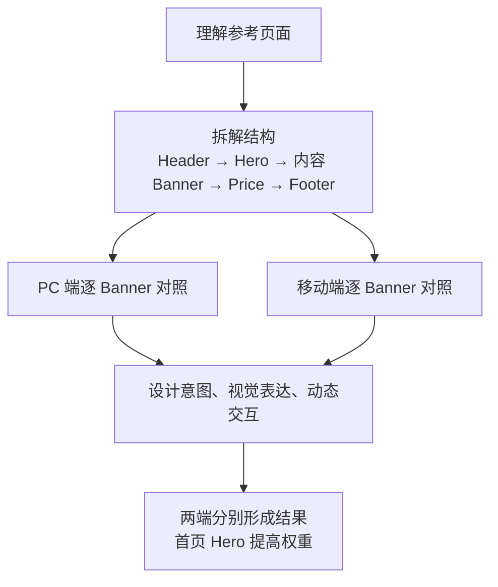

**Banner 是一个承担完整设计任务的区段。**评测先识别参考站的区段及顺序，再检查生成站有没有对应实现，包括缺失、顺序改变、区段被替换等问题。这里判断的是页面呈现，不要求代码采用相同的组件或 DOM 结构。

对于你提出的 **“banner 设计意图”**，我建议丰富成以下几个方面：

| 方面 | AI 应理解和比较什么 |
|---|---|
| 内容任务 | 这个 banner 是介绍产品、解释功能、建立信任、比较价格，还是引导咨询？生成结果有没有承担同样的任务？ |
| 视觉焦点 | 第一眼应该看到标题、产品图、数字还是案例？主次关系是否保留？ |
| 构图与空间 | 图文关系、布局、比例、留白、叠放和对齐，是否保留关键设计关系？ |
| 风格与氛围 | 字体、色彩、明暗、背景与装饰，是否表达出参考中的视觉气质？ |
| 图片或媒体的作用 | 它是背景、主体、证明材料还是产品演示？位置、比例、裁切和文案关系是否合适？ |
| 阅读与操作引导 | 用户接下来应该读什么、点击什么？CTA 的主次、位置和显著程度是否对应？ |
| 动态表达 | 切换、展开、滚动等行为如何展示信息？生成站有没有保留这种表达方式？ |

这里的“意图”，需要 AI 根据可观察的构图、内容和交互给出解释。

例如，参考 hero 用**大幅产品视觉、简短标题和突出按钮**形成强烈首屏印象，生成结果却变成小图加大段文字。即使内容都在，视觉焦点、空间关系和首屏表达也发生了明显偏离，应当反映在评分里。

再比如价格 banner，参考通过横向比较和推荐方案帮助用户选择；生成结果只放一段价格介绍，那么内容可能齐全，但比较关系和选择引导没有还原。

**首页 Hero 应当单独突出。**建议在 PC、移动端各自的评分中，都给予 hero 高于普通 banner 的权重，并单列其问题与证据。具体比例先不定，之后通过案例校准，作为可调整的评分规则。

**动态交互需要实际操作后再判断。**

- **轮播**：看初始展示、切换方式、切换后的图文联动，以及参考中的过渡效果。
- **手风琴**：看默认展开、展开与收起、单开或多开，以及配图是否联动。
- **滚动效果**：看触发前后状态、吸附或渐进展示是否保留原来的阅读节奏。

我建议分别说明“功能有没有实现”和“动态设计是否还原”。例如轮播能切换，但参考中的图文联动完全消失，两部分的评价应有区别。证据可以是操作前后截图、必要的中间状态或短录屏；不必预先把每个动画时长都规定成严格数值。

**PC 和移动端独立审核，这一点按你的要求确定。**

PC 参考对 PC 生成结果，移动参考对移动生成结果。移动端的图文顺序、裁切、导航和触摸交互，都按参考站移动版本判断。两端分别保留评分和问题，再按规则汇总，避免 PC 的高分掩盖移动端的明显缺陷。

这些具体检查项可以写入 Skill，并通过后续真实案例持续补充；AI 保留判断弹性，同时需要说明“观察到了什么、为什么认为设计表达发生了变化”。

---

<a id="message-0e6a4eb398885f36016aedf78a3df887d08eb54497eef5792a"></a>

## 14 · 原始回复

来源消息：`msg_0e6a4eb398885f36016aedf78a3df887d08eb54497eef5792a`，任务轮次：`01a1b18d-196f-7771-b04c-594fe94d5ddf`。

这一步先确定：**完整度评的是“本次承诺交付的内容有没有被完整、正确地承接”。**我建议由评测 AI 根据内容站、资料包和任务要求整理清单，再核验生成结果。

已将以下草案记入[讨论文档](/Users/achen/Priv/Yardi/Kooboo/docs/automation-evaluation-discussion.md:794)，具体规则仍待讨论。

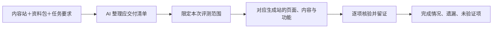

**完整清单应从来源形成。**可以复用已有采集清单，没有清单时由 AI 整理，不要求资料包采用固定格式。每项保留来源依据，避免 AI 只看到生成站做了什么，就据此定义“应该做什么”。

有独立参考站的升级任务中，参考站主要提供视觉依据；迁移哪些内容和功能，仍以内容站、资料与明确要求为准。

完整度可以先分成五类：

| 类别 | 检查什么 |
|---|---|
| 页面与栏目 | 应有的栏目、列表、详情等是否有对应承接 |
| 内容 | 产品、文章、案例是否齐全，正文、参数和联系方式等是否正确 |
| 资源 | 图片、视频、附件、下载资料是否正确关联并可使用 |
| 导航与关联 | 菜单、分页、列表到详情、相关内容链接能否到达正确位置 |
| 功能 | 本次要求的搜索、筛选、表单、下载等是否实际可用，结果是否正确 |

比如内容站有 100 个应迁移产品，生成站只有 20 个，即使产品列表很好看，也存在明确遗漏；列表有 100 条，但详情为空，同样不完整。

这里继续发挥 AI 的判断弹性：升级时可以按要求重组页面、调整文案，但需要核对关键事实和内容有没有丢失。新旧页面不必机械地一对一对应，允许的合并也要能说明内容被承接到了哪里。

**三种任务范围分别处理：**

- **仅首页**：检查首页应有的区段、内容、资源和约定功能；未委托的内页不扣完整度分。
- **全站**：检查约定清单中的全部范围，不能只看导航入口或几个代表页面。
- **内页续建**：检查本次新增范围，同时核验首页、公共导航和组件是否受到影响。

另一个需要明确的边界是：**遗漏和不知道，要分别记录。**

我建议逐项使用“已验证完成、部分完成、缺失／错误、未验证、按要求排除”这些状态。原站访问不到、资料不齐，或某个功能没有验证条件，就保留证据缺口；不能据此声称全站已经完整，也不能直接把未知都当成生成失败。

报告应同时呈现：

> 应交付什么 → 实际验证了什么 → 完成了什么 → 缺少什么 → 哪些仍无法判断。

具体权重可以继续自定义。这一轮先确认上述**完整度的依据、检查范围和结果表达**，再深入旧 URL 承接与 SEO 迁移保护。

---

<a id="message-06763e789848107c016aedfbf933bc87d0ac316ca60f1d1f88"></a>

## 15 · 原始回复

来源消息：`msg_06763e789848107c016aedfbf933bc87d0ac316ca60f1d1f88`，任务轮次：`01a1b19b-5b8d-7762-8e01-11a098ad8a1c`。

下一步讨论 **SEO 迁移保护**。建议先围绕一个核心问题：**迁移后，旧站已有的访问入口和对应内容，是否被正确承接？**

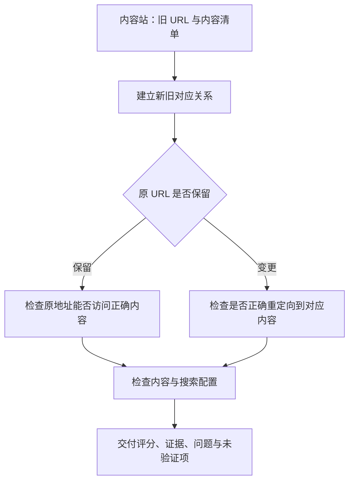

**这里与刚才的动态内容要求可以衔接起来。**

例如旧产品地址是 `/product.aspx?id=123`，我们可以把“保留这个访问入口，同时通过动态数据和复用模板展示产品”作为生成要求。具体配置方式以后核对。

这样，100 个产品仍有各自的访问地址，底层采用数据记录和动态模板。需要改变地址时，则检查每个旧入口是否对应正确的新内容，不能把全部产品地址统一跳到首页就算完成。

建议评测包含以下几项：

| 维度 | AI 主要检查什么 |
|---|---|
| 旧入口承接 | 地址是否保留；变化时是否正确跳转，有没有错误目标、循环或参数丢失 |
| 重要内容承接 | 产品、文章及关键事实是否完整，标题和页面内容是否对应 |
| 搜索配置 | canonical、内部链接、sitemap 等是否与预期正式地址一致 |
| 抓取与索引 | 按环境检查 robots、noindex 等配置，区分预览与正式站 |
| 覆盖情况 | 哪些入口已验证、哪些缺失、哪些未取得证据 |

清单可以复用克隆结果、采集记录、sitemap 和导入资料。如果客户提供了 Search Console 或流量数据，再辅助识别重要入口；不强制每个任务都先取得这些权限。

**评分还需要区分交付阶段：**

- **仅首页样稿**：只评价本次首页范围，不提前给出全站 SEO 通过结论。
- **全站预览**：检查内容、路由和配置准备；尚未生效的正式域名跳转列为“待上线核验”。
- **正式上线后**：核验真实入口和最终配置。后续收录、点击和流量观察是否纳入平台，另行讨论。

我建议 SEO 结果可以独立查看，重要旧入口丢失要突出显示；权重、是否设必过项继续支持自定义。一次评测的结论应限定在实际验证范围内。

已补入[讨论文档](/Users/achen/Priv/Yardi/Kooboo/docs/automation-evaluation-discussion.md)，本轮新增细则标为建议，等待我们讨论确认。

本轮未成功获取 Google 官方指南正文，因此尚未完成这些 SEO 细则的官方依据核对。

---

<a id="message-06763e789848107c016aedff3c38a487d0bd4818872ac46300"></a>

## 16 · 原始回复

来源消息：`msg_06763e789848107c016aedff3c38a487d0bd4818872ac46300`，任务轮次：`01a1b1a9-ee04-72c0-b54c-ba25415b8703`。

下一步进入 **App 的 UI 体验与业务正确性评测**。

我建议以“用户完成业务任务”为主线，在实际操作过程中，分别评价体验和业务结果。

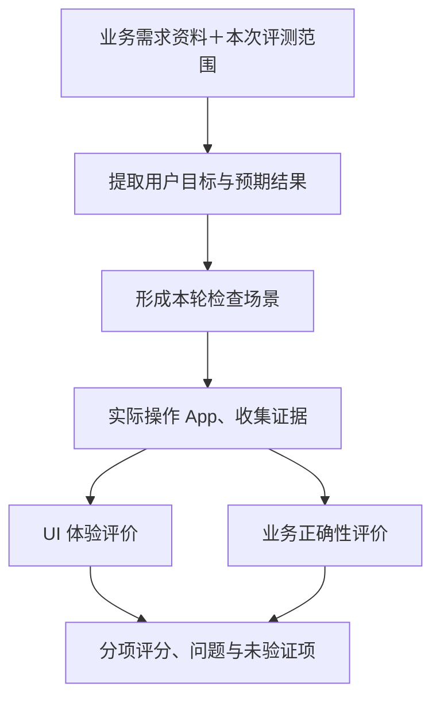

**第一步，是让 AI 从需求资料中整理出“应该验证什么”。**

资料包继续保持自由度。沿用此前业务需求讨论的口径，可以提供自然语言的用户、目标和业务流程，由评测 AI 整理检查场景，不要求我们预先写完数据库结构或整套测试用例。

每个场景只需要说清楚：

> 谁，在什么情况下，要完成什么任务，预期得到什么结果，以及如何验证这个结果。

预期结果要有需求依据；需求含糊的地方保留疑问，避免 AI 自己补出一套业务规则，再据此扣分。

**第二步，沿着任务过程检查这几个方面：**

| 部分 | 重点检查 |
|---|---|
| UI：信息组织 | 关键事实、状态、关联资料是否容易理解，复杂对象是否有足够展示空间 |
| UI：操作体验 | 入口是否易找，操作是否顺畅，返回或编辑时是否保留合理上下文 |
| UI：反馈 | 加载、空数据、输入错误、成功和失败是否有准确反馈 |
| 业务：流程完成 | 用户能否从任务起点走到预期结果，各步骤能否衔接 |
| 业务：数据正确 | 保存、重新打开后是否正确，列表、详情和相关统计是否一致 |
| 业务：规则生效 | 需求中明确的计算、条件、状态变化和权限是否实际生效 |

比如，需求包含缺陷处理流程：

**提交问题 → 交给处理人 → 记录处理结果 → 验证结果。**

业务侧检查记录是否保存、关联是否正确、结果是否符合需求；UI 侧同时观察问题描述、附件、处理记录和主要操作是否容易查看和使用。

你之前举的“大量信息塞进小弹窗”就放在这个过程中评价：需要指出它具体造成了什么困难，例如处理记录难以阅读、关联资料无法对照，而不是单纯因为使用弹窗就扣分。

**第三步，证据和覆盖情况要跟着场景走。**

建议每个场景保留“需求依据、操作过程、预期结果、实际结果、证据”。其中：

- 保存成功还应检查重新进入后的结果。
- 前置步骤失败导致后续无法检查时，后续标为“阻塞／未验证”。
- 主流程通过后，仍单列尚未检查的规则和边界情况。

UI 与业务分别评分，权重和必过项支持自定义。具体体验细则，再用真实 App 的问题和认可案例逐步充实到 Skill 中。

已作为**待确认草案**补入[讨论文档](/Users/achen/Priv/Yardi/Kooboo/docs/automation-evaluation-discussion.md:974)。


---

<a id="message-06763e789848107c016aee0097353487d08bd253edfd0ffef9"></a>

## 17 · 原始回复

来源消息：`msg_06763e789848107c016aee0097353487d08bd253edfd0ffef9`，任务轮次：`01a1b1ae-64c6-7f21-9543-e55588d0a516`。

明白，就统一按**同一套 CPR UI**记录，实施时优先复用现有样式和组件。App 评测方案也已记为确认；**全部讨论完成后，我会直接进入实施，再用实际任务验证这些规则。**

下一步收敛 **评测 Skill 的维护与更新方式**。建议在平台提供一个“评测规则”入口：

| 内容 | 维护方式 |
|---|---|
| SOP | Markdown 编辑，调整步骤、证据要求和交付内容 |
| 参考资料与案例 | 添加说明、截图和认可案例 |
| 评分规则 | 修改维度、权重、适用条件及必过项 |
| 检查工具 | 开发维护工具实现，Skill 中保留使用说明与版本 |

更新流程建议保持简单：

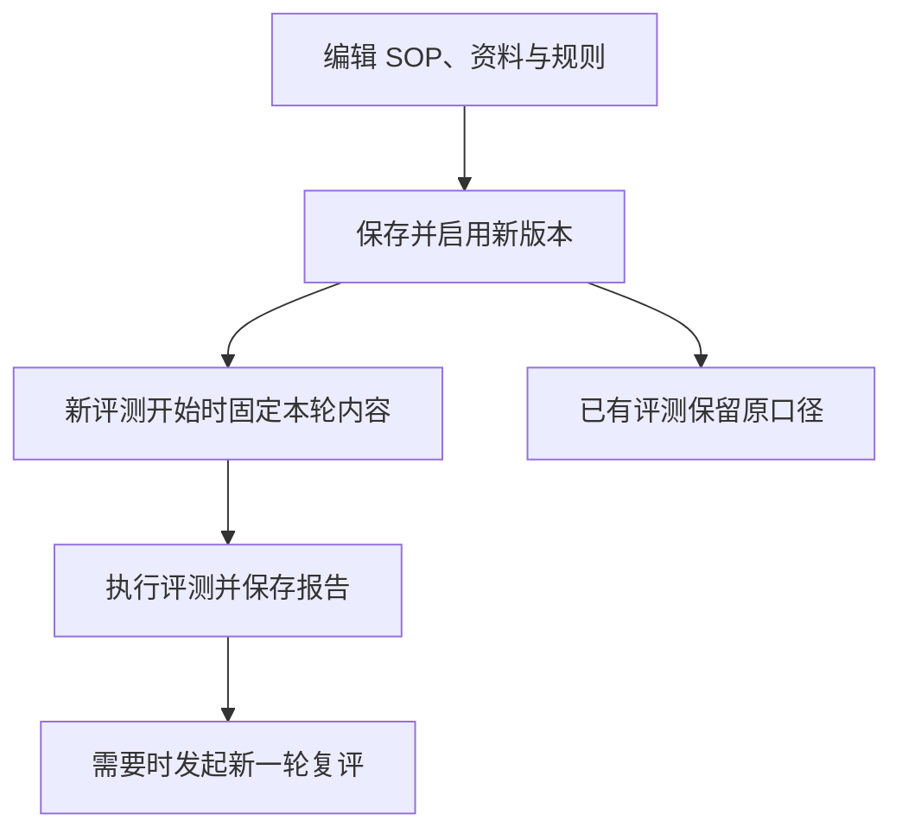

这里建议明确三点：

- **修改必须实际生效**：平台中的评分项与权重，同时驱动 AI 的评分说明和最终汇总。
- **每轮保留完整口径**：保存实际使用的规则、资料与工具版本，方便复核。
- **复评保留历史**：使用新规则创建一轮新评测，旧报告继续保留。

SOP、资料和评分规则的日常更新，通过平台完成；可执行工具的逻辑变更由开发维护。

已将确认事项和这轮新建议补入[讨论文档](/Users/achen/Priv/Yardi/Kooboo/docs/automation-evaluation-discussion.md:1042)。


---

<a id="message-06763e789848107c016aee02370e8087d0bc7a966ba638bc60"></a>

## 18 · 原始回复

来源消息：`msg_06763e789848107c016aee02370e8087d0bc7a966ba638bc60`，任务轮次：`01a1b1b4-11bc-7fa2-b6bc-ae8a3e1d3b48`。

已将 Skill 维护与版本规则记为确认。下一步讨论 **评测报告，以及问题如何交给外部 AI／人工跟进**。

建议同一份结果同时支持平台查看和外部 AI 读取，包含：

| 内容 | 要回答的问题 |
|---|---|
| 任务与范围 | 评的是哪个站、哪个输入版本、本次哪些页面或业务 |
| 执行状态 | 评测是否正常完成，有没有中断或取证失败 |
| 质量与评分 | 各维度表现如何，存在哪些重要问题 |
| 验证覆盖 | 哪些已验证、哪些未验证、哪些属于范围外 |
| 问题与证据 | 哪里有问题，预期与实际有何差异，证据在哪里 |
| 本轮口径 | 使用了哪个版本的 Skill、规则、模型和工具 |

平台按场景展示适用维度，例如 App 展示 UI 与业务结果，Site 展示对应的视觉、完整度和 SEO 结果。

**跟进流程建议沿用已经确定的职责分工：**

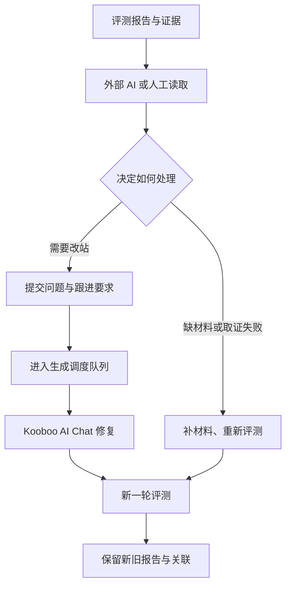

系统负责整理问题、证据和任务上下文；外部 AI／人工决定处理方式。修复执行继续受原有并发上限约束。

这里建议明确三个口径：

- **执行完成、质量通过、证据覆盖分别表达。** 评测跑完后仍可能存在问题或未验证项。
- **修复结果需要复评确认。** Kooboo AI 表示完成后，保留执行记录，再检查问题是否解决。
- **局部复评只给局部结论。** 同时检查必要的回归范围，保留旧报告。

这样，外部 AI 能直接取得足够的跟进材料，人工也能沿着证据复核。

已作为新建议补入[讨论文档](/Users/achen/Priv/Yardi/Kooboo/docs/automation-evaluation-discussion.md:1100)。这部分收敛后，再讨论运行环境、部署方式和首版实施范围。


---

<a id="message-02a05bd5a435cb87016aee7cf3a9bc87d08105400348559a58"></a>

## 19 · 原始回复

来源消息：`msg_02a05bd5a435cb87016aee7cf3a9bc87d08105400348559a58`，任务轮次：`01a1b395-aedb-7ce3-92e9-d865591647cd`。

**目前能看到部分评测过程，但还没有完整的会话查看界面。**

你这次测试分为两段：

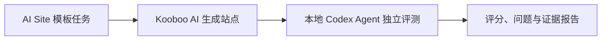

1. **评测会话在哪里看？**

   目前在「任务详情 → 执行记录」可以看到已完成的 AI 输出和工具执行摘要；输入页会显示评测会话 ID。完整工具输出、执行中的增量消息还没有展示。[当前实现](/Users/achen/Priv/Yardi/AI-App/Kooboo-AI-Automation-Lab/server/automation/evaluator.ts:74)

   它使用独立的 Codex 运行目录，当前没有接入 Codex 桌面侧栏的会话入口。SDK 本身支持保存和恢复会话，因此可以进一步做成平台里的「评测会话」，展示委托内容、AI 回复、工具调用和截图证据。[SDK 说明](/Users/achen/Priv/Yardi/AI-App/Kooboo-AI-Automation-Lab/node_modules/@openai/codex-sdk/README.md:98)

2. **为什么模型设置分两块？**

   这是兼容原评分平台留下的配置拆分，界面确实不够清晰。现在的使用关系是：

   | 配置 | 当前用途 |
   |---|---|
   | 上方模型名称、Responses 地址 | 决定新 Codex 评测使用哪个模型、调用哪里 |
   | 下方 API Key | 新 Codex 评测也使用这个密钥 |
   | 下方默认地址 | 上方地址留空时，作为回退 |
   | 下方历史执行器模型 | 原评分执行器使用，不决定新 Codex 评测的模型 |

   这些关系已按[实际调用代码](/Users/achen/Priv/Yardi/AI-App/Kooboo-AI-Automation-Lab/server/automation/evaluator.ts:21)核对。

**我建议将当前评测配置合并成一张卡片：模型名称、API 地址、API Key、测试连接、保存。** 原执行器的配置收进兼容设置；任务详情增加「评测会话」入口。

这两项建议已记入讨论文档，本轮没有修改你正在测试的任务或配置。


---

<a id="message-0ea4717fbae34248016aee8210aff487d0984eba1a724107ba"></a>

## 20 · 原始回复

来源消息：`msg_0ea4717fbae34248016aee8210aff487d0984eba1a724107ba`，任务轮次：`01a1b3a6-bbc7-7032-9c45-76f5222e491b`。

**查清楚了：两次会话都已有首页交付结果，但平台没有识别到结束，也没有取得评测地址，导致流程断了。这里有我之前实现的衔接缺陷，需要修正。**

我只读检查了实际记录：

| 任务 | Kooboo 原会话的最后回复 | 平台记录 |
|---|---|---|
| Rendani | 明确报告首页完成，并列出交付对象、验证和缺口 | 待跟进，没有会话上下文、评测地址 |
| Beximco | 明确报告首页完成并保存，同时说明一项审计缺证据 | 同样停在待跟进 |

这些是生成 AI 的交付声明，页面质量仍需独立评测；两个生成站的公开地址也都已经存在。

具体有两个错误：

1. **完成判断用了另一套聊天界面的标记。** 平台等待 `.chat-turn` 的完成状态，但实际 AI Chat 使用其他组件，所以一直等不到。
2. **站点地址解析匹配错了字段。** 接口返回 `siteId`，平台却查找 `id`；而且仅在生成前查询一次，空白站那时可能还没有首页。

所以，仅修改 prompt 或延长等待时间解决不了这次问题。

我建议把自动化收敛成下面的流程：

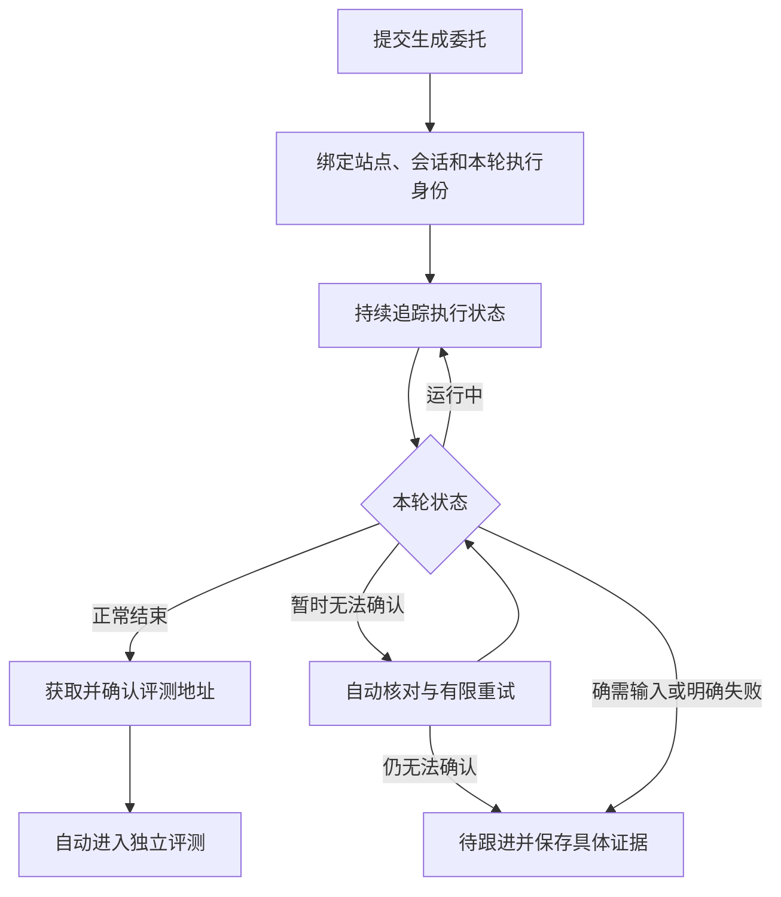

其中，我认为有四条原则需要明确：

- **执行状态要可靠。** 分别记录会话 ID、本轮执行 ID和结束原因。优先复用 Kooboo 现有状态，必要时增加一个轻量状态桥接；停止按钮只能作为辅助信号。
- **未知状态先自动核对。** 读取异常、状态暂时不同步时，系统先核对原执行和会话记录，再决定是否需要跟进。不能看到按钮消失就交给用户。
- **正常执行结束后，即可进入评测。** 页面不好看、有遗漏、生成 AI 自报缺陷，正好应该由评测发现。可选的“继续生成内页”“清理 Sandbox”也不应阻断首页评测。
- **交接必须可恢复。** 地址在生成后重新获取；临时不可访问时有限重试；恢复后避免重复生成、重复创建评测。

Beximco 提到的“预览 iframe 为 0×0，审计缺证据”，也应该保留下来交给评测核查，不能只采信生成 AI 所说的“不是页面问题”。

**对现有这两次任务，建议恢复已有结果、确认执行结束后补接评测，避免重新建站和重复消耗生成 token。** 这一轮先讨论这个修复范围，不引入复杂的 AI 自动修复循环。

已记录到[讨论文档·议题三十](/Users/achen/Priv/Yardi/AI-App/Kooboo-AI-Automation-Lab/docs/automation-evaluation-discussion.md:1455)，方案标记为待确认；没有修改实现或干预任务。


---

<a id="message-0ea4717fbae34248016aee83a01e7c87d08d78a19f6a464089"></a>

## 21 · 原始回复

来源消息：`msg_0ea4717fbae34248016aee83a01e7c87d08d78a19f6a464089`，任务轮次：`01a1b3b0-92f9-73d3-aa3d-29a1d7b92570`。

**是的，这样我们就把“理解问题、决定怎么继续”也纳入平台内部了。** 我上一轮把跟进主要留给外部 AI，范围收得窄了；按你现在的方向，应增加一个通过 Codex SDK 运行的**流程跟进 Agent**。

它拿到任务目标、范围、原会话、当前问题和工具后，可以主动查证、执行操作，再根据结果继续决策。

```mermaid
flowchart TD
    A[Kooboo AI 执行生成] --> B{执行状态}
    B -->|正常结束| E[独立评测 Agent]
    B -->|异常、停顿或状态不明| C[流程跟进 Agent]
    C --> D[读取会话、状态和站点证据]
    D --> F{决定下一步}
    F -->|继续观察| D
    F -->|需要继续生成| G[通过调度器跟进原会话]
    G --> A
    F -->|确认可以评测| E
    F -->|确需用户输入| H[保留上下文并提出具体问题]
```

三者的职责可以这样分：

| 角色 | 职责 |
|---|---|
| 调度器 | 保存状态、控制并发、避免同站重复执行、执行取消与恢复 |
| 流程跟进 Agent | 理解问题、补查信息、选择工具、推动流程继续 |
| 评测 Agent | 独立收集证据，判断质量并输出报告 |

**跟进 Agent 要有行动工具，不能只输出建议。** 例如：

- 读取原会话、执行状态、站点信息和错误记录。
- 等待后重新检查。
- 向原会话发送补充指令，继续完成当前任务。
- 确认执行结束和目标就绪后，申请进入评测。
- 无法自主解决时，向用户提出具体问题。

对应这次案例，它可以读取到“首页已完成”，再核查实际执行状态和站点地址；把“继续内页”“清理 Sandbox”识别为可选后续，然后推动首页评测。若首页确实没做完，就组织跟进消息，让 Kooboo AI 继续完成原委托。

我建议同时明确三个设计点：

1. **跟进 SOP 也可自定义。** 包括遇到什么情况如何查证、允许采取哪些行动、什么情况下交给用户。
2. **跟进仍经过调度器。** AI 决定下一步，工具负责检查执行前提，避免上一轮还没停就再次生成，或重复创建评测。
3. **跟进有可配置预算。** 限制时间、token 和无进展的重复次数，防止任务持续消耗却没有推进。

上一轮发现的状态识别和地址解析错误仍需修正，给这个 Agent 提供可靠的信息与工具。

**我建议首版先覆盖“生成过程中及生成到评测之间的自主跟进”。** 评分出来后是否再自动修复、复评，可以作为下一层闭环继续讨论。

已记入[议题三十一](/Users/achen/Priv/Yardi/AI-App/Kooboo-AI-Automation-Lab/docs/automation-evaluation-discussion.md:1486)，并注明它更新了此前依赖外部 AI 跟进的方向。本轮仅更新讨论文档。

---

<a id="message-0ea4717fbae34248016aee8415eedc87d0abe1f3d2e735b2a3"></a>

## 22 · 原始回复

来源消息：`msg_0ea4717fbae34248016aee8415eedc87d0abe1f3d2e735b2a3`，任务轮次：`01a1b3b2-ecd5-7703-8477-869d432b9264`。

**对，这就是我们要确定的产品目标：一次发起，系统自主推进，最终交付评测报告，或者给出明确、可行动的中断说明。**

AI 的介入范围覆盖整个流程，包括资料准备、生成、交接评测，以及评测中的异常处理。

```mermaid
flowchart TD
    A[你发起任务] --> B[系统推进：准备 → 生成 → 评测]
    B -->|顺利完成| C[交付评测报告]
    B -->|出现不确定或阻塞| D[内置 AI 查证并调用工具处理]
    D --> E{是否能够继续}
    E -->|能够继续| F[从对应阶段恢复]
    F --> B
    E -->|明确不能继续| G[中断并通知你：原因与下一步]
```

这里需要把两个终点定义清楚：

| 终点 | 你应收到的结果 |
|---|---|
| **评测完成** | 评分、问题、证据和未验证项。评分不达标也属于流程完成。 |
| **明确中断** | 停在哪一步、为什么无法继续、AI 尝试过什么、已保留哪些成果，以及你需要补充什么或采取什么行动。 |

因此，“状态不明”“页面停止”“工具报错”都应先成为 **AI 跟进的起点**。AI 可以查询、等待、恢复会话、补充指令、重试失败环节，推动流程继续。

确实缺少无法推断的资料、环境持续不可用，或者达到约定预算且没有进展时，才形成明确中断。恢复条件满足后，应尽量沿用已有站点和成果继续。

**本轮的目标是把评测跑完；评分后是否自动修复到达标，我们另行确定。**

已记录到[议题三十二](/Users/achen/Priv/Yardi/AI-App/Kooboo-AI-Automation-Lab/docs/automation-evaluation-discussion.md:1520)。当前仍在讨论阶段，尚未实施。

---

<a id="message-096d87c3fae9720a016aee8d2e5f1887d09dc5873057d85215"></a>

## 23 · 原始回复

来源消息：`msg_096d87c3fae9720a016aee8d2e5f1887d09dc5873057d85215`，任务轮次：`01a1b3b7-4151-77a1-99ea-8649897e638f`。

已实施，并更新了本机 **4180 服务**。

```mermaid
flowchart TD
    A[准备 → 生成 → 评测] --> B[报告与证据]
    A -->|异常或停顿| C[内置 AI 查证并处理]
    C -->|重试 / 继续 / 回答 / 交接| A
    C -->|无法继续或预算耗尽| D[中断原因、下一步与通知]
```

- **系统设置 → AI 跟进**：可调整 SOP、并发、次数、时间和 token 预算。
- 恢复保留原站、输入版本及证据；修复了完成状态识别和首页地址获取，增加发送回执与评测交接去重。
- 两个历史任务保持原状，刷新平台后可点击 **“AI 接管 / 恢复”**。

验证：**136 项通过，1 项浏览器测试跳过**；类型检查、生产构建和桥接检查通过。真实模型闭环尚未验收，本轮未重跑历史任务、未提交 Git。

已更新[讨论记录](/Users/achen/Priv/Yardi/AI-App/Kooboo-AI-Automation-Lab/docs/automation-evaluation-discussion.md:1565)。


---

<a id="message-084a5bc7650ffc0e016aee900437f887d0940022f5ee8ea7a6"></a>

## 24 · 原始回复

来源消息：`msg_084a5bc7650ffc0e016aee900437f887d0940022f5ee8ea7a6`，任务轮次：`01a1b3db-3090-7902-a274-aa66c556a612`。

明白，**迁移能力跟随 Kooboo 连接配置**，德国交付只用于需要它的任务。

```mermaid
flowchart TD
    A[选择 Kooboo 连接] --> B[生成 → 完整评测]
    B --> C{是否需要迁移交付}
    C -->|Local 无交付| D[报告完成]
    C -->|香港连接 需要交付| E[迁移德国 → 交付核验]
    E --> D
```

建议连接配置保存“支持迁移、迁移接口、目标环境”，页面据此显示入口。Local 连接隐藏迁移入口，评测结束即可完成。支持迁移的连接是否自动迁移，仍待确认。

费用记录也已列入 TODO：分别采集**生成、跟进、评测**的 usage，按缓存、模型及当时单价估算金额；缺失用量明确标记，不能算作零成本。[官方计价页](https://api-docs.deepseek.com/zh-cn/quick_start/pricing)还区分高峰与空闲时段，因此需要保存计价快照。

本轮结论和 TODO 已写入[讨论文档·议题三十四](/Users/achen/Priv/Yardi/AI-App/Kooboo-AI-Automation-Lab/docs/automation-evaluation-discussion.md:1608)，并同步 Kooboo 侧副本，包括计时隔离、白屏排查、用量费用和可选迁移。**本轮仅更新文档，未修改业务代码。**

---

<a id="message-025d59537abc1714016aeed61b661887d0b1e2c9d96f51bbb3"></a>

## 25 · 原始回复

来源消息：`msg_025d59537abc1714016aeed61b661887d0b1e2c9d96f51bbb3`，任务轮次：`01a1b4f2-8e39-74d1-8c84-323a3562d3c4`。

我看完了关联会话。**我赞成在现有流程上增加“按报告修复 → 独立复评”的质量优化闭环。** 那边提出的“双端 85 分、最多 3 轮”目前还是建议，我们可以逐项确认。

先确定用户发起任务后，系统要做到哪一步：

```mermaid
flowchart TD
    A[生成站点] --> B[独立评测]
    B --> C{任务目标}
    C -->|生成并评测| D[交付报告]
    C -->|自动优化| E{达到质量目标？}
    E -->|达到| D
    E -->|未达到| F[跟进 AI 查看报告与截图]
    F --> G[Kooboo AI 在原站修复]
    G --> B
    F -->|预算耗尽或无法继续| H[保留成果并说明停止原因]
```

我的建议是，**继续复用现有跟进 AI**，给它增加读取报告、查看截图和组织修复任务的能力：

| 角色 | 职责 |
|---|---|
| 跟进 AI | 判断主要差距，选择本轮修复内容，提交具体要求 |
| Kooboo AI | 在原站实施修改 |
| 评测 AI | 根据新证据独立评分 |
| 平台 | 管理队列、预算、历史和停止条件 |

修复委托应该具体到问题，例如：“恢复流程区的深色背景、卡片层次和移动端排列”，附上对应参考图与生成图。这样后续才能判断问题是否解决。

质量目标也需要一致：**如果目标是 85，初次得到 82 分也应该继续优化**。因此我倾向直接使用可配置的目标分，不额外设置“低于 80 才启动”的门槛。PC、移动端分别达标，同时检查本范围内的重大问题和必过项。

另外，结合今天的情况：**模型繁忙、断流、取证失败，应计入流程恢复预算，不应算作完成了一轮质量优化。** 两类预算分别控制，费用仍完整累计。

我们先确认第一步：**新建任务时提供“生成并评测”和“自动优化到目标”两种选择，首版先对 AI Site 模板开放自动优化**，这个产品行为符合你的预期吗？

已补入[讨论记录](/Users/achen/Priv/Yardi/AI-App/Kooboo-AI-Automation-Lab/docs/automation-evaluation-discussion.md)，本轮未实施。

---

<a id="message-025d59537abc1714016aeed700937087d097443e9fc264c983"></a>

## 26 · 原始回复

来源消息：`msg_025d59537abc1714016aeed700937087d097443e9fc264c983`，任务轮次：`01a1b4f6-f032-72f1-b943-ea77d6a1b6d7`。

达标条件已记录为确认方案。接下来，我建议**由跟进 AI 把报告整理成具体修复委托，再交给 Kooboo AI 执行。**

```mermaid
flowchart LR
    A[报告与截图] --> B[跟进 AI 选择本轮重点]
    B --> C[组织修复委托]
    C --> D[Kooboo 原站修复]
    D --> E[重新取证与独立复评]
    E --> F[核对改善与回归]
```

每项修复应包含这些内容：

| 内容 | 示例 |
|---|---|
| 位置与视口 | 首页流程区，PC 与移动端 |
| 当前差距 | 参考站的深色分层被简化为普通浅色卡片 |
| 设计意图 | 通过背景、编号和卡片关系形成流程感 |
| 修复期望 | 恢复视觉层次、阅读顺序及移动端排列 |
| 保留约束 | 保留现有业务文案；图片继续遵守模板资源规范 |
| 对应证据 | 生成站与参考站的相关截图，供 Kooboo AI 实际查看 |

这样，Kooboo AI 能依据自己的 skill、reference 和 tools 决定具体实现。

每轮修什么，我建议交给跟进 AI 判断：**先处理重大问题，再结合 Hero、结构等权重和实际差距选择一组重点。** 不固定每轮必须修几项；涉及共享样式时，要同时考虑其他区段和双端的影响。

修复之后，复评要回答四个问题：

| 结果 | 后续处理 |
|---|---|
| 原问题已解决 | 保存新证据，记录解决 |
| 原问题仍存在 | 说明剩余差距，供下一轮调整 |
| 暂时无法验证 | 补充取证或说明阻塞 |
| 出现新问题 | 纳入后续修复，避免只看到分数上涨 |

**复评仍覆盖原定范围和双端，并保持参考基准与评分口径一致。** Kooboo 的“已完成”作为执行记录，问题是否解决由独立评测确认。

这套方式如果你认可，下一步我们就讨论最后一组关键约束：**最多优化几轮、预算如何控制，以及没有改善或发生退化时怎样停止。**

---

<a id="message-02e58a7082d6478b016aeeda40b5a887d0baab220b00f0a3e4"></a>

## 27 · 原始回复

来源消息：`msg_02e58a7082d6478b016aeeda40b5a887d0baab220b00f0a3e4`，任务轮次：`01a1b502-9dfb-7932-8323-058a5d72c350`。

已记录确认。接下来建议把**轮数与停止条件**这样定下来：

| 项目 | 建议 |
|---|---|
| 最大优化轮数 | 默认 **3 轮**，可修改；首次生成和评测不计入 |
| 达标停止 | 任一轮复评满足已确认的双端目标及质量条件，立即完成 |
| 无改善停止 | 连续 **2 轮没有实质改善**时停止，由 AI 根据实际问题和证据解释原因 |
| 异常恢复 | 服务繁忙、断流不算完成一轮；沿用当前轮次恢复，并受恢复预算限制 |
| 费用限制 | 可设置整个任务链的费用上限，包含生成、评测、跟进与修复 |
| 时间限制 | 跟进计时继续排除 Kooboo 生成等待，不增加统一的任务总倒计时 |

“没有实质改善”不能只看分数波动：还要看重要问题是否解决、另一端是否退化、有没有新增缺陷。

费用达到上限后，停止启动新的模型阶段。**已经运行的调用仍可能产生费用**，因此这是阶段之间的预算控制，不能承诺金额绝不超出。

```mermaid
flowchart TD
    A[取得有效评测报告] --> B{达到质量目标？}
    B -->|是| C[完成：目标达成]
    B -->|否| D{轮数、费用及改善情况允许继续？}
    D -->|是| E[委托修复 → 独立复评]
    E --> A
    D -->|否| F[停止：保留结果并说明原因和下一步]
```

停止时交付**当前站点、最近有效报告、每轮修复与费用记录、停止原因和下一步建议**。如果最后一次修改后复评失败，就明确标注“当前版本尚未完成复评”，避免旧报告代表新站点。

历史最高分可以保留，但自动恢复到那个版本需要站点快照，建议另行讨论。

这套边界是否可以确定下来？确认后，我们就讨论这些内容在任务详情中的呈现和 API 输出。

---

<a id="message-02e58a7082d6478b016aeedae4f96c87d0b8be9f95ca27443d"></a>

## 28 · 原始回复

来源消息：`msg_02e58a7082d6478b016aeedae4f96c87d0b8be9f95ca27443d`，任务轮次：`01a1b505-f2e9-7700-be1e-f1f9772238ec`。

已将循环和停止条件记录到[讨论文档](/Users/achen/Priv/Yardi/AI-App/Kooboo-AI-Automation-Lab/docs/automation-evaluation-discussion.md)。接下来建议确认页面与 API，继续沿用现有五个页签。

**创建任务时**选择“自动优化到目标”，再展示目标分数、最多轮数和可选费用上限。

| 页面位置 | 展示内容 |
|---|---|
| 概览 | 当前阶段、目标、最新双端分数、优化轮次；停止时展示原因和下一步 |
| 评测结果 | 当前报告、各轮分数及主要变化；选择某轮查看问题和证据 |
| 执行记录 | 各轮 AI 决策、修复委托、执行过程与异常恢复 |
| 用量费用 | 整个流程的总费用，按阶段、轮次筛选，明细分页 |
| 输入与配置 | 本次固定的目标、限制、范围及评分规则 |

“评测结果”中的轮次表可以类似这样，以下仅为示意：

| 轮次 | PC | 移动端 | 结果 |
|---|---:|---:|---|
| 初评 | 76 | 78 | 未达目标 |
| 修复 1 | 82 | 84 | Hero 改善，结构仍有差距 |
| 修复 2 | — | — | 修复完成，正在复评 |

**站点已经修改但复评未完成时，当前版本显示“待复评”**，此前分数保留在历史轮次中。

任务中心以一个发起任务呈现整个流程；每次独立评测仍保留自己的报告与证据，进入详情查看历史，避免列表被中间轮次铺满。

对外 API 提供两层信息：

```mermaid
flowchart LR
    A[外部 Admin] --> B[流程摘要：进度、目标、当前结果、费用、停止原因]
    B --> C[分页读取各轮记录]
    C --> D[独立报告与证据]
```

现有报告链接保持可用。流程摘要明确区分“执行结束”“质量达标”“当前版本待复评”，同事就能直接判断交付情况。

这一部分是否也符合你的预期？确认后，就可以汇总实施范围和验收用例。

---

<a id="message-02e58a7082d6478b016aeee2d2913887d0b358273b0bf5b4a4"></a>

## 29 · 原始回复

来源消息：`msg_02e58a7082d6478b016aeee2d2913887d0b358273b0bf5b4a4`，任务轮次：`01a1b525-726c-7f50-bbc5-c9697314a1d1`。

是的，你的推导正确。**正常流程中，“改到一半就开始复评”不应该发生**；修复与复评必须串行。

```mermaid
flowchart LR
    A[修复中] --> B[修复完成]
    B --> C[独立复评]
    C --> D[当前版本分数与证据]
    A -->|中断| E[恢复修复或明确停止]
    C -->|中断| F[恢复复评]
```

需要区分的是下面三种实际状态：

| 状态 | 当前版本对外结果 |
|---|---|
| 修复中途被中断 | 无有效分数，说明修复未完成 |
| 修复完成，复评尚未完成或中断 | 无有效分数，说明等待复评或复评中断 |
| 复评完成 | 返回真实分数及证据，是否达到目标另行判断 |

因此，**旧报告不再代表当前站点的边界，是站点开始被修改时**，而不是开始复评时。旧报告仍保留在内部历史中。

另外，断流不代表 Kooboo 已停止修改；执行状态不确定时，先核查，确认修复结束后再复评。

已补充到[讨论记录](/Users/achen/Priv/Yardi/AI-App/Kooboo-AI-Automation-Lab/docs/automation-evaluation-discussion.md)。

---

<a id="message-0ae283427fb0864b016aef00b6a3b887d091f701db0c7e4760"></a>

## 30 · 原始回复

来源消息：`msg_0ae283427fb0864b016aef00b6a3b887d091f701db0c7e4760`，任务轮次：`01a1b598-1345-7702-b55b-ff74d984fd6d`。

可以，**这次应在现有站点上创建“全站续建任务”**，保留已优化的首页。

```mermaid
flowchart LR
 A[现有首页] --> B[同一站点继续生成]
 B --> C[补齐内页、导航和交互]
 C --> D[全站独立评测]
 D --> E[按需继续优化]
```

目前操作路径：

1. 任务详情点击 **查看资源**。
2. 在 **生成站** 中找到本次站点，点击 **继续生成**。
3. 范围选择 **全站**，补充要求建议填写：

> 在当前站点上补齐全站，保留已经优化完成的首页设计。先梳理参考站的页面、列表及详情模板、导航和交互，再完成缺失部分，保持整站视觉一致。动态内容采用 Kooboo 对应的数据存储和动态路由。图片继续遵守模板素材替换约束，不直接复用参考站资源。

4. 选择“生成并评测”，或重新设置“自动优化到目标”，然后加入队列。

**不要使用原任务的“提交生成跟进”来扩展范围**，它目前仍会继承“仅首页”。另一个现有限制是：“继续生成”复用站点，但不会明确继承原 Kooboo 会话。

后续批量 AI Site 模板任务**目前已默认全站**，首页仍可作为测试选项保留。

正式做全站验收前，我们还应补齐模板的全站完整度规则：页面覆盖、列表与详情、导航和交互等。当前默认规则偏重视觉，不能把首页高分直接当成全站完成。上述结论已记录到讨论文档，本轮没有启动任务。

---

<a id="message-0ae283427fb0864b016aef05e10ae087d09f102c71764463dd"></a>

## 31 · 原始回复

来源消息：`msg_0ae283427fb0864b016aef05e10ae087d09f102c71764463dd`，任务轮次：`01a1b5ad-f2d8-75f3-afd0-e1a70fab3a5a`。

我赞成，**接下来应以真实案例逐个跑通其他四个场景**，边跑边修，先每类一个，再考虑批量。

AI Site 模板目前可以确认的是：首页生成、评测、自动优化闭环已跑通；全站完整度还需要用这次续建验证。

在扩大测试前，我建议先补两项共用问题：

| 优先项 | 原因 |
|---|---|
| **AI 跟进预算控制** | 上次已出现单次 Agent 会话超过 token 预算，需要收紧请求级控制，避免无人值守时持续消耗 |
| **全站完整度评测** | 明确应有哪些页面、模板和功能，再核对遗漏；否则可能首页分数很好，内页没有完成 |

之后按这个顺序推进：

```mermaid
flowchart LR
 A[资料建站] --> B[站点迁移]
 B --> C[旧站升级]
 C --> D[AI App 模板]
```

- **资料建站**：先验证资料导入、内容理解、内容准确性和全站生成。
- **站点迁移**：增加内容对应、动态数据、路由与 SEO 检查。
- **旧站升级**：验证“内容来自内容站、设计来自参考站”，防止内容丢失或来源混用。
- **AI App 模板**：重点验证业务流程、数据持久化、异常处理和 UI 合理性。

每个案例都要做到：**生成 → 异常自动跟进 → 独立评测 → 有证据的结果**。目前“低分自动修复提分”仅支持 Site 模板，其他场景是否扩展，可以结合案例再定。

我的建议是：**先补预算控制和最小全站完整度规则，然后用同事的示例资料包跑资料建站。** UI 微调和德国交付暂时后排。上述建议已记录到讨论文档，本轮未启动任务。

---

<a id="message-0ae283427fb0864b016aef072252f487d0bc7719991f924a4c"></a>

## 32 · 原始回复

来源消息：`msg_0ae283427fb0864b016aef072252f487d0bc7719991f924a4c`，任务轮次：`01a1b5b2-8092-7851-898b-fba7c5c61c33`。

我同意，**经验沉淀应该成为这套自动化的核心能力，可以放到后续四个场景验收之前设计，再用真实案例验证它。** 目前系统已有日志、证据和 SOP 快照，但还没有跨任务的经验闭环。

你希望实现的应该是：

```mermaid
flowchart LR
 A[生成与跟进] --> B[独立评测或明确中断]
 B --> C[结合证据复盘]
 C --> D[提炼候选经验]
 D --> E[后续案例验证]
 E --> F[按适用条件采用]
 F --> A
 E --> G[修订或停用]
```

关键是：**保存经验之后，下一次执行要能找到、采用，并验证它有没有帮助。**

**1. 经验沉淀建议先做小而完整**

可以先分三类：

| 类型 | 示例 |
|---|---|
| 生成经验 | 哪些委托说明能减少遗漏，怎样保留已有首页并补齐内页 |
| 跟进经验 | 某类中断应先检查什么，哪些情况继续等待，哪些应停止重试 |
| 评测经验 | 容易漏掉哪些页面、展开态或业务分支，需要哪些证据 |

每条经验需要说明：**什么情况下适用、采取什么做法、依据哪个案例、有什么限制。**

一次成功可以形成候选经验，但不能直接认定为通用规律。例如，这次修改 Hero 后提分，不代表其他站点照搬同一种 Hero 就能提分。

我建议采用以下边界：

- **阶段完成或明确中断后复盘**，不必每条日志都分析；没有新经验就不新增。
- 下一次只提供少量相关经验，避免历史越多，prompt 越大。
- 执行经验可以受控地自动试用，后续发现反例就修订或停用，无需每条都等人工审批。
- **评分标准、任务权限和预算不能由经验 Agent 自行调整**，否则可能通过降低标准制造“进步”。
- 真正的代码缺陷进入修复待办，不能全部靠追加提示词绕过。

经验复盘本身也要有独立预算，并记录用量；复盘失败不影响已经交付的报告。

**2. 预算上限与你的意思一致：额度可以大，停止机制必须可靠**

我核对了，当前前后端配置上限确实都是 **200 万 token**，而且只在 Agent 会话之间检查。

可以支持你说的 **1000 万、2000 万等可配置额度**。需要同时做到：

- 每个模型请求前检查累计预算，而不是等整个 Agent 会话结束。
- 限制单次请求和单次会话，防止一次执行吞掉所有额度。
- 重试、换会话、服务重启都不能自动清零。
- 同时保留次数、活动时间和重复无进展的停止条件。

在途请求仍可能产生消耗，因此实际允许的超量边界也要明确，不能把“请求前检查”说成精确的计费硬封顶。

**3. 全站完整度仍然是评测基础**

经验可以提醒 AI“以前这里经常遗漏”，但当前任务仍要重新核对页面、模板、内容、导航和功能，不能继承其他案例的通过结论。

我建议接下来先讨论并确定**经验如何提炼、验证和采用**；实施时先补预算保护，再接入最小经验闭环，随后跑其他四个场景。这样后面的测试同时也是积累经验的过程。

已记录到讨论文档，本轮没有修改运行配置或启动任务。

---

<a id="message-0ae283427fb0864b016aef0833195887d0bf28046c9821865e"></a>

## 33 · 原始回复

来源消息：`msg_0ae283427fb0864b016aef0833195887d0bf28046c9821865e`，任务轮次：`01a1b5b7-256b-7c42-baaf-3495cc5349ed`。

是的，**默认由本地 AI 自主决定并执行，人工可以随时查看和干预**，这符合无人值守的目标。

可以形成这样的闭环：

```mermaid
flowchart TD
 A[即将执行某个阶段] --> B[本地 AI 选择适用经验]
 B --> C[生成 / 跟进 / 独立评测]
 C --> D[本地 AI 根据结果复盘]
 D --> E[新增、合并、修订或停用经验]
 E --> F[经验库]
 F --> B
 H[人工查看与调整] <--> F
```

这里有两个不同的决策：

| 时机 | AI 负责决定 |
|---|---|
| **执行前使用经验** | 哪些经验适用、是否采用、如何应用到当前任务；没有适用经验也可以跳过 |
| **执行后沉淀经验** | 是否值得记录，新增还是补充已有经验，原经验是否失效；通过工具实际保存 |

例如：某次评测遗漏了移动端手风琴展开态，经验 AI 可以记录相应检查方法；后续遇到类似组件时，再决定加入本次取证计划。**是否真正解决遗漏，仍看后续独立评测的证据。**

人工入口建议保留两处：

- **经验库**：查看内容、适用条件、来源证据和使用效果，支持编辑、启停及版本恢复。
- **任务详情**：按需查看“本次采用了哪些经验、产生了哪些新经验”，默认收起，避免信息堆叠。

自动执行仍需遵守几个边界：经验不能自行改变评分标准、任务权限或预算；人工停用不能被 AI 静默重新启用；经验处理失败时保留记录，主流程可以按原 SOP 继续。

实现上可以复用现有本地 Codex SDK 能力，给经验决策配置独立的 SOP、工具和预算。**不必每个工具调用都启动一次经验 AI，在阶段开始和取得结果后介入即可。**

已将“经验默认由本地 AI 决策和执行、人工可查看调整”记为确认决策。本轮仍仅讨论和记录。

---

<a id="message-0ae283427fb0864b016aef08b102ec87d08f448e3ee829931c"></a>

## 34 · 原始回复

来源消息：`msg_0ae283427fb0864b016aef08b102ec87d08f448e3ee829931c`，任务轮次：`01a1b5b8-ff07-7780-b913-51697a3f32c5`。

下一步我们把**一条经验长什么样、怎样自动生效、如何判断有效**明确下来。首版建议保持简单。

**1. 每条经验都能指导具体行动**

| 内容 | 作用 |
|---|---|
| 适用条件 | 什么场景、阶段或问题下可以使用 |
| 推荐做法 | AI 应该具体怎么处理 |
| 不适用条件 | 避免把局部经验推广到所有任务 |
| 来源与证据 | 从哪个任务发现，实际结果是什么 |
| 使用记录 | 后来哪些任务采用过，结果如何 |

例如我们之前的 UI 问题，可以沉淀为：

> 当管理页面包含大量执行记录或用量数据时，采用服务端分页或分批加载；默认展示摘要，明细按需读取。评测时检查长列表下的阅读、操作和请求情况。

这比“注意信息层级、提升用户体验”更容易执行和验证。

**2. “允许使用”和“已经验证有效”要分开**

- **使用状态**：可用、停用。
- **证据情况**：待验证、有支持证据、有反例。

这样，AI 可以自动决定试用一条新经验，同时明确它还未经后续案例验证，不必等待人工审批。

```mermaid
flowchart LR
 A[提炼经验] --> B[AI 判断适用并试用]
 B --> C[检查实际执行与独立结果]
 C --> D[补充支持证据]
 C --> E[收窄条件、修订或停用]
 D --> B
 E --> B
```

**3. 效果判断也交给 AI，但必须依据结果**

复盘时至少区分：

- 建议没有被实际执行。
- 已执行，但效果暂时无法验证。
- 有证据支持它解决了问题。
- 出现反例，或者引入了新问题。

**整站提分不能证明本轮采用的每条经验都有效。** 首版也不必做严格 A/B 实验，先保留可追溯的判断与证据即可。

使用时，经验 AI 把选中的经验转成本次具体建议：生成侧放入交给 Kooboo 的委托消息；跟进侧用于恢复决策；评测侧用于完善检查和取证。继续复用 Kooboo 的 Skill、reference 和 tools。

经验与当前要求冲突时，AI 可以跳过并说明原因；人工停用的经验保持停用。每次采用固定版本，后续修订不影响正在执行的任务。

这套首版提案已记录到讨论文档。下一步可以收敛**触发时机、预算配置和页面入口**，然后就具备实施条件了。

---

<a id="report-history-2026-11-08"></a>

## 2026-11-08 · 生成站详情与评测报告历史（源码摘录）

本条保存主对话前一轮助手回复的图表源码与来源上下文，非完整原始回复。消息与轮次 ID 未采集，不作推测。

用户提出资源对应多个生成站、每个生成站对应多份评测报告，建议取消独立报告菜单，改为详情页评测结果 tab 内先展示倒序记录，再进入报告详情。助手赞同，补充同站全部历史聚合、分页、当前有效结果及范围规则，用户随后明确确认。讨论记录见 [评测报告入口方案](../automation-evaluation-discussion.md)。

```mermaid
flowchart LR
    A[资源] --> B[生成站 A]
    A --> C[生成站 B]
    B --> D[详情 · 评测结果]
    D --> E[评测记录列表]
    E --> F[某次报告与证据]
```

<a id="migration-manifest-2026-11-08"></a>

## 2026-11-08 · 迁移清单驱动生成、对账与独立评测（源码摘录）

来源会话：「提炼会话经验」（01a1b88d-c1d2-7461-90bd-c6ad908852d5）。用户要求沿用「梳理自动化插件与评分平台需求」会话的 Mermaid 沟通方式，并同意迁移清单方向。助手提出完善现有 RequirementManifest，用同一版本贯穿生成、程序对账和独立评测。图为细化提案，非已实施功能；本条仅保存来源上下文与图源码，非完整原始回复，未采集消息 ID。详见[讨论记录](../migration-manifest-discussion-2026-11-08.md)。

```mermaid
flowchart TD
    A[冻结的来源资料与迁移要求] --> B[建立迁移清单 v1]
    B --> C[Kooboo 按清单生成]
    B --> D[程序逐项对账]
    C --> D
    D -->|缺失或不一致| E[按具体 ID 和 URL 修复]
    E --> C
    D -->|数据与路由检查通过| F[独立评测复核来源与目标]
    F -->|发现遗漏或质量问题| E
    F -->|必交付项验证通过| G[结合质量与上线条件判定交付]
```

<a id="diagnostic-export-2026-11-08"></a>

## 2026-11-08 · 完整站点与平台执行档案的一键排障导出（源码摘录）

用户明确平台未来部署到同事电脑，需要一键导出以离线排障，并补充使用 Kooboo“全部＋完整模式”原生站点 ZIP 加平台执行档案。用户要求生成 Mermaid 图并确认是否可准备实施。本图表达站点导出成功或失败时均保留平台排障材料，记录缺失及采集时间。尚未实施或进行真实导出验收；本条是来源上下文摘要和图源码，非完整回复，未采集消息 ID。

```mermaid
flowchart TD
    A[生成站或失败任务：导出排障包] --> B[固定关联范围与导出截止时间]
    B --> C[收集平台记录与已有证据]
    B --> D{Kooboo 站点可导出吗}
    D -->|可以| E[原生全部导出：完整模式]
    D -->|离线、未建站或失败| F[记录站点包缺失与原因]
    C --> G[整理目录、脱敏平台凭证并核对文件]
    E --> G
    F --> G
    G --> H[生成摘要、索引与校验信息]
    H --> I[下载一个 ZIP]
    I --> J[离线分析站点与执行过程]
```
