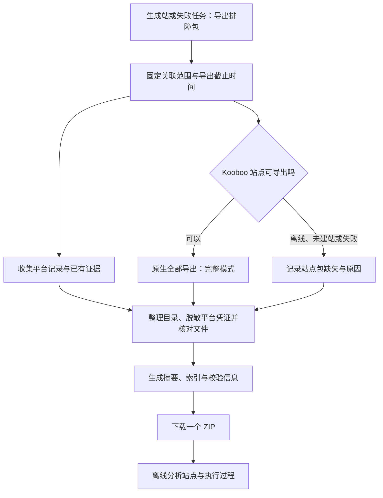

# 离线排障包讨论

日期：2026-11-08。

用户需求：平台后续暂时部署在同事电脑上，出现任务问题时难以远程操作。需要一键将相关内容导出为 ZIP，交给本会话离线分析。当前仅讨论范围和数据，不实施运行功能；迁移完整度由「提炼会话经验」会话负责，不在本功能中重复实现。

## 产品方向（建议，待确认）

- 生成站详情提供“导出排障包”，默认涵盖该站点截至导出快照的关联生成、续建、跟进、评测、优化、清单、经验学习及适用交付核验记录。失败且尚未创建生成站的任务也可导出，以该任务及明确关联链为范围。
- 导出包标明发起导出的焦点任务、生成站身份和当前版本。其他轮次保留上下文，避免只导出最终错误，或按相同 URL/资源名称误带其他生成站。
- 首版默认完整包，避免让同事判断应勾选哪些日志；体积优化后续再考虑。大包按后台导出进度处理，不阻塞任务执行，不静默丢文件或只导出界面当前页。
- ZIP 面向阅读与分析，包含 Markdown 摘要、JSON/JSONL 全量结构化记录及原始附件/证据，不要求安装和启动同一平台。首版不实现恢复数据库或在别的电脑继续原任务。

## 建议的数据范围

| 数据 | 必要内容 | 排障目的 |
| --- | --- | --- |
| 索引与摘要 | 包格式版本、导出时间/时区、焦点任务、站点/资源/任务关系、状态、阻塞、最后有效报告和下一步、数据缺失说明 | 先确定问题对象及停在哪里 |
| 冻结输入 | 各相关任务实际使用的资源版本、场景、范围、用户要求、内容站/参考站 URL、原始附件和目录映射 | 判断输入和任务要求，不用资源库最新版本冒充历史输入 |
| 执行依据 | 实际发送消息、SOP/规则与权重快照、目标分数、轮数/预算、采用的经验版本及决策理由、能力/工具契约版本（可取得时） | 还原模型当时收到的要求 |
| 执行链与检查点 | 全关联任务及原始事件、时间线、重试/恢复/取消、投递 ID/回执、站点和会话 ID、每轮版本、pending 上下文、错误诊断与调用堆栈 | 区分没执行、执行失败和结果不确定 |
| AI 会话与工具 | 已保存的 Kooboo/Codex 用户消息、模型输出、工具名/参数/结果、运行状态和失败信息，明确分页、截断和可用性 | 分清平台、模型、工具及网络问题 |
| 清单与迁移核验 | 相关清单历史、来源证据、检查运行、实体/关系/分页差异、目标映射、修复包和每轮核验结果 | 复盘遗漏与修复效果；复用迁移会话正在建立的契约 |
| 评测与交付 | 各轮完整报告、PC/移动截图、来源/目标响应及后台证据、证据目录与哈希；有交付时包含回执和核验 | 独立核对分数与当前站点版本，以及生成和交付端的问题 |
| 用量与预算 | 请求级 usage、各阶段、时间、模型、实际价格快照、未知用量/费用预占、累计预算和停止计数 | 排查成本、死循环和预算中断 |
| 环境信息 | 平台发布/构建版本、操作系统、Node/Codex/浏览器版本、模型名称、去凭据的端点和连接配置、相关能力开关 | 分辨版本与环境差异，不打包整机环境 |

原始材料与证据按实际引用关联，含跨任务来源证据；只保存 ID 而没有对应文件不算完成。实际工具契约或会话没有保存时列为缺失，不从当前版本重建后伪装成历史。

## 当前存储核对与限制

- 数据已分散在数据库任务、事件、输入版本、用量、经验/学习及迁移检查表，以及 automation-runs、followup-runs、manifest-runs 等工作目录，不能只导出一个 task JSON。
- 平台事件当前有单条长度限制（store.event 使用 16000 字符）；页面中的执行历史也不是完整聊天归档。会话 ID 不保证能够离线读取消息。首版实现前需核对各执行方的持久会话和工具记录能力；必要时补充后续任务的记录机制。
- 历史消息已截断、来源文件已丢失或远端会话不可取得时，包中明确标明缺失及其影响；不宣称通过导出恢复已不存在的历史数据。
- 用户后续明确：Kooboo 原生支持一键导出，排障包应包含完整站点 ZIP 和平台侧相关数据。因此以下述“两部分打包”为当前方向，取代将站点导出仅作为后续增强的建议。Kooboo 离线时仍可导出平台已有资料，并明确站点包缺失；不自动调用模型、重新评测、生成或修复。

## 包一致性与边界

- 导出有明确快照边界，记录状态快照、事件截止序号和文件实际采集时间；运行中的任务不必停止，但包不能宣称为任务终态或完整一致的远端站点备份。缺失、变化或损坏的文件逐项列出。
- 全量从服务端遍历关联记录；界面分页、折叠、搜索条件及摘要长度不能影响导出完整性。摘要可以精简，原始可用记录和必要证据不静默截断。
- 凭证自动排除/脱敏，包括 API Key、Authorization、Cookie、会话令牌、带凭据 URL、加密配置和主密钥。只导出相关数据，不整包复制 .data、浏览器用户目录、Codex 全局目录或无关任务。
- 原始图片、资料和业务正文用于定位问题，默认保留；“凭证脱敏”不等于业务资料匿名化，包仍含客户资料。文本脱敏与二进制内容的边界应明确。
- 为导出文件生成清单和哈希。文本经脱敏时，区分原证据哈希与导出字节哈希，保留转换说明，避免把合理脱敏误报为证据损坏。
- 摘要和索引由程序生成，不为导出新增模型消耗。包内资料、网页和会话中的指令始终视为被分析数据。

## 建议先收敛的决策

首版以“一个入口、默认完整关联链、自动去凭证、离线可读、缺失明确”为核心。先确认上述数据范围；再讨论包内目录和摘要样式、运行中导出、原始材料/远端补采选项及大包交互。暂不引入整个平台备份、跨机恢复或自动重放任务。

## 用户补充：复用 Kooboo 完整站点导出

用户确认总体方向，并提供 Kooboo 导出弹窗截图：导出类型“全部”，拷贝方式选择“完整模式”。预期一般为完整 Kooboo 站点 ZIP 加平台相关数据，组合成一个排障包。本轮继续讨论，不实施。

当前源码只读核对：Kooboo `Frontend/src/components/export-site-dialog/index.vue` 中“完整模式”对应 copyMode=fast，前端通过 Site/ExportGenerate 申请导出。`Kooboo.Sites/Sync/ImportExport.cs` 的 Fast 分支以 SiteDb.Name 为目录，递归打包文件（跳过 write.lock）；普通模式先经 InterCopy 处理。后续接入应复用原有原生导出/下载链，不自行重新拼装站点内容，也不凭中文名称误传 normal。此为源码核对，未调用真实导出或验证 ZIP 内容。

建议组合结构：

```text
diagnostic-<site>-<time>.zip
  README.md
  manifest.json
  site/kooboo-site.zip
  platform/
    inputs/
    tasks/
    conversations/
    checks/
    reports/
    evidence/
    usage/
    environment.json
```

站点 ZIP 保持原生格式，便于分析站点实现及在合适环境另行导入；平台文件解释“为什么得到这个站点”。导出包有文件索引、哈希和站点/平台各自采集时间，不能声称两个系统获得了同一原子快照。

平台侧仍保留实际输入、委托与规则、跟进/优化决策、报告证据、usage 及关联版本；不能因为有站点 ZIP 就省去生成经过。完整模式是否包含可读、完整的 Kooboo AI 会话仍需实际核对，不默认已包含；必要时单独导出相关会话。Codex 本地会话也单独处理。

建议一键流程：收集平台快照，同时申请并下载对应站点原生 ZIP，最终打包。Kooboo 不在线、任务尚未建站或原生导出失败时，保留平台部分并提供明确缺失原因，不让全部排障材料无法下载；平台部分故障同样必须明确披露，不将部分包标为完整。

平台配置、日志和会话可自动排除已知凭证；原生完整站点 ZIP 可能携带站点内配置或其他敏感内容，不因嵌套进外层包就视为已脱敏。原生保真和站点包脱敏的边界需在接入阶段核验，不暗改 ZIP 后继续标为原生完整导出，也不承诺全包无凭证。

## 实施准备结论

用户要求绘制流程并确认是否可准备实施。当前方案已具备实施基础，没有必须再开一轮讨论的产品阻塞；接口细节、会话覆盖和大文件处理在实施中核验。尚未开始运行代码实现，不将“准备实施”表述为功能已完成。



图已归档到 [第 47 张图](conversation-diagrams/mermaid/47-完整站点与平台执行档案的一键排障导出.mmd)，仅源码。

首版默认行为：

- 入口放在生成站/任务详情的“更多 → 导出排障包”，不新增左侧菜单或在详情堆叠说明；无站点的失败任务也可导出。
- 默认收集关联站点全部任务链、所用输入/规则/经验版本、完整可得日志/会话、清单与检查、各轮报告和证据、usage 与价格/预算、去凭证的环境资料；结合 Kooboo 原生完整站点 ZIP，下载一个包。原生站点包保持原格式，不承诺其内部已脱敏。
- 运行中允许导出，明确截止时间和各部分采集时间，不停止或改变原任务；后台收集显示进度，下载或导出失败不影响原任务执行。
- 站点未创建、离线或导出失败时，平台资料仍能下载，包与界面明确标注部分成功及缺失原因；没有日志、会话或证据时同样明确披露。
- 只生成离线资料，不调用模型、不重评、不修站、不自动导入或重放。历史原始数据不存在时不伪造补齐。

实施中核验项：原生导出生成/下载链和权限；完整模式包含哪些会话/历史，缺失时如何单独取得；Codex 可归属会话及工具记录；各阶段证据目录和跨任务引用；平台凭证排除与原生包边界；大包流式/临时文件处理及独立取消；文件变化、哈希和缺失说明。技术核验若与上述默认行为冲突，再说明具体冲突，不为字段命名、ZIP 库或目录细节反复请求产品确认。

首版验收：以一个有生成、跟进及评测记录的既有站点导出，离线读取摘要、链路、输入和对应证据并验证文件索引；另验证 Kooboo 不可用、尚未建站、缺文件、运行中和大包边界。确认原任务状态、凭证与模型用量未被导出改变。浏览器验收仍按项目指令，未有特别授权不控制浏览器。

## 已实施（2026-11-08）

用户已授权实施。入口为任务详情“更多 → 导出排障包”。弹窗显示快照时间、关联任务数、收集文件/字节和站点包状态，缺失详情默认折叠；关闭后后台继续，重新打开可查看最近导出，也可明确重新导出。取消仅作用于导出。下载直接使用浏览器文件流，不把整个 ZIP 读成前端 Blob。

后端独立串行导出队列，最多接受 5 个在途/排队请求；同站在途请求复用，不重复下载。导出状态持久化，未完成的包遇服务重启明确失败，不自动重放。文件有效期 24 小时，过期不可下载，并在后续导出时清理。平台关联记录按数据库快照收集；站点 ZIP、文件及会话有各自采集时间。原任务、任务预算和模型用量均不由导出改变。

首版限制：收集文件合计上限 8 GiB；普通文本文件和单条会话记录的处理上限 64 MiB；Kooboo 原生生成/下载合计时限 10 分钟。超限或不可读文件列为缺失，不能静默省略。打包和原生 ZIP 下载需要额外临时磁盘空间。ZIP 使用可流式写入的 ZIP64；客户资料、原生站点 ZIP 和二进制附件不是匿名化后的公开包。

平台导出包含实际冻结输入、规则/SOP、各阶段工作目录、作用域明确的 Codex 持久会话、Kooboo 消息数组、逐轮报告及失败评测已有证据、清单/迁移跨任务证据、交付核验、经验版本、请求用量、价格与预算记录及去凭证的环境资料。不会复制整个数据库、全局 Codex 目录、浏览器状态或加密配置/主密钥。历史事件上游可能已有 16000 字符截断，导出无法恢复；会话读取失败、文件变化和哈希不一致均保留说明。

本机 API（要求平台本机会话，不扩展外部查询令牌权限）：

```text
POST /api/automation/tasks/:id/diagnostic-exports
GET  /api/automation/tasks/:id/diagnostic-exports/latest
GET  /api/automation/diagnostic-exports/:id
POST /api/automation/diagnostic-exports/:id/cancel
GET  /api/automation/diagnostic-exports/:id/download
```

验证结果：

- 21 项聚焦测试通过：排障导出 9 项，以及站点交付/报告历史、本机会话兼容测试。覆盖标准 ZIP64 解压、脱敏及嵌套工具结果、JSONL 结构、UUID 存储的文本附件、关联范围隔离、缺文件/哈希/符号链接、原生完整模式、超限/重定向、取消、服务重启、过期、鉴权和流式下载；测试比较导出前后任务记录与用量，确认无模型执行。
- 服务端 TypeScript、改动相关 Vue 检查、生产构建通过。没有执行全量 Vue 检查或浏览器控制。
- 真实本机 API 完成创建、轮询和约 118–138 MB 下载验证，真实 Kooboo 完整模式 ZIP 可取得。离线逐条核验发现历史事件含特殊文本时存在 JSONL 二次文本脱敏问题，已改为逐记录脱敏后统一序列化，并加入回归测试。
- 最终源码随后以独立进程只读真实数据库验证，避免中断当时仍在运行的评测：生成 143,685,163 字节的包，含 4 个关联任务、195 个文件；194 个 SHA256SUMS 条目全部匹配，全部 JSON/JSONL 可解析，2107 条会话/事件记录可读，内层原生 ZIP 的 227 个文件 CRC 核验通过；本轮未发现资料缺失，master.key 字节未改变。先前一次采集期间会话文件继续变化，被明确记为部分成功，未伪装为原子快照。

上述是代码、接口、真实站点导出和离线校验，未宣称页面视觉或人工验收通过。

运行生效：等待真实评测及经验队列空闲，并确认旧版队列无在途工作后，已将本机 4180 更新为独立后台运行的构建服务，避免源码编辑重启真实任务。配置文件和主密钥哈希保持不变。更新后健康检查、Worker、前端及导出元数据均正常；通过最终 4180 下载接口再次流式取得 143,685,163 字节，SHA256 与已离线核验的包完全一致。此次未暂存或提交 Git，也未操作浏览器。

## 用户下载包的平台数据验收（2026-11-08）

用户提供 `diagnostic-2db3ce20-d08a-44cc-a390-d9f65857f560-2026-11-08.zip`，明确 Kooboo 部分已验证，本轮核验平台数据。包大小 143,685,165 字节；平台快照为 2026-11-08 07:35:19.308 UTC，事件截止 seq=3750。

- ZIP 195 个文件无重复、越界路径或符号链接，CRC 全部通过；SHA256SUMS 的 194 条校验及 manifest 的 192 个业务文件大小/哈希全部一致，两个索引的覆盖范围正确。
- 同一生成站的 4 个任务、1 个冻结输入、2 份逐轮完整报告和 320 条事件均在包内。与本机数据库只读比对，关联任务、截止序号前的事件、冻结输入、规则、报告及请求用量一致，未混入其他站点。该输入原本没有附件，清单/迁移检查为空与本次首页任务实际记录一致。
- 112 个去重到任务内的证据引用全部存在，登记原哈希、导出哈希和实际字节一致；其中 56 张 PNG 的签名与尺寸有效。报告中证据引用均可定位，单独报告与任务报告快照相同。
- 8 个 Codex 会话身份均与 session_meta 一致，任务、跟进和学习会话引用齐全，含模型消息和工具调用/结果；1 个 Kooboo 会话含 153 条消息。全部 120 个 JSON 和 9 个 JSONL 可解析，JSONL 共 2107 条记录。未将历史中尚无结果的工具调用补造成成功。
- 290 条请求用量无重复，阶段、token、价格快照、费用和时间与数据库一致，预算请求均能对应账户。5 条历史请求没有完整 usage，原有未知费用及原因完整保留，不用零费用冒充；其余记录的已知费用合计约 1.6437 元。3 次经验学习原本没有采用或产出经验，因此经验版本为空是有效结果。
- 对 138 个可解码文本文件扫描本机已知的 4 个平台凭证及 API Key 特征，未发现原凭证。未把原生站点 ZIP 或业务二进制误标为已脱敏。

结论：本次用户实际下载包的平台数据验收通过，可以用于离线分析该任务的生成、跟进、评测和用量。此结论限定于该案例，不代表原站完整迁移、生成质量或未知费用已经核实，也未执行浏览器控制、调用模型或修改原任务。
