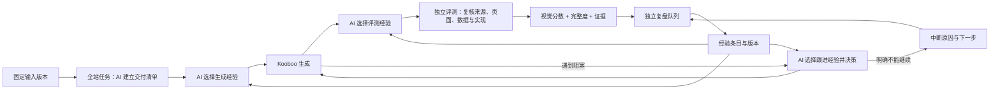

# 经验学习、预算保护与全站交付

2026-11-07 实施。新任务使用创建时的策略快照；不批量回填历史、不改写历史报告、已发布规则或加密模型配置。

2026-11-08 新增 [迁移 checklist 首批实施](migration-checklist-phase1.md)：扩展原交付清单，提供实体、分类关系与 URL/分页的纯程序对账及保存证据离线 CLI。自动取证和优化调度尚未接入；旧清单不自动升级为已核验迁移。

## 预算

| 项目 | 新流程默认值 | 计量边界 |
| --- | --- | --- |
| AI 跟进 | 每任务累计 10,000,000 token、80 次模型请求；保留原次数及活动时间配置 | 含请求输入与输出。普通恢复不清零；首次质量规划沿用原设计，明确建立一次独立预算期 |
| 经验选择与复盘 | 每任务链共享 10,000,000 token | 生成、跟进、评测及优化子任务共用；与跟进额度分开 |
| 每次经验 Agent | 活动时间 3 分钟、最多 20 次模型请求 | 模型请求次数与活动时间持久化；人工恢复保留计数 |
| 后台复盘 | 并发 1 | 生成和独立评测优先，同工作流活动阶段结束后处理；不占生成或评测队列名额 |
| 全站清单规划 | 每任务 10,000,000 token、3 分钟、20 次请求 | 独立规划用量；重试沿用同一账户。可在设置中调整 |

设置中的原已保存值继续保留。例如原配置为 200 万 token，升级代码不会悄悄改成 1000 万。用户保存更高上限后，恢复原任务会采用新策略，同时保留原 token、请求数、尝试次数和活动时间。

本地 Responses relay 在每次上游调用前检查 token、请求次数、相同请求重复次数及适用的工作流费用上限，预占输入估算与有上限的输出，再转发。默认每次输出不超过 8192 token；同一 Agent 的相同模型请求累计三次后阻止再次提交。压缩端点没有可验证的输出限制时拒绝发送，可新建会话复用证据。

输入预占使用请求字节量和图片估算，不能保证第三方 tokenizer 或计费 token 绝对不超额；已经在途的请求也可能产生费用。返回真实 usage 后按其核销预占；没有完整 usage 或进程中断则保留预占并阻止该账户新增请求。任务的“用量”中可在确认原执行停止后人工确认保留预占，不清零 token，也不把待核算费用伪装成已知金额。费用上限遇到未知费用仍会停止。

2026-11-08：点击“恢复任务”时，若当前任务及同工作流执行、交付和经验运行均已停止，自动保留当前跟进预算账户中中断请求的原预占，并解除这些请求的阻塞。预算状态记为 `retained`，与真实用量已返回的 `complete` 区分；原用量、未知费用、累计 token、请求数、跟进次数、活动时间、站点与会话均保留。仅处理当前任务的跟进请求，不批量解除其他账户。自动重试不会执行此确认；费用上限对未知费用的阻塞继续有效。

## 经验入口与执行

- 左侧“经验库”：分页搜索、启停筛选，独立详情编辑，查看来源、版本和恢复历史版本。人工停用后 AI 无权恢复或修改。
- 系统设置“经验学习”：使用 / 采集开关、预算、并发和选择 / 复盘 SOP。用于后续任务，任务与学习运行保留各自快照。
- 任务“输入与配置”：阶段采用的经验及版本；重复执行同一阶段复用快照。
- 任务“执行”：选择 / 复盘记录、采用效果、沉淀条目链接、手动复盘及恢复失败复盘。手动恢复可以明确采用当前设置，但不重置用量与计时。
- 任务“用量”：经验与规划分别计量，费用汇入原工作流。

没有候选经验时不启动选择 Agent。Agent 可以不采用，也可以在复盘中不新增任何条目。选择失败沿用原 SOP，复盘失败不撤销有效报告。来源结果指纹去重，不递归学习自身失败。合并通过原子更新主条目、停用重复条目完成；相同标题或内容不能重复新建。

复盘初始上下文提供独立报告、简短执行摘要和优先引用的问题证据，其他截图 / 元数据通过 `read {kind:"evidence",page:1}` 分页查找；完整执行摘要仍可按证据 ID 读取。经验库总数为零时不逐关键词重复检索。`budget` 工具提供当前剩余 token、请求数和活动时间，要求给最终提交预留额度。明确的复盘结果若遗漏外层 `tool:submit` 封装，工具仅补齐封装，仍经过相同结果结构、版本与来源证据校验，不能靠修改本地文件声明成功。失败诊断保留安全的网络错误码，未知 usage 仍保留预占。

经验仅提供补充建议，不改预算、权限、任务范围、规则权重或评分阈值。评测经验用于取证，不能预设缺陷或分数。改变执行建议或适用条件后重新标为待验证。整体提分不能直接作为每条经验的有效性证明，采用效果单独保留“未执行 / 已采用待验证 / 支持 / 反例”及来源证据。

## 全站交付

生成前的本地 AI 只能读取固定资料、内容站及参考站的同域来源，通过校验后的工具提交清单。清单保存版本、来源证据与缺口，生成侧收到固定快照。规划失败会建立明确未验证的基线，不声称已覆盖全站。

独立评测重新读取来源，允许通过 `extend_manifest` 补充遗漏、数量、记录标识及来源覆盖状态。旧清单保留，必交付项的类型、数量、路径、记录标识、视口及已声明样本不能被删除或缩减。清单在结果校验时采用本轮最新版本，报告固定引用其 ID 和版本。

- 静态页面：每条路径 PC / 移动端分别截图并核对实际 URL，不能重复引用首页截图充数。
- 动态数据：预期数量和全部记录标识必须明确，核对实际数量及全部标识，另查路由对应；总数相同不能证明全部数据正确。
- 动态模板：声明代表性和边界样本路径，逐个检查双端画面与交互；截图抽样与全量数据核对分开披露。
- 实现：Content / Commerce / Sqlite、动态路由、模板与动态取值必须有后台证据，截图不能证明架构正确。
- 迁移 / 升级：结合原内容与 URL / SEO 需求；模板按替代资源及示例内容要求审查，不强行套用旧站搜索权重迁移标准。
- App：按用户业务流程、交互与结果列项，保留后续真实案例细化空间。

后台取证是源代码核对过的固定读取契约：Page / Route / View / Code、ContentFolder / TextContent、Sqlite Tables / Data、Commerce 产品与分类。产品分页按 Kooboo 契约发送固定只读 POST 查询体，其余为 GET；无任意 URL、SQL、KScript 或写入接口。权限、分页、来源覆盖和实现证据不足则未验证。

报告增加 `report.completeness`，包含清单版本、来源完整性、逐项状态和证据。视觉分数照实保留；必交付缺失使质量不通过，来源或必要项目未验证不能宣布全站完成，自动提分也不能仅凭双端高分结束。平台清单 / 完整度列表每页 20 条，明细按需展开。原外部报告和证据 API 保持兼容，新增字段只出现在新流程报告。

## 本机管理 API

以下接口沿用本机 HttpOnly 会话。外部报告读取令牌不获得经验编辑、复盘、清单修改或预算确认权限；外部继续通过现有报告 API 获取新增的完整度字段与证据。

| 接口 | 用途 |
| --- | --- |
| `GET /api/automation/experiences` | 搜索、启停筛选及分页列表 |
| `POST /api/automation/experiences` | 人工新增经验 |
| `GET /api/automation/experiences/:id` | 经验详情 |
| `PUT /api/automation/experiences/:id` | 带当前 revision 的更新，防止覆盖并发修改 |
| `GET /api/automation/experiences/:id/history` | 分页版本历史 |
| `POST /api/automation/experiences/:id/restore` | 将历史内容保存为新版本 |
| `GET /api/automation/tasks/:id/learning` | 工作流选择 / 复盘记录，支持分页与 kind 筛选 |
| `POST /api/automation/tasks/:id/reflect` | 对已有报告或明确中断的已停止任务发起单例复盘 |
| `POST /api/automation/learning/:id/retry` | 恢复失败复盘；可明确采用当前设置，累计预算不清零 |
| `GET /api/automation/tasks/:id/manifest` | 当前清单及可编辑状态 |
| `GET /api/automation/tasks/:id/manifest/items` | 分页读取交付项 |
| `PUT /api/automation/tasks/:id/manifest/items/:itemId` | 以 expectedId 校验清单版本，修改单项或新增交付项 |
| `PUT /api/automation/tasks/:id/manifest` | 整份清单版本更新，固定必交付项不可缩减 |
| `GET /api/automation/tasks/:id/manifest/evidence/:name` | 校验哈希后读取来源证据 |
| `GET /api/automation/tasks/:id/completeness` | 分页读取完整度检查及对应交付要求 |
| `GET /api/automation/tasks/:id/budget` | 工作流待核查预占 |
| `POST /api/automation/tasks/:id/budget/acknowledge` | 所有相关执行停止后确认保留预占，不清零消耗 |

分页接口使用 `page`、`pageSize`。经验写入要求说明 reason；清单只在停止且尚未委托 / 产出报告的适用任务上允许人工编辑，不能修改执行中的评测依据。

## 验证边界

自动检查使用临时数据库、模拟 Codex 与本机模拟 HTTP 服务，验证请求拦截、持久预算、经验选择 / 复盘 / 版本保护、只读取证、独立清单扩展、逐项状态、证据哈希和分页。没有把这些检查当作真实模型效果或浏览器视觉验收。

后续真实验收应使用一条明确授权的测试任务，验证“沉淀 → 后续采用 → 独立结果反馈”，以及全站遗漏 / 动态数据 / 双端证据。本轮不自动启动付费任务，不刻意消耗千万 token 测预算。

2026-11-07，用户在已有任务 `ef8d8679-81d6-4686-bcc3-ecedba045425` 手动复盘并授权跟进排查。原 Codex 会话实际生成 5 条候选，但遗漏工具提交封装，后续达到累计 20 次请求上限。修复上下文读取、空库检索提示、剩余额度展示及提交封装兼容后，对该会话已生成的原始 JSON 草稿进行哈希核对，并重放原 `reflectExperience` 宿主结构 / 来源校验，5 条经验入库且标记待验证。此次提交恢复没有新增模型请求，累计请求仍为 20、账户占用仍为 1,511,335 token（其中包含保留的未知用量预占 75,149）；报告、配置和主密钥未改变。这证明真实模型草稿可经校验入库，不代表新的无人协助经验全流程或后续采用效果已经验收。
