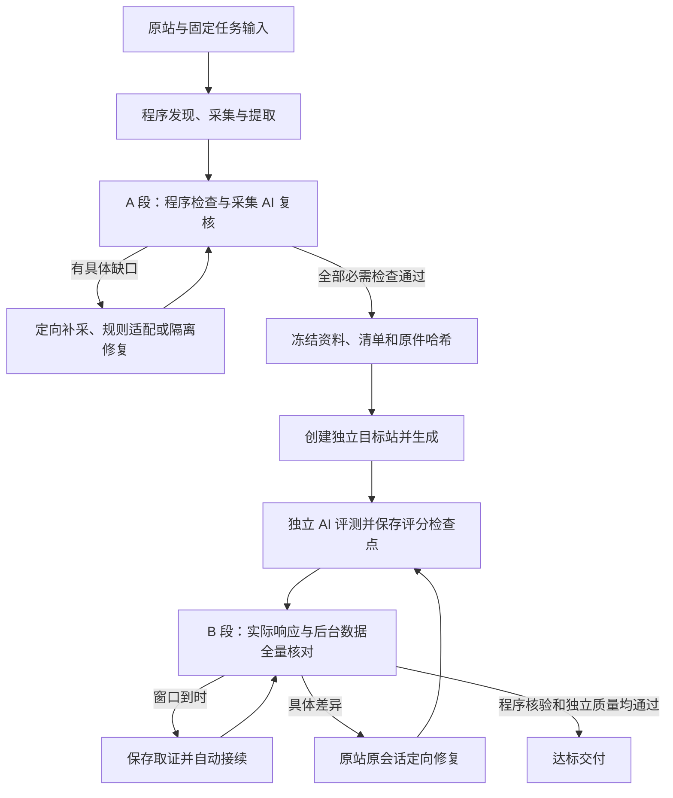

# manwei 自主迁移新任务验证

2026-11-08。用户已授权实施 A/B 完整性设计，并要求以 manwei 重新创建独立生成站任务实测。此文记录本次新工作流，不替换旧站迁移报告。

任务：`b055a7ee-8b8c-442d-9d10-6a5f5090036a`。资源：`40edce37-174d-4976-bbc7-cf0dea23cf5a`。采集：`c2a163e4-9fb6-4a4c-b5c5-437b58281395`。来源：`https://manwei-sav.com/`。通过真实本机 API 创建，幂等键为 `collection-validation-manwei-20261108-v1`；未绑定旧生成站或旧会话。

## 已实施的运行约束

- A 未通过前禁止访问目标环境创建站点；机械检查成功仍需独立复核。
- 冻结输入版本不原地修改；资料快照、原件索引、复核与清单共同绑定。
- B 的结论由宿主取得的真实响应和只读后台记录计算；AI 自述、HTTP 200 或数量相同不能替代正文、身份、关系及顺序核验。
- 采集/核验按窗口保存并接续；累计模型用量、预占及失败历史保留。显式硬限制、取消、未知投递和防循环继续有效。
- B 取证中断后复用已校验的 AI 评分检查点；站点修订变化后重新取证。
- Windows 普通采集和规则有实现分支，未实机验收；代码修复当前仅支持 macOS Seatbelt，隔离不可用时关闭候选执行。
- 交付包含平台内置 Python 引擎和 SOP；Python 3.12 本体需接收者安装，不依赖个人 site-harvest skill。

## 实测记录

已安全重启本机 4180 API/worker；原有自动执行、自动评测设置已启用，未改写系统配置或密钥。新任务采用 completion-first，无用户显式费用或修复轮数硬限制。

首批采集：已发现 542 个候选 URL，保留读取 300 页，242 个超出本批页数窗口；此处保留缺口，不能计为来源全集或完整迁移。780 个素材候选中，743 个成功保存或去重，37 个失败，约 78.8 MB。失败包括 31 个 404、3 个 502、2 个外域 403 和 1 个返回 HTML 的字体 SVG；其中有正文图片，不能全部当作非必需资源排除。

首次采集 AI 复核未放行 A 段。它查明 196 个已发现详情页尚未采集，并定位 `/cn/category/183` 分页未闭合；自主提交 `fetch` 定向目标，将窗口由 300 扩为 700，带 242 个真实已发现 URL 续采、保留旧对象身份。程序已执行该目标，实时状态开始出现新发现页面；本轮完成计数以后续操作回执为准。全源站公开总量仍未知。

一次部署重启恰逢 worker 开始 data 操作，原任务经过一次 AI 跟进后保留采集成果恢复。已追加停服回归修正：尚无建站、会话或投递痕迹的自主采集任务可直接留在耐久队列接续，不计无进展失败；未知投递、取消或停止未确认不适用。补丁待安全检查点加载，不中断正在运行的采集操作。

后续已实际扩采至 **574 页**，574 个已发现页面均取得原件，没有 pending/failed/over-limit 页面；来源公开全集仍未知。素材候选927项，846项保存、去重或缓存，81项失败，总量约83.6 MB。当前失败包含44项外域图片403、3项旧图片主机无法连接、2项百度外链图片403和32项同源CSS引用问题（31项404、1项SVG返回HTML）。这些是尚未关闭的缺口，不能合并为“源站非必需资源”后放行。

真实采集AI发现 `/cn/map` 正文很短而地址/坐标位于脚本，提交任务内候选修复，经 macOS Seatbelt 隔离执行、失败与正常样本核验后采用；共享引擎未改。回执为 `.work/code-repairs/29caeb89ba1752582ff5f758283710d2a2b51480485f2779ba7d1a4e926e1915/receipt.json`。这证明任务内修复链路实际运行，不证明地图交互及全站提取语义均已验收；脚本线索仍需独立复核。

实际资源诊断取得同源CSS原文、外域403响应中的 bucket referer policy、旧素材主机DNS失败等证据。新版诊断以登记的来源页面URL作Referer，保留实际请求头、各跳响应、原始字节及哈希；旧根路径Referer诊断不能代替页面Referer结论。诊断只留证，不改原采集结果和检查门槛。对应证据均在任务私有 `.work/diagnostics/`。

第7轮复核再次提出原样 assets 重试，被防循环拦截，任务于2026-11-08 20:08（Asia/Shanghai）停止。此次暴露的是复核上下文未清楚展示已执行重试与诊断索引，不能只归因为外部素材阻塞。现已补上有界恢复历史、各操作实际执行次数和最近8条诊断索引，并区分已执行操作与被拦截的提案。保留原防循环阈值、原任务、累计用量和历史，通过正式resume接口于20:15恢复至第8轮；最终结论以后续回执为准。

第8轮于20:17提交带实际读取哈希与原文的 `blocked` 结论，任务现已确认停止；未再执行原样素材重试。引用包括 `site/completeness.json`、此前 assets 操作回执、同源404诊断和新取得的 media 图片403诊断；新诊断保存来源页面Referer与对象存储明确错误 `You are denied by bucket referer policy.`。这次停止来自实际素材缺口，而非输出窗口耗尽或再次触发防循环。其“无可用替代来源”是当前已尝试和可用证据范围内的判断，未证明互联网上不存在其他副本。

采集AI结论沿用了旧回执中的 test4 HTTP502；宿主另取得DNS ENOTFOUND证据，二者应按采集时间分别保留。同源32项也须区分31个404与1个返回HTML，不能统称32个404。81项是否全部业务必需尚未逐项确认；当前机制保守保留缺口，未获范围变更授权。

已检查平台登记的 manwei 资源与输入版本，均未带历史素材附件；现有采集库中仅本次独立采集。当前工程中未找到带原URL映射、可直接补齐的历史素材清单。已生成私有 `.work/platform-missing-resources.json`，包含81项来源URL、引用页面、角色及实际错误，`required` 保留为 `unverified`；该清单不是新增采集证据或放行结论。

目标站尚未创建，A段未通过，B段尚未执行；本轮验证结果为**有证据阻塞，尚未完成端到端验收**。继续所需的最小外部条件是取得缺失原素材/恢复源存储访问，或者由用户明确约定可接受的源站既有失效与必需范围，再按正式范围规则重新核验。当前任务、原件和用量均保留，无需再创建验证任务。采集复核223次模型请求累计计入14,038,220 tokens（包含重复上下文输入），不含其他角色；不能与旧约2亿tokens的已建站任务当作同阶段成本直接比较。

## 聚焦检查

- 服务端 TypeScript 检查、前端与服务端构建通过；存在既有的约 500 kB bundle 提示。
- A/B、补采、续窗、诊断、resume、恢复、上下文和迁移聚焦 Node 回归118项通过；模型账本/独立决策及工具别名回归19项通过。后续恢复历史补丁追加3项回归，所在采集/诊断组23项全部通过，服务端类型检查与构建通过。
- Python 离线回归 52 项通过，Python 3.12.14 / lxml 6.1.1 引擎自检通过。
- macOS 真实隔离修复 13 项通过，无跳过；包括失败样本必须确有未提取内容、候选保留旧正文段落及顺序。不等于 Windows 或真实采集异常已验收。
- B 已追加真实 Python 提取产物契约回归，覆盖完整原文、长标题、内联文本、base、导航、数字路径、.aspx、查询分页；当前服务已加载，用于 A 通过后的正式 B 核验。

全部源码和文档尚未暂存或提交。原件、素材、模型上下文和运行数据库保留在私有 `.data/`，不进入 Git。

## 按当前素材继续的任务约定

用户随后明确要求：“我们把这个站点跑完吧，假设就按当前的素材即可”。本次 manwei 任务因此接受当前已经归账的81项素材失败，按已取得素材继续生成；此授权不代表素材已经取得，也不自动放行其他来源内容、正文、数据、关系、分页或目标质量问题。平台正在将接受集合、原错误、输入版本、接受时间及理由持久化为本任务记录，并随冻结资料交给生成与独立评测。后续新增失败与已保存文件丢失不在这次接受范围。

另一次来源契约核对确认：地图修复将脚本中的中文与坐标作为静态可见正文，虽通过此前隔离样本，却无法通过B段对原件静态正文的独立核对。该问题与素材缺失分开处理：A5需撤回或正确分离此次修复，将地图配置保留为功能线索，不能降低B正文标准。本段记录后续真实恢复结果，不把用户素材授权解释成地图功能免验收。

21:15（Asia/Shanghai）通过正式接口记录81项具体失败素材的接受集合，并恢复原任务。接受记录绑定任务、输入版本、当时state哈希和原始错误；不是修改素材原状态，也不放宽后续新增失败。第9轮采集AI实际撤回地图修复，重新生成data/render/verify；地图静态fullText恢复为“地图展示”。

本轮对照574份真实原件修正B段惰性HTML解析的兼容性：支持无分号旧HTML实体、保留小于号比较文字及行内连接、不将aria-hidden当作视觉隐藏，并兼容原站的非规范属性。脚本仍不计正文，隐藏文字仍不能代替可见正文；数字边界仍受保护。撤回地图脚本提升前，573页可回指，仅地图4段脚本文字失败。相关聚焦Node组44项及模型账本组20项通过，服务端类型检查与构建通过；这些不是目标站验收。

第10轮仍因地图页empty-content停止。Python的该判断来自少于5字且无图片/表单，不能区分仅有标题的动态功能页与提取丢失正文。21:24以后经已授权的CUA只读浏览器实际打开原站地图，观察到百度地图、公司名、完整地址及缩放/平移控件；实际截图中地图已加载，DOM显示60张已加载图片。该观察证明原站存在动态内容，不能把脚本配置直接加入静态正文，也不能因静态body为空就宣称地图无内容。当前正在接入独立来源渲染证据与目标当前修订的动态核验；尚未据此放行A段或声称地图交互已操作验收。

21:43加载来源渲染证据接入并恢复第11轮。采集AI实际调用`read kind=rendered`对已登记地图URL只读取证，平台保存真实PNG、116字动态正文及可访问快照，绑定页面身份、固定输入、引擎、静态原件和extract哈希。父会话已查看该平台截图，地图与公司信息窗口可见。原empty-content finding未删除，A5只补充对应精确页面并继续独立复核；required page/interaction清单仍必须存在，不能凭看见控件宣称已验证交互。目标B核验新增当前任务/修订/精确URL/视口绑定的真实浏览器JSON与PNG检查，保留全部静态正文、链接和数据核验。

新接入的统一聚焦组76项通过（含需本机端口的回归）；最后指导接入与来源证据组16项通过，服务端类型检查及构建通过。上述为源码/模拟回归，真实目标动态内容和交互仍待生成后验收。共享Python引擎未修改，固定引擎版本未切换。

第11至14轮暴露复核接续缺陷：5分钟窗口到时或SDK连接关闭后，新窗口重新创建会话，重复读取证据而未提交ready。第14轮自然结束后，在全部模型请求停止、无其他活跃任务的检查点安全停服。22:06加载持久接续补丁，原任务自动进入第15轮；保持单窗口5分钟，保存稳定工作目录、Codex thread和逐段已读凭据，软中断后复用，输入/规则/引擎/原件变化则失效。累计模型账本、预占和防循环记录未清空。来源渲染证据绑定与哈希仍有效时直接复用，不再仅因换窗重新capture。

接续与已有相关组50项通过；父会话另运行接续、来源渲染与目标动态三组30项通过，服务端类型检查及构建通过。此处只证明补丁回归通过；第15轮及之后同thread实际接续、A放行和目标验收仍待运行结果。

22:10第15轮通过主机结构化校验提交ready；随后已冻结来源资料版本 `bff2871d-486f-4791-b2f9-2e389514e2fd`，创建并绑定独立目标站 `50559c0b-d283-390c-c75f-b7997b502e24`。本轮在一个窗口内完成，尚未实际触发同thread跨窗口接续，不能以回归代替该项真实验证。22:14资料全部导入，Kooboo已接受生成委托；message为2237 bytes，详细内容通过kfile按需读取。22:21只读查询确认已建立CategoryPage、CategoryRecord、CategoryShowMember、CollectionRelationBindings、PageAsset、ShowRecord、SitePage七张表，页面和视图当时仍为0，不能据建表宣称站点完成。

冻结清单另有待实际评测核实的语义风险：template.samples使用采集对象ID而非URL，须由验证器以冻结原件映射解析；关系项将1044作为必迁M2M关系数量，但引擎相应统计可能是去高频链接后的出现次数，不能直接证明唯一关系边数；分页和素材被列为data，也不能伪造页面记录来满足后台映射。保留当前清单和原件，不把字段约定问题当目标缺失，也不降低尚无证据的要求；生成后按真实证据区分来源清单偏差、核验能力缺口和目标实现问题。

随后对已verify的冻结原件与extract全量重建：本案例1044恰为唯一“分类页面URL→showURL”成员边数，与原HTML链接次数一致，全部位于content，无共享导航或同页重复。421来自无扩展分类页、102来自`.aspx`首页别名、186来自`_1.aspx`首页别名、335来自后续分页。合并首页别名与分页后的业务“category数字ID→showURL”唯一关系为756；两种单位不同。目标生成中的CategoryShowMember当时1031条，不能仅凭差额13判漏迁，也不能改来源预期凑齐；须按源/目标对应关系键集合比较。模板ID映射及目标证据任务/修订/域名绑定已实现，父级新增聚焦组三组43项通过并完成服务端编译，待生成结束的安全检查点加载。

22:41首轮生成完成，目标为 `http://auto-b055a7ee-8b8.localkooboo.com/`，当前修订 `50605b01-c946-435b-a0b7-520924c14cfc`；首页真实响应200。此前最终补丁已在生成结束、全部模型请求停止的安全检查点加载，评测子任务 `fd34ac68-89cb-427c-a002-93d6fd703066` 自动恢复独立核验，未重复发送生成委托。

22:49后已用冻结原件与此前登记、逐文件校验哈希的11页目标关系观察重建键集合：来源1044条，目标1031条，目标额外0；确有13条缺失，分别为 `/cn/category/100_3.aspx` 的 show 950、951、1013、1062、1007、1009、1010、1011、1012，以及 `/cn/category/176_2.aspx` 的 show 1008、950、951、1013。两精确目标路径另取得绑定当前评测任务、修订的真实桌面截图，实际分页内容为空。私有诊断保留目标观察的登记时点与原哈希，不将被恢复流程丢弃登记的旧文件冒称为当前新证据。

独立评测仍在提交报告，当前不得将报告草稿、页面数量或HTTP200称为最终通过。已识别宿主验证契约缺口：关系与素材被当作页面记录；索引表与业务表共享sourceUrl导致无意义冲突；关系外键采用来源数字ID而程序曾只比较目标自增ID；只按pageType=list选择列表会漏掉实际有成员的分页。修正将使用显式计量域、规范记录声明、来源身份字段和分页范围，不能硬编码业务表名或把来源1044改成目标1031。

素材计数进一步核对为846个成功URL，去重后796个文件；81个失败URL仍按人类已接受的冻结集合保留。清单中765张图片的旧描述不能作为正确来源计数沿用，不能拿目标文件数反推来源已完整。8条样式表读取状态也不能替代冻结原始CSS字节和目标核验。任何清单澄清需保留原必交付范围并创建新修订。

23:10前后，最终B核验及评测结果文件提交修复已在安全检查点加载。B按显式page／relations／assets计量域核对，支持规范记录声明、来源身份字段及精确分页范围；关系键保留完整父子来源URL，素材来源URL数量与去重文件数量分开计算。完整AI结果改为写入本轮宿主指定的唯一普通JSON文件，最终输出仅提交该文件指针；宿主读取后仍执行完整schema、全部清单keys及有效证据校验。旧文件、错误路径、链接文件、无效UTF-8、超限文件和前导说明不能作为成功结果兜底，结果修正也不能借机缩减冻结范围。

本次最终聚焦日志 `/tmp/manwei-final-b-tests.log` 记录146项测试、146项通过、0失败、0跳过，日志完成于23:13左右；服务端构建通过，`/tmp/manwei-final-b-build.log` 无诊断输出。上述包括B身份／关系／素材契约、证据绑定及结果文件提交回归，只证明补丁检查通过，不代表真实目标已通过B或AI质量验收。本次文档补记只读已有日志和源码，没有重新运行测试、读取运行数据库或触发API。

已证诊断范围保持精确：13条页面成员关系缺失为前述两个分页的9条与4条，来源1044和目标1031使用同一精确页面URL成员边计量域；不能改成756条业务实体关系或降低来源预期。另对574条已保存目标PageMeta捕获与冻结来源逐项对照，只有11个metaDescription及 `/cn/show/664` 的seoTitle共12个字段不同，全部恰为ASCII双引号被删除；这不是仅由HTTP审计正则推断的差异。`/cn/show/1059`、`/cn/show/1241`、`/cn/show/1204` 的末尾省略号来源本来就有，不应扩成新增截断修复。当前审计未保留目标HTTP原始响应正文，历史捕获在诊断读取时亦非全部仍登记为活动任务证据，因此这些结论保留采集时点和来源，只用于精确诊断，不能冒称最新修订的正式验收。89个aspx来源均无canonical，其中38个首页别名与基础页原HTML哈希完全相同，指向基础页不能统一判错；其余51个后续分页的canonical属于尚需明确的SEO策略。来源robots为404、sitemap读取遇403，地图原HTML本就无description／robots，现有清单与规则的核对要求不能直接变成新增入口或元数据功能要求。

846个成功素材来源URL对应796个冻结去重原文件，81个接受失败不因此变成成功素材。8条status=read样式表尚无可回指的冻结原始CSS字节，不能以读取状态、目标自报哈希或其他文件推导原件，也不属于81项失败接受集合的自动豁免；B必须保留该素材字节核验局限。清单计量域和keys仍须经正式extend_manifest补充，保留旧必交付范围与冻结来源，不从目标796条反推来源全集。

截至本次补记，首轮生成已经完成，但有效AI评测报告和B终态仍未完成；尚不能宣布manwei达标交付。旧报告草稿及其分数不作为本轮结论，后续仍需取得有效结构化报告、完成宿主B核验，并对真实缺口执行正式修复与重新验证。
