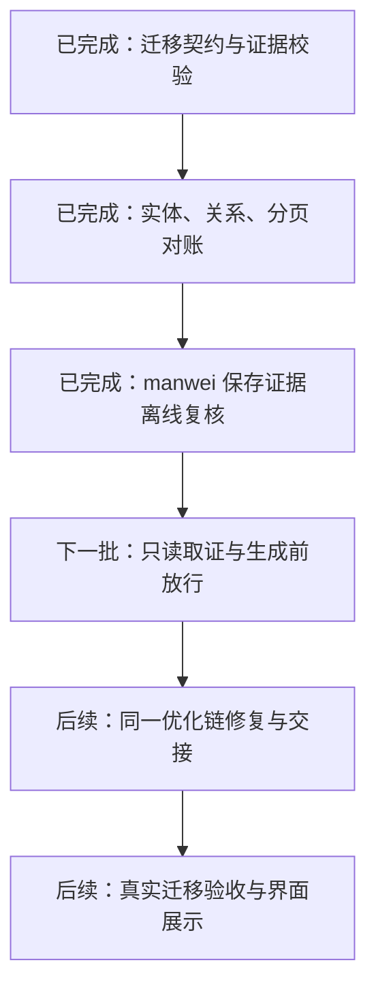

# 迁移 checklist 首批实施

2026-11-08。依据 [确认方案](migration-manifest-discussion-2026-11-08.md) 和 [主会话评审](migration-manifest-review-2026-11-08.md)，本批完成契约、纯程序对账及保存证据的离线验证。尚未接入自动生成、优化调度或界面。



图表源码同时归档至 [第 43 图](conversation-diagrams/mermaid/43-迁移_checklist_首批实施与后续接入.mmd)。

## 契约与对账入口

- `shared/migration.ts`：现有 `RequirementManifest.migration` 的可选版本化扩展；来源实体键、关系、URL/页序、覆盖范围、目标观测及检查运行分别记录。
- `server/automation/migration-contract.ts`：结构校验。有限范围需范围决定引用；未知/不完整覆盖必须说明缺口；保留 `.aspx`、页码及 query 语义。
- `server/automation/migration-check.ts`：纯函数，不联网、不读写数据库、不调用模型。
- `server/automation/migration-adapters/manwei-saved.ts`：独立解析已保存的 manwei 证据；不把站点选择器、记录数或字段塞进通用检查器。
- `scripts/audit-migration.ts`：离线调用上述能力，仅读取显式指定的任务导出和保存证据，可选新建私有结果文件。

调用顺序为 `verifyMigrationArtifacts` → 适配标准快照 → `reconcileMigration`。证据必须先核对原始字节的大小及 SHA-256，再交给检查器；直接传入未经校验的 metadata 会被拒绝。适配器是宿主代码，须保证标准记录实际来自引用的证据；哈希校验本身不证明提取语义正确。

核对身份使用来源的 namespace、kind、id；标题不充当身份。目标物理映射由 recordType 与 recordId 共同定位。分别检查：

| 检查 | 核验内容 |
| --- | --- |
| entities | 缺失、额外、重复及多个来源实体误合并到同一物理记录 |
| stored-relations | 后台分类归属、悬空引用及要求保留的关系顺序 |
| output-relations | 由实际页面响应提取的归属与顺序，独立于后台关系 |
| pages | 旧路径、响应状态、跳转、对应实体及分页内容顺序 |

额外项须在基线规则中明确允许，不能抵消缺失或掩盖预期实体重排。不完整目标全集不能证明缺失；没有完整内容提取的页面不能据空数组判定丢内容。来源身份歧义保留为未验证。

## 证据、范围与兼容

`source`、`target-data`、`target-response`、`code-derived` 和 `scope-decision` 分层保存。实际目标证据绑定输入版本、Kooboo siteId、目标修订及观测时间。未知时间的旧来源保留 null；实际目标证据缺时间时不能通过。

全源站覆盖与约定范围覆盖分别保留。完整站点需两者具备完整依据；明确有限范围可以保留全源站未知，但必须有宿主保存的 human 范围决定证据。当前没有新增范围审批或缩减入口。

`ManifestStore` 保存扩展并沿用历史版本；拒绝跨输入版本、移除或缩减固定基线、改变既有分页语义及放松额外项规则。普通保存只能追加；未来范围变更流程须显式处理新基线和历史关系。

旧清单不会自动升级为结构化迁移清单，旧场景的通用完整度行为保留。含迁移扩展时，现有 AI 数量型 completeness 结果不能认证结构化迁移完成：宿主检查尚未接入正式报告前整体保持 unverified，已有明确失败仍为 incomplete。

`compareMigrationRuns` 为后续宿主进度判定提供纯函数：仅比较同一基线、清单版本、输入和站点的后续轮次；返回已解决、剩余及新增差异。当前证据退化或仍有未验证/局限时不宣称改善，也不把消失的证据计为已解决。现有 optimization 中的模型 progress.improved 尚未替换，属于后续接入工作。

## manwei 保存证据复核

只读取本机已有导出，不连接源站或目标站，也不读取运行数据库。复核 286 份 JSON 的大小及哈希；完整差异仅写入私有临时目录，仓库中只保留摘要与合成故障样本。

| 项目 | 结果及证据边界 |
| --- | --- |
| 已知来源实体 | 483：102 个分类、381 条详情标识；不代表详情正文或全源站完整 |
| 已知分类关系 | 756 条 |
| 已知来源分类页 | 153 页，其中 17 页未识别出支持的详情列表版式，内容保留待核验 |
| 保存的目标实体 | 483 个来源键映射；来源仍有覆盖和版式局限，entities 为 unverified |
| 后台分类关系 | 680 条；相对于已有来源证据，确认缺少 76 条具体关系，stored-relations 为 partial |
| 模板代码推导 | 678 条；78 条缺失仅为诊断，output-relations 为 unverified |
| 实际目标 URL/分页 | 保存证据未提供所需响应，pages 为 unverified；153 条缺失不作为实测失败 |
| 总体 | incomplete，存在已确认的后台关系缺失；不能声称真实迁移验收完成 |

来源详情 ID 仅从保存的 `proud_list`、`news`、`case` 列表提取；不把页脚等无关链接列为必交付项。其他版式继续保留入口和局限，后续需独立适配。模板推导仅支持明确的保存模板哈希，声明式模拟标题去重与上限；不会执行保存的代码，也不会将该推导升级为实际页面响应。

离线运行：

```sh
npm run audit:migration -- <保存证据目录> <导出的任务JSON> [私有结果路径]
```

导出格式为 `{task:{id,versionId,siteRevision,requirementsId?,report:{artifacts:[{name,size,sha256,role}]}},site:{siteId}}`。siteId 为 Kooboo 实际站点 ID，不是平台 generatedSiteId。证据文件名仅接受保存格式的 source-review/implementation JSON；导出不可含密钥。CLI 默认仅输出统计，可选文件使用 0600 权限并禁止覆盖，解析失败不打印原始资料片段。

## 验证与剩余接入

21 项新增聚焦测试及 33 项既有 learning/optimization 回归通过。覆盖同名实体、多归属、同数量错 ID、物理记录误合并、分页 200 重复首页、目标提取不完整、证据角色/哈希/时间/版本、允许额外项后的排序、旧清单、内存数据库版本保存及回滚。既有回归需要临时本地模拟端口，沙箱放行后全部通过。

服务端类型检查与服务端构建通过。未运行全量 vue-tsc/lint；没有前端改动。未调用真实模型、浏览器或真实修站任务，未修改 `.data`、配置或运行服务。

下一批先接入只读取证与来源放行，包括已有诊断清单的补采恢复、ensureManifest 长异常摘要和正式迁移门槛。随后将结构化差异修复接入同一优化根任务，贯通证据归属、轮次、累计预算、串行互斥、恢复及 message/临时 kfile；视觉修复继续要求适用截图。最后进行原站原会话的真实验收与 checklist 展示。

## 真实案例追加（2026-11-08）

用户随后授权以原 manwei 任务真实验证，过程及状态见 [案例记录](manwei-migration-validation-2026-11-08.md)。本节追加能力不改变上文首批离线验收的历史边界。

适配器新增可选的第三参数 `{ relationFolderId }`：由宿主明确选择当前独立关系目录，读取 `catId/showId` 的全部分页，核对总量、页码及重复证据；选用该格式后不再从旧分类 `linkUrl` 拼接归属。未提供参数时保留原保存格式。目录分页的插入顺序不作为业务顺序，未提供顺序字段时继续保留未验证。实际输出仍需独立响应取证。

检查器及适配器累计 25 项测试通过。真实案例第 1 轮的新后台证据与实际响应交叉核验，确认还缺 4 条分类关系及一个旧分页 404，而正式 AI 报告未单独列出该缺陷；因此旁路检查尚不能视为正式调度已接入。

实际评测另发现取证达到 300 次后无法读取或补充清单的问题。`inspection-tools.ts` 保持来源/后台读取上限 300 次，为不联网的 manifest/extend_manifest 另设 20 次上限。耗尽读取后仍能保存来源缺口，不放松来源证据和必交付范围校验；对应新增接口回归与既有 learning/optimization 共 34 项测试通过。当前开发服务使用 tsx watch，后续运行中不要改动它正在监听的服务依赖。

第2轮正式复评完成后，适配器另增 `{ contentFolderId }`，由宿主选择当前实体目录，防止新增CoverageAudit等无关目录污染实体分页完整性；选定目录缺页、格式错误及实体/关系目录相同仍被拒绝，未选择时保留保守兼容行为。迁移测试累计26项通过，服务端类型检查通过。真实案例第2轮为桌面71.9、移动65、业务85，完整性仍incomplete，并因累计跟进5/5次停止。清单版本2已保存12项，正式报告这次识别了4条归属及末页缺失，并新增正文与内链缺陷；程序对账自动接入仍未完成。

## 后续接入进展

用户随后授权继续实施程序差异接入。现已完成宿主登记、真实只读检查、正式报告合并、修复消息完整附入和每轮回归入口，首个适配器为manwei；详见[接入说明](migration-checklist-integration.md)。上文“尚未接入”描述保留为首批及当时案例的历史状态，不代表当前进度。

原案例实际读取153条冻结路径及13页后台证据，自动识别4条归属和末页404，修复上下文保留正式报告全部6个问题。累计预算未重置，没有开始第三轮。新增13项接入测试，相关回归共83项通过，服务端类型检查与构建通过；真实修站及新一轮独立复评尚未运行。
