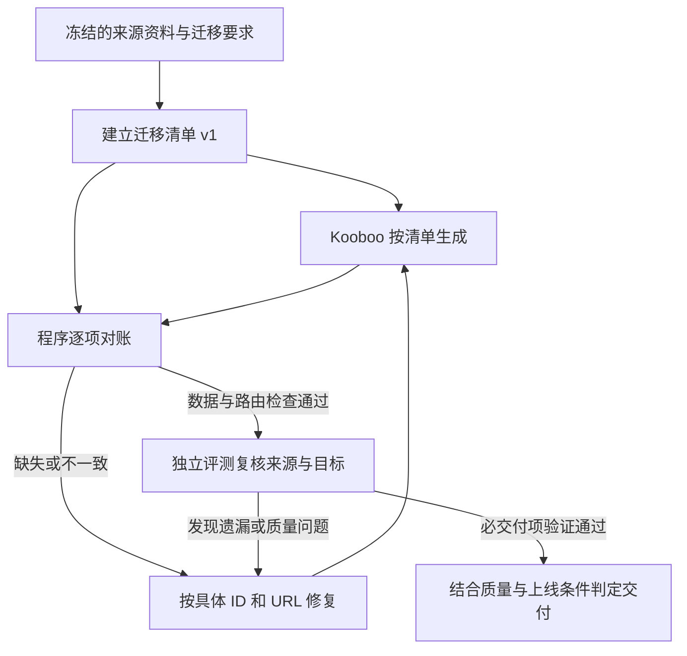

# 迁移清单讨论

日期：2026-11-08。

已确认：沿用 Mermaid 图表逐步沟通；将迁移完整性要求落实为版本化迁移清单，作为生成、自查、独立评测的共同交付依据。

以下细节为本轮提案，尚未确认或实施。完善现有 RequirementManifest，保留通用完整度检查及历史版本；迁移特有结构不直接强加给模板等其他场景。依据：overnight-run-analysis-2026-11-08.md 与当前 shared/completeness.ts、server/automation/completeness.ts。

## 清单参与流程

修复循环受既有预算、取消和停止条件约束；本轮不确定具体轮数。独立评测发现清单遗漏时记录来源证据并补充新版本，重新对账，不能修改旧报告所绑定的清单。

## 最小内容

| 层次 | 记录内容 | 核验目标 |
| --- | --- | --- |
| 来源与范围 | 输入版本、入口语言、来源 URL、采集时间、证据哈希、已知缺口与明确排除项 | 区分约定迁移范围和来源覆盖情况 |
| 内容实体 | 带来源命名空间的稳定键、类型、来源 URL、必要内容和目标映射 | 全量检查缺失、重复、额外项；标题不能充当身份 |
| 分类关系 | 分类键、实体键、来源依据、需要保留时的顺序 | 多对多归属、孤儿和悬空引用 |
| URL 与分页 | 旧 URL、目标 URL、预期状态或跳转、页码、对应实体及顺序 | 返回 200 不能代替页面语义核对 |
| 显示与 SEO 字段 | 正文名称/H1、页面 title、分类标签、description、canonical 等适用字段 | 各字段按来源与迁移要求分别保留或转换 |

稳定键优先使用来源 ID；来源没有 ID 时采用可追溯 URL 或明确的映射策略。额外实体/关系先列差异，按约定范围解释；额外项不一概判失败，但不能用来抵消缺失项。分页保留原分布还是只保留旧 URL 的正确承接，应按迁移约定固定；manwei 的现有目标按保留原页序核对。

manwei 作为离线验收样本：381 条唯一详情与 756 条分类关系是两个独立集合。此前记录存在不能证明归属完整；保存的模板代码对应渲染关系仅 678，且存在旧分页回第一页、同名内容被标题去重等问题。来源全集仍有覆盖限制，不能由这些已知集合推出全源站完整。

## 责任与版本

- 程序负责证据索引、结构校验、全量集合与页序比较及具体差异输出；模型负责来源语义、内容类型和字段映射判断；独立评测复核清单是否遗漏来源要求，并按计划核验目标表现。
- 全量明细保存在证据中，模型读取摘要和具体差异，必要时按 ID 展开。不能为了减少 token 丢掉全量核验。
- 每次生成和评测绑定清单 ID、修订号、输入版本；目标核验还绑定对应站点版本或观测时间。报告保存当时基线，后续清单修订不改写历史。
- 补采扩充清单需新版本和证据；缩减迁移范围需要明确的用户范围决定。来源未知保留未验证状态，不能通过改 expectedCount 消除缺失。

## 待讨论的首个决策

建议默认自动建立清单、补采和做结构核对；正常任务不增加逐份人工审批。遇到无法补齐的来源缺口或范围冲突时，暂停正式全站迁移并请求用户决定补充来源、限定范围或停止。有限范围验收应明确范围；源站覆盖未知的事实继续保留。

首期实施建议只做现有清单契约补充和 manwei 保存证据的离线对账，随后接入生成、修复与独立评测。本轮仅记录讨论和图表，没有实施产品功能。
