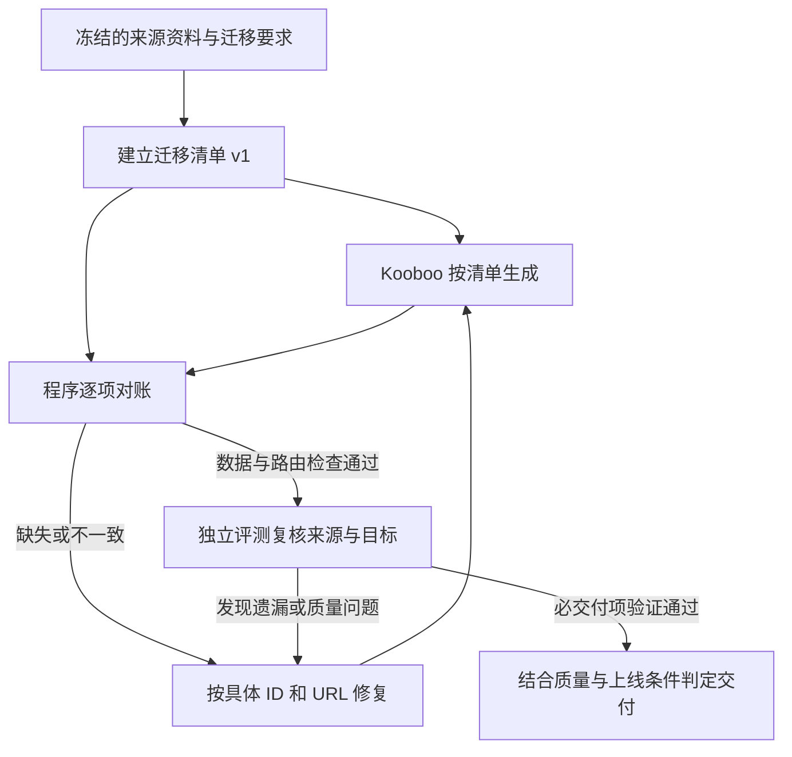
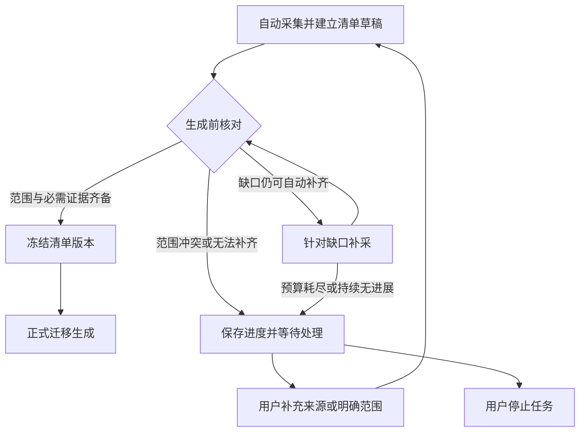
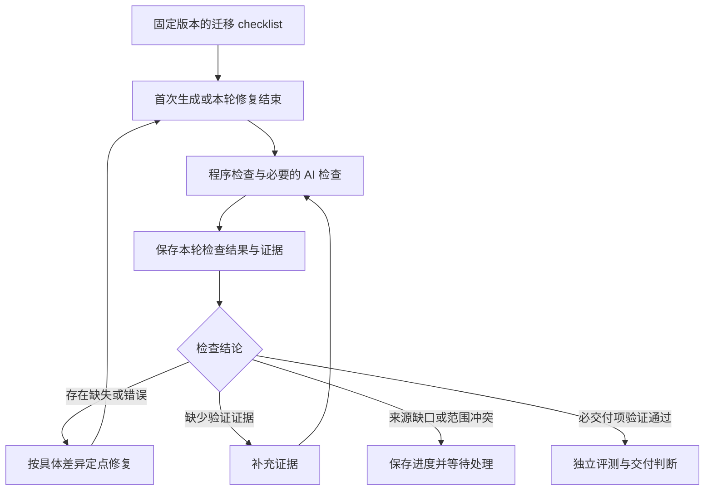
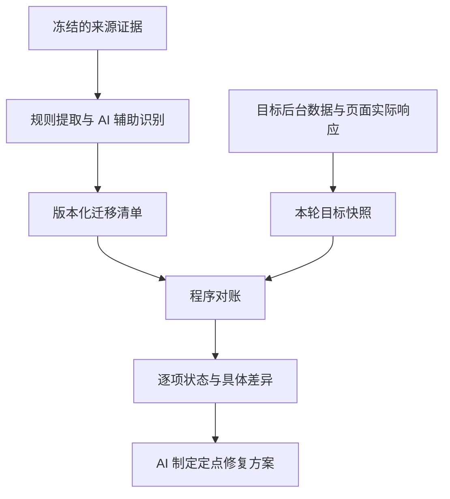
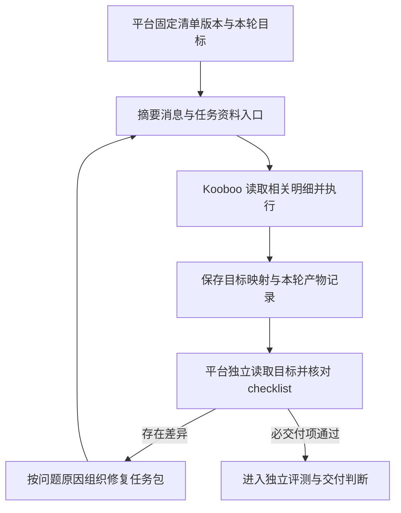
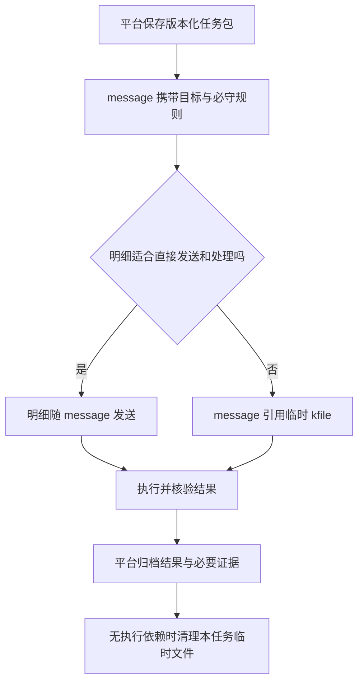
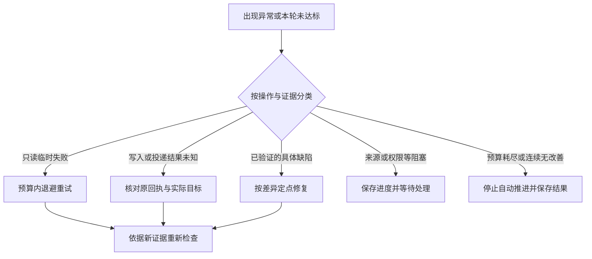

# 迁移清单讨论

日期：2026-11-08。

## 当前决议：首批离线对账已实施，运行链路待接入

用户确认方案后，授权读取主会话 review 并开始实施。已按评审顺序完成首批契约、纯程序对账、manwei 保存证据适配和离线 CLI；验证结果与具体边界见 [首批实施说明](migration-checklist-phase1.md)。后续自动取证、生成前放行、同一优化链中的结构化修复及前端展示尚未接入。

首批范围：完善现有 RequirementManifest 及证据契约，实现实体标识/映射、分类关系、URL/分页的纯对账能力，并用保存的 manwei 证据及必要故障样本验证。验收应能列出具体差异、保留未验证项、区分代码推导与实际页面证据，并兼容旧清单；不能把离线通过表述为真实迁移验收。

后续批次：先接入只读取证、生成前门槛及首次/逐轮检查，再接入 message/临时文件交接、差异修复与恢复，最后展示 checklist 和轮次记录。清单失败兜底修复随相关阶段落实，超长异常只存短摘要并引用独立诊断证据。

字段命名、分片阈值、重试间隔等按现有代码与聚焦验证确定，无需为每个实现细节重开产品讨论。临时文件清理失败对最终交付的具体标记/阻断规则，在接入该阶段时明确，不阻塞首批离线对账工作。真实模型与浏览器验收继续按既定授权和证据要求执行。

已确认：沿用 Mermaid 图表逐步沟通；将迁移完整性要求落实为版本化迁移清单，作为生成、自查、独立评测的共同交付依据。

另已确认：默认自动建立清单、补采和做结构核对，正常任务无需逐份人工审批；遇到无法补齐的来源缺口或范围冲突，暂停正式全站迁移，请用户决定补充来源、限定范围或停止。

另已确认：迁移默认保留旧 URL 的正确访问承接，以及原分页对应的内容集合与顺序；任务明确要求改变时，将新规则与映射固定到清单。完整度应呈现为 checklist，在首次生成及每轮生成/修复完成等合适时机，由程序或 AI 检查。

逐轮 checklist 的结论与建议已获用户明确同意：清单要求与各轮结果分开保存；首次、每轮修复及交付前按计划核验；程序全量核对基础集合，AI 复查受影响项及相关回归样本；证据必须适用于当前版本，缺证据先补证据；首版优先实体、关系、URL/分页三类程序检查。本轮继续细化讨论，不将“进入下一步”解释为已经开始源码实施。

交付载体已确认：message 优先；大批结构化明细按需要使用临时 kfile，平台负责副本清理、保存原件及恢复。不是默认把全部清单长期保存在站点，也不依赖 AI 自行删除作为唯一保证。见第六步。

下文保留逐步讨论时的原始提案与确认过程；其中“本轮未实施”等描述对应当时状态。当前实施范围以上述首批说明为准。沿用现有 RequirementManifest，保留通用完整度检查及历史版本；迁移特有结构不直接强加给模板等其他场景。依据：overnight-run-analysis-2026-11-08.md 与当前 shared/completeness.ts、server/automation/completeness.ts。

## 清单参与流程

修复循环受既有预算、取消和停止条件约束；本轮不确定具体轮数。独立评测发现清单遗漏时记录来源证据并补充新版本，重新对账，不能修改旧报告所绑定的清单。

## 最小内容

| 层次 | 记录内容 | 核验目标 |
| --- | --- | --- |
| 来源与范围 | 输入版本、入口语言、来源 URL、采集时间、证据哈希、已知缺口与明确排除项 | 区分约定迁移范围和来源覆盖情况 |
| 内容实体 | 带来源命名空间的稳定键、类型、来源 URL、必要内容和目标映射 | 全量检查缺失、重复、额外项；标题不能充当身份 |
| 分类关系 | 分类键、实体键、来源依据、需要保留时的顺序 | 多对多归属、孤儿和悬空引用 |
| URL 与分页 | 旧 URL、目标 URL、预期状态或跳转、页码、对应实体及顺序 | 返回 200 不能代替页面语义核对 |
| 显示与 SEO 字段 | 正文名称/H1、页面 title、分类标签、description、canonical 等适用字段 | 各字段按来源与迁移要求分别保留或转换 |

稳定键优先使用来源 ID；来源没有 ID 时采用可追溯 URL 或明确的映射策略。额外实体/关系先列差异，按约定范围解释；额外项不一概判失败，但不能用来抵消缺失项。分页保留原分布还是只保留旧 URL 的正确承接，应按迁移约定固定；manwei 的现有目标按保留原页序核对。

manwei 作为离线验收样本：381 条唯一详情与 756 条分类关系是两个独立集合。此前记录存在不能证明归属完整；保存的模板代码对应渲染关系仅 678，且存在旧分页回第一页、同名内容被标题去重等问题。来源全集仍有覆盖限制，不能由这些已知集合推出全源站完整。

## 责任与版本

- 程序负责证据索引、结构校验、全量集合与页序比较及具体差异输出；模型负责来源语义、内容类型和字段映射判断；独立评测复核清单是否遗漏来源要求，并按计划核验目标表现。
- 全量明细保存在证据中，模型读取摘要和具体差异，必要时按 ID 展开。不能为了减少 token 丢掉全量核验。
- 每次生成和评测绑定清单 ID、修订号、输入版本；目标核验还绑定对应站点版本或观测时间。报告保存当时基线，后续清单修订不改写历史。
- 补采扩充清单需新版本和证据；缩减迁移范围需要明确的用户范围决定。来源未知保留未验证状态，不能通过改 expectedCount 消除缺失。

## 已确认的自动推进方式

用户已确认：默认自动建立清单、补采和做结构核对；正常任务不增加逐份人工审批。遇到无法补齐的来源缺口或范围冲突时，暂停正式全站迁移并请求用户决定补充来源、限定范围或停止。有限范围验收应明确范围；源站覆盖未知的事实继续保留。

首期实施建议只做现有清单契约补充和 manwei 保存证据的离线对账，随后接入生成、修复与独立评测。本轮仅记录讨论和图表，没有实施产品功能。

## 第二步讨论：生成前的清单放行条件

当前代码在 generator.ts 中调用 ensureManifest 后继续生成；completeness.ts 允许规划失败后保留 sourceComplete=false 的待核对基线。本节提议增加明确的迁移放行判定。保留诊断基线不应自动授权正式全站生成。

放行检查提案：

1. 迁移范围明确：完整度始终针对已约定范围；全站任务不能被系统静默改成已发现 URL 的迁移。有限范围来源闭合与整个源站覆盖情况分别记录。
2. 范围有覆盖证据：记录导航、列表分页、详情、附件等实际存在的入口及追踪结果；没有 sitemap 本身不构成失败。已发现未处理入口、采集失败和分页异常不得被忽略。覆盖检查不等于证明不存在任何不可发现页面，报告需说明发现方式与局限。
3. 预期数据可核对：稳定键、分类关系、旧 URL/分页及必要字段有来源证据，身份无歧义，关系无悬空引用，来源矛盾须解释。全部 expectedKeys 由证据提取和结构核验支撑，不接受模型仅自述“已齐全”。
4. 迁移规则可执行：约定哪些内容原样保留，哪些字段允许转换，旧地址如何承接。目标 Kooboo 内部 ID 可以不同，保存来源键到目标键的映射；不强制复制原数据库结构。

生成前要求来源与迁移规则可核对；目标站实现、目标路由和双端质量在生成后验证。程序执行结构与集合核验；模型提出语义映射和范围判断，二者产物均保留证据。

补采仅处理明确缺口，复用已保存证据；每轮记录新入口、新实体、解决的失败项。缺口相同、没有新证据时不原样循环。预算耗尽保存进度和原因，恢复沿用累计用量；具体子预算参数后续讨论。用户不必等待补采失败才可主动限定范围或取消。

已确认的具体迁移默认规则：默认保留旧 URL 的访问承接，以及原分页对应的内容集合与顺序；显式的任务要求可以指定新路径、页面容量或排序，并在清单中固定映射。自动生成不得擅自改分页语义；技术结构转换通过源键到目标键映射兼容。

## 第三步讨论：每轮执行的 checklist

用户明确提出将完整度做成 checklist，在首次完成、每轮生成完成等时机由程序或 AI 核验，并已明确同意上轮回复的执行结论和建议。以下为已讨论的执行设计，尚未实施。

### 定义与结果分开

沿用 RequirementManifest 与 RequirementCheck 的职责划分，补齐机器可执行规则和轮次快照。清单定义记录条目 ID、预期、来源依据、检查方法、必交付属性、依赖和受影响范围；每轮结果记录清单版本、站点版本或可靠观测标识、状态、实际值、证据、时间和检查执行方。首次通过不是永久勾选，未取得证据不能判为通过。示意状态为通过、缺失或错误、未验证；现有 partial 等细分状态继续保留，不在本轮确定具体枚举。

程序结果与模型意见分别保留。模型不能覆盖确定性差异；若认为检查规则不适用，需要来源/需求证据，按清单版本变更流程处理，禁止直接改预期值消除缺失。

### 首版条目与分工提案

| 条目 | 主检查方式 | 必要证据 |
| --- | --- | --- |
| 全部来源实体有唯一目标映射，缺失/重复/额外项已处理 | 程序全量集合比较 | 来源实体、目标实体与映射快照 |
| 分类归属与约定顺序一致，无悬空关系 | 程序全量比较 | 来源关系、目标存储和实际输出证据 |
| 旧 URL 承接、分页集合与顺序正确 | 程序读取并解析实际响应 | URL、状态/跳转及对应内容 ID 序列；不能只检查 200 或保存代码 |
| 正文名称、H1、页面 title 等符合约定 | 程序比对明确字段，AI 核验转换语义 | 来源字段、目标实际输出与转换规则 |
| 代表模板及边界内容在双端可用 | AI 结合真实页面证据，适用时辅以程序检查 | 绑定目标版本、路径和视口的证据 |

动态模板抽样不替代实体、关系、分页的全量核对。生成 AI 的完成声明或自查只构成线索；最终仍依据独立取证和规则判定。

### 触发与复用提案

- 首次生成后：执行完整 checklist；程序先跑全量确定性核对，有明确错误时优先定点修复，按需进行 AI 诊断，不必先消耗完整视觉评分预算。
- 每轮生成/修复后：程序全量重跑低成本核对；AI 检查本轮受影响项、相关模板和回归样本。修改共享模板会影响其全部实例，不能只复查本轮报错 URL。
- 已通过项只有在依赖未改变、检查规则/来源仍相同且有可靠版本依据时才允许引用旧证据，并明确标注；不能证实时应重新核验或保留未验证。
- 进入独立评测与交付判断前：汇总清单，确认本次范围的所有必交付项都有适用于当前站点版本的验证结果。独立评测继续复核来源遗漏和目标质量；发现新问题仍可回到修复或补证据流程。预览环境不能代替上线验收。
- 清单或迁移范围升级：按新版本检查新增项与相关依赖，保留旧版本全部轮次记录。

修复输入建议直接包含条目 ID、预期、实际、具体缺失 ID/URL 和证据引用，避免仅向生成侧发送笼统低分或“请完善全站”。缺证据先补证据；来源或范围问题按已确认方式等待处理，不盲目改站。预算、取消与无进展守卫继续生效。

页面建议按实体、关系、URL/分页、内容与 SEO、双端与交互分组，默认显示当前状态，按需展开证据和历史轮次；未验证单独列出，不能只显示一个完成百分比。此处仅讨论展示信息，尚未授权界面实施或浏览器验收。

## 第四步讨论：首版三类程序检查的具体契约

以下为本轮细化提案，尚未实施。先将来源证据与目标只读证据转成相同的逻辑结构，再由程序执行集合、关系和序列比较。模型协助识别结构和映射；读取失败、无法提取实体或页序等情况保留未验证，不能由模型自述通过。

### 实体标识与映射检查

- 预期集合按来源命名空间、实体类型、来源键区分；标题只用于展示。没有来源 ID 时使用已固定的 URL/稳定键规则。
- 每个必迁实体有可追溯目标映射；默认不允许重复导入或把不同来源实体误合并。特殊拆分/合并需由明确迁移规则说明，不强制目标底层结构与来源一致。
- 输出 missing、duplicate、unexpected 和 mappingConflict 等差异。额外项按约定的允许项解释，不用来抵消缺失；目标全部数据页未读完不能判为通过。
- 这一项通过只证明逻辑实体标识与映射齐全；正文、媒体、附件及字段内容的完整性另有检查项，不因 ID 齐全而通过。

### 分类关系及输出检查

- 按来源分类键与实体键比较多对多关系；存在约定顺序时另比序列。
- 分别核对目标存储关系和页面实际输出关系。数据库关系齐全但模板过滤、标题去重或排序造成遗漏时，实际输出项失败。
- 一条内容属于多个分类是合法关系，不因重复出现而去重；同一分类内是否允许重复按固定规则判断。悬空引用和孤儿按来源约定判定，不能把来源允许的未分类内容一概判错。
- 输出具体分类、缺失/多余实体、顺序差异和发生层次；缺目标页面响应时，输出检查保持未验证，代码推导只作为实现线索。

### URL 与分页检查

- 为每个约定旧 URL 保存预期行为及来源实体序列；区分分类首页、分页、详情、附件和无效地址规则，不随意归一化掉有语义的路径或参数。
- 读取目标实际响应，核对状态/重定向链、最终地址及承接实体；列表分页比较本页实体集合与顺序，不只检查 200。
- 按合同检查首、中、末页，已知合法分页全量核对；空页、未知 ID、非法页码按约定状态验证，不自动指定所有站点均使用同一种状态码。
- URL 无法访问、目标实体识别规则失效或响应依赖当前取证能力不支持的脚本时，保留未验证并补证据；不能以保存的源代码代替已执行的目标响应。

### 证据与结果输出

每条差异携带 checkId、清单版本、目标版本/可靠观测标识、轮次、检查器及规则版本、来源证据和目标证据引用（哈希及记录定位）、预期与实际、差异类型、具体实体键/分类键/URL。全量差异保存为可分页明细，模型仅接收摘要和受限批次，不能因摘要截断丢失尾部问题。

示意修复委托：指定分类缺失哪些来源键；区分存储缺失与输出缺失；引用来源、目标及规则证据；列出修复后应复查的条目。模型可提出原因与实施方法，但不能擅自降低预期或将缺证据改成已验证。

### 最小实施顺序提案

1. 补充现有清单契约与纯对账逻辑，使用 manwei 已保存证据离线复现实体、存储关系、模板去重差异。代码推导结果单独标记；缺实际目标响应的 URL 状态与页序仍未验证。此阶段不声称修站或真实验收完成。
2. 增加/完善来源及目标的只读适配，形成可重用、带页数/完整性标记与证据引用的快照；接入实际响应核对。适配器不能处理的站点结构明确上报，不编造通用解析能力。
3. 接入首次/逐轮检查、生成前门槛和具体差异修复委托，结果绑定版本和轮次，复用既有预算、取消与恢复规则。
4. 再展示当前 checklist 和历史轮次，并继续扩充正文/附件、字段、双端与交互等检查项。前三类通过不代表全部完整度或最终交付通过。

后续需要讨论的衔接：如何把清单及差异交给 Kooboo（摘要、全量明细读取入口、修复批次与版本确认），以及生成侧如何返回来源键到目标键映射。暂无实施与浏览器操作授权变更。

## 第五步讨论：平台与 Kooboo 的交接

用户要求继续下一步讨论。本节为细化提案，尚未实施。

后续状态：本节“优先 kfile”的交付载体建议已因用户提出站点持久残留问题重新讨论，第六步的 message 优先与按需临时 kfile 策略已获确认，取代此处默认载体建议。第五步原图保留讨论历史。

当前 generator.ts 把完整 RequirementManifest JSON 追加到委托消息；已有资料通过 kfile 等通道导入目标站，并有 deliveryId、原会话身份、发送回执与执行终态核对。optimization.ts 的通用修复动作当前要求图片证据。本提案复用既有资料导入和可靠投递机制，补充可读取的清单/差异任务资料和产物约定；数据修复按结构化证据处理，视觉修复按需附图片，不另起并行生成会话。

### 首次委托

聊天摘要固定任务、目标站和原会话身份、输入/清单版本、本轮目标、必守迁移规则、任务资料索引及回传约定。完整实体、关系、URL/分页和必要字段规则保存为带总数、分片/分页信息及哈希的资料，通过现有工具通道读取；验证导入和读取成功，不能只发一个尚不可读的路径。

资料按任务与清单版本组织，版本内保持不变，供 AI 工具读取，不作为访客页面内容。入口权限、引用有效性与资料完整性在接入时核验；不能在委托里附凭据。首版优先沿用既有 kfile 通道，具体路径及分片格式为实现细节，不在此另造对外发布 API。

按需读取降低重复消息长度，不等于采样交付：执行前读取索引和适用规则；批量导入由程序遍历该任务范围全部数据分片，记录处理范围/失败项。未处理的尾部分片不能被摘要掩盖。原始网页与资料作为数据使用，经验建议不得覆盖当前固定迁移要求。

### 目标映射与产物

尽量由批量导入/更新脚本在实际成功后记录来源键与目标类型、ID、URL 的映射，来源键可保存在目标可查询字段或专用映射资料中，具体方式兼容 Kooboo 实际存储能力。发生错误保留已成功范围和失败项；恢复时先核对目标现状再继续，不能仅靠模型记忆或重新从头导入。

本轮产物记录引用任务/清单版本、本轮 ID、完成及未完成范围、变更内容/模板/路由、映射资料和异常。映射仅是候选核验线索，平台仍独立检查目标是否存在、映射是否冲突、实际内容和页面是否正确，不接受自述结果替代实证。不能要求模型手工在聊天里输出所有实体映射。

区分三个状态：委托被接受、执行循环结束、检查验证通过。前两个状态不能自动勾选完整度，也不能直接判交付完成。

### 修复委托

每包携带当前清单/目标版本、本轮 ID、相关 checkId、预期/实际、完整差异入口与本次处理范围、证据引用和回归项。纯数据问题以结构化数据与响应证据为主；视觉问题增加对应路径、视口和真实图片证据。改变现有图片必需约束时保留视觉修复的取证要求。

按可能的问题原因及依赖分组：导入遗漏处理实体/关系；共享模板过滤或标题去重优先修公共逻辑；分页解析导致多 URL 错误时修路由/页码逻辑。模板根因尚未验证则作为假设，保留证据核验。不能机械地为每条 URL 单独发一轮模型请求；修复公共逻辑后回归全部受影响范围。

单包过大时按可追踪批次拆分，记录总量、处理范围和余项；原站原会话串行执行，平台统一调度，Kooboo 不自行无限发起新轮次。每批结束可阶段核对，阶段结果不能冒充整轮通过。范围外的回归修复由明确的新任务包处理。

### 版本、投递与恢复

复用 deliveryId 和既有已接受/不确定状态处理；资料包也绑定唯一身份、清单版本和目标基线。相同包不盲目重发；发送结果未知时查原回执与执行状态。清单升级、目标被其他任务修改或会话身份变化时重新核对，不能把旧差异直接应用到新状态。

平台的目标版本标签需结合可观测变更依据；无法证明目标未改变时先重新取证。恢复以真实目标状态、映射与已验证证据为准，不把不完整产物记录当作事务提交证明；累计预算与已发生用量不清零。

本节首版实现衔接建议：先约定摘要、资料索引和映射产物契约；再接入既有资料通道及检查器；最后接入差异任务包、结构化数据修复与版本/恢复回归测试。不修改全局 Codex 配置，不启动真实付费任务或浏览器验收。本轮只更新讨论与图表归档。

## 第六步讨论：message 与临时 kfile 的选择

用户指出两种交付方式的区别：直接 message 不新增站点 kfile；通过 kfile 交付则会持久保留在站点，也可考虑用完删除。比较后，用户已回复“好的，可以的”，确认下述选型方向。尚未开始具体实现或实际文件清理。

已确认改为 message 优先：任务目标、固定版本、必守规则和小型差异直接发消息；当明细超过本轮消息预算，或需要脚本批量读取时，采用 message 摘要加临时 kfile。平台保留带版本的任务包原件与证据，载体变化不改变清单权威性、范围与逐轮核验规则。不引入未经测量的固定字符阈值。

### 比较

| 方面 | message | 临时 kfile |
| --- | --- | --- |
| 站点资源 | 不增加任务明细文件；消息仍保留在会话/既有任务记录中 | 新增文件，需清理与恢复管理 |
| 执行步骤 | 明细在当前消息中可见，不额外发起文件读取 | 需要确认写入、读取及后续清理 |
| 上下文与成本 | 大量全量明细会扩大上下文；缓存、压缩和实际采用方式需结合任务测量 | 按需读取/脚本批处理有潜在收益；把全文读回工具结果仍会增加会话上下文，不能预先声称节省比例 |
| 大批结构化数据 | 需要额外提取/转换才能供脚本批量执行；适合大小受控的包 | 脚本可读取完整分片、返回摘要及差异，适合实体和关系全集 |
| 后续恢复 | 从平台原件和会话恢复，需确认当前版本；不能假定模型永久记住早期消息 | 文件仍在可复用；已清理则由平台按原版本恢复，不能依赖已失效路径 |

既有 kfile 读取示例为 k.file.read 全文读取，不能从“文件交付”推断已具备分页/范围读取工具。分片、索引或脚本内批量读取需要明确实现和验证。即使使用 message，也不能因大小限制静默截断必迁数据；应选择可追踪批次或切换载体。

### 临时文件生命周期提案

- 平台持久保存清单、修复包、映射和审计证据，站点上的副本只服务本轮执行。目标业务数据中的来源标识或实际运行所需映射可长期存在，不将其混作临时任务文件。
- 使用平台登记的任务/包/版本文件清单，清理仅限本平台创建的明确临时副本；不根据宽泛目录名删除用户资料、真实内容、业务附件或运行依赖。
- 不在首次 read 后立即删除：后续脚本、重试和核验可能仍需读取。确认相关执行已结束、产物及证据已归档、没有活动读取依赖后，由平台通过实际验证过的 API 执行删除并核实结果。当前仅查实已有读写通道，本轮未验证或实现删除接口。
- 中断时保留所需资料以便恢复；用户取消时先确认相关执行停止，再决定本任务临时副本清理。任务结束后仍可能复评/恢复的资料由平台原件按需重新投放。
- 清理失败单独记录为待清理，可由平台按登记清单重试，不把清理失败伪装为迁移内容失败；交付状态如有临时残留应如实说明。具体是否作为最终交付阻断项后续确定。
- 删除 kfile 仅清理站点副本，不撤回既有会话中的消息和工具输出；任务数据保留策略与站点副本生命周期分开管理。

已确认方向：大多数小型修复直接 message；大规模迁移的实体/关系/分页明细若需批量脚本处理，才用临时 kfile。清理责任归平台，不把“AI 用完即删”作为唯一保证。需要结合真实包大小、读取次数及工具返回量再确定切换阈值；本轮没有启动基准任务或付费请求。

## 第七步讨论：异常、重试与停止规则

异常与停止规则方案已获用户确认，尚未实施。基于当前已有的可靠投递、累计预算和连续两轮无改善停止机制，补充按操作语义和证据分类的处理规则，不依据异常文本或 HTTP 状态码一概重试。

### 处理分类提案

- 只读临时异常：如读取响应暂时失败，在现有请求、用量与时间限制内有限退避重试，不能一遇故障就重开模型分析。网络错误发生在创建、导入或投递时，不能沿用只读重试规则。
- 写入或投递结果未知：先核对原 deliveryId、原会话执行及目标数据。确认未执行且可安全重放才恢复；仍未知则等待处理。不能重复建站、重复导入或重发相同修复包。
- 确定性输入/结构错误：例如字段不合法、提交 JSON 结构错误、消息超出限制，输出可定位的诊断，复用已生成结果修正结构或拆包后再试。相同错误不原样循环；既有有界 schema 修正机制可复用，不以修正结构为由重采全部证据或重生成站点。
- 环境/权限/来源阻塞：权限不足、工具不可用、身份冲突或来源缺口无法补齐时保存证据与可执行下一步；运行环境或资料未改变前不反复请求。缺证据但能力可用时优先补证据，而不是发起站点修复。
- 明确目标缺陷：先基于 checklist 形成定点修复包。生成、检查、修复和评测串行，沿用累计预算、轮次与取消规则。
- 临时文件清理失败：单独记录清理状态并限定重试，只处理已登记临时副本；不触发重新生成或重新迁移，不能把内容验收失败和清理失败混为一谈。最终是否阻断交付仍待确定，至少如实显示待清理事项。

### 无进展判定提案

保留现有“连续两轮修复无实质改善则停止”的默认规则，补充 checklist 差异和回归证据，不能只依靠模型 improved 布尔值或分数波动。

修复进展要对应本次明确目标：哪些缺失实体、关系或错误 URL 已验证解决；哪些仍存在；是否引入新的必交付缺陷。减少输出摘要条数、删除清单项、降低预期或换标识不能算改善。重大回归需单独处理，不因其他小问题解决而忽略。AI 的语义判断仍需附证据；宿主校验可确定的集合差异和规则约束。

补证据可算核验进展，但不冒充修复成功；读取/投递重试和纯结构修正不计作新的站点修复轮次，也不重置修复无进展计数。每一类操作仍有其累计预算与限次，不能通过换阶段或拆批无限延长。清单或来源范围改变时保留版本变化原因，不能直接把不同基线的差异数作同口径改善比较。

### 停止与恢复提案

预算耗尽、达到修复轮数、连续无改善或用户取消时停止发起新的生成、模型与修复阶段。正在执行的写入先确认停止状态；不把停止按钮当成已回滚或已停止的证据。允许在有界程序操作中记录已发生用量、核对运行状态和完成必要收尾，不能借收尾继续发起付费模型推理。

持久保存当前站点身份/版本、清单版本、最后可信报告、已通过/缺失/未验证项、各轮差异、累计用量、未知费用、剩余批次、临时文件状态、停止原因和可用下一步。已知费用不能覆盖未知请求费用；无法确认受约束预算余量时停止新增付费阶段。恢复保留累计用量与已发生操作，核对当前版本和目标状态后继续，不从头重跑或隐式清零。

停止自动推进与是否可交付分别表达：达到目标、等待处理、因限制停止但未达标、用户取消应有明确原因；未达到目标不能仅因流程结束就展示为交付完成。首版不必为每个底层异常新增产品状态，先将原因、证据和 available actions 结构化接入现有任务/优化状态。

迁移 checklist 首版主流程、交接和停止规则已获确认，可按当前决议分批实施。字段命名、分片大小和退避间隔可结合现有代码与配置确定；截至本次记录尚未开始产品源码实现。
