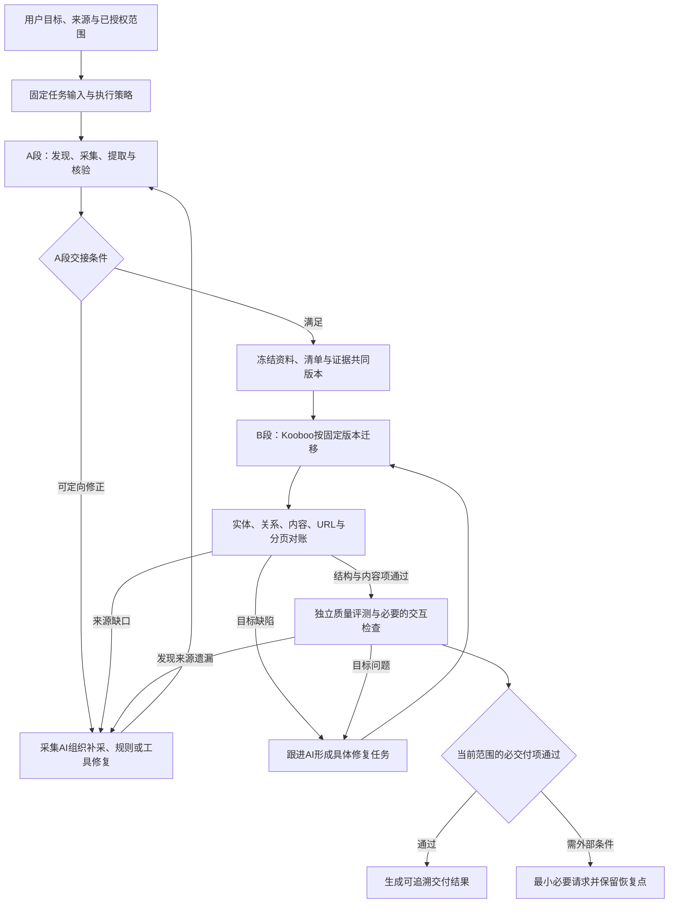
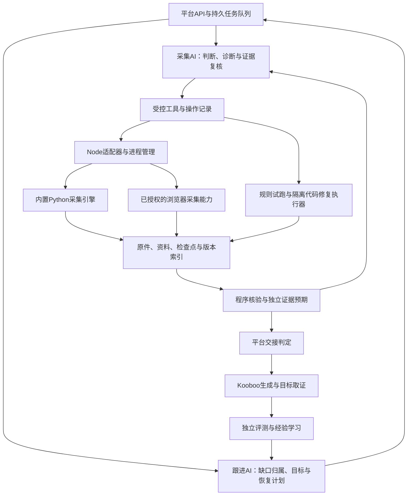
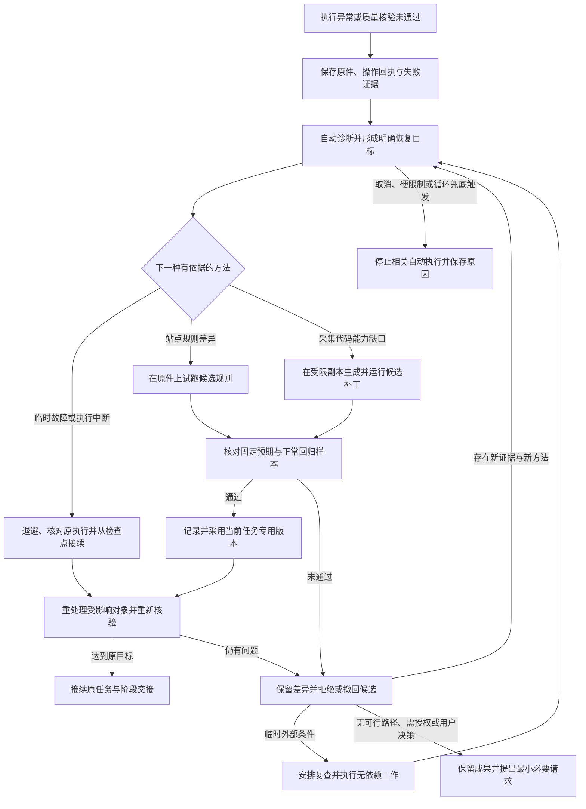

# 站点迁移与无人值守采集完整设计 v1

日期：2026-11-08。来源会话：01a1b88d-c1d2-7461-90bd-c6ad908852d5。

状态：设计已获用户批准，正在实施与真实验证。本文保留设计基线；实现进度及真实验收边界见 [manwei 自主迁移验证记录](manwei-autonomous-validation-2026-11-08.md)。自动扩窗补采已在新任务触发，尚不代表 A/B 或交付通过；Windows 实机及代码隔离仍未验收。

本稿整合此前逐轮讨论，不要求用户再审阅所有历史提案。与历史图中“普通预算到限直接停止”等旧建议冲突时，以本稿所保留的最新决策为准。API命名、数据库字段及退避参数在实施中按现有约束确定，不为每个字段重开产品讨论。

## 1. 目标与首版范围

核心目标：用户发起任务并给出必要权限后，平台在无人值守条件下持续发现问题、定向修正、核验和接续，最终交付与约定范围一致、证据可追溯的迁移结果。质量条件和用户明确硬限制不会因自主执行而放宽。

首版包含：

- 将个人site-harvest的采集核心、规则和资料契约收编为平台内置能力；保留Python，由Node管理调用。
- A段原站到资料的完整性核验，以及与既有B段资料到Kooboo对账能力的衔接。
- 本地采集AI、程序批量执行、跟进AI恢复规划、既有独立评测及经验学习的协作。
- 版本化站点规则、原件试跑、隔离代码修复、任务内自动采用、回退及受影响资料重核。
- 检查点、重启恢复、暂时故障退避、明确目标的自动接续及防循环。
- Windows/macOS运行组件、统一初始化、自检和交付验收。

保持原有生成站身份、版本、API、历史报告和已有数据，不把这轮采集设计强加给所有模板或AI App场景。设置页改版由另一会话负责，本稿只给出需要呈现的信息契约。

自动代码修复限于当前任务的采集模块或适配扩展。修改平台自身、固定核验标准、共享依赖环境以及向全部任务发布默认引擎，仍走独立开发发布流程。正式上线、业务数据破坏性操作、绕过登录或验证码不属于本稿默认授权。

## 2. 整体流程：两段完整性分别成立

图61，原始源码见[61.mmd](conversation-diagrams/mermaid/61-站点迁移完整设计-A段采集与B段落地闭环.mmd)。

两段分别回答：

| 阶段 | 核心问题 | 不能据此推出的结论 |
|---|---|---|
| A：原站→资料 | 约定范围的入口、记录、正文、素材和关系是否被发现、采集并正确提取 | 文件齐全或已发现对象全采完，不代表源站全集已确认 |
| B：资料→Kooboo | 固定资料中的必迁对象、内容、关系、URL和分页是否正确落地 | 目标ID齐全、页面200或视觉得分高，不代表迁移完整 |

沿用sourceCoverage与scopeCoverage分别记录来源覆盖和约定范围覆盖。明确有限范围可以按该范围验收，同时保留全源站未知；全站任务不能被系统静默缩为已发现集合。没有来源总数时不伪造分母和100%百分比，报告说明发现路径、核验方法和局限。

## 3. 职责与系统组成

图62，原始源码见[62.mmd](conversation-diagrams/mermaid/62-站点迁移完整设计-平台组件与AI职责.mmd)。

| 参与者 | 负责 | 交付物 |
|---|---|---|
| 采集AI | 范围疑点、发现策略、类型与异常复核、规则和采集代码修复候选 | 具体操作目标、带证据的复核、修复候选与结论边界 |
| Python引擎 | 发现、抓取、提取、素材下载、数据化和资料包输出 | 原件、结构化结果、对象清单、错误和执行检查点 |
| Node平台 | 参数和权限、任务队列、进程生命周期、持久状态、版本、用量、交接条件 | 可恢复执行记录及版本一致的阶段结果 |
| 跟进AI | 归因、依赖、具体下一步及进展分析 | 采集、目标修复、补证据或恢复任务 |
| Kooboo生成AI | 按固定资料与清单生成、修复目标站 | 目标实现及站点执行回执 |
| 独立评测 | 目标视觉/内容/适用交互质量，复核遗漏要求 | 引用实际证据且绑定目标版本的报告 |
| 经验学习AI | 提炼方法、适用条件及失败边界 | 候选经验及后续支持或反对证据 |

这些是职责划分，不要求每个动作新建一个AI会话或新增常驻角色。沿用平台本地AI执行机制、统一自动化的Codex SDK与配置约定，不修改全局Codex配置。“本地”指平台执行位置，不代表离线模型。

## 4. 输入、资料与版本模型

最低业务输入是来源入口与任务目标。语言、域名和范围沿用已授权任务及默认规则；已有资料、排除项依据、浏览器能力、硬限制、历史失败与经验由平台补齐，不要求用户先制作sitemap或逐轮写提示词。

建议的逻辑对象如下，实施时复用现有资源、输入版本、RequirementManifest、迁移证据和队列结构，避免创建一套不相通的状态系统。

| 对象 | 内容与约束 |
|---|---|
| 采集任务 | 来源与范围、目标、权限和策略快照、与迁移任务的关联 |
| 恢复/修正目标 | 问题及证据、本轮目标、操作和影响范围、验收依据、依赖与执行边界 |
| 批次操作 | 唯一操作ID、输入版本、对象集合、阶段、执行身份、回执、检查点、状态和下次时间 |
| 来源对象 | 命名空间+类型+来源ID，或固定URL键；发现依据、归属、页序、响应与处理状态 |
| 证据对象 | 来源/目标/代码推导层次、URL与时间、哈希、大小、采集及提取版本、证据定位 |
| 资料版本 | 原件索引、逐页正文、记录、素材及关系的共同快照；与清单及复核关联 |
| 核验结果 | 检查项版本、预期、实际、证据、执行方、适用范围及目标版本 |
| 规则/修复版本 | 基础版本、候选变更、适用类型、试跑与回归结果、采用或撤回记录 |
| 用量与尝试历史 | 实际及未确认用量、失败路径、策略变化、进展证据；跨角色和批次保留 |

身份不以标题代替；不丢弃有语义的数字路径、.aspx、页码和查询参数。目标内部ID可以不同，通过来源键到目标键映射承接。

原始HTTP响应/保存HTML、渲染DOM、提取fullText、逐页Markdown与候选记录分层保存。fullText也是提取产物，不能代替原件。候选记录可以有摘要或链接数量限制，必须标明派生性质，不作为无损迁移唯一依据。

冻结版本不可原地覆盖。补采或规则修复形成新版本，保留旧报告及其依据；B段只切换到已通过A段交接的新版本，并重核新增或受影响项。若来源在采集期间变化，保留各次采集时间与冲突，重核受影响入口和记录，不能伪称整站原子快照。

## 5. A段：七项完整性checklist

| 条目 | 程序检查 | AI复核与所需证据 |
|---|---|---|
| A1 范围 | 主机、语言、路径、排除项及授权与输入一致 | 子页面入口、业务子站和语言冲突；排除依据 |
| A2 入口发现 | 导航、页脚、sitemap、列表、分页等发现过程可追溯 | 按钮、加载更多、外嵌/API线索及未知入口 |
| A3 栏目与记录 | 声明总量/总页数与不同ID、分页、分类关系及顺序对账 | 来源声明冲突、身份含糊或未知总量，不用样本替全集 |
| A4 原始采集 | 必需对象的响应、跳转、编码、非空内容、缓存与文件可读取 | 错误页、验证码、空壳及原件异常 |
| A5 内容提取 | 必含内容、引用、字段和异常差异；原件到各派生层追溯 | 按实际页面类型和异常检查正文、表格、隐藏/重复区域、乱码 |
| A6 素材 | 图片/附件计划、下载、文件类型、实际文件及引用归账 | 核心素材误判、图集/附件遗漏、PDF正文和图片文字的提取边界 |
| A7 版本化交接 | 资料、清单、证据、规则和复核记录的共同版本与引用存在 | 声明结论的适用范围、未解决项和局限 |

每项区分通过、缺失或错误、部分完成、未验证、按要求排除；具体枚举与现有契约对齐。排除需符合范围规则并有依据，不能通过排除失败对象使检查变绿。

执行成功、退出码0、verify成功、no-known-gaps和AI自述完成都不能独自放行。正常情况下平台自动检查并冻结版本，不新增逐份人工审批。有可补缺口时继续恢复；缺证据时补证据；真正的外部条件或范围冲突才请求最小输入。

没有sitemap或公开总数本身不自动判失败。平台结合已验证的入口遍历、分类/分页闭合、内容类型复核及异常处置判断约定范围覆盖是否有充分依据，并单独保留总量未知。证据仍不足时相关项保持未验证并继续补证据；不能由AI一句“已经尽力”替代放行条件，也不声称证明了所有不可发现页面不存在。

## 6. B段：固定资料到Kooboo的落地核验

沿用既有迁移契约和程序对账能力，不能把manwei保存证据适配器当作所有网站的通用发现器。采集模块为B段提供标准化来源资料和证据，目标侧按实际实现取得数据与响应。

| 检查类别 | 验证要求 |
|---|---|
| 实体与映射 | 全部必迁来源键有正确目标映射；缺失、重复、额外和冲突分别列出 |
| 分类及关系 | 多对多、顺序、悬空引用；目标存储关系与页面实际输出分别核对 |
| 正文与字段 | 必迁正文、表格、素材、附件和SEO字段保留或按明确转换规则实现；ID齐全不代替正文正确 |
| URL与分页 | 默认保留旧URL正确承接、原页实体集合及顺序；状态200不足以通过，核对实际响应和跳转 |
| 模板及体验 | 代表模板、边界内容、桌面/移动和适用交互有当前版本证据；抽样不替代全量数据核对 |

首次生成后完整检查；每轮修复后重跑低成本确定性检查，并复核受影响内容、共享模板及回归样本。复用旧证据需证明其依赖未变，不能证明就重新取证或保留未验证。

每个后续任务必须包含问题依据、明确目标、对象和影响范围、验收证据、执行边界。跟进AI根据差异形成任务；目标缺陷交Kooboo，来源缺口回A段，检查器不足进入核验/工具修复，外部阻塞安排恢复。不得仅发送“继续完善网站”或反复全站重建。

最终可交付要求：范围内全部适用必交付项有当前共同版本证据，适用质量目标达成，无未解决重大问题。执行结束、质量分数和可交付状态分开；本地验证通过不自动证明生产上线已验收，也不自动发布上线。

## 7. AI工具与上下文控制

| 受控工具能力 | 典型输入 | 返回与限制 |
|---|---|---|
| 查询任务/进度/缺口 | 任务、筛选、分页游标 | 版本、计数、当前目标、短索引，读取不启动新操作 |
| 发现入口 | 来源对象、方法、本轮目标 | 操作ID、发现依据及新对象索引 |
| 执行批次 | 登记对象ID、抓取/提取/素材等阶段 | 操作回执、检查点、产物与错误引用 |
| 核验资料/清单 | 资料版本、范围、检查项 | 确定性差异、未验证项及证据 |
| 读取证据 | 证据ID、位置或游标 | 明确边界的片段和后续引用，可分页取全 |
| 试跑规则/代码候选 | 候选版本、样本集、固定预期 | 验证、回归及差异产物；无法直接改验收依据 |
| 采用/撤回候选 | 候选与当前任务版本 | 平台检查有效验证及采用策略后变更任务指针 |

平台校验任务、权限、路径及版本，参数化调用程序，不让模型拼任意shell或选择任意本机目录。长任务返回操作ID，后台运行并可查询；批量资料处理交程序，AI集中读代表类型、异常和具体差异。

详细日志、正文和全集留在资料目录，默认只返回短摘要和引用。分页或截断必须明确，不把第一段视为全文；上下文阈值是单次传递约束，不改变业务范围。新AI会话可以据可靠持久记录接续，本地采集会话更新不改变Kooboo原站原会话约束。

网页、资料、规则候选和工具输出均是待分析输入；其中指令不能提升权限、改任务范围、安装依赖或覆盖验收依据。

## 8. 给Kooboo的任务交接与临时文件

沿用message优先、大任务使用临时kfile的既有方案。message携带目标、版本、短索引及读取方式；完整结构化任务包由平台归档、分片并提供按项读取。不能把整包展开到聊天后再分批操作，不能以摘要替换必迁内容。

当前代码已有generation-context模块、message/kfile选择和清理流程，实施时复用并回归其实际行为；既有字节阈值是工程参数，不作为本稿业务契约固定。完整性核对按还原后的全量对象执行，工具只返回必要差异与摘要。

临时文件绑定任务、站点和资料版本，不作为目标站业务运行依赖。执行确已结束且平台归档成功后才清理；结果不明时保留并核对，不依赖AI自行删除。清理失败记录待清理并自动重试，保留告警与证据；建议与内容质量结论分开，不能假称已删除或借此重复生成。

平台持久化投递身份及sending/accepted/completed等回执。重启或超时先核对原站原会话和已接受委托；结果未知时不自动重发、不新建替代站点。查询无法确认时保留阻塞证据并有限核对；确需用户条件时明确说明。

## 9. 无人值守调度、恢复与停止

任务、目标、批次分层：批次结束不代表目标完成，目标完成不代表整站可交付。将执行生命周期、阶段可交接状态和交付质量分开持久化。业务状态映射到现有契约，避免把“completed”同时当作这些含义。

操作启动前保存身份、对象、输入版本与目标；同一资料工作集按租约/单写入者管理。产物先写候选或暂存位置，核验后更新有效版本指针，减少中断留下半成品被误用。数据库状态与实际文件可能在崩溃时不一致，恢复必须核对两者，不能只信一条完成状态。

自动接续规则：

- 有可验证进展且目标未完成：继续下一批；软额度或单次时限到限保存检查点并自动接续。
- 临时故障：持久化下次时间，退避、按已确认操作身份重试或核对；不清空已有结果。
- 执行结果未知：先核对存活执行、回执和产物；对不确定写入/投递不重复执行。
- 连续无改善：触发有限诊断及有依据的换策，不能单凭相同失败无限重试。
- 单点阻塞：保留依赖与下一步条件，继续无依赖工作；必需依赖未完成时整体不宣称交付。
- 用户取消：停止安排新操作，收尾在途操作并保存状态；不自行恢复。
- 用户明确硬限制、循环或异常消耗兜底触发：停止相应自动执行并给出原因，不能换角色或批次绕过。

防循环依据同一目标的输入、操作、结果及实际证据变化，识别重复失败和策略A→B→A回转；仅有AI声称“有进展”不清零历史。累计用量与未知费用保留，默认服务于归因和异常识别，不能把普通累计消耗当作停止原因。

现有代码仍存在预算、轮数和无改善停止规则。实施需区分用户显式硬限制与旧默认执行上限，显式硬限制继续遵守；新策略冻结到适用新任务，历史任务不因升级自动扩大付费执行或启动修复。旧任务迁移/恢复明确记录适用策略，保留历史报告和用量。

退避、诊断窗口和异常消耗参数集中定义并随任务快照，实施时通过故障样本校准，不以固定总轮数截断有效推进。

## 10. 站点规则与隔离代码修复

图63，原始源码见[63.mmd](conversation-diagrams/mermaid/63-站点迁移完整设计-隔离修复与无人值守恢复.mmd)。

先用受控站点规则表达主机/语言/模板适用条件、正文容器、字段位置、分页链接、素材和关系位置。多个规则冲突、结构特征不匹配或引擎能力不足时报告问题，不静默选用、不排除未识别页面。

规则候选保存问题证据、适用对象、基础与候选版本、样本、固定预期及影响范围。用已存原件在独立输出目录试跑，检查失败页、正常页和已知模板变体，并保留未用于调规则的回归样本。数量按类型和异常决定，不固定抽三页。

配置无法解决时允许采集AI生成采集模块补丁或任务专用适配，在隔离副本验证。修复采用条件如下：

| 边界 | 首版设计 |
|---|---|
| 可写范围 | 当前任务的候选采集代码、规则与输出目录；稳定引擎、平台源码和验收预期不直接覆盖 |
| 输入 | 明确授予的原件样本与配置；凭证由平台持有，不向候选执行器暴露 |
| 外部能力 | 候选解析优先在保存原件上运行；新增抓取走平台受控工具及既有授权，候选代码不获得任意网络或子进程权限 |
| 依赖 | 使用固定受管理运行环境；新依赖通过组件/开发发布流程准备，不由候选代码临时安装 |
| 验证 | 固定失败预期、正常回归、对象/引用/契约和受影响范围检查，AI语义意见单独留证 |
| 采用 | 平台核验有效试跑后，自动固定到当前任务具体代码/规则版本；不要求逐次人工审批 |
| 回退 | 新退步则撤回采用并保留新旧差异；旧版本已有缺口仍是未解决项 |
| 共享发布 | 可生成可评审变更及经验，但向其他任务发布默认版本走独立开发发布流程 |

隔离须由实际执行环境落实文件、网络和进程边界；工作目录隔离、提示词约束或静态扫描不等于代码执行隔离。Windows和macOS必须分别验证越界写入、凭证读取、任意联网及子进程限制。实现路径在工程验证中选择，不假设同事预装容器或额外虚拟机。

隔离执行与回归能力未验证前不启用候选代码自动运行；基础采集和规则能力可以分批交付，但不能将其称为首版自动代码修复已完成。若某个平台尚不能可靠支持，这构成该项能力/完整首版交付的阻塞，须明确报告并解决，不能静默降级为任意执行。

修复候选不能同时改掉验收依据来制造通过。若核验器本身有误，保存其缺陷与独立预期，通过独立版本化开发验证更新；原报告不改写，受影响任务重新核验。采集器和自检器共享同一盲区时，需要来源证据和独立样本揭示，不能靠同一实现自证。

## 11. 正确性与质量保障

四层保障：

1. 固定样本：保存原件与可审查预期，覆盖编码、URL语义、分页、表格、素材、动态入口、失败和恢复。预期不由被测提取器自动生成。AI标注明确身份，不能冒充人工金标准。
2. 任务内程序核验：集合、数量、关系、原件/提取/派生差异及必含内容；无可靠来源总量保留未知，文件哈希仅证明一致性。
3. AI类型与异常复核：原件对照、语义、遗漏及方法边界。样本通过不等于逐页语义已证明，程序全量核对与AI复核互补。
4. 发布与历史追溯：固定引擎、规则、核验器和SOP版本，缺陷出现时追溯受影响资料及交接结论，必要时标为需重新核验。

浏览器证据与HTTP状态分别记录，不能把渲染DOM伪装成同一次HTTP响应。PDF原文件保留不等于正文已提取，图片下载不等于文字已OCR；核心资料依赖这些能力时保留提取缺口，不能自动通过。

## 12. 经验沉淀与消耗控制

经验记录来源案例、问题类型、适用模板特征、方法/规则或补丁引用、失败条件、验证证据和消耗变化。当前任务验证通过的规则可以成为候选经验，新站仍需匹配并验证，不因使用.aspx或相似URL直接套用。

减少消耗优先靠：原件缓存、分层索引、程序批处理、明确下一步、按影响范围重核、正确恢复，以及复用有版本依据的有效证据。AI不逐页重复读全集，不为已知结构错误先反复跑全套视觉评分。必要核验不因节约token而删除。

经验学习失败不使已通过的交付失效；候选经验不直接升级为通用引擎默认。规则和补丁长期以单一核心及显式版本维护，避免个人skill与平台两份代码漂移。

## 13. Windows/macOS安装、升级与运行环境

平台继续使用既有Node运行方式及本地会话，不增加独立采集服务或手动登录。Python/lxml随受管理组件或平台初始化准备，用户无需个人site-harvest目录、全局Python或个人Chrome路径。

初始化检查操作系统/架构、平台/引擎/依赖兼容版本、可写数据目录与所需浏览器组件；失败给出可诊断结果，已支持的组件修复路径尽量自动完成。源码安装与交付包安装都纳入验证，不能只验证维护者机器。

独立可执行组件与受管理解释器的具体形式通过双平台最小验证选择，不作为继续产品讨论的前置问题。架构清单按实际同事机器和可发布构建确认，不声称所有CPU都支持。离线安装是否提供另行由交付能力明确，首版不假定离线可用。

浏览器能力优先复用平台管理的Playwright/Chromium；实际浏览器操作沿用授权边界，安装不等于授权。原skill的系统Chrome路径探测不直接作为Windows支持实现。

版本清单记录平台、引擎、规则、资料结构、核验器、SOP及依赖组件。升级核对检查点和缓存兼容性，必要时从原件重提取；已有配置、.data及master.key保持，不以更新覆盖或重新生成。数据备份包含其主密钥，运行资料和密钥不入Git。

## 14. 实施落点与兼容边界

拟议落点，实际命名允许在实施中调整：

| 位置 | 内容 |
|---|---|
| server/automation/collection/ | Node采集协调、受控工具、检查点、版本冻结与恢复 |
| shared/collection.ts及既有shared契约 | 采集、规则、修复与交接契约；与migration/completeness关联 |
| 项目内采集引擎目录 | 收编Python核心及离线测试，构建交付包含完整版本 |
| sop/下版本化采集SOP | 发现、补采、语义复核、修复和结论边界 |
| tests-node/与引擎测试 | 工具契约、调度恢复、隔离边界、对账及故障回归 |
| 既有资源/任务API及详情 | 来源版本、阶段checklist、恢复目标、动作历史、用量和待补条件 |

数据库/API增量兼容，旧资源和报告可读，缺少新证据的历史结果不自动升级为完整；旧任务不被静默重新执行。新采集入口遵守队列启用策略。

只对任务和资源补必要状态和证据入口，设置页整体布局不在本任务实现。保留统一浮动反馈和现有详情分区，避免新增不必要标签或独立管理页面。保持现有临时kfile交接、原站原会话和外部Admin契约。

## 15. 分批实施与验收

实现可以分批，但下列各批通过前，不能将相应能力宣称为已完成。每批保留可审查差异和验证结果，不把mock测试当真实模型、浏览器或双平台验收。

| 批次 | 实施内容 | 完成证据 |
|---|---|---|
| 1 引擎与契约 | 收编核心、标准产物、版本、受控调用；验证两平台运行/隔离技术路径 | 无个人skill依赖；现有回归可运行；组件及隔离验证有记录 |
| 2 采集闭环 | 本地AI工具、A段checklist、原件/资料索引、冻结与B段交接 | 可定位具体缺口；源覆盖未知不会被文件自检改成完整 |
| 3 恢复与规则 | 持久操作、接续、防循环、规则试跑和自动采用 | 故障后自动恢复，错误规则被拒绝，缓存复用且用量不丢失 |
| 4 隔离代码修复 | 候选生成、受限运行、独立回归、任务内采用和撤回 | 工具能力缺口能自动修复并接续；越界被执行环境拒绝 |
| 5 端到端交付 | manwei回归、其他模板样本、目标对账、独立评测、双平台安装升级 | 当前版本交付条件可验证；恢复、成本、已知局限与安装记录齐全 |

必验场景：

| 场景 | 预期行为 |
|---|---|
| 来源声明120条，实际119条 | 保存具体差异，自动补采/修提取；不改预期总量制造通过 |
| 来源没有总数或动态入口未展开 | 保留未知与待处理目标，补发现证据；不显示虚构完成百分比 |
| 漏正文、规格表或附件 | 能发现并形成明确目标，规则或代码修复后对照原件重核 |
| 请求超时/短暂断网 | 保留成功对象，持久化退避并继续，不要求用户重发任务 |
| 中途服务重启/模型上下文耗尽 | 从真实检查点接续，核对原进程/回执，按索引开启必要新会话 |
| 投递Kooboo结果未知 | 核对原站原会话，不重复发送或创建替代站点 |
| 新规则/补丁引入退步 | 拒绝或撤回采用，保留原缺口和新差异，不按成功交接 |
| 候选代码试图越界 | 文件/网络/进程边界实际拒绝，平台稳定运行与验收依据不被改写 |
| 失败策略循环或异常消耗 | 有限诊断换策，触发兜底后停止相关自动执行，保留成果及原因 |
| 用户取消或设置硬限制 | 尊重取消及限制，不靠新角色或批次绕过 |
| 确需登录、来源资料或业务决定 | 只请求最小必要条件；补足后接续，无依赖工作可继续 |
| B段目标集合/关系/旧URL错误 | 输出具体ID、层次和URL，定向修复并重核实际响应 |
| 两平台中文/空格路径与升级 | 统一入口可运行；版本/缓存兼容；已有数据及密钥保留 |

manwei用于真实复杂案例回归，同时以多种独立模板样本验证通用性；保存证据通过只能说明该证据范围内的检查行为，不能证明manwei全源站已经完整。Windows/macOS实际运行、真实模型规划、真实浏览器行为分别列验收记录。历史授权不自动等于新一轮浏览器验收已执行。

交付结果至少包含：任务与资料/清单/站点版本、A/B段逐项结论、适用质量报告、修复及回退历史、来源局限与未解决项、实际及未知用量、后续所需条件。只看最终分数或一句“完成”不足以验收。

## 16. 当前状态与依据

截至本稿检查：平台已有Node/Vue架构、持久任务与生成回执、迁移契约/对账及generation-context等基础代码；不能仅凭这些代码存在就认为新采集闭环已经接通。当前优化代码仍有预算及轮数停止规则，需要按最新策略兼容改造。

site-harvest目前位于个人skill目录，尚未按本设计收编；本轮不修改它。前轮两个本机解释器缺lxml，完整引擎回归未完成，5项无需lxml的dataset测试通过；未取得新方案的真实模型、浏览器或Windows验收。这些是实施起点，不是本稿完成证明。

主要依据：

- [A段讨论及逐轮确认](source-collection-ai-discussion-2026-11-08.md)。
- [迁移清单讨论](migration-manifest-discussion-2026-11-08.md)及[既有接入说明](migration-checklist-integration.md)，历史预算建议以本稿最新原则为准。
- [当前共享迁移契约](../shared/migration.ts)、[通用完整度契约](../shared/completeness.ts)、[生成上下文模块](../server/automation/generation-context.ts)。
- [项目README](../README.md)、[前端约定](../.kooboo-ai/specs/frontend.md)、[交付说明](HANDOFF.md)。
- 已读取的本机site-harvest SKILL、采集脚本、文件/完整性检查和三个测试文件；个人skill路径不是未来运行依赖。
